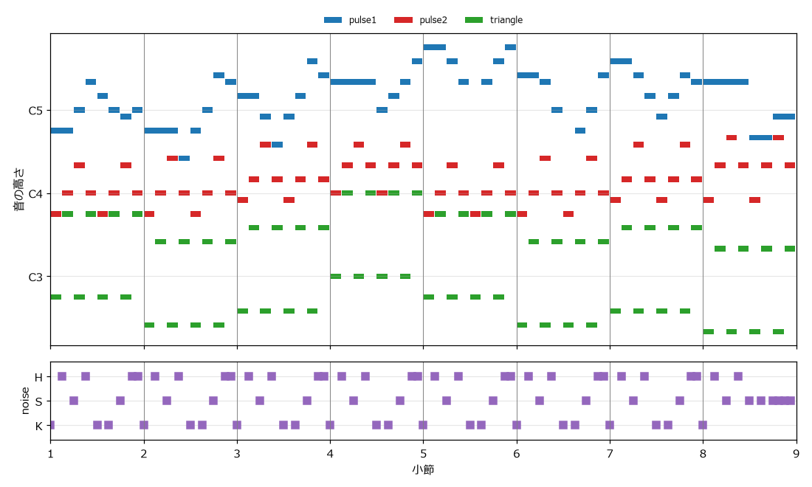

.. _ch-bgm:

BGM を作る
==========

この章では、4 つのチャンネルを使った短いループ BGM を作る。そのために、テキストで書いた楽譜を読み込んで音を合成する簡易シーケンサを実装する。

ゲームの BGM の特徴
-------------------

ゲームの BGM は、映画や音楽 CD の曲とは異なる性質を持つ。

* ループする: プレイヤーがその場面にどれだけ留まるかはわからない。そのため、曲の終わりから先頭へ途切れずに戻り、何度でも繰り返せるように作る。
* 前に出すぎない: プレイヤーの注意はゲームの画面と操作に向いている。BGM は場面の雰囲気を伝えつつ、効果音を邪魔しないことが求められる。
* 聞き飽きにくい: 同じ曲を長時間繰り返し聞くことになるため、単調すぎず、かといって情報量が多すぎない構成にする。

曲の冒頭を 1 回だけ演奏し、その後の部分を繰り返す構成もよく使われる。1 回だけ演奏する部分を\ :term:`イントロ`、繰り返す部分をループ部という。本書の作例は、説明を簡単にするため、イントロなしの 8 小節をそのまま繰り返す。

チャンネルの役割分担
--------------------

ファミコンの音源で曲を作るときは、4 つのチャンネルに次のように役割を割り当てるのが基本である。

.. list-table:: チャンネルの役割分担
   :header-rows: 1
   :widths: 20 25 55

   * - チャンネル
     - 役割
     - 理由
   * - 矩形波 1
     - メロディ
     - 倍音が多く、はっきり聞こえる。音量やデューティ比で表情を付けられる。
   * - 矩形波 2
     - ハーモニー（伴奏）
     - メロディと同じ音色だと区別しにくいため、デューティ比や音量を変えて目立たせすぎないようにする。
   * - 三角波
     - ベース
     - 倍音が少なく、低い音でも濁らない。音量を変えられないため、一定の音量で鳴らすベースに向く。
   * - ノイズ
     - ドラム
     - 周期と減衰の速さを変えて、キック、スネア、ハイハットを表現する。

この割り当てでは、和音を鳴らすために使えるチャンネルは矩形波 2 の 1 つしかない。本書の作例では、矩形波 2 で和音の構成音を 8 分音符で順番に鳴らし（分散和音。音楽一般でいうアルペジオ）、和音の響きを表現している。

楽譜の書き方
------------

本書のシーケンサでは、楽譜を次の規則で書いた文字列で表す。空白で区切った 1 つのトークンが、1 ステップ（16 分音符 1 つ分）に対応する。

.. list-table:: 楽譜のトークン
   :header-rows: 1
   :widths: 25 75

   * - トークン
     - 意味
   * - 音名（例: ``C4``、``F#3``、``Bb4``）
     - その音を鳴らし始める
   * - ``-``
     - 直前の音を伸ばす
   * - ``.``
     - 休符（音を止める）
   * - ``K``、``S``、``H``
     - ノイズチャンネルで、キック、スネア、ハイハットを鳴らす
   * - ``|``
     - 小節の区切り。読みやすくするためだけに使い、処理では無視する

例えば、次の 1 小節（16 ステップ）は、A4 を 4 分音符（4 ステップ）、C5、E5、D5、C5、B4、C5 を 8 分音符（2 ステップ）で鳴らすことを表す。

.. code-block:: text
   :linenos:

   A4 - - - C5 - E5 - D5 - C5 - B4 - C5 -

この書き方は、「:ref:`ch-tools`」で紹介するトラッカーと同じ考え方である。トラッカーでは、時間が上から下へ流れ、1 行が 1 ステップに対応する。本書の楽譜は、それを横に並べたものと考えるとよい。

シーケンサの設計
----------------

シーケンサは、楽譜を次の流れで音に変換する。

.. graphviz::
   :caption: シーケンサの処理の流れ

   digraph G {
       rankdir=LR;
       node [shape=box, style=rounded];
       score [label="楽譜\n（文字列）", shape=note];
       parse [label="parse\n音の一覧に変換"];
       note [label="render_note / render_drum\n1 音ずつ合成"];
       track [label="render_track\nチャンネルごとに配置"];
       song [label="render_song\n全チャンネルをミキシング"];
       wav [label="WAV ファイル", shape=note];
       score -> parse -> note -> track -> song -> wav;
   }

データ構造
~~~~~~~~~~

音色、打楽器、チャンネル、曲の設定は、それぞれデータクラスで表す。``@dataclass`` を付けたクラスは、フィールドを並べるだけで初期化の処理が自動的に作られる。

.. literalinclude:: ../examples/sequencer.py
   :language: python
   :pyobject: Instrument
   :lineno-match:
   :caption: sequencer.py の Instrument クラス

``Instrument`` は音色の設定である。波形の種類、デューティ比、音量、ADSR のパラメータ、ビブラートのパラメータを持つ。

.. literalinclude:: ../examples/sequencer.py
   :language: python
   :pyobject: Drum
   :lineno-match:
   :caption: sequencer.py の Drum クラス

.. literalinclude:: ../examples/sequencer.py
   :language: python
   :start-at: DRUMS: dict
   :end-at: }
   :lineno-match:
   :caption: sequencer.py の打楽器の定義

``Drum`` はノイズチャンネルで鳴らす打楽器の設定であり、``DRUMS`` 辞書で 1 文字の名前と対応付けている。

.. list-table:: 打楽器の設定
   :header-rows: 1
   :widths: 20 20 20 40

   * - 打楽器
     - 周期インデックス
     - 長さ
     - 考え方
   * - キック（K）
     - 12
     - 0.10 秒
     - 周期を長くして低い「ドッ」という音にする
   * - スネア（S）
     - 6
     - 0.15 秒
     - 中くらいの周期で「タッ」という音にする
   * - ハイハット（H）
     - 0
     - 0.04 秒
     - 最も短い周期でごく短く鳴らし、「チッ」という音にする

.. literalinclude:: ../examples/sequencer.py
   :language: python
   :pyobject: Song
   :lineno-match:
   :caption: sequencer.py の Song クラス

``Song`` は曲全体の設定であり、テンポとチャンネル（``Track``）の一覧を持つ。1 ステップの長さは、1 拍の長さ :math:`60 / \text{BPM}` を 1 拍あたりのステップ数（既定は 4）で割って求める。140 BPM なら約 0.107 秒である。

楽譜を解析する
~~~~~~~~~~~~~~

``parse`` 関数は、楽譜の文字列を「何ステップ目から、何ステップの長さで、何を鳴らすか」というイベントの一覧に変換する。

.. literalinclude:: ../examples/sequencer.py
   :language: python
   :pyobject: parse
   :lineno-match:
   :caption: sequencer.py の parse 関数

トークンを先頭から順に見ていき、``-`` なら直前の音を伸ばすので何もしない。それ以外のトークンが来たら、鳴っている音をその位置で終わらせてイベントとして記録し、新しい音を鳴らし始める。末尾に休符 ``.`` を 1 つ足しておくことで、最後の音も確実に記録される。先ほどの 1 小節を解析すると、次のイベントが得られる。

.. list-table:: 解析結果の例
   :header-rows: 1

   * - 開始ステップ
     - 0
     - 4
     - 6
     - 8
     - 10
     - 12
     - 14
   * - 長さ
     - 4
     - 2
     - 2
     - 2
     - 2
     - 2
     - 2
   * - 値
     - A4
     - C5
     - E5
     - D5
     - C5
     - B4
     - C5

1 音を合成する
~~~~~~~~~~~~~~

``envelope_for`` 関数は、指定した長さ（ゲート）だけ鍵盤を押したときの音量の変化を作る。ゲートの間はアタック、ディケイ、サステインに従い、ゲートが終わった後はリリースの時間をかけて 0 に下がる。

.. literalinclude:: ../examples/sequencer.py
   :language: python
   :pyobject: envelope_for
   :lineno-match:
   :caption: sequencer.py の envelope_for 関数

``render_note`` 関数は、このエンベロープと音色の設定を使って 1 音を合成する。矩形波ではエンベロープを 16 段階に丸めて掛け、三角波ではエンベロープを使わない。

.. literalinclude:: ../examples/sequencer.py
   :language: python
   :pyobject: render_note
   :lineno-match:
   :caption: sequencer.py の render_note 関数

三角波の音の両端に 3 ミリ秒のフェードを入れているのは、クリック音を防ぐためである。実機の三角波チャンネルは、音を止めるとその時点の値を保ったまま止まるため、クリック音が出にくい。本書の方法では止めた瞬間に値が 0 に戻るので、その代わりに短いフェードを入れている。

打楽器は ``render_drum`` 関数で合成する。ノイズの音量を、打楽器の長さの間に直線的に 0 まで下げる。

.. literalinclude:: ../examples/sequencer.py
   :language: python
   :pyobject: render_drum
   :lineno-match:
   :caption: sequencer.py の render_drum 関数

チャンネルを合成する
~~~~~~~~~~~~~~~~~~~~

``render_track`` 関数は、1 チャンネル分のイベントを順に合成し、それぞれの開始位置に配置する。

.. literalinclude:: ../examples/sequencer.py
   :language: python
   :pyobject: render_track
   :lineno-match:
   :caption: sequencer.py の render_track 関数

この関数には、実機の制約とループのための 2 つの工夫がある。

1 つ目は、1 チャンネルで同時に 1 音しか鳴らさないことである。リリースを設定した音は、ゲートが終わった後も余韻が続く。しかし実機では、1 つのチャンネルが次の音を鳴らし始めると、前の音は止まる。そこで、次の音の開始位置で前の音を打ち切っている（変数 ``limit``）。

2 つ目は、ループのつなぎ目の処理である。曲の最後の音の余韻は、曲の終わりをはみ出すことがある。ループ再生では、はみ出した部分は曲の先頭と重なって聞こえるはずである。そこで、バッファを曲の 2 倍の長さで確保して余韻を受け止め、はみ出した部分を先頭に足し込んでいる（``result += buffer[total:total * 2]``）。これにより、ファイルの末尾から先頭へ戻ったときに、余韻が途切れずにつながる。

全チャンネルをミキシングする
~~~~~~~~~~~~~~~~~~~~~~~~~~~~

``render_song`` 関数は、各チャンネルに ``gain`` を掛けて足し合わせ、最後に最大振幅を 0.8 にそろえる。

.. literalinclude:: ../examples/sequencer.py
   :language: python
   :pyobject: render_song
   :lineno-match:
   :caption: sequencer.py の render_song 関数

``gain`` は、チャンネル間の音量のバランスを調整する係数である。「:ref:`ch-sound-chip`」で述べたとおり、実機のミキサーは非線形だが、ここでは単純な足し算で代用している。

BGM の作例
----------

楽譜
~~~~

シーケンサを使って、イ短調の 8 小節のループ BGM を作る。コード進行は「:ref:`ch-music-basics`」で紹介した Am、F、G、C、Am、F、G、E である。

.. literalinclude:: ../examples/bgm_example.py
   :language: python
   :start-at: MELODY =
   :end-at: DRUMS =
   :lineno-match:
   :caption: bgm_example.py の楽譜

各チャンネルの楽譜は、1 小節ずつ文字列のリストに並べ、``" | ".join`` で 1 つの文字列にまとめている。行末のコメントは、その小節のコードである。

* メロディ: 各小節の頭にコードの構成音を置き、その間をスケールの音でつないでいる。5 小節目からは音域を高くして、曲の後半で盛り上がるようにしている。
* ハーモニー: コードの構成音を、低い音から上がって下がる形で 8 分音符で鳴らしている。最後の小節では、E の構成音（E、G#、B）を使う。
* ベース: コードの根音を、8 分音符でオクターブを上下させながら鳴らしている。ファミコンの曲でよく使われるベースの型である。
* ドラム: キックとスネアで拍を刻み、ハイハットで細かいリズムを加えている。最後の小節はスネアを連打する\ :term:`フィルイン`\ にして、ループの先頭へ戻ることを予告している。

音色とテンポ
~~~~~~~~~~~~

.. literalinclude:: ../examples/bgm_example.py
   :language: python
   :pyobject: build_song
   :lineno-match:
   :caption: bgm_example.py の build_song 関数

メロディは、デューティ比 50 % の太い音色に、ディケイとサステインで少し減衰する音量変化と、0.25 秒後からかかるビブラートを付けている。ハーモニーは、デューティ比 25 % の細い音色にし、すぐに小さくなるエンベロープと小さな ``gain`` で、メロディより目立たないようにしている。

:numref:`fig-pianoroll` は、作例の楽譜を\ :term:`ピアノロール`\ （横軸を時間、縦軸を音の高さとして音を棒で表した図）で表したものである。

.. _fig-pianoroll:

   BGM の作例のピアノロール

チャンネルごとの音
~~~~~~~~~~~~~~~~~~

各チャンネルを単独で鳴らした音を次に示す。

.. raw:: html

   
矩形波 1（メロディ）

   <audio controls preload="none" src="_static/audio/bgm_solo_pulse1.wav"></audio>
   
矩形波 2（ハーモニー）

   <audio controls preload="none" src="_static/audio/bgm_solo_pulse2.wav"></audio>
   
三角波（ベース）

   <audio controls preload="none" src="_static/audio/bgm_solo_triangle.wav"></audio>
   
ノイズ（ドラム）

   <audio controls preload="none" src="_static/audio/bgm_solo_noise.wav"></audio>

完成した BGM
~~~~~~~~~~~~

4 つのチャンネルを合わせると、次の BGM になる。

.. raw:: html

   
BGM（ループ 1 回分）

   <audio controls preload="none" src="_static/audio/bgm_loop.wav"></audio>

ループのつなぎ目を確かめるため、同じ音を 2 回つなげたものも用意した。8 小節目から 1 小節目へ戻る部分（約 13.7 秒の位置）で、音が途切れたりクリック音が出たりしないことを確かめてほしい。

.. raw:: html

   
BGM（ループ 2 回分）

   <audio controls preload="none" src="_static/audio/bgm_loop_twice.wav"></audio>

ブラウザのプレーヤーで 1 回分のファイルをループ再生すると、つなぎ目にわずかな隙間が入ることがある。これはプレーヤー側の処理によるもので、ファイルの問題ではない。ゲームに組み込んだときのループ再生については「:ref:`ch-integration`」で説明する。

サンプル音の生成
----------------

この章の音は、次のコマンドで ``output`` フォルダに書き出される。

.. code-block:: bat
   :linenos:

   python bgm_example.py

改造のヒント
------------

作例を自分の曲に作り替えるときは、次の順で進めるとよい。

#. テンポを決める: ``Song`` の ``bpm`` を変える。100 BPM 前後なら落ち着いた曲、150 BPM 以上なら急いだ雰囲気の曲になる。
#. コード進行を決める: 「:ref:`ch-music-basics`」のコードの中から 4 つから 8 つ程度を選んで並べる。
#. ベースとドラムを書く: コードの根音でベースを書き、ドラムの型を決める。曲の土台がこれでできる。
#. ハーモニーを書く: コードの構成音を並べる。分散和音、和音の連打、アルペジオなど、形を変えると雰囲気が変わる。
#. メロディを書く: 「:ref:`ch-music-basics`」で述べた目安に沿って、コードに合うメロディを書く。
#. 音色とバランスを調整する: ``Instrument`` のパラメータと ``Track`` の ``gain`` を調整する。

練習
----

#. ``Song`` の ``bpm`` を 100 と 180 に変えて、曲の印象がどう変わるか聞き比べてみよう。
#. ハーモニーのチャンネルを、``Instrument`` に新しい項目を追加して、アルペジオ（「:ref:`ch-shaping`」）で鳴らすように改造してみよう。
#. 1 回だけ演奏する 2 小節のイントロを追加し、イントロの後にループ部を 2 回繰り返した WAV ファイルを作ってみよう。
