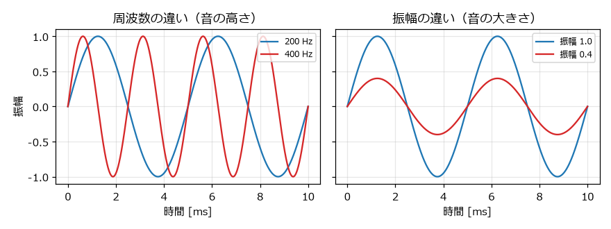
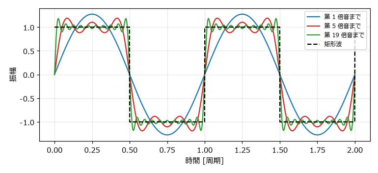
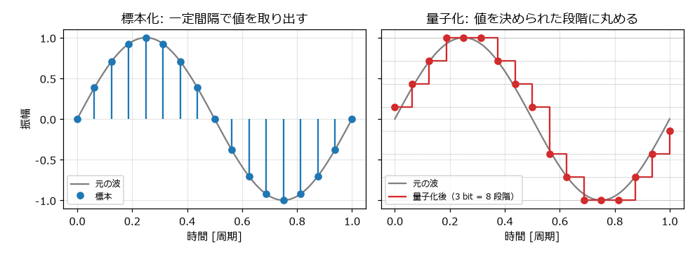
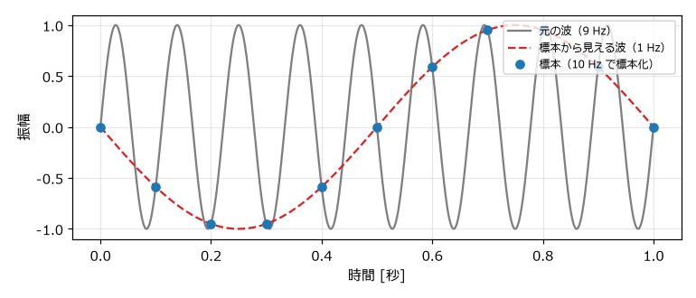

.. _ch-digital-audio:

音とデジタル音声の基礎
======================

この章では、音とは何か、そしてコンピュータが音をどのように数値として扱うのかを説明する。ここで学ぶ周波数、振幅、倍音、標本化、量子化は、以降のすべての章の土台になる。

音は空気の振動である
--------------------

音の正体は空気の圧力の細かな変化（振動）である。スピーカーの振動板が前後に動くと、周囲の空気が押し縮められたり引き伸ばされたりして、その変化が波として耳まで伝わる。この波を\ :term:`音波`\ という。

音波は、横軸を時間、縦軸を圧力の変化としたグラフで表せる。最も基本的な波形は次の式で表される\ :term:`正弦波`\ である。

.. math::

   x(t) = A \sin(2 \pi f t)

ここで :math:`t` は時刻 [秒]、:math:`A` は\ :term:`振幅`、:math:`f` は\ :term:`周波数` [Hz] である。

周波数と音の高さ
~~~~~~~~~~~~~~~~

周波数は 1 秒間に波が繰り返す回数であり、単位はヘルツ（Hz）である。周波数が高いほど音は高く聞こえる。1 回の繰り返しにかかる時間を\ :term:`周期`\ といい、周期 :math:`T` と周波数 :math:`f` には次の関係がある。

.. math::

   T = \frac{1}{f}

例えば、時報の「ピッ、ピッ、ピッ」の音は 440 Hz であり、その周期は約 2.27 ミリ秒である。人間が聞き取れる周波数の範囲は、おおむね 20 Hz から 20000 Hz とされている。

振幅と音の大きさ
~~~~~~~~~~~~~~~~

振幅は波の揺れ幅であり、振幅が大きいほど音は大きく聞こえる。:numref:`fig-sound-wave` に、周波数と振幅の違いを示す。

.. _fig-sound-wave:

   周波数と振幅の違い

音の大きさは\ :term:`デシベル`\ （dB）で表すことが多い。基準の振幅 :math:`A_0` に対する振幅 :math:`A` の大きさは、次の式で求められる。

.. math::

   L = 20 \log_{10} \frac{A}{A_0} \ \mathrm{[dB]}

振幅が 2 倍になると約 +6 dB、半分になると約 -6 dB になる。人間の耳は音の大きさを比で感じ取るため、対数で表すデシベルが感覚に合っている。音声ファイルでは、表現できる最大の振幅を 0 dB とし、それより小さい音を負の値で表す。この表し方を dBFS（decibels relative to full scale）という。

倍音と音色
----------

同じ高さ、同じ大きさの音でも、ピアノとトランペットでは聞こえ方が違う。この違いを\ :term:`音色`\ という。音色の違いは波形の違いから生まれる。

周期的な波形は、どのような形であっても、周波数が :math:`f, 2f, 3f, \ldots` の正弦波の足し合わせとして表せる（フーリエ級数）。最も低い周波数 :math:`f` の成分を\ :term:`基音`、その整数倍の周波数の成分を\ :term:`倍音`\ という。音の高さは基音の周波数で決まり、音色はどの倍音がどれだけ含まれているかで決まる。

例えば、デューティ比（「:ref:`ch-sound-chip`」で説明する）が 50 % の\ :term:`矩形波`\ は奇数倍の倍音だけを含み、:math:`n` 倍音の振幅は基音の :math:`1/n` になる。

.. math::

   x(t) = \frac{4}{\pi} \sum_{k=1}^{\infty} \frac{\sin(2 \pi (2k-1) f t)}{2k-1}
        = \frac{4}{\pi} \left( \sin(2 \pi f t) + \frac{1}{3} \sin(2 \pi \cdot 3 f t) + \frac{1}{5} \sin(2 \pi \cdot 5 f t) + \cdots \right)

:numref:`fig-harmonics` は、奇数倍音を順に足していくと矩形波に近づく様子を示している。

.. _fig-harmonics:

   奇数倍音を足していくと矩形波に近づく

倍音を多く含む音ほど、明るく鋭い音に聞こえる。倍音を含まない正弦波は丸く澄んだ音で、倍音を多く含む矩形波は硬くはっきりした音である。次の 2 つの音は、どちらも 440 Hz（A4）である。

.. raw:: html

   
正弦波（440 Hz）

   <audio controls preload="none" src="_static/audio/sine_a4.wav"></audio>
   
矩形波（440 Hz）

   <audio controls preload="none" src="_static/audio/pulse_50_a4.wav"></audio>

同じ振幅でも、矩形波のほうが大きく聞こえる。矩形波は常に最大の振幅にあり、さらに耳が敏感な高い周波数の倍音を多く含むからである。8 bit サウンドの波形は、どれも倍音を多く含んでいる。

デジタル音声
------------

コンピュータは連続的に変化する音波をそのままは扱えない。そこで、音波を一定の時間間隔で区切り、各時点の値を整数で記録する。この方式を :term:`PCM`\ （Pulse Code Modulation）という。PCM は 2 つの手順からなる。

標本化（サンプリング）
~~~~~~~~~~~~~~~~~~~~~~

一定の時間間隔で波形の値を取り出すことを\ :term:`標本化`\ （サンプリング）という。取り出した 1 つ 1 つの値を\ :term:`サンプル`\ （標本）、1 秒あたりのサンプル数を\ :term:`サンプリング周波数`\ という。サンプリング周波数を :math:`f_s` とすると、:math:`n` 番目のサンプルの時刻は次のとおりである。

.. math::

   t_n = \frac{n}{f_s}

代表的なサンプリング周波数は、音楽 CD の 44100 Hz と、動画やゲームで多く使われる 48000 Hz である。本書のサンプルコードは 44100 Hz を使う。

量子化
~~~~~~

取り出した値を、決められた段階の整数に丸めることを\ :term:`量子化`\ という。段階の細かさを表すビット数を\ :term:`量子化ビット数`\ といい、:math:`b` bit なら :math:`2^b` 段階で値を表す。音楽 CD や本書の WAV ファイルは 16 bit（65536 段階）である。

:numref:`fig-sampling` は、正弦波を標本化し、さらに 3 bit（8 段階）で量子化した例である。

.. _fig-sampling:

   標本化と量子化

量子化で丸めた分の誤差は、雑音（量子化雑音）として聞こえる。量子化ビット数が 1 bit 増えるごとに、信号と量子化雑音の比は約 6 dB 改善する。16 bit あれば、通常の用途で量子化雑音が問題になることはない。

データの大きさ
~~~~~~~~~~~~~~

PCM の音声データの大きさは、次の式で求められる。

.. math::

   \text{データ量 [バイト]} = f_s \times \frac{b}{8} \times \text{チャンネル数} \times \text{秒数}

44100 Hz、16 bit、モノラル（1 チャンネル）の場合、1 秒あたり :math:`44100 \times 2 \times 1 = 88200` バイト、つまり約 88 KB になる。「:ref:`ch-what-is-8bit`」で述べたように、8 bit 機の時代にはこの量のデータを扱うのは難しかった。

ナイキスト周波数とエイリアシング
--------------------------------

標本化には限界がある。サンプリング周波数 :math:`f_s` で標本化した音声は、:math:`f_s / 2` までの周波数しか正しく表せない。この上限を\ :term:`ナイキスト周波数`\ という。44100 Hz で標本化した場合、ナイキスト周波数は 22050 Hz であり、人間が聞き取れる範囲を十分にカバーしている。

ナイキスト周波数を超える成分を標本化すると、その成分は実際より低い別の周波数として現れる。この現象を\ :term:`エイリアシング`\ という。周波数 :math:`f` の成分は、標本化後には次の周波数 :math:`f'` に化ける。

.. math::

   f' = \left| f - k f_s \right| \quad (k \text{ は } f' \leq f_s / 2 \text{ となる整数})

:numref:`fig-aliasing` は、9 Hz の波を 10 Hz で標本化した例である。標本だけを見ると、1 Hz の波と区別できない。

.. _fig-aliasing:

   エイリアシング（9 Hz の波を 10 Hz で標本化した場合）

エイリアシングは 8 bit サウンドを作るときにも関係する。矩形波は無限に高い倍音まで含むため、プログラムで単純に矩形波を作ると、ナイキスト周波数を超えた倍音がエイリアシングを起こす。この影響は「:ref:`ch-waveform`」で確認する。

WAV ファイル
------------

PCM の音声データを保存する代表的なファイル形式が :term:`WAV` である。WAV ファイルは、ヘッダー部分にサンプリング周波数や量子化ビット数などの情報を持ち、その後ろにサンプルの値をそのまま並べた構造になっている。データを圧縮しないため、ファイルは大きいが、読み書きが簡単で音質が劣化しない。

.. list-table:: WAV ファイルの主な構造（PCM、16 bit の場合）
   :header-rows: 1
   :widths: 25 20 55

   * - 部分
     - 大きさ
     - 内容
   * - RIFF ヘッダー
     - 12 バイト
     - ファイルの種類（RIFF 形式の WAVE であること）と全体の大きさ
   * - fmt チャンク
     - 24 バイト
     - 形式（PCM）、チャンネル数、サンプリング周波数、量子化ビット数など
   * - data チャンク
     - 8 バイト + データ
     - サンプルの値。16 bit の場合は符号付き整数（-32768 から 32767）をリトルエンディアンで並べる

Python では、標準ライブラリの ``wave`` モジュールを使うと、ヘッダーを意識せずに WAV ファイルを読み書きできる。本書のサンプルコードでは、-1.0 から 1.0 の浮動小数点数で音を作り、最後に 16 bit の整数に変換して書き出す。この処理は「:ref:`ch-waveform`」で説明する。
