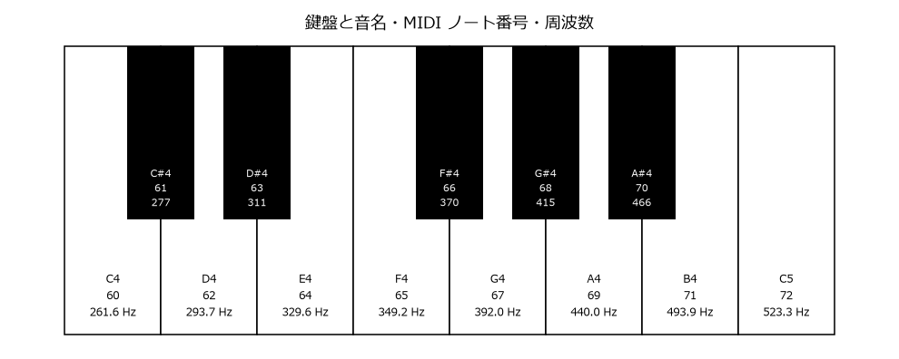

.. _ch-music-basics:

最低限の音楽知識
================

効果音は音楽の知識がなくても作れるが、BGM を作るには音の高さとリズムの決まりごとを知っておく必要がある。この章では、本書の BGM の作例を理解するのに必要な範囲に絞って、音楽の基礎を説明する。

音名とオクターブ
----------------

音名
~~~~

日本語の「ドレミファソラシ」は、英語の音名では C、D、E、F、G、A、B に対応する。本書ではプログラムで扱いやすい英語の音名を使う。

.. list-table:: 音名の対応
   :header-rows: 1

   * - 英語
     - C
     - D
     - E
     - F
     - G
     - A
     - B
   * - イタリア語（ドレミ）
     - ド
     - レ
     - ミ
     - ファ
     - ソ
     - ラ
     - シ

オクターブ
~~~~~~~~~~

ある音から周波数がちょうど 2 倍の音までの音程を\ :term:`オクターブ`\ という。周波数が 2 倍の音は、高さは違っても「同じ音名の音」として聞こえる。例えば 440 Hz の A と 880 Hz の A は、1 オクターブ違いの同じ A である。

同じ音名の音を区別するため、本書では音名の後ろにオクターブ番号を付ける（科学的音名表記）。ピアノの中央付近のド（中央ハ）が C4 であり、その上のラが A4（440 Hz）である。オクターブ番号は C で切り替わり、B4 の次の音は C5 になる。

.. note::

   オクターブ番号の付け方は統一されておらず、中央ハを C3 と表記するソフトウェアもある。「:ref:`ch-tools`」で紹介する Pyxel はさらに異なり、A2 を 440 Hz（中央ハが C2）としている。ツールを使うときは、どの表記を採用しているかを確認すること。

半音と全音
~~~~~~~~~~

1 オクターブは 12 個の\ :term:`半音`\ に分かれている。ピアノの鍵盤では、隣り合う鍵盤（白鍵と黒鍵を区別せずに数える）の音程が半音である。半音 2 つ分の音程を\ :term:`全音`\ という。

黒鍵の音は、隣の白鍵の音名に記号を付けて表す。半音高い音には ♯（シャープ）、半音低い音には ♭（フラット）を付ける。本書のプログラムでは、キーボードで入力しやすいように ``#`` と ``b`` で表す。例えば C4 の半音上は C#4 であり、これは D4 の半音下の Db4 と同じ音である。

12 平均律と周波数
-----------------

1 オクターブを 12 個の半音に等しい比率で分ける音律を :term:`12 平均律`\ という。1 オクターブで周波数が 2 倍になるので、半音 1 つ分の周波数の比は :math:`2^{1/12} \approx 1.0595` である。

音の高さを番号で表すと計算しやすい。本書では :term:`MIDI ノート番号`\ を使う。MIDI ノート番号は、C4 を 60、A4 を 69 とし、半音ごとに 1 ずつ増える整数である。MIDI ノート番号 :math:`n` の音の周波数 :math:`f` は次の式で求められる。

.. math::

   f = 440 \times 2^{(n - 69) / 12} \ \mathrm{[Hz]}

例えば、C4（:math:`n = 60`）の周波数は :math:`440 \times 2^{-9/12} \approx 261.6` Hz である。逆に、周波数 :math:`f` から MIDI ノート番号を求めるには次の式を使う。

.. math::

   n = 69 + 12 \log_2 \frac{f}{440}

:numref:`fig-keyboard` に、鍵盤と音名、MIDI ノート番号、周波数の対応を示す。C2 から B6 までの対応表は「:ref:`ch-frequency-table`」に掲載している。

.. _fig-keyboard:

   鍵盤と音名・MIDI ノート番号・周波数（黒鍵の周波数は整数に丸めている）

音程の細かなずれを表すときは\ :term:`セント`\ という単位を使う。半音 1 つ分を 100 セントとし、周波数 :math:`f_1` と :math:`f_2` の音程は次の式で求められる。

.. math::

   c = 1200 \log_2 \frac{f_2}{f_1} \ \mathrm{[セント]}

数セント程度のずれはほとんど聞き分けられないが、10 セントを超えると、ほかの音と同時に鳴らしたときに音程がずれて聞こえやすくなる。

リズム
------

テンポと拍
~~~~~~~~~~

音楽には、一定の間隔で刻まれる基本の単位がある。これを\ :term:`拍`\ という。拍の速さを\ :term:`テンポ`\ といい、1 分間あたりの拍の数（BPM: beats per minute）で表す。1 拍の長さは次のとおりである。

.. math::

   \text{1 拍の長さ [秒]} = \frac{60}{\text{BPM}}

例えば、120 BPM なら 1 拍は 0.5 秒、140 BPM なら約 0.43 秒である。

拍子と小節
~~~~~~~~~~

拍をいくつかまとめた区切りを\ :term:`小節`、1 小節に含まれる拍の数と種類を\ :term:`拍子`\ という。ゲーム音楽で最も多いのは、1 小節に 4 分音符が 4 つ入る 4 分の 4 拍子である。本書の作例もすべて 4 分の 4 拍子である。

音符の長さ
~~~~~~~~~~

音の長さは音符の種類で表す。4 分の 4 拍子では、4 分音符を 1 拍とする。

.. list-table:: 音符の長さ（4 分の 4 拍子）
   :header-rows: 1
   :widths: 25 20 25 30

   * - 音符
     - 拍数
     - 1 小節に入る数
     - 140 BPM での長さ
   * - 全音符
     - 4
     - 1
     - 約 1.71 秒
   * - 2 分音符
     - 2
     - 2
     - 約 0.86 秒
   * - 4 分音符
     - 1
     - 4
     - 約 0.43 秒
   * - 8 分音符
     - 1/2
     - 8
     - 約 0.21 秒
   * - 16 分音符
     - 1/4
     - 16
     - 約 0.11 秒

本書の BGM の作例では、16 分音符を最小の単位（1 ステップ）とし、1 小節を 16 ステップで表す。8 分音符は 2 ステップ、4 分音符は 4 ステップである。この考え方は「:ref:`ch-tools`」で紹介するトラッカーと同じである。

スケール
--------

メロディには、12 個の半音のうち決まった 7 個の音を選んで使うことが多い。この音の並びを\ :term:`スケール`\ （音階）という。

長音階（メジャースケール）
~~~~~~~~~~~~~~~~~~~~~~~~~~

C から始まる白鍵だけの並び C、D、E、F、G、A、B が、C の長音階（C メジャースケール）である。音と音の間隔は「全音、全音、半音、全音、全音、全音、半音」になっている。明るい響きを持つ。

短音階（マイナースケール）
~~~~~~~~~~~~~~~~~~~~~~~~~~

A から始まる白鍵だけの並び A、B、C、D、E、F、G が、A の自然短音階（A ナチュラルマイナースケール）である。間隔は「全音、半音、全音、全音、半音、全音、全音」になる。暗く、物悲しい響きを持つ。

自然短音階の 7 番目の音（A の短音階では G）を半音上げた音階を和声的短音階という。G を G# にすると、G# から A へ半音で進むことになり、曲が A に落ち着く感じが強まる。本書の BGM の作例では、曲の最後の小節で G# を使っている。

C の長音階と A の短音階は、使う音が同じである。どちらに聞こえるかは、曲がどの音を中心に組み立てられているかで決まる。曲の中心となる音とスケールの組み合わせを\ :term:`調`\ といい、C を中心とする長音階なら「ハ長調（C メジャー）」、A を中心とする短音階なら「イ短調（A マイナー）」と呼ぶ。

和音とコード進行
----------------

和音
~~~~

高さの異なる音を同時に鳴らしたものを\ :term:`和音`\ （コード）という。最も基本的な和音は、基準となる音（根音）に、3 度上と 5 度上の音を重ねた三和音である。

.. list-table:: 基本的な三和音
   :header-rows: 1
   :widths: 25 30 25 20

   * - 種類
     - 根音からの半音数
     - 例（根音が C）
     - 響き
   * - 長三和音（メジャー）
     - 0、4、7
     - C、E、G（コード名: C）
     - 明るい
   * - 短三和音（マイナー）
     - 0、3、7
     - C、Eb、G（コード名: Cm）
     - 暗い

コード名は、根音の音名で長三和音を表し、短三和音には m を付ける。例えば Am は A、C、E からなる短三和音である。

ファミコンの音源で和音を鳴らすには複数のチャンネルが必要になる。チャンネルが足りない場合は、和音の構成音を素早く切り替えて鳴らす\ :term:`アルペジオ`\ を使う。この手法は「:ref:`ch-shaping`」で扱う。

コード進行
~~~~~~~~~~

和音を並べた流れを\ :term:`コード進行`\ という。C の長音階の音だけで作れる三和音は、C、Dm、Em、F、G、Am、Bdim（ディミニッシュ。根音から 0、3、6 半音）の 7 つである。これらを組み合わせるだけでも、多くの曲を作れる。

本書の BGM の作例は、イ短調で次のコード進行を使う。

.. list-table:: BGM の作例のコード進行
   :header-rows: 1

   * - 小節
     - 1
     - 2
     - 3
     - 4
     - 5
     - 6
     - 7
     - 8
   * - コード
     - Am
     - F
     - G
     - C
     - Am
     - F
     - G
     - E

Am から始まり、F、G、C と進む流れは、ゲーム音楽やポピュラー音楽でよく使われる。最後の E は、イ短調で「次に Am へ戻りたくなる」働きを持つ和音である。E の構成音 E、G#、B に含まれる G# が A へ半音で進もうとするため、8 小節目から 1 小節目へ戻るループのつなぎ目が自然に聞こえる。

メロディの作り方の目安
~~~~~~~~~~~~~~~~~~~~~~

作曲の技法は本書の範囲を超えるが、次の目安を守ると、コード進行に合ったメロディを作りやすい。

* 小節の頭など、拍の強い位置には、その小節のコードの構成音を置く。
* 構成音の間は、スケールの音で順番につなぐ。
* 同じリズムの型を繰り返し、少しずつ変化させる。

本書の BGM の作例のメロディも、この目安に沿って作っている。
