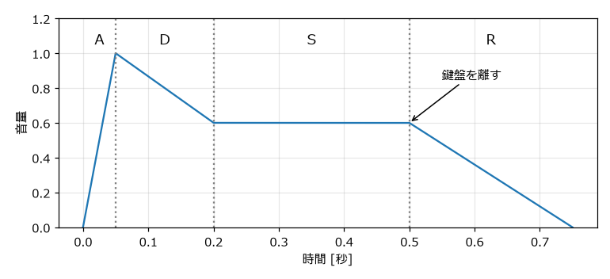
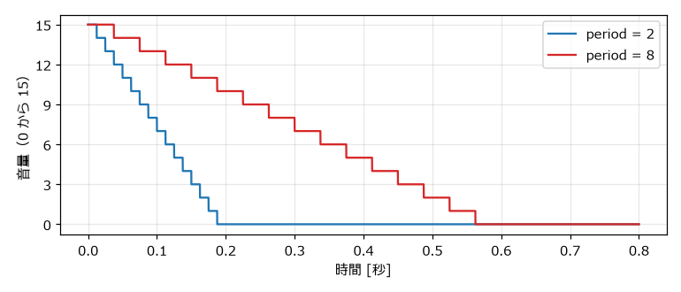
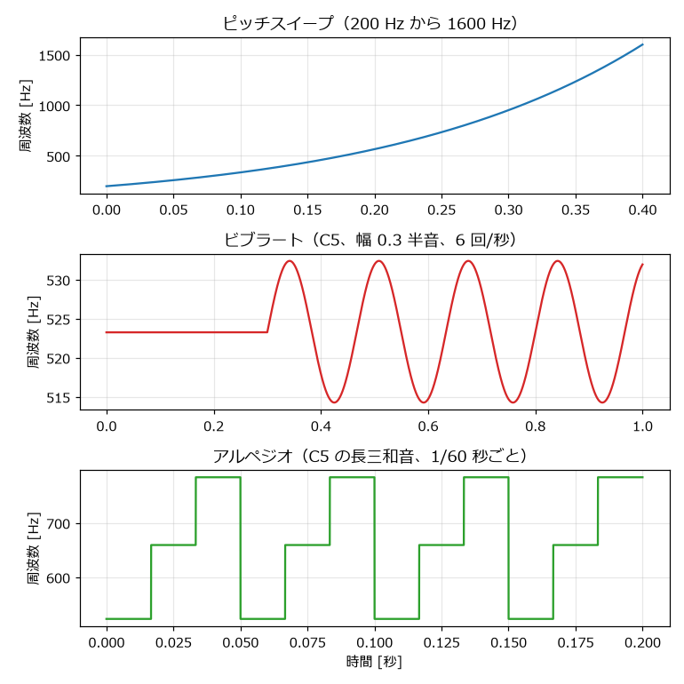

.. _ch-shaping:

音を形づくる
============

前の章で作った波形は、一定の高さ・一定の大きさで鳴り続けるだけの音であった。実際の楽器や効果音では、音量や音程が時間とともに変化する。この章では、音量・音程・音色を時間とともに変化させて、音に表情を付ける方法を学ぶ。

扱う関数はすべて ``envelope.py`` にある。どの関数も、1 サンプルごとの音量または周波数を並べた配列を返す。音量の配列は波形に掛け算し、周波数の配列は ``phase_from_frequency`` に渡して使う。

音量の変化（エンベロープ）
--------------------------

ADSR エンベロープ
~~~~~~~~~~~~~~~~~

音量の時間変化を\ :term:`エンベロープ`\ という。シンセサイザーでは、エンベロープを次の 4 つのパラメータで表すことが多い。頭文字をとって :term:`ADSR` と呼ぶ。

.. list-table:: ADSR のパラメータ
   :header-rows: 1
   :widths: 25 75

   * - パラメータ
     - 意味
   * - Attack（アタック）
     - 鳴らし始めてから最大音量に達するまでの時間
   * - Decay（ディケイ）
     - 最大音量からサステインの音量まで下がる時間
   * - Sustain（サステイン）
     - 鍵盤を押している間、保ち続ける音量（時間ではなく音量の割合）
   * - Release（リリース）
     - 鍵盤を離してから音量が 0 になるまでの時間

.. _fig-adsr:

   ADSR エンベロープ

アタックが短いと音の立ち上がりがはっきりし、長いとふわっと鳴り始める。ディケイが短くサステインが低いと、弾いた瞬間だけ強く鳴る歯切れのよい音になる。

.. literalinclude:: ../examples/envelope.py
   :language: python
   :pyobject: adsr
   :lineno-match:
   :caption: envelope.py の adsr 関数

``np.interp(t, times, levels)`` は、折れ線グラフの頂点（``times`` と ``levels`` の組）を直線で結び、時刻 ``t`` での値を求める関数である。``np.cumsum`` で各区間の長さから頂点の時刻を求めている。

.. raw:: html

   
エンベロープなし

   <audio controls preload="none" src="_static/audio/no_envelope.wav"></audio>
   
ADSR エンベロープあり

   <audio controls preload="none" src="_static/audio/adsr.wav"></audio>

ファミコン風の減衰
~~~~~~~~~~~~~~~~~~

「:ref:`ch-sound-chip`」で説明したとおり、ファミコンの矩形波とノイズのエンベロープは、音量 15 から 1 段階ずつ下がっていく。この動作をそのまま再現する。

.. literalinclude:: ../examples/envelope.py
   :language: python
   :pyobject: nes_decay
   :lineno-match:
   :caption: envelope.py の nes_decay 関数

経過時間 ``t`` に 240 を掛けるとクロックの回数になり、それを ``period + 1`` で割って切り捨てると、下がった段階の数になる。:numref:`fig-nes-decay` のように、音量は階段状に下がる。

.. _fig-nes-decay:

   ファミコン風の減衰エンベロープ

.. raw:: html

   
減衰が速い（period = 2）

   <audio controls preload="none" src="_static/audio/nes_decay_2.wav"></audio>
   
減衰が遅い（period = 8）

   <audio controls preload="none" src="_static/audio/nes_decay_8.wav"></audio>

音量を 16 段階に丸める
~~~~~~~~~~~~~~~~~~~~~~

ADSR のように滑らかに変化するエンベロープを使う場合も、16 段階に丸めるとファミコンの音量の粗さを再現できる。

.. literalinclude:: ../examples/envelope.py
   :language: python
   :pyobject: quantize_volume
   :lineno-match:
   :caption: envelope.py の quantize_volume 関数

音量が大きいうちは段階の差はほとんど聞き分けられないが、音が小さくなって消えていく部分では、段階的に音量が下がる 8 bit サウンドらしい響きになる。

音程の変化
----------

ピッチスイープ
~~~~~~~~~~~~~~

音程を連続的に上げ下げすることを\ :term:`ピッチスイープ`\ という。ジャンプやレーザーなど、多くの効果音の基本になる。

人間の耳は、周波数の差ではなく比で音程を感じ取る。200 Hz から 400 Hz への変化と、800 Hz から 1600 Hz への変化は、どちらも 1 オクターブの上昇として同じ幅に聞こえる。そのため、周波数を直線的に変化させると、高い側で音程の変化が遅く聞こえてしまう。音程として均等に変化させるには、周波数を指数関数的に（一定の比率で）変化させる。

.. literalinclude:: ../examples/envelope.py
   :language: python
   :pyobject: exponential_sweep
   :lineno-match:
   :caption: envelope.py の exponential_sweep 関数

``np.geomspace`` は、隣り合う要素の比が一定（等比数列）になる配列を作る関数である。

.. raw:: html

   
上昇するスイープ（200 Hz から 1600 Hz）

   <audio controls preload="none" src="_static/audio/sweep_up.wav"></audio>
   
下降するスイープ（1600 Hz から 200 Hz）

   <audio controls preload="none" src="_static/audio/sweep_down.wav"></audio>

ビブラート
~~~~~~~~~~

音程を周期的に細かく揺らすことを\ :term:`ビブラート`\ という。長く伸ばす音にビブラートをかけると、音に生き生きとした表情が出る。揺れの幅を :math:`D` [半音]、1 秒あたりの揺れの回数を :math:`r` とすると、周波数は次の式で表せる。

.. math::

   f(t) = f_0 \times 2^{D \sin(2 \pi r t) / 12}

:math:`2^{x/12}` は :math:`x` 半音分の周波数の比である。実際の演奏では、音を鳴らし始めてから少し遅れてビブラートをかけることが多いため、遅延時間 ``delay`` を指定できるようにしている。

.. literalinclude:: ../examples/envelope.py
   :language: python
   :pyobject: vibrato
   :lineno-match:
   :caption: envelope.py の vibrato 関数

.. raw:: html

   
ビブラート（幅 ±0.3 半音、6 回/秒、0.3 秒後から）

   <audio controls preload="none" src="_static/audio/vibrato.wav"></audio>

アルペジオ
~~~~~~~~~~

「:ref:`ch-what-is-8bit`」で述べたように、チャンネル数が限られた音源では、和音の構成音を素早く切り替えて 1 チャンネルで和音のように聞かせる手法が使われた。これを本書では\ :term:`アルペジオ`\ と呼ぶ。音楽一般では和音を 1 音ずつ順に弾く奏法をアルペジオというが、8 bit サウンドでは、1/60 秒程度の非常に短い間隔で切り替えるため、個々の音ではなく、震えるような 1 つの和音に聞こえる。

.. literalinclude:: ../examples/envelope.py
   :language: python
   :pyobject: arpeggio
   :lineno-match:
   :caption: envelope.py の arpeggio 関数

``offsets`` には根音からの半音数を指定する。長三和音なら ``[0, 4, 7]``、短三和音なら ``[0, 3, 7]`` である（「:ref:`ch-music-basics`」を参照）。時刻を切り替え間隔 ``step`` で割った商を、構成音の数で割った余りが、その時点で鳴らす構成音の番号になる。

.. raw:: html

   
アルペジオ（C の長三和音）

   <audio controls preload="none" src="_static/audio/arpeggio_major.wav"></audio>
   
アルペジオ（C の短三和音）

   <audio controls preload="none" src="_static/audio/arpeggio_minor.wav"></audio>

:numref:`fig-pitch-effects` に、ピッチスイープ、ビブラート、アルペジオの周波数の変化を示す。

.. _fig-pitch-effects:

   ピッチスイープ、ビブラート、アルペジオの周波数の変化

音色の変化（デューティ比の切り替え）
------------------------------------

矩形波のデューティ比を時間とともに切り替えると、音色が揺れ動くような効果が得られる。``pulse_wave`` 関数はデューティ比に配列を受け取れるので、1 フレームごとのデューティ比を並べた配列を渡せばよい。

.. literalinclude:: ../examples/envelope.py
   :language: python
   :start-at: # 1 フレームごとにデューティ比
   :end-at: sounds["duty_switch"]
   :lineno-match:
   :caption: envelope.py の generate 関数の一部

各サンプルが何フレーム目に当たるかを ``frame_index`` として求め、4 フレームで一巡するデューティ比の並び 12.5 %、25 %、50 %、25 % から値を取り出している。

.. raw:: html

   
デューティ比の切り替え

   <audio controls preload="none" src="_static/audio/duty_switch.wav"></audio>

疑似エコー
----------

エコー（やまびこのような残響）は、遅らせて小さくした同じ音を重ねることで作れる。ファミコンには残響を作る回路がないため、空いているチャンネルで同じメロディを少し遅らせ、音量を下げて鳴らす方法が使われた。

.. literalinclude:: ../examples/envelope.py
   :language: python
   :pyobject: pseudo_echo
   :lineno-match:
   :caption: envelope.py の pseudo_echo 関数

``gain ** n`` により、``n`` 回目の繰り返しほど音が小さくなる。

.. raw:: html

   
エコーなし

   <audio controls preload="none" src="_static/audio/echo_off.wav"></audio>
   
エコーあり（0.2 秒遅れ、音量 0.4 倍ずつ）

   <audio controls preload="none" src="_static/audio/echo_on.wav"></audio>

この関数は 1 つの配列に元の音とエコーを足し合わせているので、1 チャンネルで同時に複数の音が鳴っていることになり、「1 チャンネルは同時に 1 音」という実機の制約を超えている。実機と同じ制約で作る場合は、エコー用にチャンネルを 1 つ確保する必要がある。

三角波の表現
------------

三角波チャンネルは音量を変えられないため、エンベロープによる表現ができない。三角波で音の区切りをはっきりさせるには、音を短めに切り、次の音との間に短い休符を挟む。次の音は、0.18 秒鳴らして 0.07 秒休む、を繰り返した三角波のベースである。

.. raw:: html

   
三角波のベース

   <audio controls preload="none" src="_static/audio/triangle_bass.wav"></audio>

三角波の音量が一定であることは、ベースの音量をそろえやすいという利点にもなる。「:ref:`ch-bgm`」の作例でも、ベースには三角波を使う。

複数の音を重ねる
----------------

複数の音を同時に鳴らすには、配列を足し合わせればよい。このとき、足し合わせた結果が -1.0 から 1.0 の範囲を超えると、WAV ファイルへの書き出し時に切り詰められて（\ :term:`クリッピング`）音がひずむ。

これを防ぐには、各音に 1 より小さい係数を掛けてから足すか、足し合わせた後に全体の音量を調整する。``wav_io.py`` の ``normalize`` 関数は、最大の振幅が指定した値になるように全体の音量をそろえる。

.. literalinclude:: ../examples/wav_io.py
   :language: python
   :pyobject: normalize
   :lineno-match:
   :caption: wav_io.py の normalize 関数

最大値を 1.0 ではなく 0.9 などに抑えておくのは、ゲームの中で他の音と重なったときに備えて余裕（\ :term:`ヘッドルーム`）を残すためである。

サンプル音の生成
----------------

この章の音は、次のコマンドで ``output`` フォルダに書き出される。

.. code-block:: bat
   :linenos:

   python envelope.py

練習
----

#. ``adsr`` 関数のパラメータを変えて、オルガンのように鳴っている間ずっと音量が変わらない音と、木琴のようにすぐに減衰する音を作ってみよう。
#. ビブラートの幅 ``depth`` と速さ ``rate`` を大きくすると、どのような印象の音になるか確かめてみよう。
#. アルペジオの ``offsets`` を ``[0, 4, 7, 11]``\ （長七の和音）や ``[0, 12]``\ （オクターブ）に変えて、響きの違いを聞き比べてみよう。
