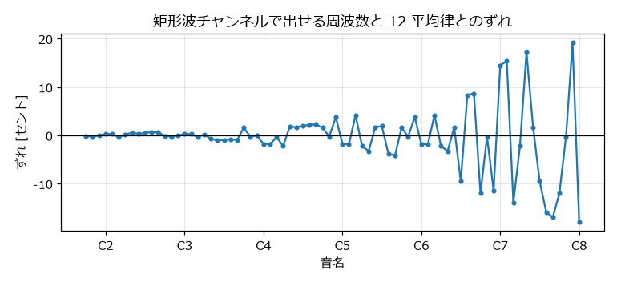
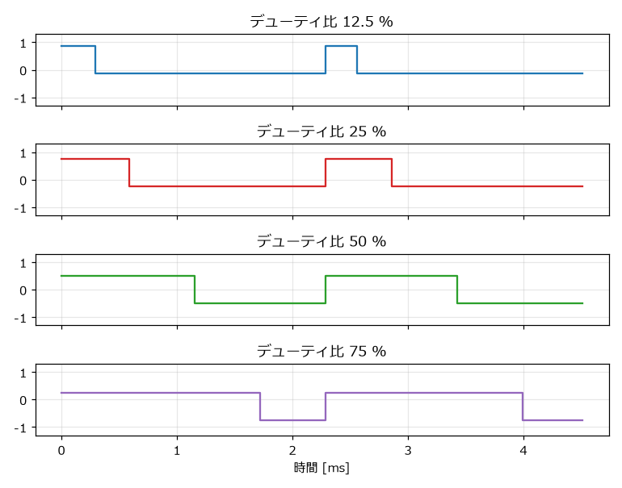
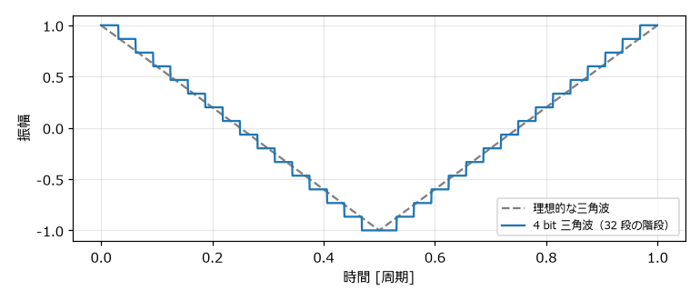

.. _ch-sound-chip:

音源チップの仕組み
==================

この章では、本書が手本とするファミコンの音源の仕組みを説明する。どのような部品が、どのような制約のもとで音を作っていたのかを知ると、8 bit サウンドらしい音を作るために何を再現すればよいかがわかる。

APU の全体像
------------

ファミコンの CPU（NTSC 版は RP2A03、以下 2A03）には、音を作る回路が内蔵されている。この回路を :term:`APU`\ （Audio Processing Unit）という。APU は次の 5 つのチャンネルを持ち、それぞれが独立して音を出す。

.. list-table:: APU のチャンネル
   :header-rows: 1
   :widths: 25 35 40

   * - チャンネル
     - 波形
     - 主な用途
   * - 矩形波 1
     - 矩形波（デューティ比 4 種類）
     - メロディ、効果音
   * - 矩形波 2
     - 矩形波（デューティ比 4 種類）
     - ハーモニー、伴奏、効果音
   * - 三角波
     - 4 bit の三角波
     - ベース
   * - ノイズ
     - 疑似乱数によるノイズ
     - 打楽器、爆発音などの効果音
   * - DPCM
     - 1 bit の差分で表した録音データ
     - 打楽器、短い音声

CPU は、APU の\ :term:`レジスタ`\ （アドレス ``$4000`` から ``$4017`` の範囲に割り当てられた設定値の置き場所。この範囲には APU 以外のレジスタも一部含まれる）に値を書き込んで音を制御する。各チャンネルの出力は\ :term:`ミキサー`\ で 1 つにまとめられ、スピーカーへ送られる。

.. graphviz::
   :caption: APU の構成

   digraph G {
       rankdir=LR;
       node [shape=box, style=rounded];
       cpu [label="CPU\n（ゲームのプログラム）"];
       reg [label="レジスタ\n$4000 - $4017", shape=box3d];
       frame [label="フレームカウンター\n（約 240 Hz の時計）"];
       p1 [label="矩形波 1"];
       p2 [label="矩形波 2"];
       tri [label="三角波"];
       noi [label="ノイズ"];
       dmc [label="DPCM"];
       mix [label="ミキサー"];
       out [label="スピーカー", shape=ellipse];
       cpu -> reg [label="値を書き込む"];
       reg -> {p1 p2 tri noi dmc};
       frame -> {p1 p2 tri noi} [style=dashed, label="エンベロープなどを更新"];
       {p1 p2 tri noi dmc} -> mix -> out;
   }

フレームカウンターは、エンベロープ（音量の時間変化）やスイープ（音程の時間変化）などを更新するための時計である。NTSC 版では、エンベロープを約 240 Hz、スイープと音の長さのカウンターを約 120 Hz で更新する。

例えば、矩形波 1 のレジスタは次の 4 バイトである。

.. list-table:: 矩形波 1 のレジスタ
   :header-rows: 1
   :widths: 15 35 50

   * - アドレス
     - ビットの割り当て
     - 内容
   * - ``$4000``
     - ``DDLC VVVV``
     - D: デューティ比、L: 音の長さのカウンターの停止（エンベロープのループ）、C: 音量固定、V: 音量またはエンベロープの速さ
   * - ``$4001``
     - ``EPPP NSSS``
     - スイープの設定（E: 有効、P: 周期、N: 上げるか下げるか、S: 変化量）
   * - ``$4002``
     - ``TTTT TTTT``
     - タイマー値の下位 8 bit
   * - ``$4003``
     - ``LLLL LTTT``
     - 音の長さ（L）とタイマー値の上位 3 bit

音を 1 つ鳴らすのに必要な情報は、たった 4 バイトである。「:ref:`ch-what-is-8bit`」で述べたように、CPU は波形そのものではなく、こうした少量の設定値だけを扱う。

タイマーと周波数
----------------

APU は、CPU のクロック（NTSC 版では :math:`f_{\mathrm{CPU}} = 1789773` Hz）を\ :term:`タイマー`\ で分周して音の周波数を作る。タイマーは、設定された値から 0 まで数え下げるたびに波形を 1 段階進める仕組みである。

矩形波チャンネルは 11 bit のタイマー値 :math:`t`\ （0 から 2047）を持つ。波形は 8 段階で 1 周期となり、タイマーは CPU クロック 2 回に 1 回の割合で数え下げる。そのため、周波数は次の式で決まる。

.. math::

   f = \frac{f_{\mathrm{CPU}}}{16 (t + 1)}

例えば A4（440 Hz）を鳴らしたい場合、:math:`t = 1789773 / (16 \times 440) - 1 \approx 253.2` なので、整数に丸めた :math:`t = 253` を設定する。このとき実際に出る周波数は約 440.4 Hz であり、12 平均律の 440 Hz とはわずかに異なる。

タイマー値は整数なので、出せる周波数はとびとびの値に限られる。:math:`t` が小さい（音が高い）ほど、:math:`t` が 1 違うときの周波数の差が大きくなるため、高い音ほど音程のずれが大きくなる。:numref:`fig-pulse-timer-error` に、各音名を鳴らしたときのずれをセントで示す。A6 付近からずれが 10 セントを超える音が現れ、C7 より上ではそれが大半になる。極端に高い音をメロディに使うときは、このずれに注意が必要である。

.. _fig-pulse-timer-error:

   矩形波チャンネルで出せる周波数と 12 平均律とのずれ

なお、矩形波チャンネルは :math:`t` が 8 未満になると音が止まる。そのため、出せる周波数はおよそ 54.6 Hz から 12.4 kHz の範囲である。各音名に対応するタイマー値は「:ref:`ch-frequency-table`」に掲載している。

矩形波チャンネル
----------------

デューティ比
~~~~~~~~~~~~

矩形波チャンネルの波形は、高い値と低い値の 2 つだけからなる。1 周期のうち高い値になっている時間の割合を\ :term:`デューティ比`\ という。ファミコンの矩形波チャンネルは、12.5 %、25 %、50 %、75 % の 4 種類のデューティ比を選べる。

.. _fig-duty:

   デューティ比の比較

デューティ比が 50 % の矩形波を特に「矩形波」、それ以外を「パルス波」と呼び分けることもある。本書では、デューティ比にかかわらずまとめて矩形波と呼ぶ。

デューティ比が変わると、含まれる倍音の割合が変わり、音色が変わる。デューティ比 :math:`d` の矩形波に含まれる第 :math:`n` 倍音の振幅は、次の式に比例する。

.. math::

   \frac{|\sin(\pi n d)|}{n}

:math:`d = 0.5` のときは偶数倍音が 0 になり、奇数倍音だけが残る。:math:`d = 0.25` では 4 の倍数の倍音が、:math:`d = 0.125` では 8 の倍数の倍音が 0 になる。デューティ比が小さいほど高い倍音の割合が増え、細く鋭い音になる。

.. raw:: html

   
デューティ比 12.5 %

   <audio controls preload="none" src="_static/audio/pulse_12_5_a4.wav"></audio>
   
デューティ比 25 %

   <audio controls preload="none" src="_static/audio/pulse_25_a4.wav"></audio>
   
デューティ比 50 %

   <audio controls preload="none" src="_static/audio/pulse_50_a4.wav"></audio>

デューティ比 75 % の波形は、25 % の波形の上下を反転させたものである。上下の反転は耳では区別できないため、75 % と 25 % は同じ音色に聞こえる。

音量とエンベロープ
~~~~~~~~~~~~~~~~~~

矩形波チャンネルの音量は 4 bit、つまり 0 から 15 の 16 段階である。音量は次の 2 つの方法で決められる。

* 音量固定: レジスタに書いた値（0 から 15）をそのまま音量にする。
* エンベロープ: 音量を 15 から始めて、一定の間隔で 1 ずつ下げ、0 で止める（またはループさせる）。

エンベロープの間隔は、フレームカウンターの約 240 Hz のクロックを :math:`V + 1` 回数えるごとに 1 段階である（:math:`V` はレジスタに書いた 0 から 15 の値）。:math:`V = 0` なら約 1/16 秒で、:math:`V = 15` なら約 1 秒で音が消える。この自動で減衰する音量は、ピアノのように「鳴らした瞬間が最も大きく、だんだん小さくなる」音を作るのに使う。

実際のゲームでは、音楽を再生するプログラムが一定の間隔で音量を書き換えて、より細かな音量変化を作ることが多い。この仕組みは、この章の「サウンドドライバとフレーム」で説明する。

スイープ
~~~~~~~~

スイープは、タイマー値を一定の間隔で自動的に増減させて、音程を連続的に変化させる機能である。音程が素早く上がる、または下がる効果音を、CPU の処理なしで作れる。

三角波チャンネル
----------------

三角波チャンネルは、0 から 15 の 16 段階の値を 15、14、…、0、0、1、…、15 の順に出力して三角波を作る。1 周期は 32 段階であり、周波数は次の式で決まる。

.. math::

   f = \frac{f_{\mathrm{CPU}}}{32 (t + 1)}

同じタイマー値なら、矩形波チャンネルより 1 オクターブ低い音になる。:numref:`fig-triangle` のように、波形は滑らかな三角波ではなく 32 段の階段になっている。

.. _fig-triangle:

   4 bit の三角波と理想的な三角波

三角波チャンネルの最大の特徴は、**音量を変えられない**\ ことである。鳴らすか止めるかしか選べないため、だんだん小さくなる音は作れない。三角波は倍音が少なくやわらかい音なので、主にベースに使われる。

.. raw:: html

   
三角波（440 Hz）

   <audio controls preload="none" src="_static/audio/triangle_a4.wav"></audio>

ノイズチャンネル
----------------

線形帰還シフトレジスタ
~~~~~~~~~~~~~~~~~~~~~~

ノイズチャンネルは、15 bit の\ :term:`線形帰還シフトレジスタ`\ （LFSR: Linear Feedback Shift Register）で疑似乱数を作り、その最下位ビットに応じて音を出す。LFSR はタイマーで決まる間隔ごとに次の手順で更新される。

#. bit 0 と bit 1 の排他的論理和（XOR）を計算する。
#. レジスタ全体を 1 bit 右へずらす。
#. 手順 1 の結果を最上位の bit 14 に入れる。

出力は bit 0 が 0 のときに音量の値、1 のときに 0 になる。

.. graphviz::
   :caption: LFSR の動作（通常モード）

   digraph G {
       rankdir=LR;
       node [shape=record, fontsize=11];
       reg [label="<b14> 14|13|12|11|10|9|8|7|<b6> 6|5|4|3|2|<b1> 1|<b0> 0"];
       xor [label="XOR", shape=circle];
       out [label="出力\n（bit 0 が 0 なら音を出す）", shape=box, style=rounded];
       reg:b0 -> xor;
       reg:b1 -> xor;
       xor -> reg:b14 [label="右シフト後に\nbit 14 へ戻す"];
       reg:b0 -> out;
   }

LFSR の値は、32767 回の更新で一巡して元に戻る。規則的に計算しているが、一巡するまでの並びは乱数のように見えるため、ザーという雑音に聞こえる。

短周期モード
~~~~~~~~~~~~

ノイズチャンネルには、XOR をとる位置を bit 1 から bit 6 に変える短周期モードがある。このモードでは LFSR が 93 回（初期値によっては 31 回）の更新で一巡するため、雑音の中に一定の高さの音が混ざった、金属的な音になる。

.. raw:: html

   
ノイズ（通常モード）

   <audio controls preload="none" src="_static/audio/noise_long.wav"></audio>
   
ノイズ（短周期モード）

   <audio controls preload="none" src="_static/audio/noise_short.wav"></audio>

ノイズの周期
~~~~~~~~~~~~

LFSR を更新する間隔は、16 種類の中から選ぶ。本書では、この 0 から 15 の番号を周期インデックスと呼ぶ。間隔が短いほど高い成分を多く含む「シャー」という音に、長いほど低い「ゴー」という音になる。

.. list-table:: ノイズチャンネルの周期（NTSC 版）
   :header-rows: 1

   * - 周期インデックス
     - 0
     - 1
     - 2
     - 3
     - 4
     - 5
     - 6
     - 7
   * - CPU クロック数
     - 4
     - 8
     - 16
     - 32
     - 64
     - 96
     - 128
     - 160
   * - 周期インデックス
     - 8
     - 9
     - 10
     - 11
     - 12
     - 13
     - 14
     - 15
   * - CPU クロック数
     - 202
     - 254
     - 380
     - 508
     - 762
     - 1016
     - 2034
     - 4068

次の音は、周期インデックスを 0 から 15 まで 0.25 秒ずつ順に変えたものである。

.. raw:: html

   
ノイズの周期の変化（周期インデックス 0 から 15）

   <audio controls preload="none" src="_static/audio/noise_periods.wav"></audio>

ノイズチャンネルの音量の仕組みは、矩形波チャンネルと同じ（16 段階、エンベロープあり）である。

DPCM チャンネル
---------------

DPCM チャンネルは、カートリッジに保存した録音データを再生するチャンネルである。データは 1 サンプルあたり 1 bit で、「前の値から少し上げる」か「少し下げる」かだけを記録する（デルタ変調）。出力値は 7 bit（0 から 127）のカウンターで保持される。

1 bit で記録するのでデータ量は少ないが、それでも容量の限られたカートリッジでは長い音を入れられない。そのため、主にドラムの音や短い掛け声に使われた。本書では、録音データを使わずに音を作ることに集中するため、DPCM チャンネルは扱わない。

ミキサー
--------

APU のミキサーは、各チャンネルの出力を単純に足し合わせるのではなく、非線形な式でまとめる。NESdev Wiki に掲載されている近似式は次のとおりである（各チャンネルの値は、矩形波・三角波・ノイズが 0 から 15、DPCM が 0 から 127）。

.. math::

   \mathrm{pulse\_out} = \frac{95.88}{\dfrac{8128}{\mathrm{pulse1} + \mathrm{pulse2}} + 100}

.. math::

   \mathrm{tnd\_out} = \frac{159.79}{\dfrac{1}{\dfrac{\mathrm{triangle}}{8227} + \dfrac{\mathrm{noise}}{12241} + \dfrac{\mathrm{dmc}}{22638}} + 100}

最終的な出力は :math:`\mathrm{pulse\_out} + \mathrm{tnd\_out}` である。この式から、2 つの矩形波を同時に最大音量で鳴らしても、出力は 1 つのときの 2 倍にはならないことがわかる。本書のサンプルコードでは、わかりやすさを優先して、各チャンネルに係数を掛けて足し合わせる単純な方法を使う。

サウンドドライバとフレーム
--------------------------

ゲームの音楽は、CPU 上で動く\ :term:`サウンドドライバ`\ が再生する。サウンドドライバは、画面の更新と同じく 1 フレーム（NTSC 版では約 1/60 秒）に 1 回呼び出され、楽譜のデータを読んで APU のレジスタを書き換える。

そのため、音量や音程の変化、音の長さは、基本的に 1/60 秒単位で刻まれる。ビブラートやアルペジオも、このフレーム単位で音程を書き換えて作られる。本書のサンプルコードでも、アルペジオなどの切り替え間隔の既定値を 1/60 秒にしている。

他の音源との比較
----------------

「:ref:`ch-what-is-8bit`」で紹介した他の音源と、ファミコンの音源を比較する。

.. list-table:: 音源の比較
   :header-rows: 1
   :widths: 16 21 21 21 21

   * - 項目
     - ファミコン（APU）
     - ゲームボーイ
     - AY-3-8910
     - SN76489
   * - 矩形波
     - 2 チャンネル。デューティ比 4 種類
     - 2 チャンネル。デューティ比 4 種類。1 チャンネルはスイープ付き
     - 3 チャンネル。デューティ比 50 % のみ
     - 3 チャンネル。デューティ比 50 % のみ
   * - その他の波形
     - 三角波 1、DPCM 1
     - 波形メモリ 1（4 bit × 32 サンプルの波形を自由に設定）
     - なし
     - なし
   * - ノイズ
     - 1 チャンネル。LFSR（15 bit）
     - 1 チャンネル。LFSR（15 bit または 7 bit）
     - ノイズ発生器 1 つを各チャンネルに混ぜる
     - 1 チャンネル
   * - 音量
     - 16 段階。三角波は変更不可
     - 16 段階（波形メモリは 4 段階）
     - 16 段階（対数的な段階）。共通のハードウェアエンベロープあり
     - 16 段階（2 dB 刻みの減衰量）
   * - 出力
     - モノラル
     - ステレオ（チャンネルごとに左右を選択）
     - モノラル（チャンネルごとに出力端子あり）
     - モノラル

どの音源も、矩形波とノイズを中心に、16 段階の音量で音を作るという点は共通している。本書で学ぶ考え方は、ファミコン以外の音源の音を作るときにも役立つ。

再現する特徴のまとめ
--------------------

本書のサンプルコードでは、ファミコンの音源の次の特徴を再現する。

* 矩形波（デューティ比 12.5 %、25 %、50 %、75 %）、4 bit の三角波、LFSR によるノイズ（通常モードと短周期モード）を使う。
* 矩形波とノイズの音量は 16 段階に丸める。三角波の音量は変えない。
* 1 チャンネルは同時に 1 つの音しか出せない。
* アルペジオやデューティ比の切り替えは、サウンドドライバと同じく 1/60 秒単位で行う（スイープやビブラートは、サンプル単位で滑らかに変化させる）。

一方、次の点は再現しない。

* DPCM チャンネル
* ミキサーの非線形性
* タイマー値による音程のずれ（BGM の作例では 12 平均律の周波数をそのまま使う）
* ファミコン本体のアナログ回路によるフィルターの効果

これらを再現しなくても、8 bit サウンドらしさを決める要素は十分に表現できる。次の章から、実際にプログラムで音を作っていく。
