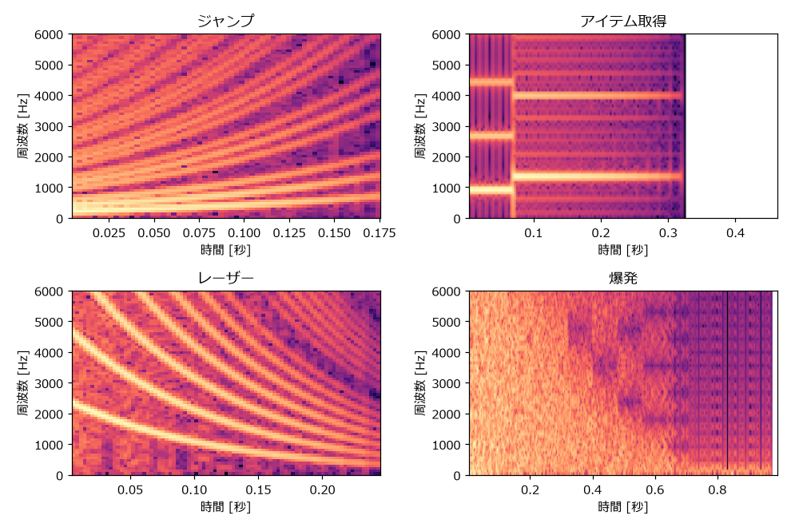

.. _ch-sound-effects:

効果音を作る
============

この章では、前の章までに作った部品を組み合わせて、ゲームでよく使う効果音を作る。効果音は短く、単音で完結するものが多いため、作ってすぐに結果を確かめられる。

効果音設計の考え方
------------------

効果音の役割
~~~~~~~~~~~~

ゲームの効果音の最も重要な役割は、プレイヤーに「何が起きたか」を伝えることである。ボタンを押したら決定音が鳴り、敵の攻撃が当たったらダメージ音が鳴る。音が鳴ることで、プレイヤーは画面を注視していなくても状況を把握できる。

そのため、効果音には次の性質が求められる。

* 短い: 操作への反応として鳴る音は、長くても 0.5 秒程度に収める（爆発やパワーアップなど、演出として聞かせる音は例外）。同じ音が連続して鳴ることも多いため、長い音は重なって聞き取りにくくなる。
* 区別しやすい: 意味の異なる音は、音程の動きや波形を変えて、聞いてすぐに区別できるようにする。
* 意味と結び付いている: 音程が上がる音は「成功」「獲得」「前進」を、下がる音は「失敗」「損失」「取り消し」を連想させる。この対応を利用すると、初めて聞く音でも意味が伝わりやすい。
* 聞き疲れしない: 頻繁に鳴る音（足音、カーソル移動など）は、短く、音量を控えめにする。高すぎる音や鋭すぎる音は、繰り返し聞くと不快になりやすい。

効果音を作る 3 つの要素
~~~~~~~~~~~~~~~~~~~~~~~

本書の効果音は、どれも次の 3 つの要素の組み合わせでできている。

.. list-table:: 効果音を作る 3 つの要素
   :header-rows: 1
   :widths: 20 40 40

   * - 要素
     - 選択肢
     - 使う関数
   * - 波形
     - 矩形波（デューティ比）、三角波、ノイズ（周期、モード）
     - ``pulse_wave``、``triangle_wave``、``noise_wave`` など
   * - 音程の変化
     - 一定、スイープ、ビブラート、アルペジオ、複数の音の連結
     - ``exponential_sweep``、``vibrato``、``arpeggio``
   * - 音量の変化
     - 一定、減衰、ADSR
     - ``nes_decay``、``adsr``、``quantize_volume``

次の表に、この章で作る効果音の設計をまとめる。

.. list-table:: 効果音の設計
   :header-rows: 1
   :widths: 16 22 32 30

   * - 効果音
     - 波形
     - 音程の変化
     - 音量の変化
   * - ジャンプ
     - 矩形波 25 %
     - 180 Hz から 700 Hz へ上昇（0.18 秒）
     - 減衰（period = 2）
   * - アイテム取得
     - 矩形波 50 %
     - A5 から E6 へ切り替え
     - 2 音目だけ減衰（period = 3）
   * - 決定
     - 矩形波 12.5 %
     - C6 から G6 へ切り替え
     - 減衰（period = 1）
   * - キャンセル
     - 矩形波 50 %
     - G5 から C5 へ切り替え
     - 減衰（period = 1）
   * - 被ダメージ
     - 矩形波 50 % とノイズ
     - 900 Hz から 80 Hz へ下降（0.3 秒）
     - 減衰
   * - 爆発
     - ノイズ
     - 周期を徐々に長くする（音が低くなる）
     - 指数関数的な減衰（1 秒）
   * - レーザー
     - 矩形波 12.5 %
     - 2400 Hz から 300 Hz へ下降（0.25 秒）
     - 減衰（period = 3）
   * - パワーアップ
     - 矩形波 50 %
     - 長三和音のアルペジオで根音を上げていく
     - 直線的な減衰
   * - 回復
     - 三角波
     - C5、E5、G5、C6 と上昇、ビブラート付き
     - 一定

各効果音の作り方
----------------

ここからは、効果音を 1 つずつ作っていく。いずれの関数も ``sound_effects.py`` にある。

ジャンプ
~~~~~~~~

ジャンプの音は、音程が素早く上がる矩形波で作る。上昇する音程が、体が上に向かう動きを表す。デューティ比 25 % の少し細い音色にすると、軽快な印象になる。

.. literalinclude:: ../examples/sound_effects.py
   :language: python
   :pyobject: jump
   :lineno-match:
   :caption: sound_effects.py の jump 関数

.. raw:: html

   
ジャンプ

   <audio controls preload="none" src="_static/audio/se_jump.wav"></audio>

アイテム取得
~~~~~~~~~~~~

アイテム取得の音は、短い音の直後に高い音を伸ばす 2 音で作る。2 音目を 1 音目より高くすることで、「獲得した」という前向きな印象になる。ここでは 1 音目を A5、2 音目を 5 度上の E6 にしている。

.. literalinclude:: ../examples/sound_effects.py
   :language: python
   :pyobject: coin
   :lineno-match:
   :caption: sound_effects.py の coin 関数

``np.concatenate`` は、複数の配列を順につなげる関数である。

.. raw:: html

   
アイテム取得

   <audio controls preload="none" src="_static/audio/se_coin.wav"></audio>

決定とキャンセル
~~~~~~~~~~~~~~~~

メニュー操作の決定音とキャンセル音は、対になるように作る。決定は上昇する 2 音、キャンセルは下降する 2 音にする。さらに、決定は細い矩形波（12.5 %）、キャンセルは太い矩形波（50 %）にして、音色でも区別できるようにしている。

.. literalinclude:: ../examples/sound_effects.py
   :language: python
   :pyobject: select
   :lineno-match:
   :caption: sound_effects.py の select 関数

.. literalinclude:: ../examples/sound_effects.py
   :language: python
   :pyobject: cancel
   :lineno-match:
   :caption: sound_effects.py の cancel 関数

.. raw:: html

   
決定

   <audio controls preload="none" src="_static/audio/se_select.wav"></audio>
   
キャンセル

   <audio controls preload="none" src="_static/audio/se_cancel.wav"></audio>

被ダメージ
~~~~~~~~~~

ダメージを受けた音は、急降下する矩形波に短いノイズを重ねて作る。下降する音程が「損失」を、ノイズが「衝撃」を表す。

.. literalinclude:: ../examples/sound_effects.py
   :language: python
   :pyobject: damage
   :lineno-match:
   :caption: sound_effects.py の damage 関数

2 つの音を重ねるときは、それぞれに係数（ここでは 0.7 と 0.5）を掛けて音量のバランスを取る。

.. raw:: html

   
被ダメージ

   <audio controls preload="none" src="_static/audio/se_damage.wav"></audio>

爆発
~~~~

爆発の音はノイズで作る。鳴り始めは高い成分を多く含む激しい音にし、時間とともにノイズの周期を長くして低い「ゴー」という音へ変えていく。音量はゆっくりと減衰させる。

.. literalinclude:: ../examples/sound_effects.py
   :language: python
   :pyobject: explosion
   :lineno-match:
   :caption: sound_effects.py の explosion 関数

周期インデックスを 6 から始め、0.08 秒ごとに 1 つずつ大きくしている（最大 15）。インデックスの配列から LFSR の更新頻度の配列を作り、``noise_from_rate`` に渡す。音量は :math:`e^{-3.5t}` で減衰させ、16 段階に丸めている。

.. raw:: html

   
爆発

   <audio controls preload="none" src="_static/audio/se_explosion.wav"></audio>

レーザー
~~~~~~~~

レーザーの音は、細い矩形波で高い音から一気に下げて作る。デューティ比 12.5 % の鋭い音色と、急激な下降の組み合わせが、ビームが飛んでいく感じを表す。

.. literalinclude:: ../examples/sound_effects.py
   :language: python
   :pyobject: laser
   :lineno-match:
   :caption: sound_effects.py の laser 関数

.. raw:: html

   
レーザー

   <audio controls preload="none" src="_static/audio/se_laser.wav"></audio>

パワーアップ
~~~~~~~~~~~~

パワーアップの音は、長三和音のアルペジオを、根音を C5、D5、E5、F5 と上げながら鳴らして作る。明るい和音と段階的な上昇で、力が高まっていく様子を表す。

.. literalinclude:: ../examples/sound_effects.py
   :language: python
   :pyobject: power_up
   :lineno-match:
   :caption: sound_effects.py の power_up 関数

.. raw:: html

   
パワーアップ

   <audio controls preload="none" src="_static/audio/se_power_up.wav"></audio>

回復
~~~~

回復の音は、やわらかい三角波で和音の構成音を順に上昇させて作る。軽いビブラートをかけて、きらめくような印象を加えている。三角波は音量を変えられないので、音量は一定のままである。

.. literalinclude:: ../examples/sound_effects.py
   :language: python
   :pyobject: heal
   :lineno-match:
   :caption: sound_effects.py の heal 関数

.. raw:: html

   
回復

   <audio controls preload="none" src="_static/audio/se_heal.wav"></audio>

スペクトログラムで確かめる
--------------------------

音の周波数成分が時間とともにどう変化するかを表した図を\ :term:`スペクトログラム`\ という。横軸が時間、縦軸が周波数で、明るい色ほどその周波数の成分が強いことを表す。:numref:`fig-sfx-spectrograms` に、作った効果音のスペクトログラムを示す。

.. _fig-sfx-spectrograms:

   効果音のスペクトログラム

ジャンプとレーザーでは、基音と倍音が並んで上昇または下降している様子がわかる。アイテム取得では、0.07 秒の時点で音程が切り替わっている。爆発では、時間とともに高い周波数の成分が弱まっていく。

ジャンプの図には、上昇する線の間を右下がりに横切る線も見える。これは「:ref:`ch-waveform`」で述べたエイリアシングの成分である。

乱数で効果音を探す
------------------

効果音のパラメータを乱数で決めて、たくさんの候補を自動で作る方法もある。2007 年に公開された効果音生成ツール :term:`sfxr` は、この方法で手軽に効果音を作れることから広く使われた（「:ref:`ch-tools`」で紹介する）。

.. literalinclude:: ../examples/sound_effects.py
   :language: python
   :pyobject: random_effect
   :lineno-match:
   :caption: sound_effects.py の random_effect 関数

長さ、開始周波数、終了周波数、デューティ比、減衰の速さを乱数で決めている。終了周波数は、開始周波数の :math:`2^{-3}` 倍から :math:`2^{2}` 倍の範囲（3 オクターブ下から 2 オクターブ上）でランダムに決める。``np.random.default_rng(seed=8)`` のように乱数の種（seed）を固定すると、毎回同じ候補が生成される。

.. raw:: html

   
乱数で作った効果音 1

   <audio controls preload="none" src="_static/audio/se_random_1.wav"></audio>
   
乱数で作った効果音 2

   <audio controls preload="none" src="_static/audio/se_random_2.wav"></audio>
   
乱数で作った効果音 3

   <audio controls preload="none" src="_static/audio/se_random_3.wav"></audio>

乱数で作った音がそのまま使えることは少ないが、思いがけない音に出会えることがある。気に入った候補が見つかったら、そのパラメータを手で調整して仕上げるとよい。

調整のコツ
----------

効果音を作るときは、次の点に注意すると仕上がりがよくなる。

* ゲームの画面と合わせて聞く: 効果音だけを聞いて良い音でも、ゲームの動きと合わせると長すぎたり軽すぎたりすることがある。最終的な判断は、ゲームに組み込んで行う。
* 全体の音量をそろえる: ``generate`` 関数では、すべての効果音を ``normalize`` で最大振幅 0.5 にそろえている。ただし、最大振幅が同じでも、長く鳴る音や倍音の多い音は大きく聞こえる。実際に聞いて、個別に調整する。
* BGM と周波数帯を分ける: BGM のメロディと同じ高さの効果音は、BGM に埋もれて聞き取りにくい。効果音はメロディより高めにするか、ノイズなど BGM と異なる音色を使う。
* 少しずつ変える: 同じ効果音を何度も鳴らす場合、毎回わずかに音程を変える（例えば ±1 半音の範囲でランダムに変える）と、単調さが和らぐ。

サンプル音の生成
----------------

この章の効果音は、次のコマンドで ``output`` フォルダに書き出される。

.. code-block:: bat
   :linenos:

   python sound_effects.py

練習
----

#. ``jump`` 関数のスイープの範囲と長さを変えて、大ジャンプと小ジャンプの音を作り分けてみよう。
#. ``explosion`` 関数で ``noise_from_rate`` に ``short_mode=True`` を渡すと、どのような爆発音になるか確かめてみよう。
#. 階段を上る足音、扉が開く音、ゲームオーバーの短いジングルなど、自分でテーマを決めて効果音を設計してみよう。設計は、上の「効果音の設計」の表と同じ形式で書き出してから実装するとよい。
