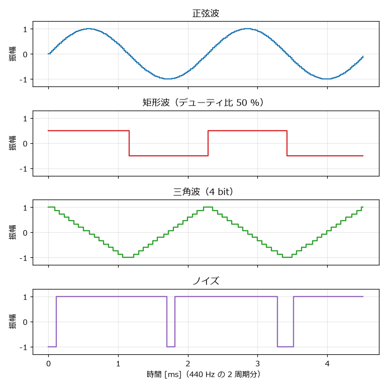
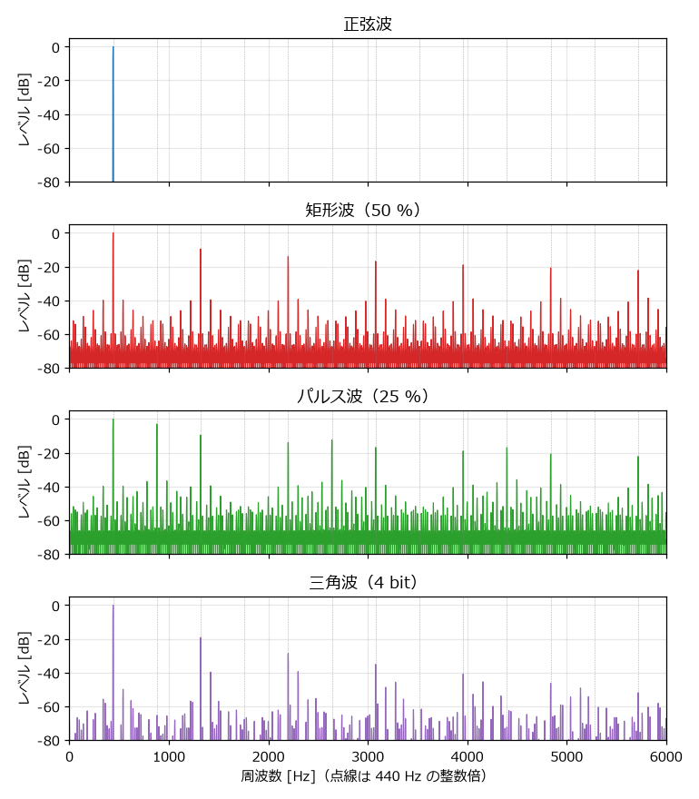
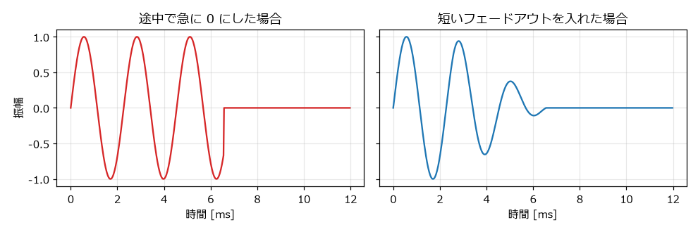

.. _ch-waveform:

Python で波形を作る
===================

この章から、実際にプログラムで音を作る。まず、すべての音の材料となる矩形波・三角波・ノイズを生成し、WAV ファイルとして書き出せるようにする。

サンプルコードの構成
--------------------

本書のサンプルコードは、次のモジュールで構成されている。この章では ``wav_io.py`` と ``waveforms.py`` を扱う。

.. list-table:: サンプルコードのモジュール
   :header-rows: 1
   :widths: 25 50 25

   * - ファイル
     - 内容
     - 説明している章
   * - ``wav_io.py``
     - WAV ファイルの書き出し
     - 本章
   * - ``waveforms.py``
     - 矩形波・三角波・ノイズの生成
     - 本章
   * - ``envelope.py``
     - 音量や音程の時間変化
     - 「:ref:`ch-shaping`」
   * - ``sound_effects.py``
     - 効果音の作例
     - 「:ref:`ch-sound-effects`」
   * - ``sequencer.py``
     - テキストの楽譜から曲を合成する簡易シーケンサ
     - 「:ref:`ch-bgm`」
   * - ``bgm_example.py``
     - BGM の作例
     - 「:ref:`ch-bgm`」
   * - ``pyxel_sound.py``
     - Pyxel の音源機能を使う例
     - 「:ref:`ch-tools`」
   * - ``play_pygame.py``
     - pygame-ce で BGM と効果音を鳴らす例
     - 「:ref:`ch-integration`」
   * - ``make_all.py``
     - すべての音声ファイルを一括で生成する
     - 「:ref:`ch-introduction`」

音は NumPy の配列で表す
-----------------------

本書のサンプルコードでは、音を NumPy の 1 次元配列で表す。配列の各要素が 1 つのサンプルであり、値の範囲は -1.0 から 1.0 である。44100 Hz で 1 秒の音なら、要素数 44100 の配列になる。この型には ``Signal`` という別名を付けている。

NumPy を使うのは、配列の全要素に対する計算を 1 行で書けて、しかも Python の ``for`` 文で 1 サンプルずつ計算するより大幅に速いからである。例えば、``signal * 0.5`` と書けば全サンプルの音量が半分になり、``a + b`` と書けば 2 つの音が重なる。

WAV ファイルに書き出す
----------------------

最初に、作った音を WAV ファイルに書き出す関数を用意する。

.. literalinclude:: ../examples/wav_io.py
   :language: python
   :pyobject: write_wav
   :lineno-match:
   :caption: wav_io.py の write_wav 関数

この関数は次の手順で書き出す。

#. ``np.clip`` で -1.0 から 1.0 の範囲外の値を切り詰める。範囲外の値をそのまま整数に変換すると、値があふれて大きな雑音になるためである。
#. 値に 32767 を掛け、16 bit の符号付き整数（``"<i2"`` はリトルエンディアンの 2 バイト整数を表す）に変換する。
#. ``wave`` モジュールでチャンネル数（1: モノラル）、1 サンプルのバイト数（2: 16 bit）、サンプリング周波数を設定し、データを書き込む。

動作を確かめるため、``wav_io.py`` を単独で実行すると 440 Hz の正弦波を 1 秒間書き出すようにしている。

.. literalinclude:: ../examples/wav_io.py
   :language: python
   :pyobject: main
   :lineno-match:
   :caption: wav_io.py の main 関数

``np.arange(SAMPLE_RATE) / SAMPLE_RATE`` は、各サンプルの時刻 :math:`t_n = n / f_s` を並べた配列である。これを正弦波の式 :math:`A \sin(2 \pi f t)` に代入している。

位相で波形を作る
----------------

正弦波は :math:`\sin(2 \pi f t)` で作れたが、この式は周波数 :math:`f` が一定であることを前提にしている。効果音では音程を時間とともに変化させたいことが多い。そこで本書では、\ :term:`位相`\ を使って波形を作る。

位相は「波の 1 周期のうち、今どの位置にいるか」を 0 以上 1 未満の値で表したものである。周波数 :math:`f` の音では、1 サンプルごとに位相が :math:`f / f_s` ずつ進み、1 に達したら 0 に戻る。:math:`n` 番目のサンプルの位相 :math:`\phi_n` は、それまでの増分を足し合わせて求められる。

.. math::

   \phi_n = \left( \sum_{k=0}^{n-1} \frac{f_k}{f_s} \right) \bmod 1

ここで :math:`f_k` は :math:`k` 番目のサンプルの時点での周波数である。周波数が途中で変わっても、位相は途切れずに進むので、滑らかに音程が変化する。

.. literalinclude:: ../examples/waveforms.py
   :language: python
   :pyobject: phase_from_frequency
   :lineno-match:
   :caption: waveforms.py の phase_from_frequency 関数

``np.cumsum`` は配列の累積和を求める関数である。周波数には定数と配列のどちらも渡せるように、``np.broadcast_to`` で長さ ``num_samples`` の配列にそろえている。

位相さえ求めれば、波形は「位相から値への変換」として書ける。正弦波なら :math:`\sin(2 \pi \phi)` である。

矩形波
------

矩形波は、位相がデューティ比より小さいときに高い値、それ以外で低い値を出力すればよい。

.. literalinclude:: ../examples/waveforms.py
   :language: python
   :pyobject: pulse_wave
   :lineno-match:
   :caption: waveforms.py の pulse_wave 関数

``np.where(条件, a, b)`` は、条件を満たす要素を ``a`` に、満たさない要素を ``b`` にした配列を返す。デューティ比 ``duty`` にも配列を渡せるので、デューティ比を時間とともに変えることもできる（「:ref:`ch-shaping`」で使う）。

実機の矩形波チャンネルは、0 と音量の値の 2 つを出力する。このままでは波形の平均値が 0 にならず、平均値の分だけ全体が片側にずれた状態になる。このずれを\ :term:`直流成分`\ という。直流成分は音としては聞こえないが、表現できる振幅の範囲を無駄に使ううえ、音の鳴り始めと鳴り終わりでクリック音（後述）の原因になる。実機では、出力の後段にある回路が直流成分を取り除いている。

そこで ``pulse_wave`` では、1 と 0 の 2 値を作った後、その平均値であるデューティ比 ``duty`` を引いて直流成分を取り除いている。例えばデューティ比 25 % の場合、出力は 0.75 と -0.25 の 2 値になり、平均値は 0 になる。

三角波
------

ファミコンの三角波は、16 段階の値を 32 ステップで上下させる階段状の波形である。この並びを配列 ``TRIANGLE_SEQUENCE`` として用意しておき、位相に応じて値を取り出す。

.. literalinclude:: ../examples/waveforms.py
   :language: python
   :start-at: # 三角波チャンネルが
   :end-at: TRIANGLE_SEQUENCE =
   :lineno-match:
   :caption: waveforms.py の TRIANGLE_SEQUENCE

.. literalinclude:: ../examples/waveforms.py
   :language: python
   :pyobject: triangle_wave
   :lineno-match:
   :caption: waveforms.py の triangle_wave 関数

位相に 32 を掛けて切り捨てると、0 から 31 のステップ番号が得られる。取り出した 0 から 15 の値を 7.5 で割って 1 を引き、-1.0 から 1.0 の範囲に変換している。

ノイズ
------

LFSR の出力を求める
~~~~~~~~~~~~~~~~~~~

ノイズは「:ref:`ch-sound-chip`」で説明した LFSR で作る。LFSR の出力は一巡すると元に戻るので、一巡分のビット列をあらかじめ計算しておく。

.. literalinclude:: ../examples/waveforms.py
   :language: python
   :pyobject: lfsr_sequence
   :lineno-match:
   :caption: waveforms.py の lfsr_sequence 関数

``register & 1`` で bit 0 を、``(register >> tap) & 1`` で bit 1（短周期モードでは bit 6）を取り出し、``^`` で XOR を計算する。``register >> 1`` で右に 1 bit ずらし、``feedback << 14`` で XOR の結果を bit 14 に入れる。レジスタが初期値に戻ったら一巡したと判断して終了する。通常モードでは 32767 個、短周期モードでは 93 個のビットが得られる。

サンプルに変換する
~~~~~~~~~~~~~~~~~~

LFSR は 1 秒あたり :math:`f_{\mathrm{CPU}} / (\text{周期の CPU クロック数})` 回更新される。インデックス 0（4 クロック）では毎秒約 447000 回であり、1 サンプル（1/44100 秒）の間に約 10 回更新される。そこで、各サンプルの時点までに LFSR が何回更新されたかを計算し、その回数番目のビットを取り出す。

.. literalinclude:: ../examples/waveforms.py
   :language: python
   :pyobject: noise_from_rate
   :lineno-match:
   :caption: waveforms.py の noise_from_rate 関数

更新回数を ``sequence.size`` で割った余りを使うことで、ビット列の末尾に達したら先頭に戻る。ビットが 0 なら +1、1 なら -1 を出力する。周期インデックスで指定する場合は ``noise_wave`` 関数を使う。

.. literalinclude:: ../examples/waveforms.py
   :language: python
   :pyobject: noise_wave
   :lineno-match:
   :caption: waveforms.py の noise_wave 関数

音名から周波数を求める
----------------------

楽譜を扱うには、「A4」のような音名を周波数に変換する必要がある。「:ref:`ch-music-basics`」で説明したとおり、音名をいったん MIDI ノート番号に変換し、12 平均律の式で周波数を求める。

.. literalinclude:: ../examples/waveforms.py
   :language: python
   :pyobject: note_number
   :lineno-match:
   :caption: waveforms.py の note_number 関数

.. literalinclude:: ../examples/waveforms.py
   :language: python
   :pyobject: note_frequency
   :lineno-match:
   :caption: waveforms.py の note_frequency 関数

``note_number`` は、音名の 1 文字目から C を 0 とした半音の数を求め、``#`` と ``b`` の数だけ増減し、オクターブ番号から :math:`12 \times (\text{オクターブ} + 1)` を加える。C4 なら :math:`12 \times 5 + 0 = 60` になる。

波形を書き出す
--------------

ここまでの関数を組み合わせ、一定の音程の音を作る ``tone`` 関数を用意する。

.. literalinclude:: ../examples/waveforms.py
   :language: python
   :pyobject: tone
   :lineno-match:
   :caption: waveforms.py の tone 関数

``waveforms.py`` を実行すると、``output`` フォルダに各波形の音が書き出される。

.. code-block:: bat
   :linenos:

   python waveforms.py

書き出される音は、「:ref:`ch-digital-audio`」と「:ref:`ch-sound-chip`」に掲載した音と同じである。生成した波形を\ :numref:`fig-waveforms` に示す。

.. _fig-waveforms:

   生成した 4 種類の波形

スペクトルで確かめる
--------------------

波形にどのような周波数の成分が含まれているかを表したものを\ :term:`スペクトル`\ という。:numref:`fig-spectra` は、生成した波形のスペクトルである。横軸が周波数、縦軸が各周波数の成分の大きさ（最大の成分を 0 dB とする）を表す。

.. _fig-spectra:

   生成した波形のスペクトル

正弦波は 440 Hz の成分だけを持つ。矩形波（50 %）では 440 Hz の奇数倍の位置に、矩形波（25 %）では 4 の倍数を除く整数倍の位置に、大きな成分が並んでいる。いずれも「:ref:`ch-sound-chip`」で説明した倍音の性質のとおりである。

一方、矩形波や三角波のスペクトルには、点線（440 Hz の整数倍）から外れた位置にも小さな成分が多数現れている。これは「:ref:`ch-digital-audio`」で説明したエイリアシングによるものである。本書の方法では、高い周波数の成分を取り除く処理（帯域制限）をせずに、1 サンプルごとに階段状の波形の値を直接決めているため、ナイキスト周波数（22050 Hz）を超える倍音が低い周波数に折り返されている。

エイリアシングの成分は、低い音ではほとんど気にならないが、高い音ほど目立ち、ざらついた音や濁った音に聞こえる原因になる。対策としては、波形の切り替わり部分を補正する方法（PolyBLEP など）や、高いサンプリング周波数で生成してから低域通過フィルターをかけて間引く方法（オーバーサンプリング）がある。本書では、仕組みのわかりやすさを優先してこれらの対策は行わない。

クリック音を防ぐ
----------------

音を途中で急に止めたり、急に鳴らし始めたりすると、「プチッ」という雑音が聞こえることがある。これを\ :term:`クリック音`\ という。:numref:`fig-click` の左のように、波形の値が一瞬で大きく変化すると、その部分に幅広い周波数の成分が含まれるためである。

.. _fig-click:

   音を急に止めた場合と、フェードアウトを入れた場合

これを防ぐには、音の始まりと終わりに数ミリ秒の短いフェードを入れる。

.. literalinclude:: ../examples/waveforms.py
   :language: python
   :pyobject: fade_edges
   :lineno-match:
   :caption: waveforms.py の fade_edges 関数

``np.linspace(0.0, 1.0, length)`` で 0 から 1 へ直線的に増える配列を作り、先頭に掛ける。末尾には ``ramp[::-1]``\ （逆順にした配列）を掛ける。既定の 5 ミリ秒は、聞こえ方を変えずにクリック音を防げる程度の長さである。

なお、矩形波はもともと値が急に変化する波形なので、波形の途中の変化はクリック音にならない。問題になるのは、音の鳴り始めと鳴り終わりで値が 0 との間を急に行き来する場合である。

練習
----

#. ``tone`` 関数を使って、C4、E4、G4、C5 を 0.25 秒ずつ順に鳴らす音を作り、``np.concatenate`` でつないで書き出してみよう。
#. 同じ音を矩形波と三角波で作り、音色の違いを聞き比べてみよう。
#. ``noise_wave`` の ``period_index`` と ``short_mode`` を変えて、どのような音になるかを確かめてみよう。
