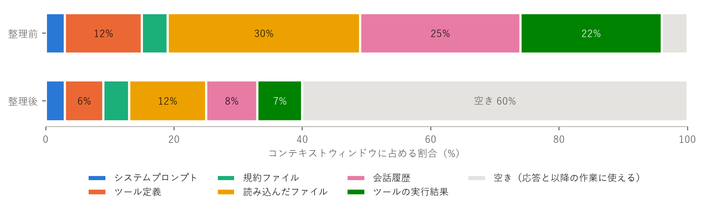

コンテキストエンジニアリング
==========================================

本書の定義
------------------------------------------

:term:`コンテキストエンジニアリング`\ とは、推論のたびにモデルへ渡す情報全体（:term:`コンテキスト`）を設計し、管理する技術である。プロンプトエンジニアリングが「指示文をどう書くか」を扱うのに対し、コンテキストエンジニアリングは「指示文を含め、何を、どれだけ、どの順でモデルに見せるか」を扱う :ref:`[Anthropic-Context] <ref-anthropic-context>`。

:doc:`overview`\ で述べたとおり、モデルは記憶を持たず、今回の入力に含まれる情報だけを手がかりに判断する。エージェントが長い作業をこなすほど、コンテキストには会話履歴やツールの実行結果が積み重なっていく。その中から判断に必要な情報を過不足なく保つことが、この層の課題である。

コンテキストの構成要素
------------------------------------------

コーディングエージェントのコンテキストは、おおむね\ :numref:`table-context-elements` の要素からなる。

.. _table-context-elements:

.. list-table:: コンテキストの構成要素
   :header-rows: 1
   :widths: 25 45 30

   * - 要素
     - 内容
     - 主な管理手段
   * - システムプロンプト
     - エージェントの役割、振る舞いの規則
     - エージェントの製品側が用意する。利用者が追加できる場合もある
   * - ツール定義
     - 使えるツールの名前、説明、引数
     - 使うツールを絞る
   * - 規約ファイル
     - プロジェクトの規約、よく使うコマンド、注意事項
     - ``AGENTS.md``、``CLAUDE.md`` などを整備する
   * - 読み込んだ情報
     - ソースコード、文書、検索結果
     - 必要なものだけを、必要なときに読み込む
   * - 会話履歴
     - 利用者の依頼とモデルの応答
     - 作業ごとに会話を分ける。要約する
   * - ツールの実行結果
     - コマンドの出力、テストの結果、ファイルの内容
     - 出力を絞る。古い結果を除く

:numref:`fig-context-budget` は、コンテキストウィンドウの内訳を例として示したものである。整理する前は、読み込んだファイル、会話履歴、ツールの実行結果が大半を占め、新しい作業に使える空きがほとんど残っていない。不要な情報を除き、古い履歴を要約すると、同じ作業でも多くの空きを確保できる。

.. _fig-context-budget:

   コンテキストウィンドウの内訳の例（説明のための例であり、実測値ではない）

基本的な考え方
------------------------------------------

多ければよいわけではない
^^^^^^^^^^^^^^^^^^^^^^^^^^^^^^^^^^^^^^^^^^

コンテキストウィンドウが大きくなっても、情報を詰め込むほどよい結果になるわけではない。入力が長くなると、モデルが個々の情報に向ける注意は分散し、重要な情報を見落としやすくなる。特に、長い入力の中ほどにある情報は、先頭や末尾にある情報より活用されにくいことが報告されている :ref:`[Liu2023] <ref-liu2023>`。また、入力が長いほど、処理にかかる時間と料金も増える。

コンテキストエンジニアリングの目標は、「望む結果を得られる可能性が最も高くなる、最小限の情報の集合」を見つけることである :ref:`[Anthropic-Context] <ref-anthropic-context>`。

コンテキストの失敗の型
^^^^^^^^^^^^^^^^^^^^^^^^^^^^^^^^^^^^^^^^^^

コンテキストに起因する失敗は、次の型に分けると原因を見つけやすい。

.. list-table:: コンテキストの失敗の型
   :header-rows: 1
   :widths: 18 47 35

   * - 型
     - 状況
     - 例
   * - 不足
     - 判断に必要な情報が入っていない
     - プロジェクトの規約を知らず、既存の書き方と違うコードを書く
   * - 過剰
     - 無関係な情報が多く、重要な情報が埋もれる
     - 前の作業の履歴が残っていて、今回の作業と混同する
   * - 矛盾
     - 互いに食い違う情報が入っている
     - 古い設計書と現在のコードが食い違い、どちらに従うべきか分からない
   * - 汚染
     - 誤った情報が入り、それを前提に判断を重ねる
     - 一度誤った推測をすると、その推測が履歴に残り、以降の判断もそれに引きずられる

汚染が起きた場合は、誤りを指摘して修正させるより、会話をやり直して正しい情報だけで始めるほうが早いことが多い。

主な手法
------------------------------------------

規約ファイル
^^^^^^^^^^^^^^^^^^^^^^^^^^^^^^^^^^^^^^^^^^

:term:`規約ファイル`\ は、プロジェクトの情報や作業のルールを書いておき、エージェントがセッションの開始時に自動的に読み込むファイルである。毎回同じ説明をする手間が省け、説明の漏れも防げる。

.. list-table:: 主な規約ファイル
   :header-rows: 1
   :widths: 45 55

   * - ファイル
     - 読み込むツール
   * - ``AGENTS.md``
     - OpenAI Codex、GitHub Copilot、Cursor など多くのツール（共通の形式として提案されている :ref:`[AGENTS.md] <ref-agentsmd>`）
   * - ``CLAUDE.md``
     - Claude Code
   * - ``.github/copilot-instructions.md``
     - GitHub Copilot
   * - ``.cursor/rules/`` 配下のファイル
     - Cursor

規約ファイルには、モデルがコードを読むだけでは分からないことを書く。

* よく使うコマンド（テスト、静的解析、ビルド、開発サーバーの起動）
* コーディング規約と、その理由
* アーキテクチャ上の決まり（どの層からどの層を呼んでよいか）
* 触れてはいけないファイルや操作
* 作業の進め方（実装前に方針を確認する、など）

逆に、コードを読めば分かること、一般的なプログラミングの知識、頻繁に変わる情報は書かない。規約ファイルは毎回コンテキストに含まれるため、長くなるほど他の情報の場所を奪い、個々の指示も守られにくくなる。要点に絞り、守られていない指示があれば書き方を見直す。具体例は\ :doc:`practice_claude_code` で示す。

必要なときに読み込む
^^^^^^^^^^^^^^^^^^^^^^^^^^^^^^^^^^^^^^^^^^

関連しそうな情報をあらかじめすべて入れておくのではなく、エージェントが必要になった時点で検索し、読み込む方式が主流になっている。人間がリポジトリ全体を暗記せず、必要に応じてファイルを開くのと同じである。

検索の方法には、大きく 2 つある。

.. list-table:: 検索の方法
   :header-rows: 1
   :widths: 25 40 35

   * - 方法
     - 内容
     - 向いている対象
   * - キーワード検索
     - ``grep`` やファイル名のパターンで探す。エージェントがツールとして使う
     - ソースコード（識別子が明確で、検索結果を確かめやすい）
   * - 意味検索
     - 文書を埋め込みベクトルに変換して索引を作り、意味の近いものを探す
     - 大量の文書、表現がそろっていない文書

検索した結果をコンテキストに加えて生成させる手法を :term:`RAG`\ （検索拡張生成）という :ref:`[Lewis2020] <ref-lewis2020>`。コーディングエージェントでは、事前に索引を作らず、エージェント自身が ``grep`` やファイルの一覧を使って探索することが多い。索引の更新が不要で、検索結果が常に最新のコードと一致するためである。

また、情報を段階的に見せる方法も有効である。例えば、最初はファイル名や手順書の要約だけを見せ、必要と判断したときに本文を読ませる。Claude Code のスキル（:doc:`practice_claude_code` 参照）は、この考え方に基づいている。

要約と除去
^^^^^^^^^^^^^^^^^^^^^^^^^^^^^^^^^^^^^^^^^^

作業が長くなると、会話履歴とツールの実行結果がコンテキストを圧迫する。古い履歴を要約に置き換えることを\ :term:`コンパクション`\ という。多くのエージェントは、コンテキストが上限に近づくと自動でコンパクションを行い、利用者が明示的に実行することもできる。

要約では情報が失われる。決定事項、未解決の問題、変更したファイルなど、作業の継続に必要な情報が要約に残るよう、要約の指示を工夫する。また、すでに役目を終えたツールの実行結果（一度読んだ長いログなど）は、要約するより除去するほうがよい場合もある。

最も単純で効果的な方法は、作業ごとに会話を分けることである。ある作業が終わったら会話を消去し、次の作業を新しいコンテキストで始める。

外部の記憶
^^^^^^^^^^^^^^^^^^^^^^^^^^^^^^^^^^^^^^^^^^

コンテキストウィンドウに収まらない長い作業では、進捗や決定事項をファイルに書き出させ、後で読み戻させる。例えば、作業の計画と完了した項目を ``PLAN.md`` に記録させておけば、会話をやり直しても、そのファイルを読むだけで作業を再開できる :ref:`[Anthropic-Harness] <ref-anthropic-harness>`。:doc:`spec_driven`\ で扱う仕様書と実装計画も、この外部の記憶の役割を果たす。

コンテキストの分離
^^^^^^^^^^^^^^^^^^^^^^^^^^^^^^^^^^^^^^^^^^

大量のファイルを読む調査を別のエージェント（:term:`サブエージェント`）に任せ、結果の要約だけを受け取ると、主となるエージェントのコンテキストを節約できる。この方法は\ :doc:`multi_agent`\ で詳しく扱う。

サンプルコード：予算内でのコンテキストの組み立て
------------------------------------------------------------------------------------

:numref:`code-ex02` は、ここまでの手法を単純化して組み合わせた例である。

.. _code-ex02:

.. literalinclude:: ../examples/ex02_context_builder.py
   :language: python
   :caption: 予算内でのコンテキストの組み立て（ex02_context_builder.py）
   :linenos:

* ``retrieve``\ （38 〜 47 行目）は、クエリと共通する語の数で文書を選ぶ。実際の RAG における検索の部分を、キーワードの一致数だけでごく単純にしたものである。
* ``compact_history``\ （50 〜 59 行目）は、直近の履歴を残し、古い履歴を要約に置き換える。
* ``build_context``\ （68 〜 79 行目）は、優先度の高い順に、予算に収まる項目だけを選ぶ。

実行結果は次のとおりである。予算の 160 トークンを超えるため、優先度の最も低い「古い履歴の要約」が除外されている。

.. code-block:: text
   :caption: ex02_context_builder.py の出力
   :linenos:

   種類            トークン  内容
   instruction       29  あなたはこのリポジトリの開発を支援するエージェントである。
   memory            26  プロジェクト規約: 型ヒント必須。テストは tests/ に置く。
   history           28  AI: auth.py を修正し、既存テストがすべて成功することを確認した
   history           19  利用者: 次は注文 API のテストを追加したい
   retrieved         42  [docs/testing.md] テスト: pytest を使う。DB を使う
   合計 144 トークン（予算 160）
   予算超過で除外: history （これまでの 3 件の要約）利用者: ログイン画面の不具合を / AI: aut

実際のエージェントでは、この判断の多くをモデル自身が行う。人間の役割は、規約ファイルや検索の手段を整え、モデルが正しい情報にたどり着ける状態を作ることである。
