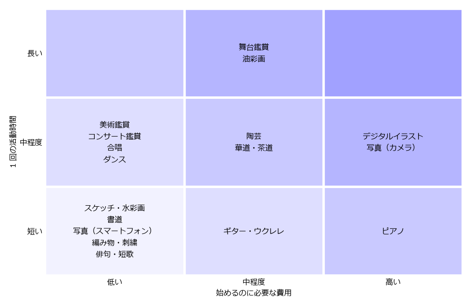

自分に合った芸術の選び方
========================

第 3〜15 章で見てきたように、趣味として楽しめる芸術は数多い。本章では、その中から自分に合った分野を選ぶための観点と、分野の比較、選び方の手順を示す。

選ぶときの観点
--------------

何に興味があるか
   最も大切な観点である。「あの絵のような色を出してみたい」「あの曲を弾いてみたい」など、心が動いた経験があれば、それを手がかりにする。興味があるものから始めると、続けやすい。

費用
   始めるときにかかる費用（道具や楽器の購入費、教室の入会金など）と、続けるためにかかる費用（材料費、月謝、鑑賞のチケット代など）がある。始めるときの費用が少なくても、続けるための費用がかさむ分野もあるため、両方を考える。

時間
   1 回の活動にどれくらいの時間が必要かを考える。仕事や家事で忙しい人は、短い時間でも少しずつ進められる分野が向いている。

場所
   自宅でできるか、教室や専用の設備が必要かを考える。自宅で活動する場合は、道具を広げる場所や、音やにおいが周囲に与える影響にも注意する。

一人か、仲間とか
   一人で自分のペースで楽しみたいか、仲間と一緒に活動したいかによって、向いている分野は異なる。

体力・身体の条件
   ダンスのように体力を使う分野もあれば、座ったままできる分野もある。目や手指、膝などに負担がかかる分野もあるため、自分の体の状態に合わせて選ぶ。

分野の比較
----------

主な分野について、始めるのに必要な費用と 1 回の活動時間の目安を :numref:`fig-cost-time` に、各観点の目安を :numref:`table-genre-compare` に示す。いずれも、標準的な始め方をした場合の大まかな目安であり、道具の選び方や取り組み方によって大きく変わる。

.. _fig-cost-time:

   分野ごとの、始めるのに必要な費用と 1 回の活動時間の目安

図の目安は次のとおりである。

* 始めるのに必要な費用：低い（1 万円程度まで）、中程度（1 万〜3 万円程度）、高い（3 万円程度以上）
* 1 回の活動時間：短い（1 時間程度以内でも楽しめる）、中程度（1〜3 時間程度）、長い（3 時間以上、半日程度）

.. _table-genre-compare:

.. list-table:: 分野ごとの目安
   :header-rows: 1
   :widths: 22 13 13 22 15 15

   * - 分野
     - 始めるのに必要な費用
     - 1 回の活動時間
     - 主な場所
     - 一人でできるか
     - 体力
   * - 美術鑑賞
     - 低い
     - 中程度
     - 美術館、ギャラリー
     - できる
     - 少し使う（歩く）
   * - コンサート鑑賞
     - 低い
     - 中程度
     - ホール、ライブハウス
     - できる
     - あまり使わない
   * - 舞台鑑賞
     - 中程度
     - 長い
     - 劇場
     - できる
     - あまり使わない
   * - スケッチ・水彩画
     - 低い
     - 短い
     - 自宅、屋外
     - できる
     - あまり使わない
   * - 油彩画
     - 中程度
     - 長い
     - 自宅、教室
     - できる
     - あまり使わない
   * - デジタルイラスト
     - 高い
     - 中程度
     - 自宅
     - できる
     - あまり使わない
   * - 書道
     - 低い
     - 短い
     - 自宅、教室
     - できる
     - あまり使わない
   * - 写真（スマートフォン）
     - 低い
     - 短い
     - どこでも
     - できる
     - 少し使う（歩く）
   * - 写真（カメラ）
     - 高い
     - 中程度
     - 屋外
     - できる
     - 少し使う（歩く）
   * - 陶芸
     - 中程度
     - 中程度
     - 教室、工房
     - 教室で行う
     - 少し使う
   * - 編み物・刺繍
     - 低い
     - 短い
     - どこでも
     - できる
     - あまり使わない
   * - ピアノ
     - 高い
     - 短い
     - 自宅、教室
     - できる
     - あまり使わない
   * - ギター・ウクレレ
     - 中程度
     - 短い
     - 自宅
     - できる
     - あまり使わない
   * - 合唱
     - 低い
     - 中程度
     - 所属する団体の練習場所
     - 仲間と行う
     - 少し使う
   * - ダンス
     - 低い
     - 中程度
     - 教室
     - 教室で行う
     - 使う
   * - 俳句・短歌
     - 低い
     - 短い
     - どこでも
     - できる
     - あまり使わない
   * - 華道・茶道
     - 中程度
     - 中程度
     - 教室
     - 教室で行う
     - 少し使う（正座など）

選び方の手順
------------

何から始めるか迷った場合は、:numref:`fig-choose-flow` の流れを参考にするとよい。

.. _fig-choose-flow:

.. graphviz::
   :caption: 自分に合った芸術の選び方の例

   digraph choose {
       graph [rankdir=TB, nodesep=0.3, ranksep=0.45, bgcolor="transparent"];
       node [fontsize=12, color="#4a6fa5"];
       edge [color="#4a6fa5", arrowsize=0.7, fontsize=11];

       start [label="まずは気軽に\n芸術に触れたい？", shape=diamond, style=filled, fillcolor="#fdf1dc", color="#c08a2b"];
       view [label="鑑賞から始める\n美術館、コンサート、劇場\n（第 3〜6 章）", shape=box, style="rounded,filled", fillcolor="#eef3fb"];
       q1 [label="仲間と一緒に\n活動したい？", shape=diamond, style=filled, fillcolor="#fdf1dc", color="#c08a2b"];
       q2 [label="体を動かしたい？", shape=diamond, style=filled, fillcolor="#fdf1dc", color="#c08a2b"];
       q3 [label="自宅で少しずつ\n取り組みたい？", shape=diamond, style=filled, fillcolor="#fdf1dc", color="#c08a2b"];
       body [label="ダンス、演劇\n（第 13 章）", shape=box, style="rounded,filled", fillcolor="#eef3fb"];
       group [label="合唱、楽団、句会\n伝統文化の教室\n（第 12、14、15 章）", shape=box, style="rounded,filled", fillcolor="#eef3fb"];
       home [label="スケッチ、書道、編み物\n俳句、楽器、DTM\n（第 7、8、11、12、14 章）", shape=box, style="rounded,filled", fillcolor="#eef3fb"];
       studio [label="陶芸、ガラス工芸、油彩画\n教室・工房の体験教室\n（第 7、10、11 章）", shape=box, style="rounded,filled", fillcolor="#eef3fb"];

       start -> view [label="はい"];
       start -> q1 [label="いいえ\n（つくりたい）"];
       q1 -> q2 [label="はい"];
       q1 -> q3 [label="いいえ"];
       q2 -> body [label="はい"];
       q2 -> group [label="いいえ"];
       q3 -> home [label="はい"];
       q3 -> studio [label="いいえ\n（教室に通いたい）"];
   }

この図は一つの例にすぎない。実際には、気になる分野を一つに絞り込む必要はなく、いくつかの体験教室に参加して比べてみるのがよい。鑑賞から始めて、気に入った分野を自分でもつくってみるという順番もある。

選ぶときのこつ
--------------

まず体験してみる
   多くの分野で、1 回限りの体験教室やワークショップが開かれている。道具をそろえる前に体験すると、自分に合うかどうかが分かり、無駄な出費を避けられる。

道具は最初から高価なものをそろえない
   入門用の道具やセットで始め、続けられそうだと分かってから、必要に応じて良い道具に買い替えればよい。ただし、品質があまりに低い道具は思いどおりに使えず、上達を妨げることがある。店の人や教室の先生に相談して選ぶとよい。

完璧を目指さない
   最初から上手にできる人はいない。うまくできなくても楽しめることが、趣味として続けるための大切な条件である。

続かなくてもよい
   試してみて合わなかったら、別の分野に移ってもかまわない。いくつかの分野を経験することで、本当に好きなものが見つかることもある。
