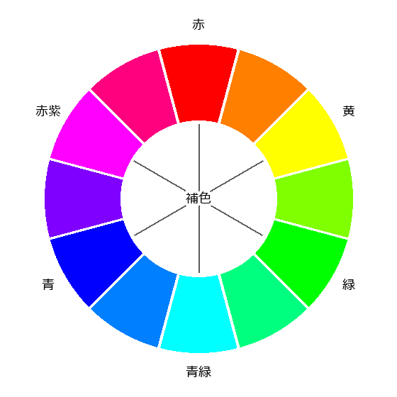

絵を描く
========

絵を描くことは、紙と鉛筆さえあれば始められる、最も身近な創作である。画材によって、表現できることや必要な道具、制作にかかる時間が大きく異なる。本章では、主な絵の種類と画材の特徴を紹介する。

スケッチ・デッサン
------------------

どのようなものか
   スケッチは、目の前のものを短時間で描き留める絵である。デッサン（素描）は、主に鉛筆や木炭を使い、形や明暗、質感を正確にとらえることを目指して描く絵である。どちらも、ほかの絵の基礎になる。

楽しみ方・魅力
   描くために対象をよく観察するうちに、ものの形や光の当たり方に気付くようになる。旅先や散歩の途中で小さなスケッチブックに描けば、写真とは違う旅の記録になる。

始め方
   鉛筆（硬さの異なるものを数本）、消しゴム、スケッチブックがあれば始められる。最初は、りんごやコップなど、形の単純なものを描くとよい。鉛筆による明暗のつけ方を学ぶと、立体感が出せるようになる。

水彩画
------

どのようなものか
   水で溶いた絵具で描く絵である。絵具を薄く重ねて下の色を透かす透明水彩と、下の色を覆い隠す不透明水彩（ガッシュ）がある。一般に「水彩画」というと透明水彩を指すことが多い。

楽しみ方・魅力
   水のにじみやぼかしを生かした、みずみずしい表現ができる。道具が比較的軽く、後片付けも簡単なため、屋外での写生にも向いている。鉛筆やペンで描いた線に色を付ける「淡彩スケッチ」は、初心者でも取り組みやすい。

始め方
   絵具、筆（太さの異なるものを数本）、パレット、筆洗（筆を洗う容器）、水彩紙が必要である。水彩紙は、水を含んでも波打ちにくいように厚く作られており、普通の画用紙より描きやすい。12 色程度の絵具のセットから始めれば十分である。

油彩画
------

どのようなものか
   顔料を乾性油（乾燥すると固まる植物油）で練った油絵具で描く絵である。キャンバスに描くことが多い。

楽しみ方・魅力
   色に深みと光沢があり、絵具を厚く盛り上げる表現もできる。乾くまでに時間がかかるため、色を混ぜながらじっくり描き進められ、失敗した部分は乾いてから上に塗り重ねて直せる。

始め方
   油絵具、筆、パレット、ペインティングナイフ（絵具を混ぜたり、画面に塗ったりするへら状の道具）、画用液（絵具を溶いたり、乾き方や艶を調整したりする液）、筆を洗う洗浄液、キャンバスが必要である。必要な道具が多いため、画材店で入門用のセットを購入するか、教室で道具の使い方から教わるとよい。画用液や洗浄液には揮発性の溶剤を含むものがあるため、制作中は換気を心がける（:doc:`cautions` を参照）。

アクリル画
----------

どのようなものか
   合成樹脂を含むアクリル絵具で描く絵である。水で溶いて使い、乾くと耐水性になる。

楽しみ方・魅力
   乾きが速く、すぐに上から塗り重ねられる。水を多く加えると水彩画のように、水を加えずに厚く塗ると油彩画のように描ける。紙、キャンバス、木、布、石など、さまざまなものに描ける。においが少なく、自宅でも扱いやすい。

始め方
   絵具、筆、パレット、筆洗、描くもの（紙やキャンバスボード）が必要である。乾くと固まって落ちなくなるため、使い終わった筆はすぐに洗う。パレットには、使い捨てのペーパーパレットを使うと後片付けが楽になる。

色鉛筆・パステル
----------------

どのようなものか
   色鉛筆は、芯に顔料を練り込んだ鉛筆である。油性の色鉛筆のほか、塗った後に水を含ませた筆でなぞると水彩画のようになる水彩色鉛筆がある。パステルは、顔料を棒状に固めた画材で、粉っぽく柔らかいソフトパステル、硬めのハードパステル、油分を含んだオイルパステルなどがある。

楽しみ方・魅力
   色鉛筆は、鉛筆と同じ感覚で使え、細かい部分まで描き込める。パステルは、指や布で色をこすってぼかせるため、柔らかい色の変化を表現しやすい。どちらも水や筆を使わずに描けるため、準備と後片付けがほとんど要らない。

始め方
   色鉛筆は 24 色程度のセットと画用紙から始められる。ソフトパステルで描いた絵は粉が落ちやすいため、完成後に定着液（フィキサチーフ）を吹き付けて保護する。

水墨画・日本画
--------------

どのようなものか
   水墨画は、墨の濃淡やにじみ、かすれだけで描く絵である。日本画は、岩石などを砕いて作った岩絵具を、膠（にかわ）という接着剤で和紙や絹に定着させて描く絵である。

楽しみ方・魅力
   水墨画は、一色で描くにもかかわらず、墨の濃淡によって遠近や空気感まで表現できる。書道と道具の多くが共通しており、書道の経験が生かせる。日本画は、岩絵具の独特の質感と、落ち着いた色合いが魅力である。

始め方
   水墨画は、筆、墨、硯（すずり）、画仙紙（にじみやすい和紙）などがあれば始められる。日本画は、膠を溶かす、岩絵具を練るなどの準備に手間がかかるため、教室で学ぶのが一般的である。

デジタルイラスト
----------------

どのようなものか
   パソコンやタブレット端末と、描画用のアプリケーション（ソフトウェア）を使って描く絵である。漫画やイラストを描く人の多くがデジタルの道具を使っている。

楽しみ方・魅力
   色を塗った部分を簡単に取り消したり、色を変えたりでき、失敗を恐れずに試せる。透明なシートを重ねるように絵を描き分けられる「レイヤー」の機能を使えば、線画と色塗りを別々に修正できる。絵具の準備や後片付けが不要で、完成した絵をそのまま SNS などで公開できる。

始め方
   次のいずれかの組み合わせが一般的である。描画用のアプリケーションには、無料のものから有料のものまである。

   * 専用のペンが使えるタブレット端末
   * パソコンと、ペンで入力するペンタブレット（画面のない板状の機器）
   * パソコンと、画面に直接描ける液晶ペンタブレット

   スマートフォンと指やタッチペンでも描けるため、まずはスマートフォン用の無料のアプリケーションで試してみるのもよい。

大人の塗り絵
------------

どのようなものか
   あらかじめ線で描かれた図柄に色を塗るものである。子ども向けの塗り絵と違い、細かい模様や風景、名画などを題材にした大人向けの塗り絵の本が多く出版されている。

楽しみ方・魅力
   構図や形を考える必要がないため、色選びと塗ることに集中できる。絵を描くことに苦手意識がある人でも、完成度の高い作品を仕上げられる。色の組み合わせの練習にもなる。

始め方
   塗り絵の本と色鉛筆があれば始められる。

色の基本
--------

どの画材を使う場合でも、色の基本的な性質を知っておくと、色を選ぶときや混ぜるときに役立つ。

色の 3 属性
   色は、色相（赤、黄、青などの色合い）、明度（明るさ）、彩度（鮮やかさ）の 3 つの性質で表せる。

色相環
   色相を円形に並べたものを色相環という。色相環で隣り合う色どうしはなじみやすく、向かい合う位置にある色どうしを補色という。補色を隣に並べると互いに引き立て合う。また、補色の関係にある絵具どうしを混ぜると、灰色や黒に近いくすんだ色になる。

   12 色の色相環と補色の関係

色相環にはいくつかの体系があり、体系によって色の並び方や補色の組み合わせが少し異なる。図は光の色（ディスプレイなどの色）に基づく色相環である。絵具の色を基にした色相環では、たとえば黄の補色は青紫に近い色になる。絵具で補色を考えるときは、絵具の色を基にした色相環を参考にするとよい。

暖色と寒色
   赤や橙、黄などの色は暖かさを感じさせ、暖色と呼ばれる。青や青緑などの色は冷たさを感じさせ、寒色と呼ばれる。一般に、暖色は手前に、寒色は奥にあるように見えやすいため、遠くの山を青みがかった色で描くと奥行きが出る。

費用・時間・場所の目安
----------------------

.. list-table:: 絵の種類ごとの目安（2026 年時点）
   :header-rows: 1
   :widths: 18 22 22 38

   * - 種類
     - 始めるのに必要な費用
     - 主な場所
     - 向いている人
   * - スケッチ・デッサン
     - 数千円程度
     - 自宅、屋外
     - 道具を少なくして始めたい人、観察することが好きな人
   * - 水彩画
     - 数千円〜1 万円程度
     - 自宅、屋外
     - 風景や草花を描きたい人、屋外で描きたい人
   * - 油彩画
     - 1 万〜3 万円程度
     - 自宅（換気できる部屋）、教室
     - 時間をかけて一枚の絵を仕上げたい人
   * - アクリル画
     - 数千円〜1 万円程度
     - 自宅
     - 油彩画のような表現を手軽に試したい人、さまざまな素材に描きたい人
   * - 色鉛筆・パステル
     - 数千円程度
     - 自宅
     - 準備や後片付けの手間を省きたい人
   * - 水墨画・日本画
     - 水墨画は数千円〜1 万円程度、日本画は教室の受講料が中心
     - 自宅、教室
     - 日本の伝統的な表現に関心がある人
   * - デジタルイラスト
     - タブレット端末やペンタブレットをそろえると数万円〜10 万円程度
     - 自宅
     - 漫画やイラストを描きたい人、SNS で作品を公開したい人
   * - 大人の塗り絵
     - 数千円程度
     - 自宅
     - 絵を描くことに苦手意識がある人、気軽に始めたい人

スケッチや色鉛筆、塗り絵などは、1 回 30 分〜1 時間程度でも楽しめる。一方、油彩画は、準備と後片付けに時間がかかり、絵具が乾くのを待ちながら描き進めるため、1 回に 3 時間以上かけることが多い。教室に通う場合は、別に受講料が必要である。教室の選び方と費用の目安は :doc:`learning` で説明する。
