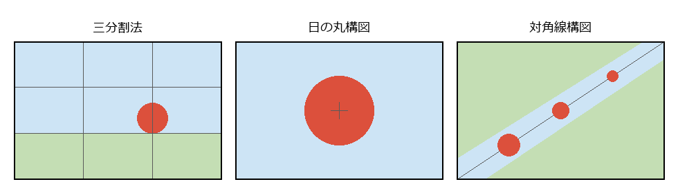

写真・映像を撮る
================

スマートフォンの普及によって、写真は誰もが毎日のように撮るものになった。記録のために撮るだけでなく、構図や光を工夫して「作品」として撮ると、写真は奥深い芸術になる。本章では、写真と動画を撮る楽しみを紹介する。

写真の楽しみ方
--------------

写真の題材は、風景、草花、人物、動物、鉄道、街並み、料理など、身の回りのあらゆるものである。同じものでも、撮る位置や時間、光の向きによってまったく違う写真になる。

* 季節や時間を変えて同じ場所を撮り、変化を記録する。
* 散歩や旅行に出かける際に、テーマ（「赤いもの」「影」など）を決めて撮る。
* 撮った写真を印刷して、アルバムにまとめたり部屋に飾ったりする。
* 写真教室や撮影会に参加して、ほかの人と同じ被写体を撮り比べる。

撮影の道具
----------

スマートフォン
   最も手軽な道具である。近年のスマートフォンは、複数のカメラやソフトウェアによる処理を組み合わせて、明るさや色を自動で整えてくれる。多くの機種では、明るさやピントの位置を手動で調整したり、背景をぼかしたりもできる。まずは手元のスマートフォンで構図や光を意識して撮ることから始めるとよい。

レンズ交換式カメラ
   撮影する場面に合わせてレンズを交換できるカメラである。現在の主流はミラーレス一眼カメラで、従来からある一眼レフカメラもある。スマートフォンに比べて撮像素子（光を受けて画像にする部品）が大きく、暗い場所でもきれいに撮れ、背景を大きくぼかした写真も撮りやすい。

コンパクトデジタルカメラ
   レンズ一体型の小型のカメラである。大きな撮像素子を備えた高画質な機種や、遠くのものを大きく撮れる機種などがある。

フィルムカメラ
   フィルムに記録するカメラである。撮影できる枚数に限りがあり、現像するまで仕上がりを確認できないが、その分 1 枚ごとに丁寧に撮るようになる。フィルム特有の色合いを好む人も多い。

構図の基本
----------

構図とは、画面の中に被写体をどのように配置するかである。代表的な構図を知っておくと、撮るときの手がかりになる。

   代表的な構図

三分割法
   画面を縦横それぞれ 3 等分する線を想定し、その線や交点に被写体や地平線を置く。被写体を中央からずらすことで、画面に動きや広がりが生まれる。多くのスマートフォンやカメラでは、画面に 3 分割の線（グリッド）を表示する設定がある。

日の丸構図
   被写体を画面の中央に置く。見せたいものがはっきり伝わる。単調になりやすいため、被写体を大きく写す、背景を整理するなどの工夫をするとよい。

対角線構図
   道や川、線路などを画面の対角線に沿って配置する。奥行きや動きのある写真になる。

構図のほかに、次の点を意識すると写真が変わる。

* 被写体に近づく：伝えたいものを大きく写すと、写真の主題がはっきりする。
* 高さを変える：しゃがんで低い位置から撮る、高い位置から見下ろして撮るなど、目の高さ以外から撮ると新鮮な写真になる。
* 余計なものを外す：撮る前に画面の四隅を確認し、主題と関係のないものが写り込んでいないか確かめる。

光を読む
--------

写真は光を記録するものであり、光の向きと質が写真の印象を大きく左右する。

* **順光**：被写体の正面から当たる光である。色がはっきり写るが、立体感は出にくい。
* **逆光**：被写体の後ろから当たる光である。草花や髪の輪郭が光り、柔らかく印象的な写真になる。
* **斜光**：被写体の横や斜めから当たる光である。影ができて立体感や質感が出る。

日の出や日の入りの前後の時間は、光が柔らかく暖かい色になるため、風景写真に適している。曇りの日の光は影が柔らかく、草花や人物を撮るのに向いている。

露出の基本
----------

露出とは、写真を撮るときに撮像素子に当てる光の量であり、絞りとシャッター速度で決まる。写真の明るさは、この露出と ISO 感度の組み合わせで決まり、光が多すぎると写真が白っぽく、少なすぎると黒っぽくなる。これらの 3 つの要素は、まとめて「露出の 3 要素」と呼ばれることも多い。

絞り
   レンズを通る光の量を調整する仕組みで、F 値という数値で表す。F 値が小さいほど絞りが開いて光が多く入り、ピントが合う範囲が狭くなって背景がぼける。F 値が大きいほど、手前から奥までピントが合いやすくなる。

シャッター速度
   撮像素子に光を当てる時間である。速くすると動いているものが止まって写り、遅くすると光が多く入る代わりに、動いているものやカメラの揺れがぶれて写る。

ISO 感度
   撮像素子が受けた光を、どれだけ増幅して画像にするかを表す値である。高くすると暗い場所でも明るく撮れるが、画像にざらつき（ノイズ）が出やすくなる。

.. graphviz::
   :caption: 写真の明るさを決める 3 つの要素

   digraph exposure {
       graph [rankdir=LR, nodesep=0.3, ranksep=0.7, bgcolor="transparent"];
       node [shape=box, style="rounded,filled", fillcolor="#eef3fb", color="#4a6fa5", fontsize=12];
       edge [color="#4a6fa5", arrowsize=0.7];

       a [label="絞り\nF 値を小さくする（絞りを開く）と明るくなる\n副作用：背景がぼける"];
       s [label="シャッター速度\n遅くすると明るくなる\n副作用：動きがぶれる"];
       i [label="ISO 感度\n高くすると明るくなる\n副作用：ノイズが出る"];
       e [label="写真の明るさ", fillcolor="#4a6fa5", fontcolor="white"];

       a -> e;
       s -> e;
       i -> e;
   }

同じ明るさの写真でも、どの要素で明るさを調整するかによって写り方が変わる。たとえば、流れる滝を糸のように写したいときはシャッター速度を遅くし、明るさが過剰にならないように絞りを絞る（F 値を大きくする）。カメラの自動露出に任せても撮影はできるが、3 つの要素の関係を知っておくと、思いどおりの写真に近づけられる。

撮った後の楽しみ
----------------

写真の編集（レタッチ）
   撮った写真の明るさや色合い、傾き、切り取る範囲などを、アプリケーションで調整する。スマートフォンの標準の写真アプリにも、基本的な編集の機能がある。

プリント
   画面で見るのと、印刷して見るのとでは、写真の印象が異なる。気に入った写真は大きく印刷して飾ると、作品としての完成度が実感できる。写真展に応募する場合もプリントが必要になる。

動画を撮る
----------

スマートフォンで高画質の動画が撮れるようになり、動画の制作も身近な趣味になった。旅行の記録や家族の行事、趣味の作品の制作過程などを撮影し、編集用のアプリケーションで不要な部分を切り取ったり、音楽や字幕を付けたりして 1 本の作品に仕上げる。

動画では、構図や光に加えて、時間の流れを考える必要がある。一つの場面（カット）を短めにして、遠景、中景、近景を組み合わせると、見る人を飽きさせない動画になる。撮影の際は、手ぶれを抑えるために両手でしっかり持つか、三脚やジンバル（手ぶれを抑える機器）を使う。

費用・時間・場所の目安
----------------------

.. list-table:: 写真・映像の趣味の目安（2026 年時点）
   :header-rows: 1
   :widths: 25 35 40

   * - 道具
     - 始めるのに必要な費用
     - 向いている人
   * - スマートフォン
     - 手持ちのもので始められる
     - 気軽に始めたい人、日常の中で撮りたい人
   * - レンズ交換式カメラ
     - 本体とレンズで数万〜数十万円程度
     - 背景をぼかした写真や、遠くの野鳥などを撮りたい人、機材に凝りたい人
   * - コンパクトデジタルカメラ
     - 数万円〜10 万円程度
     - 小型の機材でスマートフォン以上の画質を求める人
   * - フィルムカメラ
     - 中古の本体で数万円程度、フィルムと現像の費用が毎回必要
     - 1 枚ずつ丁寧に撮りたい人、フィルムの色合いを好む人

写真は、散歩や旅行のついでに楽しめる。撮影に出かけるだけでなく、撮った写真の整理や編集も自宅でできる。人物や他人の作品などを撮影して公開する場合は、肖像権や著作権に注意が必要である（:doc:`cautions` を参照）。
