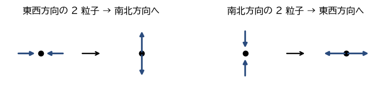
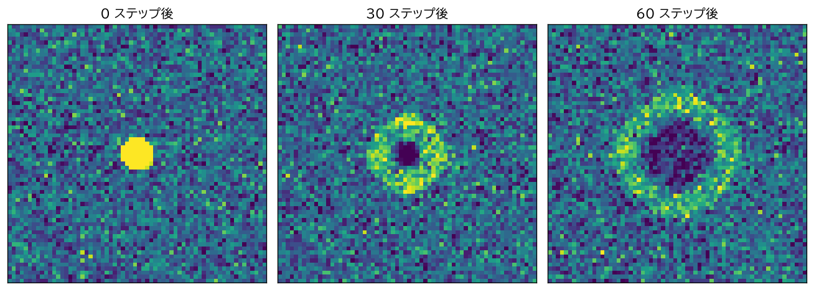
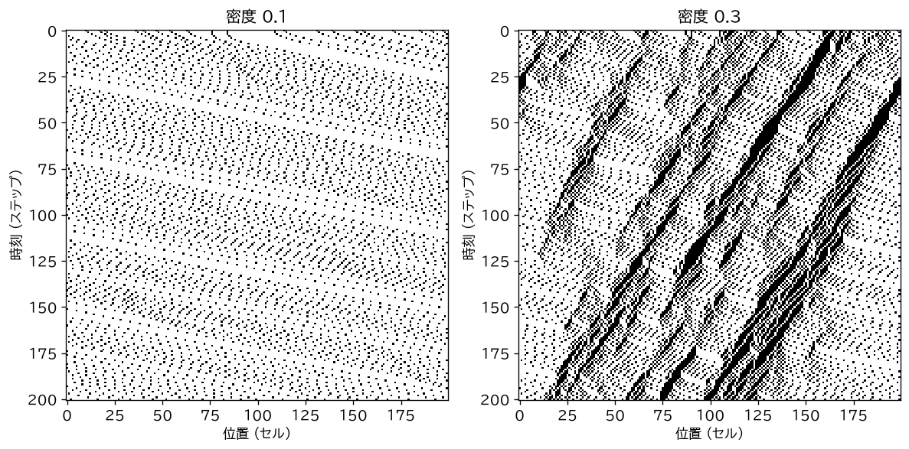
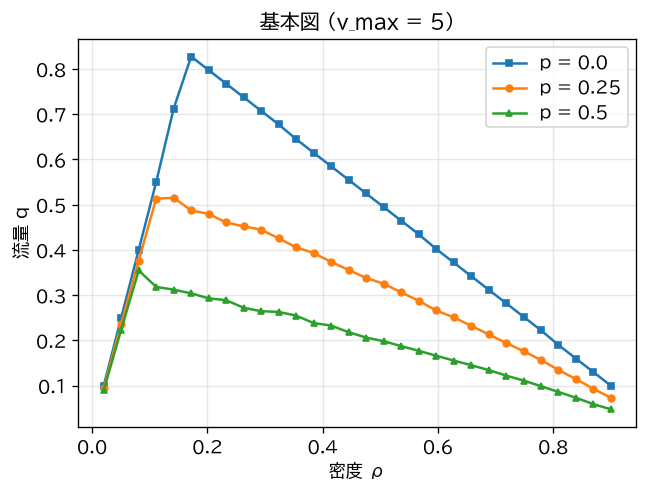

応用
====

CA は、多数の要素が局所的に相互作用する現象を直接シミュレーションできるため、物理・工学・生物・社会などのさまざまな分野でモデルとして使われてきた。本章では代表的な応用例を紹介する。

流体シミュレーション
--------------------

HPP モデル
^^^^^^^^^^

流体は膨大な数の分子からなるが、巨視的な流れの性質（ナビエ・ストークス方程式に従うこと）は、個々の分子の詳細にはあまり依存せず、「粒子の数と運動量が保存される」「粒子が局所的に衝突する」といった基本的な性質だけで決まると考えられる。そこで、分子の運動を極端に単純化した CA で流体を模倣する\ :term:`格子ガス・オートマトン`\ が考案された。

最初の格子ガス・オートマトンである HPP モデル [Hardy1973]_ では、正方格子の各ノードに、東・北・西・南の 4 方向に動く粒子が、方向ごとに高々 1 個ずつ存在できる。各ノードの状態は 4 ビットで表され、1 ステップは次の 2 段階からなる。

#. **衝突**\ ：ちょうど 2 個の粒子が正面から衝突する場合（東と西の粒子だけ、または北と南の粒子だけがある場合）、2 個の粒子の進行方向を 90 度回転させる（\ :numref:`fig-hpp-rules`\ ）。それ以外の場合は何もしない。
#. **移動**\ ：各粒子を、進行方向の隣のノードへ移す。

.. _fig-hpp-rules:

   HPP モデルの衝突規則

衝突の前後で、ノード上の粒子数も運動量の合計（正面衝突なので 0）も変わらないので、モデル全体で粒子数と運動量が保存される。衝突は次のように実装できる（サンプルコード ``lattice_gas_hpp.py`` から抜粋）。正面衝突が起きるノードでは、4 方向すべての粒子の有無を反転させればよい。

.. literalinclude:: ../examples/lattice_gas_hpp.py
   :language: python
   :pyobject: collide
   :linenos:

:numref:`fig-hpp` は、一様な粒子の分布の中央に密度の高い円形の領域を置き、時間発展させた結果である。個々のノードの粒子数はゆらぎが大きいので、4 × 4 のノードごとに平均した密度を表示している。密度の高い領域から、音波に相当する密度の波が同心円状に広がっていく様子が分かる。

.. _fig-hpp:

   HPP モデルで密度の波が広がる様子（4 × 4 のノードごとの平均粒子数）

FHP モデルと格子ボルツマン法
^^^^^^^^^^^^^^^^^^^^^^^^^^^^

HPP モデルの音波は等方的に広がるが、正方格子の対称性が低いために、運動量の流れ（粘性や非線形項）に方向による違いが残り、巨視的な振る舞いがナビエ・ストークス方程式にならない。この問題は、六角格子を使い、粒子が 6 方向に動けるようにした FHP モデルで解決された [Frisch1986]_。FHP モデルでは、巨視的な振る舞いが（流速が音速に比べて十分小さい範囲で）ナビエ・ストークス方程式に従うことが示されている。

一方、格子ガス・オートマトンには、各ノードの状態が 0 か 1 なので統計的なゆらぎが大きく、滑らかな結果を得るには広い範囲の平均をとる必要があるという欠点があった。そこで、各方向の粒子の有無の代わりに、その「平均的な存在確率」を実数で持ち、衝突規則をボルツマン方程式の衝突項で置き換えた\ :term:`格子ボルツマン法`\ が提案された [McNamara1988]_。格子ボルツマン法は、厳密には状態が連続値なので CA の定義からは外れるが、局所的な規則による同期更新という CA の性質を受け継いでおり、並列計算に向く。複雑な形状の境界を扱いやすいこともあり、現在も多孔質媒体中の流れや混相流などのシミュレーションに広く使われている。

交通流
------

\ :term:`ナーゲル・シュレッケンベルク・モデル`\ [Nagel1992]_ は、高速道路の交通流を表す 1 次元の確率的 CA である。道路を長さ約 7.5 m のセルに区切り、各セルには車が高々 1 台入る。各車は 0 から :math:`v_{\max}` までの整数の速度 :math:`v` を持ち（単位はセル/ステップ）、毎ステップ、すべての車に次の 4 つの規則を順に適用する。

#. **加速**\ ：:math:`v \leftarrow \min(v + 1,\ v_{\max})`
#. **減速**\ ：前の車までの空きセル数を :math:`g` として、:math:`v \leftarrow \min(v,\ g)`
#. **ランダムな減速**\ ：確率 :math:`p` で :math:`v \leftarrow \max(v - 1,\ 0)`
#. **移動**\ ：車を :math:`v` セル前に進める

規則 2 により、車は前の車に追突しない。規則 3 は、運転者が理由もなく減速する（ぼんやりする、過剰に反応する）ことを表しており、このモデルの本質的な部分である。1 ステップを 1 秒とし、:math:`v_{\max} = 5` とすると、最高速度は毎秒 37.5 m（時速 135 km）に相当する。:math:`v_{\max} = 1`、:math:`p = 0` とすると、このモデルは第 4 章「\ :doc:`one_dimensional`\ 」で扱ったルール 184 と一致する。

4 つの規則は次のように実装できる（サンプルコード ``traffic_nasch.py`` から抜粋）。

.. literalinclude:: ../examples/traffic_nasch.py
   :language: python
   :pyobject: step
   :linenos:

:numref:`fig-nasch-spacetime` は、周回道路での時空図である。車の密度が低いと、すべての車がほぼ最高速度で走る（自由流）。密度が高くなると、ある車のランダムな減速をきっかけに後続の車が次々に減速し、渋滞が自然発生する。時空図の黒い帯が渋滞であり、車は右へ進むのに、渋滞の帯は左（車の進行方向と逆）へ移動していく。これは実際の高速道路で観測される「渋滞の後方への伝播」と一致する。

.. _fig-nasch-spacetime:

   ナーゲル・シュレッケンベルク・モデルの時空図（:math:`v_{\max} = 5`、:math:`p = 0.25`、車は右へ進む）

道路の単位長さあたりの車の数を密度 :math:`\rho`、単位時間あたりにある地点を通過する車の数を流量 :math:`q` とすると、平均速度 :math:`\bar{v}` を使って :math:`q = \rho \bar{v}` と表せる。密度と流量の関係を表したグラフを\ :term:`基本図`\ と呼ぶ（\ :numref:`fig-nasch-diagram`\ ）。:math:`p = 0` の場合、密度が :math:`1/(v_{\max} + 1)` 以下ではすべての車が最高速度で走れるので流量は :math:`q = \rho v_{\max}` となって密度に比例して増え、それを超えると渋滞が生じて流量が減少する。ランダムな減速の確率 :math:`p` が大きいほど、最大の流量は小さくなる。このように、単純なモデルでありながら、実測の基本図の特徴をよく再現する。

.. _fig-nasch-diagram:

   ナーゲル・シュレッケンベルク・モデルの基本図（道路長 400 セル）

森林火災と感染症
----------------

森林火災のモデルでは、各セルが「空き地」「木」「燃えている木」の 3 状態をとる。ドロッセル（B. Drossel）とシュワーブル（F. Schwabl）のモデル [Drossel1992]_ では、毎ステップ次の規則を適用する。

* 燃えている木は空き地になる。
* 隣に燃えている木がある木は燃え始める。
* 隣に燃えている木がない木も、小さな確率 :math:`p_{\mathrm{f}}` で燃え始める（落雷）。
* 空き地には確率 :math:`p_{\mathrm{g}}` で新しい木が生える。

:math:`p_{\mathrm{f}} \ll p_{\mathrm{g}}` のとき、このモデルは木が生えて森が広がり、落雷による火災で一気に失われる、という過程を繰り返す。そして、1 回の火災で焼ける面積の分布が、特定の大きさを持たないべき乗則に従う。外部からパラメータを細かく調整しなくても、系が自然に臨界状態に近づくこのような性質は\ **自己組織化臨界現象**\ と呼ばれる。

同様に、各セルを「感受性者（未感染）」「感染者」「回復者」とし、感染者の隣の感受性者が確率的に感染する規則を考えると、感染症の空間的な広がりを表す CA になる。感受性者・感染者・回復者の人数の変化を微分方程式で表す SIR モデルとは異なり、人の空間的な分布や移動の制限の効果を直接表せる点が利点である。

結晶の成長
----------

雪の結晶が六角形の対称性を持つ複雑な形に成長する様子は、六角格子の CA でよく再現できる。最も単純なモデルは、「ちょうど 1 個の隣のセルが氷であるセルは、次の時刻に氷になる」という規則である。この規則で 1 個の氷のセルから始めると、六回対称の樹枝状のパターンが成長する。

ライター（C. A. Reiter）のモデル [Reiter2005]_ では、各セルが水蒸気の量を表す実数値を持ち、水蒸気の拡散と氷への取り込みを局所規則として表す。少数のパラメータを変えるだけで、板状、樹枝状などの現実の雪の結晶によく似た多様な形が得られる。

乱数生成と暗号
--------------

第 4 章「\ :doc:`one_dimensional`\ 」で述べたように、ルール 30 の中央の列は統計的に乱数に近い性質を持つ [Wolfram1986]_。CA は単純な論理演算の繰り返しで計算でき、ハードウェアで並列に実装しやすいので、擬似乱数生成器として利用されてきた。

ウルフラムは、ルール 30 で生成した系列を鍵ストリームとする暗号も提案した。しかし、マイヤー（W. Meier）とシュタッフェルバッハ（O. Staffelbach）は、生成された系列の一部から内部状態を効率よく推定する攻撃法を示した [Meier1991]_。そのため、ルール 30 をそのまま暗号に使うことは推奨されない。シミュレーション用の擬似乱数としては使えても、暗号として安全かどうかは別の問題であることに注意が必要である。

画像処理
--------

画像の各画素をセルとみなすと、多くの画像処理を CA として表すことができる。たとえば、2 値画像で「周囲 8 画素の多数決で自分の値を決める」規則を適用すると、孤立した点状のノイズが除去される。また、「周囲に背景の画素があれば背景にする」という規則は、モルフォロジー処理の収縮（erosion）に相当する。CA による画像処理は、各画素の計算が独立しているため、GPU などで並列に実行しやすい。

量子ドット・セル・オートマトン
------------------------------

\ :term:`量子ドット・セル・オートマトン`\ （Quantum-dot Cellular Automata、QCA）は、CA の考え方を電子回路の設計に応用したものである [Lent1993]_。1 つのセルは正方形の四隅に置いた 4 個の量子ドットと 2 個の電子からなる。電子どうしの反発により、電子は対角線上の 2 個のドットに入り、どちらの対角線に入るかで 0 と 1 を表す。隣り合うセルの電子はクーロン力で同じ配置にそろおうとするので、セルを並べると信号が伝わる。

QCA では、電流を流さずに電子の配置の変化だけで情報を伝えるので、消費電力を非常に小さくできる可能性がある。3 入力の多数決ゲートを基本素子として論理回路を構成する。ただし、室温で安定に動作させることなどの課題が残っており、現在も研究段階の技術である。

生物の模様
----------

イモガイの一種の貝殻には、ルール 30 などの ECA の時空図によく似た三角形の模様が現れる。貝殻は縁に沿って成長し、縁に並んだ色素細胞が隣の細胞からの活性化・抑制を受けて色素を出すかどうかを決めるので、貝殻の模様は 1 次元 CA の時空図と同じ仕組みで描かれていると考えられる。このように、CA は生物の形や模様ができる仕組みを考えるうえでも有用なモデルとなる。
