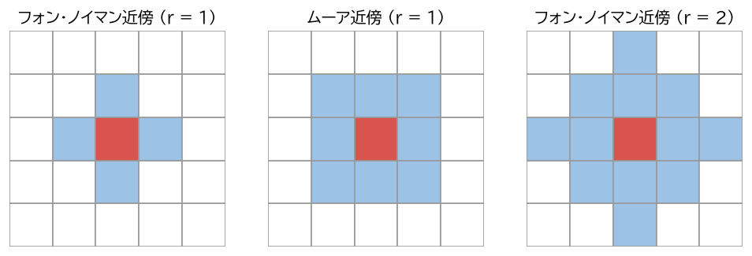
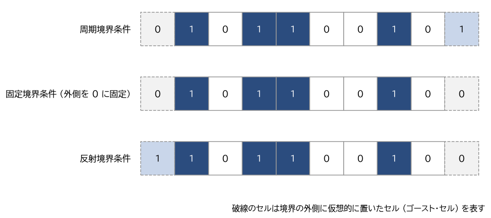

基本概念と定義
==============

本章では、本書全体で使う CA の基本的な用語と記号を定義する。

構成要素
--------

CA は次の 4 つの要素で決まる。

.. list-table:: CA の構成要素
   :header-rows: 1
   :widths: 20 20 60

   * - 要素
     - 記号
     - 意味
   * - 格子（セル空間）
     - :math:`\mathbb{Z}^d`
     - セルが並ぶ空間。:math:`d` 次元の整数格子で、各格子点が 1 つのセルに対応する。
   * - 状態集合
     - :math:`S`
     - 各セルがとりうる状態の有限集合。2 状態の場合は :math:`S = \{0, 1\}` とする。
   * - 近傍
     - :math:`N = (v_1, \ldots, v_m)`
     - 次の状態を決めるときに参照するセルの相対位置の列。:math:`v_i \in \mathbb{Z}^d` である。
   * - 局所規則
     - :math:`f : S^m \to S`
     - 近傍のセルの状態の組から、次の時刻の状態を決める関数。局所遷移規則とも呼ぶ。

ここで重要なのは、格子・近傍・局所規則がすべてのセルで共通であること（一様性）、次の状態が近傍という有限の範囲だけで決まること（局所性）、そして全セルが同時に更新されること（同期性）である。

配置と大域写像
--------------

格子上の各セルに状態を 1 つずつ割り当てたもの、すなわち写像 :math:`c : \mathbb{Z}^d \to S` を\ :term:`配置`\ （configuration）と呼ぶ。配置全体の集合を :math:`S^{\mathbb{Z}^d}` と書く。配置 :math:`c` における位置 :math:`x` のセルの状態は :math:`c(x)` である。

局所規則 :math:`f` をすべてのセルに同時に適用すると、配置 :math:`c` から新しい配置 :math:`F(c)` が得られる。

.. math::

   F(c)(x) = f\bigl(c(x + v_1),\, c(x + v_2),\, \ldots,\, c(x + v_m)\bigr) \qquad (x \in \mathbb{Z}^d)

この写像 :math:`F : S^{\mathbb{Z}^d} \to S^{\mathbb{Z}^d}` を\ :term:`大域写像`\ （大域遷移写像）と呼ぶ。初期配置 :math:`c^0` から始めて :math:`c^{t+1} = F(c^t)` を繰り返し計算することが、CA の時間発展である。

局所規則は有限集合 :math:`S^m` から :math:`S` への関数なので、その個数は有限であり、:math:`|S|^{|S|^m}` 通りある。たとえば 2 状態で 3 セルの近傍を持つ 1 次元 CA の局所規則は :math:`2^{2^3} = 256` 通りである（第 4 章「\ :doc:`one_dimensional`\ 」で扱う）。一方、2 状態で、次節で定義するムーア近傍（9 セル）を持つ 2 次元 CA の局所規則は :math:`2^{512}` 通りもあり、すべてを調べ尽くすことはできない。

近傍
----

よく使われる近傍を :numref:`fig-neighborhoods` に示す。

* **1 次元の半径 r の近傍**\ ：位置 :math:`x` の左右 :math:`r` セルずつと自分自身の :math:`2r + 1` セル、すなわち :math:`N = (-r, \ldots, -1, 0, 1, \ldots, r)` である。
* **フォン・ノイマン近傍**\ ：2 次元で、マンハッタン距離が :math:`r` 以下のセル :math:`\{ (i, j) : |i| + |j| \le r \}` である。:math:`r = 1` のときは自分自身と上下左右の 5 セルになる。
* **ムーア近傍**\ ：2 次元で、チェビシェフ距離が :math:`r` 以下のセル :math:`\{ (i, j) : \max(|i|, |j|) \le r \}` である。:math:`r = 1` のときは自分自身と周囲 8 セルの 9 セルになる。

.. _fig-neighborhoods:

   フォン・ノイマン近傍とムーア近傍（赤が中心のセル、青が近傍に含まれるセル）

単に「近傍」と言うとき、中心のセル自身を含める場合と含めない場合がある。本書では、局所規則の引数としての近傍 :math:`N` は中心のセルを含むものとし、ライフゲームの説明などで「周囲 8 セル」と言う場合は中心のセルを含まないものとする。

静止状態と有限配置
------------------

状態 :math:`q \in S` が :math:`f(q, q, \ldots, q) = q` を満たすとき、:math:`q` を\ :term:`静止状態`\ と呼ぶ。周囲がすべて静止状態ならそのセルも静止状態のままなので、静止状態は「何もない背景」を表す。本書では、静止状態は 0 であるとする。

有限個のセルを除いてすべて静止状態であるような配置を\ :term:`有限配置`\ と呼ぶ。コンピュータ上でパターンを扱うときや、計算能力の議論をするときには、有限配置を考えることが多い。

境界条件
--------

理論上の格子 :math:`\mathbb{Z}^d` は無限に広いが、コンピュータ上では有限個のセルしか扱えない。そのため、端のセルの近傍が格子の外にはみ出す部分をどう扱うかを決める必要がある。これを\ :term:`境界条件`\ と呼ぶ（\ :numref:`fig-boundaries`\ ）。

.. list-table:: 主な境界条件
   :header-rows: 1
   :widths: 20 80

   * - 境界条件
     - 扱い方
   * - 周期境界条件
     - 右端の右隣を左端のセルとみなす（2 次元では上端と下端もつなぐ）。格子は 1 次元では円周、2 次元ではトーラス（ドーナツの表面）になる。端が特別扱いされないので、最もよく使われる。
   * - 固定境界条件
     - 格子の外側のセルを、常に一定の状態（多くは静止状態）とみなす。
   * - 反射境界条件
     - 格子の外側のセルが、境界をはさんで鏡に映した位置のセルと同じ状態であるとみなす。

.. _fig-boundaries:

   1 次元の場合の境界条件（左右の破線のセルが、格子の外側に置いた仮想的なセル）

有限の格子で周期境界条件を使う場合、配置の総数は有限なので、時間発展は必ずいつか以前と同じ配置に戻り、その後は周期的になる。ただし、その周期や周期に入るまでの時間は格子の大きさに対して指数的に長くなりうるので、実際のシミュレーションで周期に達することはまれである。

更新の方式
----------

標準的な CA では、すべてのセルを同時に更新する（同期更新）。実装上は、現在の配置を読みながら新しい配置を別の配列に書き込めばよい。現在の配置を書き換えながら順に更新すると、あるセルの更新結果がまだ更新していない隣のセルの計算に混ざり、意図と異なる規則を計算することになるので注意が必要である。

これに対し、セルを 1 つずつ（またはランダムな順序で）更新する方式を非同期更新と呼ぶ。非同期更新の CA については、第 8 章「\ :doc:`advanced`\ 」で触れる。

計算例と時空図
--------------

具体例として、2 状態・半径 1 の 1 次元 CA で、局所規則を

.. math::

   f(a, b, c) = a \oplus c

とするものを考える。ここで :math:`\oplus` は排他的論理和（XOR）であり、左右の隣のセルの状態が異なれば 1、同じなら 0 となる。これは第 4 章「\ :doc:`one_dimensional`\ 」で扱うルール 90 である。セル数 8、周期境界条件で、位置 3 のセルだけが 1 の配置から始めると、時間発展は次のようになる。

.. list-table:: ルール 90 の時間発展の計算例
   :header-rows: 1
   :widths: 20 80

   * - 時刻
     - 配置（位置 0〜7）
   * - 0
     - ``0 0 0 1 0 0 0 0``
   * - 1
     - ``0 0 1 0 1 0 0 0``
   * - 2
     - ``0 1 0 0 0 1 0 0``
   * - 3
     - ``1 0 1 0 1 0 1 0``

たとえば時刻 2 の位置 0 のセルは、時刻 1 の位置 7 と位置 1 のセルがどちらも 0 なので 0 になる（位置 0 の左隣は、周期境界条件により位置 7 である）。時刻 3 の位置 0 のセルは、時刻 2 の位置 7 が 0、位置 1 が 1 なので 1 になる。

このように各時刻の配置を上から順に並べた図を\ :term:`時空図`\ と呼ぶ。1 次元 CA の振る舞いは、時空図を見ると一目で把握できる。本書の 1 次元 CA の図は、すべてこの形式で描いている。
