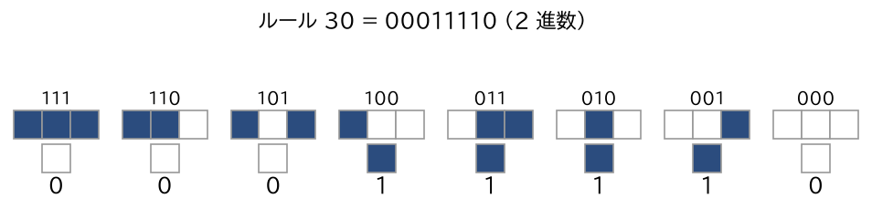
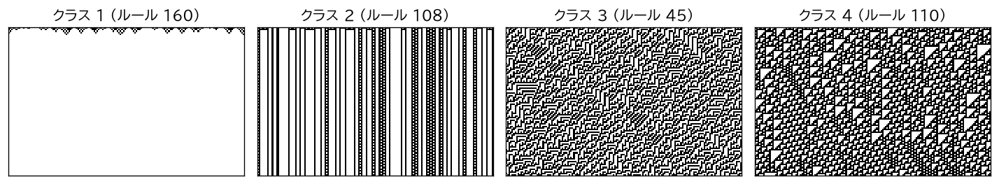
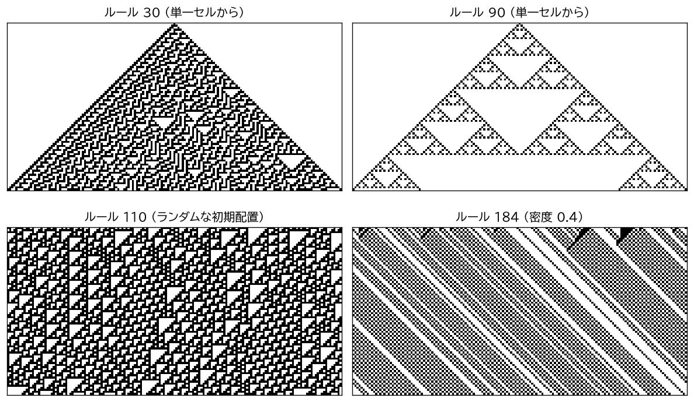

1 次元セル・オートマトン
========================

本章では、最も単純な CA である基本セル・オートマトンを中心に、1 次元 CA を扱う。1 次元 CA は規則の数が少なく、時空図によって振る舞い全体を 1 枚の図で見渡せるため、CA の性質を調べる出発点として適している。

基本セル・オートマトン
----------------------

状態が 0 と 1 の 2 つで、近傍が半径 1（自分自身と左右の隣の 3 セル）の 1 次元 CA を\ :term:`基本セル・オートマトン`\ （Elementary Cellular Automaton、ECA）と呼ぶ。局所規則は

.. math::

   c^{t+1}(x) = f\bigl(c^t(x - 1),\, c^t(x),\, c^t(x + 1)\bigr)

の形をしており、:math:`f` は 3 ビットの入力から 1 ビットを出力する関数である。入力の組は :math:`2^3 = 8` 通りあり、それぞれに対して出力を 0 か 1 に決めれば規則が 1 つ定まるので、ECA の規則は全部で :math:`2^8 = 256` 通りある。

ルール番号
----------

ウルフラムは、ECA の 256 通りの規則に 0〜255 の番号を付ける方法を導入した [Wolfram1983]_。この番号を\ :term:`ルール番号`\ （ウルフラム・コード）と呼ぶ。

近傍の状態 :math:`(a, b, c)` を 3 桁の 2 進数 :math:`4a + 2b + c` とみなすと、8 通りの近傍に 0〜7 の番号が付く。この番号の大きい順（111、110、…、000）に出力 :math:`f(a, b, c)` を並べた 8 桁の 2 進数がルール番号である。式で書くと次のようになる。

.. math::

   R = \sum_{a, b, c \in \{0, 1\}} f(a, b, c) \cdot 2^{4a + 2b + c}

逆に、ルール番号 :math:`R` が与えられたとき、近傍 :math:`(a, b, c)` に対する出力は :math:`R` を 2 進数で表したときの下から :math:`4a + 2b + c` 桁目（最下位を 0 桁目とする）のビットである。:numref:`fig-rule30-table` にルール 30 の例を示す。:math:`30` を 2 進数で表すと :math:`00011110` なので、近傍 100、011、010、001 に対して 1 を、それ以外に対して 0 を出力する。

.. _fig-rule30-table:

   ルール 30 の局所規則（上段が近傍の状態、下段が次の時刻の中央のセルの状態）

この対応を Python で書くと、次のようになる（サンプルコード ``elementary_ca.py`` から抜粋）。

.. literalinclude:: ../examples/elementary_ca.py
   :language: python
   :pyobject: rule_table
   :linenos:

1 ステップ分の時間発展は、各セルの近傍の番号 :math:`4a + 2b + c` を配列として計算し、上の表を引くだけで求められる。``np.roll`` は配列を巡回的にずらす関数なので、周期境界条件が自然に実現される。

.. literalinclude:: ../examples/elementary_ca.py
   :language: python
   :pyobject: step
   :linenos:

規則の対称性と同値類
--------------------

256 通りの規則の中には、本質的に同じ振る舞いをするものが含まれている。次の 2 つの変換を考える。

* **鏡映**\ ：左右を入れ替える。規則 :math:`f` を :math:`f'(a, b, c) = f(c, b, a)` に変える。時空図は左右反転する。
* **0・1 反転**\ ：0 と 1 を入れ替える。規則 :math:`f` を :math:`f'(a, b, c) = 1 - f(1 - a, 1 - b, 1 - c)` に変える。時空図は白黒が反転する。

これらの変換とその組み合わせで移り合う規則は、見た目が反転するだけで振る舞いは同じである。この同一視によって、256 通りの規則は 88 個の同値類に分かれる。主な規則の同値類を次に示す。

.. list-table:: 主な規則の同値類
   :header-rows: 1
   :widths: 25 75

   * - 規則
     - 同値な規則（鏡映、0・1 反転、またはその両方で移り合う規則）
   * - ルール 30
     - 30、86、135、149
   * - ルール 90
     - 90、165
   * - ルール 110
     - 110、124、137、193
   * - ルール 184
     - 184、226

ルール 90 は左右対称な規則なので鏡映では変わらず、0・1 反転をとると 165 になる。ルール 184 は鏡映でも 0・1 反転でも 226 になり、両方を組み合わせると 184 に戻る。

ウルフラムの 4 クラス分類
-------------------------

ウルフラムは、ランダムな初期配置から始めたときの ECA をはじめとする 1 次元 CA の振る舞いを観察し、次の 4 つのクラスに分類した [Wolfram1984]_。

.. list-table:: ウルフラムの 4 クラス
   :header-rows: 1
   :widths: 15 45 40

   * - クラス
     - 振る舞い
     - 力学系としての解釈
   * - クラス 1
     - ほぼすべての初期配置が、一様な配置（すべて 0 など）に落ち着く
     - 固定点に収束する
   * - クラス 2
     - 単純な静止パターンや周期パターンが、互いに分離した状態で残る
     - 周期軌道に収束する
   * - クラス 3
     - 乱雑で非周期的なパターンが続く
     - カオス的に振る舞う
   * - クラス 4
     - 局所的な構造が移動・衝突しながら、長い時間にわたって複雑に相互作用する
     - クラス 2 とクラス 3 の中間で、計算万能性と関係すると考えられている

:numref:`fig-wolfram-classes` に各クラスの例を示す。いずれも同じランダムな初期配置から始めている。

.. _fig-wolfram-classes:

   ウルフラムの 4 クラスの例（ランダムな初期配置から 100 ステップ）

この分類は直感的で分かりやすいが、時空図の見た目に基づく経験的な分類であり、数学的に厳密な定義ではない。実際、一般の CA についてクラスを形式的に定義すると、ある規則がどのクラスに属するかを判定する問題は決定不能になることが示されている [Kari2005]_。また、初期配置によって異なるクラスのような振る舞いを示す規則もある。より厳密な分類の試みについては第 6 章「\ :doc:`theory`\ 」で触れる。

代表的な規則
------------

ECA の中でも特によく知られた 4 つの規則の時空図を :numref:`fig-eca-gallery` に示す。

.. _fig-eca-gallery:

   代表的な ECA の時空図（周期境界条件、横 161 セル）

ルール 30
^^^^^^^^^

ルール 30 の局所規則は次の式で書ける。ここで :math:`\lor` は論理和である。

.. math::

   c^{t+1}(x) = c^t(x - 1) \oplus \bigl(c^t(x) \lor c^t(x + 1)\bigr)

中央の 1 セルから始めると、左側には規則的な斜めの縞模様が現れる一方、右側には不規則な三角形の模様が広がる。代表的なクラス 3 の規則である。中央の列のセルの値の並びは統計的な乱数検定を通過するほど不規則であり、ウルフラムはこれを擬似乱数生成に使うことを提案した [Wolfram1986]_。数式処理システム Mathematica の乱数生成にも使われていた。ただし暗号用途には安全でないことが後に示されている（第 7 章「\ :doc:`applications`\ 」を参照）。

ルール 90
^^^^^^^^^

ルール 90 の局所規則は :math:`c^{t+1}(x) = c^t(x - 1) \oplus c^t(x + 1)` であり、第 2 章「\ :doc:`basics`\ 」の計算例で扱った規則である。中央の 1 セルから始めると、時空図はシェルピンスキー・ガスケットになる。実際、時刻 :math:`t` に位置 :math:`x` のセルが 1 になるのは、二項係数 :math:`\binom{t}{(t + x)/2}` が奇数のとき（:math:`t + x` が偶数で、かつ :math:`|x| \le t` のとき）に限られる。すなわち、ルール 90 の時空図はパスカルの三角形を 2 を法として描いたものと一致する。

ルール 90 は、2 つの配置 :math:`c` と :math:`d` のセルごとの排他的論理和を :math:`c \oplus d` と書くとき

.. math::

   F(c \oplus d) = F(c) \oplus F(d)

を満たす。このような CA を\ :term:`加法的 CA`\ （線形 CA）と呼ぶ。加法的 CA では、任意の初期配置からの時間発展が、1 セルだけが 1 の配置からの時間発展の重ね合わせとして求められるので、振る舞いを代数的に解析できる。ルール 150（:math:`c^{t+1}(x) = c^t(x - 1) \oplus c^t(x) \oplus c^t(x + 1)`\ ）も加法的 CA である。

ルール 110
^^^^^^^^^^

ルール 110 は代表的なクラス 4 の規則である。ランダムな初期配置から始めると、空間的に周期 14、時間的に周期 7 の背景パターン（エーテルと呼ばれる）の上を、グライダーと呼ばれるさまざまな局所構造が一定の速度で移動し、衝突して消滅したり別のグライダーに変化したりする。

クックは、グライダーの衝突を組み合わせることで、ルール 110 が\ :term:`計算万能`\ であることを証明した [Cook2004]_。その後、この模倣が多項式時間で行えることも示された [Neary2006]_。証明の考え方は第 6 章「\ :doc:`theory`\ 」で説明する。

ルール 184
^^^^^^^^^^

ルール 184 の局所規則は次の式で書ける。

.. math::

   c^{t+1}(x) = c^t(x - 1)\bigl(1 - c^t(x)\bigr) + c^t(x)\, c^t(x + 1)

1 を車、0 を空きとみなすと、この式は「左隣の車は自分のセルが空いていれば進んでくる」「自分のセルの車は、右隣に車があれば進めずに留まる」ことを表している。すなわち、各車は前が空いていれば右に 1 セル進み、前が詰まっていれば止まる。この規則では 1 の個数（車の台数）が時間発展で変わらない。このような CA を\ :term:`数保存 CA` と呼ぶ。

周期境界条件のもとで車の密度を :math:`\rho` とすると、十分に時間が経った後、:math:`\rho \le 1/2` ならすべての車が止まらずに進むようになり、:math:`\rho > 1/2` なら渋滞が残って、渋滞の塊が車の進行方向と逆向きに移動していく。:numref:`fig-eca-gallery` の右下は :math:`\rho = 0.4` の例であり、初期配置に含まれていた小さな渋滞が左へ移動しながら解消していく様子が見られる。ルール 184 は、第 7 章「\ :doc:`applications`\ 」で扱うナーゲル・シュレッケンベルク・モデルの最も単純な特殊例である。

1 次元 CA の拡張
----------------

ECA は、状態数や近傍の半径を増やすことで拡張できる。状態数を :math:`k`、近傍の半径を :math:`r` とすると、近傍は :math:`2r + 1` セルなので、局所規則は :math:`k^{k^{2r+1}}` 通りある。:math:`k = 2,\ r = 2` でも :math:`2^{32}`\ （約 43 億）通り、:math:`k = 3,\ r = 1` では :math:`3^{27}`\ （約 7.6 兆）通りとなり、ECA のようにすべての規則を調べることはできない。

そこで、規則の種類を制限したクラスがよく調べられる。代表的なものが\ :term:`総和型 CA`\ （totalistic CA）であり、次の状態が近傍の状態の和だけで決まる。

.. math::

   c^{t+1}(x) = g\Bigl(\sum_{i = -r}^{r} c^t(x + i)\Bigr)

近傍の状態の和は 0 から :math:`(2r + 1)(k - 1)` までの値をとるので、関数 :math:`g` の決め方は :math:`k^{(2r + 1)(k - 1) + 1}` 通りしかない。中央のセルの状態とそれ以外のセルの状態の和とによって次の状態が決まるものを\ :term:`外部総和型 CA`\ （outer totalistic CA）と呼ぶ。第 5 章「\ :doc:`two_dimensional`\ 」で扱うライフゲームは、2 次元の外部総和型 CA である。
