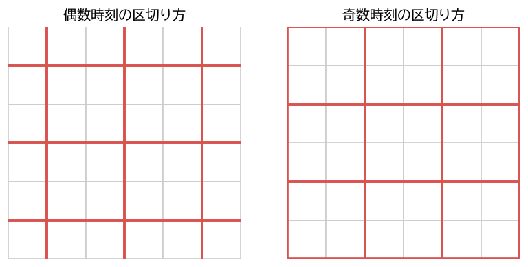
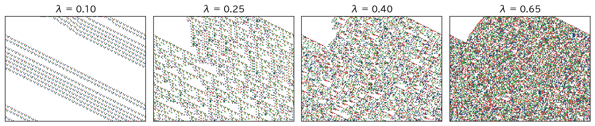

理論
====

本章では、CA の理論的な性質のうち、特に重要な 4 つの話題を扱う。計算能力（計算万能性）、自己増殖、大域写像の数学的性質（エデンの園定理と可逆性）、そして力学系としての CA の振る舞いである。

計算万能性
----------

チューリング機械と計算万能性
^^^^^^^^^^^^^^^^^^^^^^^^^^^^

チューリング機械は、無限に長いテープと、テープ上の 1 マスを読み書きするヘッド、有限個の内部状態からなる計算モデルである。現在のコンピュータで計算できることは、原理的にはすべてチューリング機械で計算できると考えられている。任意のチューリング機械の動作を模倣できる計算モデルを\ :term:`計算万能`\ （チューリング完全）であるという。

実は、1 次元 CA でチューリング機械を模倣するのは難しくない。テープの各マスを CA のセルに対応させ、セルの状態を「テープの記号」または「テープの記号とヘッドの内部状態の組」とすればよい。ヘッドがいるセルだけが特別な状態を持ち、チューリング機械の遷移規則に従って隣のセルへヘッドを移していく局所規則を書けば、CA の時間発展がチューリング機械の動作をそのまま再現する。したがって、状態数に制限を付けなければ、計算万能な CA は容易に作れる。

問題は、\ **ごく単純な規則の CA が計算万能になりうるか**\ である。ここで重要な結果が、ライフゲームとルール 110 の計算万能性である。

ライフゲームの計算万能性
^^^^^^^^^^^^^^^^^^^^^^^^

ライフゲームでは、グライダーを信号として使う。グライダー銃から一定間隔で放出されるグライダーの列を「ビット列」とみなし、グライダーがある位置を 1、ない位置を 0 とする。2 つのグライダーの列を適切な角度とタイミングで交差させると、衝突したグライダーは互いに消滅するので、次のような論理演算が実現できる。

* **NOT**\ ：信号の列に、グライダー銃から放出される「すべて 1」の列を交差させる。信号が 1 の位置では両方が消滅し、0 の位置では銃からのグライダーだけが通過するので、通過した列は元の信号を反転したものになる。
* **AND・OR**\ ：NOT と同様に、複数の列の衝突を組み合わせることで構成できる。

さらに、グライダーを吸収して消す「イーター」と呼ばれる静物や、グライダーの衝突で位置を動かせるブロックを記憶素子として使うことで、任意の論理回路と記憶装置を構成できる。この構成の概要は 1982 年に出版されたバーレカンプ（E. R. Berlekamp）、コンウェイ、ガイ（R. K. Guy）の著書で示された [Berlekamp1982]_。2000 年には、ポール・レンデル（Paul Rendell）が、ライフゲーム上で実際に動作するチューリング機械のパターンを構成している [Rendell2000]_。

ルール 110 の計算万能性
^^^^^^^^^^^^^^^^^^^^^^^

ルール 110 は、2 状態・3 セル近傍の ECA のうちで計算万能であることが証明されている規則である [Cook2004]_。クックの証明は、チューリング機械を直接模倣するのではなく、次のような巡回タグ・システムを模倣する。

* データは 0 と 1 からなる語であり、規則は有限個の語の列 :math:`(w_0, w_1, \ldots, w_{p-1})` を巡回的に使う。
* 各ステップで、データの先頭の記号を 1 つ取り除く。取り除いた記号が 1 なら、現在の規則の語をデータの末尾に追加する。0 なら何も追加しない。いずれの場合も、次のステップでは次の規則の語を使う。

巡回タグ・システムは計算万能であることが知られている。クックは、ルール 110 のエーテル（第 4 章「\ :doc:`one_dimensional`\ 」を参照）の上を動く数種類のグライダーでデータと規則を表し、グライダーの衝突によって巡回タグ・システムの各ステップが実行されるような初期配置を構成した。

計算万能性の帰結
^^^^^^^^^^^^^^^^

CA が計算万能であることは、その CA の振る舞いを予測する問題が一般には\ :term:`決定不能`\ であることを意味する。チューリング機械の停止問題（与えられたプログラムがいつか停止するかを判定する問題）を解くアルゴリズムは存在しないことが知られている。計算万能な CA では、チューリング機械の停止を「あるパターンが消滅する」などの事象に対応させることができるので、次のような問題を解く一般的なアルゴリズムも存在しない。

* ライフゲームで、与えられた有限パターンがいつか消滅するかどうか
* ライフゲームで、与えられた有限パターンがいつか周期的になるかどうか

ウルフラムは、このように時間発展を実際に 1 ステップずつ計算する以外に結果を知る近道がない性質を「計算の既約性」と呼び、単純な規則の系でも振る舞いの予測が本質的に難しい理由と考えた [Wolfram2002]_。

自己増殖
--------

フォン・ノイマンの構成
^^^^^^^^^^^^^^^^^^^^^^

第 3 章「\ :doc:`history`\ 」で述べたように、CA はフォン・ノイマンの自己増殖の研究から始まった。単純に考えると、自分自身を作る機械は、自分自身の完全な設計図を内部に持たなければならない。しかし、その設計図は機械の一部なので、設計図の中には設計図自身の設計図も含まれなければならず、無限後退に陥るように思える。

フォン・ノイマンは、次の 3 つの部品と 1 つの記述を組み合わせることで、この問題を解決した [vonNeumann1966]_。

.. list-table:: フォン・ノイマンの自己増殖機械の構成
   :header-rows: 1
   :widths: 25 75

   * - 部品
     - 役割
   * - A：万能構成機
     - 記述 :math:`\phi(X)` を読み取り、その記述が表す機械 :math:`X` を組み立てる
   * - B：複写機
     - 記述 :math:`\phi(X)` を、意味を解釈せずにそのまま複写する
   * - C：制御部
     - A と B を順に動かし、できあがった機械に記述の複写を取り付ける
   * - :math:`\phi(A + B + C)`
     - A、B、C を合わせた機械の記述

全体 :math:`A + B + C + \phi(A + B + C)` を動かすと、まず A が記述を解釈して :math:`A + B + C` を組み立て、次に B が記述を（解釈せずに）複写して新しい機械に取り付ける。こうして :math:`A + B + C + \phi(A + B + C)` の複製ができる。要点は、記述が「解釈される」場合と「そのまま複写される」場合の 2 通りに使われることであり、記述が自分自身を含む必要がないので無限後退は起こらない。これは、DNA が「タンパク質を作るための情報として翻訳される」ことと「そのまま複製される」ことの 2 通りに使われる仕組みとよく似ている。フォン・ノイマンがこの考えを講演したのは 1948 年であり、DNA の二重らせん構造が明らかにされた 1953 年よりも前であった。

フォン・ノイマンは、この構成を 29 状態の 2 次元 CA の上で具体的に実現する設計を進めた。29 状態のうち多くは、信号の伝達方向や、構成中のセルの状態を表すために使われる。

より単純な自己増殖パターン
^^^^^^^^^^^^^^^^^^^^^^^^^^

その後、自己増殖に必要な状態数を減らす研究が続いた。コッドは 1968 年に 8 状態の CA で同様の構成を示した [Codd1968]_。一方、ラングトンは 1984 年に、万能構成機を持たない代わりに、ずっと小さな構造で自己増殖する「ラングトンのループ」を発表した [Langton1984]_。ラングトンのループは 8 状態・フォン・ノイマン近傍の CA の上で、ループ状の「殻」の中を自分の形の情報が循環し、そこから腕を伸ばして隣に同じループを作る。

ラングトンのループは構造が単純な分、自分自身の複製しか作れない。自己増殖を「生物らしさ」の本質と考えるなら、どこまで単純化しても自己増殖と呼べるのかという問題が生じる。フォン・ノイマンの構成が重要なのは、単に複製を作るだけでなく、記述を変えれば任意の機械を作れる（したがって、記述の「突然変異」によって自分より複雑な子孫を作りうる）点にある。

ライフゲームでも、2010 年に「ジェミニ」と呼ばれる自己複製するパターンが構成されている [LifeWiki]_。

大域写像の性質
--------------

ここからは、CA の大域写像 :math:`F : S^{\mathbb{Z}^d} \to S^{\mathbb{Z}^d}` の数学的な性質を扱う。

全射・単射・前単射
^^^^^^^^^^^^^^^^^^

大域写像について、次の性質を考える。

.. list-table:: 大域写像の性質
   :header-rows: 1
   :widths: 20 80

   * - 性質
     - 定義
   * - 全射
     - すべての配置 :math:`e` に対して、:math:`F(c) = e` となる配置 :math:`c` が存在する
   * - 単射
     - 異なる 2 つの配置 :math:`c \ne c'` は、必ず異なる配置 :math:`F(c) \ne F(c')` に移る
   * - 前単射
     - 有限個のセルだけが異なる 2 つの配置 :math:`c \ne c'` は、必ず異なる配置 :math:`F(c) \ne F(c')` に移る

全射でない CA には、どの配置からも到達できない配置が存在する。これを\ :term:`エデンの園配置`\ と呼ぶ。エデンの園配置は初期配置としてしか現れえない。一方、前単射でない CA には、有限個のセルだけが異なるのに同じ配置に移る 2 つの配置が存在する。このような配置の組を「双子」と呼ぶ。

エデンの園定理
^^^^^^^^^^^^^^

ムーアとマイヒルは、全射性と前単射性について次の定理を示した。

.. admonition:: エデンの園定理（ムーア 1962、マイヒル 1963）

   :math:`\mathbb{Z}^d` 上の CA について、大域写像が全射であることと、前単射であることは同値である。

ムーアは「前単射でなければ（双子が存在すれば）エデンの園配置が存在する」ことを示し [Moore1962]_、マイヒルはその逆の「エデンの園配置が存在すれば双子が存在する」ことを示した [Myhill1963]_。証明の考え方は、一辺の長さが :math:`n` の大きな正方形領域に収まるパターンの数を数えることにある。双子が存在すると、領域の中に双子の片割れを置ける小さな区画をたくさん取れるので、像として区別できるパターンの数は全パターンの数よりも少なくなる。この減少は区画の数、すなわち領域の体積 :math:`n^d` に比例して効いてくる。一方、領域の外側から境界越しに影響する分は、境界の大きさ :math:`n^{d-1}` に比例する程度にしか効かない。そのため、:math:`n` を十分大きくとると、像として現れうるパターンの数が全パターンの数より少なくなり、どこからも到達できないパターンが生じる。逆向きも同様の数え上げで示される。

**例 1：ライフゲーム**\ 。すべてのセルが死んでいる配置と、1 個のセルだけが生きている配置は、1 セルだけが異なる。孤立した生きたセルは過疎で死ぬので、どちらも次の世代にはすべて死んだ配置になる。したがってライフゲームは前単射でなく、エデンの園定理により全射でもない。すなわち、ライフゲームにはエデンの園配置が存在する。実際の例は 1971 年に初めて見つかり、その後より小さな例が探索されている [LifeWiki]_。

**例 2：ルール 90**\ 。すべて 0 の配置とすべて 1 の配置は、どちらもすべて 0 の配置に移る（左右の隣が常に等しいため）。したがってルール 90 は単射ではない。しかし、この 2 つの配置は無限個のセルで異なるので、前単射性には反しない。実際、:math:`F(c) = F(c')` で :math:`c` と :math:`c'` が有限個のセルだけで異なるとすると、加法性から差 :math:`d = c \oplus c'` は :math:`F(d) = 0`、すなわちすべての :math:`x` で :math:`d(x - 1) = d(x + 1)` を満たす。:math:`d` は有限個のセルを除いて 0 なので、:math:`d` はすべて 0 となり、:math:`c = c'` である。よってルール 90 は前単射であり、エデンの園定理により全射である（エデンの園配置を持たない）。

単射ならば明らかに前単射なので、エデンの園定理から「単射な CA は全射でもある」ことが分かる。これらの関係を :numref:`fig-garden-of-eden` にまとめる。

.. _fig-garden-of-eden:

.. graphviz::
   :align: center
   :caption: 大域写像の性質の関係

   digraph goe {
       rankdir=LR;
       node [shape=box, style="rounded,filled", fillcolor="#eef3fa", color="#2b4c7e", fontsize=11];
       edge [color="#555555", fontsize=10];

       inj [label="単射"];
       bij [label="全単射\n（可逆）"];
       pre [label="前単射\n（双子が存在しない）"];
       sur [label="全射\n（エデンの園配置が存在しない）"];

       inj -> bij [label=" 同値（単射ならば全射）", dir=both];
       inj -> pre [label=" 定義から"];
       pre -> sur [label=" エデンの園定理", dir=both];
   }

なお、エデンの園定理は :math:`\mathbb{Z}^d` 上だけでなく、従順群（\ :math:`\mathbb{Z}^d` のように、大きな領域をとると境界の大きさが体積に比べていくらでも小さくなる群）の上の CA に一般化されている [Ceccherini2010]_。

カーティス・ヘドランド・リンドンの定理
^^^^^^^^^^^^^^^^^^^^^^^^^^^^^^^^^^^^^^

配置の集合 :math:`S^{\mathbb{Z}^d}` に、2 つの配置の「近さ」を次のように定める。

.. math::

   \mathrm{dist}(c, c') = 2^{-k}, \qquad k = \min\{\, \|x\|_\infty : c(x) \ne c'(x) \,\}

ただし :math:`c = c'` のときは :math:`\mathrm{dist}(c, c') = 0` とする。2 つの配置は、原点の周りの広い範囲で一致しているほど近いとみなすわけである。この距離（カントール距離）によって定まる位相のもとで、:math:`S^{\mathbb{Z}^d}` はコンパクトになる。コンパクトであるとは、直観的には、どんな配置の列からも、ある配置にいくらでも近づいていく部分列を取り出せるということである。

また、ベクトル :math:`v \in \mathbb{Z}^d` に対して、配置全体を :math:`v` だけずらす写像 :math:`\sigma_v(c)(x) = c(x + v)` をシフトと呼ぶ。CA の局所規則はすべてのセルで共通なので、大域写像はシフトと可換（:math:`F \circ \sigma_v = \sigma_v \circ F`\ ）である。また、:math:`F(c)` の原点付近の値は :math:`c` の原点付近の値だけで決まるので、:math:`F` は連続である。逆に、次の定理が成り立つ [Hedlund1969]_。

.. admonition:: カーティス・ヘドランド・リンドンの定理

   写像 :math:`F : S^{\mathbb{Z}^d} \to S^{\mathbb{Z}^d}` が CA の大域写像であるための必要十分条件は、:math:`F` が連続で、すべてのシフトと可換であることである。

ヘドランドの論文は 1 次元の場合を扱っているが、同じ定理は多次元でも成り立つ。この定理により、CA は「局所規則による定義」とは独立に、位相力学系の言葉で特徴付けられる。特に重要な帰結は次のとおりである。CA の大域写像 :math:`F` が全単射であれば、コンパクト空間の上の連続な全単射なので、逆写像 :math:`F^{-1}` も連続である。:math:`F^{-1}` はシフトとも可換なので、この定理により :math:`F^{-1}` も CA の大域写像になる。単射な CA はエデンの園定理により全射でもあるので全単射であり、その逆写像はある局所規則で表せる。ただし、逆写像の近傍は元の近傍よりずっと大きくなりうる。

可逆セル・オートマトン
^^^^^^^^^^^^^^^^^^^^^^

大域写像が全単射で、逆写像も CA の大域写像であるような CA を\ :term:`可逆 CA` と呼ぶ。上で述べたことから、CA が可逆であることは大域写像が単射であることと同値である。可逆 CA では、時間を逆向きにたどる計算も CA で行えるので、情報が失われない。微視的な物理法則は時間反転に対して可逆なので、可逆 CA は物理系のモデルとして自然である。また、情報の消去にはエネルギーの散逸が伴うという考察から、エネルギー消費の少ない計算の理論モデルとしても研究されてきた [Fredkin1982]_。

ECA で可逆なのは、恒等写像（ルール 204）、左右のシフト（ルール 170、240）、それらの出力を反転したもの（ルール 51、15、85）の 6 つだけであり、いずれも振る舞いは自明である。興味深い可逆 CA を作るには、次のような構成法を使う。

**第 2 階の CA**\ 。現在の配置だけでなく 1 つ前の時刻の配置も使い、

.. math::

   c^{t+1}(x) = f\bigl(c^t(x - 1),\, c^t(x),\, c^t(x + 1)\bigr) \oplus c^{t-1}(x)

と定める。この式は :math:`c^{t-1}(x) = f\bigl(c^t(x - 1), c^t(x), c^t(x + 1)\bigr) \oplus c^{t+1}(x)` と書き直せるので、2 つの連続する時刻の配置から過去を一意に復元できる。:math:`f` が任意の規則でもこの構成は可逆になる。なお、この CA は次の配置が現在の配置だけから決まるという第 2 章の定義をそのままでは満たさないが、連続する 2 時刻の状態の組を 1 セルの状態（4 状態）とみなせば、通常の CA として扱える。この方法はエドワード・フレドキン（Edward Fredkin）によるものとされる [Toffoli1987]_。

**ブロック CA（分割 CA）**\ 。格子を 2 × 2 のブロックに区切り、各ブロックの 16 通りの状態を、全単射な規則で 16 通りの状態に移す。ブロックの区切り方を時刻ごとに斜めに 1 セルずつずらすことで、情報がブロックの境界を越えて伝わるようにする（\ :numref:`fig-margolus`\ ）。この近傍をマーゴラス近傍と呼ぶ [Margolus1984]_。各ブロックの変換が全単射なので、全体も明らかに可逆である。マーゴラスは、この方式でビリヤード球の衝突を模倣する規則を作り、それが計算万能であることを示した。

.. _fig-margolus:

   マーゴラス近傍（赤い線で囲んだ 2 × 2 のブロックごとに更新し、時刻ごとに区切り方を斜めにずらす）

可逆性の判定
^^^^^^^^^^^^

与えられた局所規則の CA が可逆か（単射か）、あるいは全射かを判定する問題は、次元によって難しさが大きく異なる。

.. list-table:: 可逆性・全射性の判定可能性
   :header-rows: 1
   :widths: 20 40 40

   * - 次元
     - 可逆性（単射性）
     - 全射性
   * - 1 次元
     - 判定可能 [Amoroso1972]_
     - 判定可能 [Amoroso1972]_
   * - 2 次元以上
     - 判定不能 [Kari1990]_
     - 判定不能 [Kari1994]_

1 次元の場合は、局所規則から有限のグラフ（長さ :math:`2r` の部分パターンを頂点とし、重なり合う部分パターンどうしを辺で結んだド・ブラウン・グラフ）を作り、その上の経路を調べることで判定できる。2 次元の場合は、平面を決められたタイルで敷き詰められるかを判定する「タイル貼り問題」が決定不能であることを利用して、可逆性の判定も決定不能であることが証明された。

力学系としての CA
-----------------

時間発展の長期的な振る舞い
^^^^^^^^^^^^^^^^^^^^^^^^^^

CA の時間発展 :math:`c^0, F(c^0), F^2(c^0), \ldots` は、配置の空間 :math:`S^{\mathbb{Z}^d}` の上の離散力学系である。第 4 章の表で示したように、ウルフラムの 4 クラスは力学系の言葉でおおまかに解釈できる。中でもクラス 3 の特徴は、初期配置のわずかな違いが時間とともに拡大すること（初期値鋭敏性）である。たとえばルール 30 では、1 セルだけ異なる 2 つの初期配置から始めると、違いのある範囲が時間とともに広がっていく。

クラス 4 はこれらの中間にあたり、力学系として明確に定義することは難しい。ウルフラムの分類を厳密にする試みとして、配置の空間の位相を使って CA を「同程度連続」「初期値鋭敏」「拡大的」などの性質で分類するクールカ（P. Kůrka）の分類などが提案されている [Kurka1997]_。

ラングトンの λ パラメータ
^^^^^^^^^^^^^^^^^^^^^^^^^

ラングトンは、局所規則の性質を 1 つの数で表し、それと振る舞いの関係を調べた [Langton1990]_。状態数を :math:`K`、近傍のセル数を :math:`N` とし、静止状態を 0 とする。局所規則の表には :math:`K^N` 個の行があり、そのうち出力が 0 になる行の数を :math:`n_0` とする。このとき

.. math::

   \lambda = \frac{K^N - n_0}{K^N}

を :term:`λ パラメータ`\ と呼ぶ。:math:`\lambda = 0` ならすべての近傍が 0 に移るので、どんな配置もすぐに消える。:math:`\lambda` が大きいほど 0 以外の状態が生じやすい。出力が :math:`K` 個の状態に一様に分布するのは :math:`\lambda = 1 - 1/K` のときである。

ラングトンは、:math:`K = 4`、:math:`N = 5` の 1 次元 CA について、λ を指定してランダムに作った規則の振る舞いを調べた。その結果、λ を 0 から大きくしていくと、典型的な振る舞いが「固定点」→「周期的」→「複雑（長い過渡状態）」→「カオス的」と変化する傾向があることを見いだした。:numref:`fig-lambda` は、本書で同様の方法で作った規則の例である。λ が小さいと少数の単純な構造しか残らないが、λ が大きくなるにつれて不規則な領域が広がり、最後は全面が乱雑な状態に覆われる。

.. _fig-lambda:

   λ パラメータを変えて作ったランダムな規則の時空図（:math:`K = 4`、近傍の半径 2。中央の半分だけにランダムな初期配置を置いた）

ラングトンは、計算に必要な「情報の保存」と「情報の伝達」が両立するのは秩序とカオスの境目（相転移点）の付近であると考え、複雑な計算が可能な CA はこの領域に集まるという仮説を提案した。この考えは「カオスの縁（edge of chaos）」と呼ばれ、パッカード（N. H. Packard）は 1988 年に、遺伝的アルゴリズムで計算課題を解く CA を進化させると λ がカオスの縁に近づくという実験結果を報告した [Packard1988]_。しかし、ミッチェル（M. Mitchell）らは 1993 年にこの実験を再現できなかったことを報告し、λ だけで計算能力を予測できるという主張には根拠が乏しいと指摘した [Mitchell1993]_。λ は規則の大まかな傾向を表す指標としては有用だが、同じ λ を持つ規則でも振る舞いは大きく異なりうることに注意が必要である。
