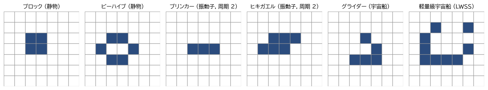
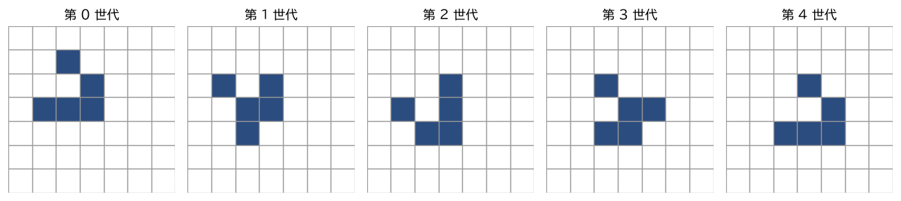
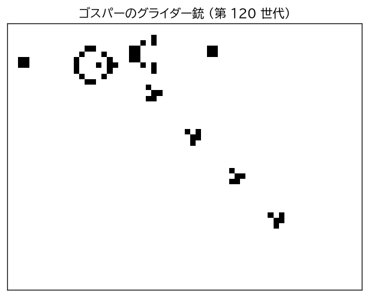
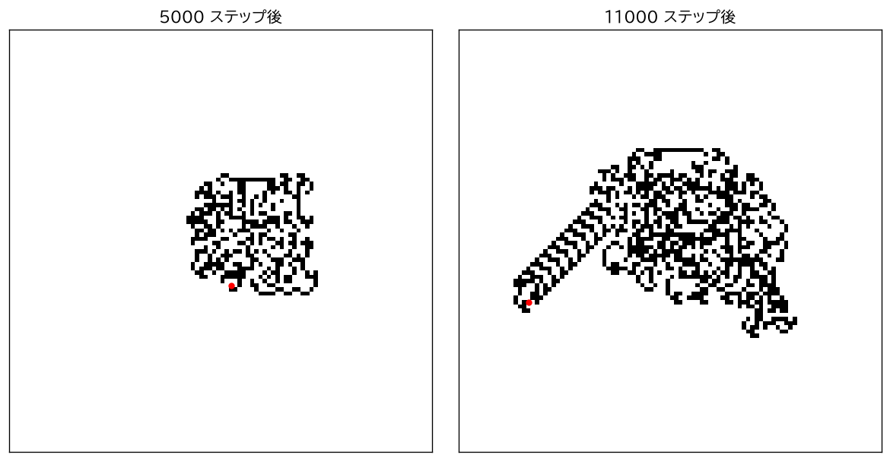

2 次元セル・オートマトン
========================

本章では、2 次元 CA の代表であるライフゲームと、その仲間の規則を扱う。2 次元 CA は 1 次元 CA よりも規則の種類がはるかに多く、移動する構造や自己組織化する模様など、より多彩な振る舞いを示す。

ライフゲーム
------------

\ :term:`ライフゲーム`\ は、コンウェイが 1970 年に考案した 2 次元 CA である [Gardner1970]_。各セルは「生」（1）か「死」（0）の 2 状態をとり、周囲 8 セル（ムーア近傍から中心を除いたもの）のうち生きているセルの数 :math:`n` によって、次の世代の状態が決まる。

.. list-table:: ライフゲームの規則
   :header-rows: 1
   :widths: 20 30 50

   * - 現在の状態
     - 条件
     - 次の世代の状態
   * - 死
     - :math:`n = 3`
     - 生（誕生）
   * - 死
     - :math:`n \ne 3`
     - 死のまま
   * - 生
     - :math:`n = 2` または :math:`n = 3`
     - 生のまま（生存）
   * - 生
     - :math:`n \le 1`
     - 死（過疎）
   * - 生
     - :math:`n \ge 4`
     - 死（過密）

生物の個体群になぞらえて、「周りに仲間がちょうど 3 個体いれば新たに生まれ、2〜3 個体なら生き続け、少なすぎても多すぎても死ぬ」と覚えるとよい。コンウェイは、パターンが単純に消滅したり無限に増殖したりせず、予測しにくい振る舞いを示すように、多くの候補の中からこの規則を選んだ。

次の世代の状態は、中心のセルの状態と周囲 8 セルの状態の和だけで決まるので、ライフゲームは外部総和型 CA である（第 4 章「\ :doc:`one_dimensional`\ 」を参照）。

パターンの分類
--------------

ライフゲームの研究では、特徴的な振る舞いをするパターンに名前を付けて分類してきた。主な分類を次に示す。

.. list-table:: ライフゲームのパターンの分類
   :header-rows: 1
   :widths: 20 50 30

   * - 分類
     - 性質
     - 例
   * - 静物（still life）
     - 世代が進んでも変化しない
     - ブロック、ビーハイブ
   * - 振動子（oscillator）
     - 一定の周期で元の形に戻る
     - ブリンカー、ヒキガエル
   * - 宇宙船（spaceship）
     - 一定の周期で、位置をずらしながら元の形に戻る
     - グライダー、軽量級宇宙船
   * - 銃（gun）
     - 形を保ちながら、宇宙船を周期的に放出し続ける
     - ゴスパーのグライダー銃
   * - メトセラ（methuselah）
     - 小さなパターンから始まり、安定するまでに長い世代を要する
     - R ペントミノ

:numref:`fig-life-patterns` に代表的な静物・振動子・宇宙船を示す。

.. _fig-life-patterns:

   ライフゲームの代表的なパターン

宇宙船の代表が\ :term:`グライダー`\ である。:numref:`fig-glider` に示すように、グライダーは 4 世代で元の形に戻り、そのとき斜め方向に 1 セルずつずれている。1 世代に 1 セルという速さは、情報がライフゲームの中を伝わる最大の速さであり、「光速」と呼ばれて :math:`c` で表される。これを使うと、グライダーの速さは :math:`c/4`、軽量級宇宙船（4 世代で 2 セル進む）の速さは :math:`c/2` と表される。

.. _fig-glider:

   グライダーの時間発展（4 世代で右下に 1 セル移動する）

ゴスパーらが 1970 年に発見したグライダー銃は、30 世代ごとにグライダーを 1 つ放出する（\ :numref:`fig-gosper-gun`\ ）。グライダー銃の発見により、有限のパターンが無限に大きくなりうること（生きたセルの数が上限なく増えること）が示された。グライダーを信号とみなし、グライダー同士の衝突で信号を消したり反射させたりすることで論理回路を組めるため、グライダー銃はライフゲームの計算万能性を示すうえでも重要な部品となる（第 6 章「\ :doc:`theory`\ 」を参照）。

.. _fig-gosper-gun:

   ゴスパーのグライダー銃（上部の銃本体から右下へグライダーが放出される）

グライダー銃が動く様子のアニメーションも用意した（\ :download:`gosper_gun.gif <_generated/gosper_gun.gif>`\ ）。なお、このアニメーションは周期境界条件で計算しているが、放出されたグライダーが盤面を一周して銃に衝突しないように、右端と下端に達したグライダーを消している。

メトセラの代表例である R ペントミノは、わずか 5 セルのパターンだが、安定するまでに 1103 世代を要し、その間にいくつものグライダーを放出する。このように、小さな初期パターンの行く末をあらかじめ予測することは難しく、実際に計算してみるしかないことが多い。これは、第 6 章「\ :doc:`theory`\ 」で述べる計算万能性と深く関係している。

B/S 表記と Life-like CA
-----------------------

ライフゲームと同じく、2 状態・ムーア近傍の外部総和型 CA で、「周囲の生きたセルの数が何個のときに誕生するか」と「何個のときに生存するか」で規則が決まるものを Life-like CA と呼ぶ。Life-like CA の規則は、誕生（Birth）の条件と生存（Survival）の条件を並べた :term:`B/S 表記`\ で表す。ライフゲームは B3/S23 と書ける。誕生と生存の条件はそれぞれ 0〜8 の 9 個の数の部分集合なので、Life-like CA は :math:`2^9 \times 2^9 = 262144` 通りある。

.. list-table:: 主な Life-like CA
   :header-rows: 1
   :widths: 25 20 55

   * - 名称
     - 規則
     - 特徴
   * - ライフゲーム
     - B3/S23
     - 本章で説明した規則
   * - HighLife
     - B36/S23
     - ライフゲームとよく似た振る舞いをするが、自分自身の複製を作り続けるパターン（レプリケーター）が存在する
   * - Seeds
     - B2/S
     - 生きたセルは必ず 1 世代で死ぬ。多くの初期配置が爆発的に広がる
   * - Day & Night
     - B3678/S34678
     - 生と死を入れ替えても同じ規則になる。生きたセルの領域と死んだセルの領域が対等に振る舞う
   * - Life without Death
     - B3/S012345678
     - 生きたセルは死なないので、生きたセルの領域は単調に広がる。はしご状の構造が伸びていくなどの特徴的な成長を示す

B/S 表記の規則による時間発展は、次のように実装できる（サンプルコード ``game_of_life.py`` から抜粋）。``count_neighbors`` は、盤面を 8 方向に 1 セルずつずらした配列を足し合わせることで、各セルの周囲 8 セルにある生きたセルの数を一度に求める。

.. literalinclude:: ../examples/game_of_life.py
   :language: python
   :pyobject: count_neighbors
   :linenos:

.. literalinclude:: ../examples/game_of_life.py
   :language: python
   :pyobject: step
   :linenos:

その他の 2 次元 CA
------------------

ライフゲーム以外にも、目的に応じてさまざまな 2 次元 CA が考案されている。

.. list-table:: その他の 2 次元 CA
   :header-rows: 1
   :widths: 24 12 64

   * - 名称
     - 状態数
     - 規則と特徴
   * - ワイヤーワールド（WireWorld）
     - 4
     - 状態は「空」「電子の頭」「電子の尾」「導線」。電子の頭は次に電子の尾に、電子の尾は次に導線になる。導線は、周囲 8 セルのうち電子の頭がちょうど 1 個または 2 個あれば電子の頭になる。導線の形を工夫することで、ダイオードや論理ゲートを作ることができ、電子回路のシミュレーションに使われる。
   * - Brian's Brain
     - 3
     - 状態は「発火」「不応」「休止」。休止中のセルは、周囲 8 セルのうち発火中のセルがちょうど 2 個あれば発火する。発火したセルは次に不応状態に、不応状態のセルは次に休止状態になる。神経細胞の発火と不応期になぞらえた規則で、多数の宇宙船が飛び交う模様が現れる。
   * - グリーンバーグ・ハスティングス・モデル
     - 3 以上
     - 興奮・不応・静止の状態を持ち、興奮が隣へ伝わる。化学反応や心筋のような興奮性媒質で見られる、らせん状の波を再現する [Greenberg1978]_。

ラングトンのアリ
----------------

\ :term:`ラングトンのアリ`\ は、ラングトンが 1986 年に発表した研究に含まれるモデルである [Langton1986]_。白か黒に塗られた正方格子の上を 1 匹の「アリ」が動き回り、次の規則に従う。

#. アリが白いセルにいれば右に 90 度、黒いセルにいれば左に 90 度向きを変える。
#. アリがいるセルの色を反転する。
#. アリが向いている方向へ 1 セル進む。

厳密には、このモデルはアリという特別な要素を含むので、第 2 章で定義した CA の形にはそのまま当てはまらない。しかし、各セルの状態を「色」と「アリがいるかどうか、いるならどちらを向いているか」の組（:math:`2 \times 5 = 10` 状態）とすれば、フォン・ノイマン近傍の CA として表すことができる。このように、格子上を動き回る主体を持つモデルはターマイト（turmite）とも呼ばれる。

すべて白の盤面から始めると、アリは最初の数百ステップの間は対称性の高い単純な模様を作るが、やがて不規則な動きになる。そして約 1 万ステップ後、突然 104 ステップを周期とする規則的な動きに移り、斜め方向にまっすぐな帯（ハイウェイ）を作りながら無限に進み続ける（\ :numref:`fig-langtons-ant`\ ）。

.. _fig-langtons-ant:

   ラングトンのアリ（赤い点がアリの位置。右図では左下へ延びるハイウェイが見える）

アリの軌跡が有界にとどまらない（どんな有限の初期配置から始めても、アリはいくらでも遠くまで移動する）ことは証明されている [Bunimovich1992]_。しかし、どんな有限の初期配置から始めても最終的にハイウェイが現れるかどうかは、未解決の問題である。規則は 3 行で書けるほど単純なのに、その長期的な振る舞いを証明することは非常に難しい。これも CA に共通する特徴である。

アリの 1 ステップは次のように実装できる（サンプルコード ``langtons_ant.py`` から抜粋）。

.. literalinclude:: ../examples/langtons_ant.py
   :language: python
   :pyobject: step
   :linenos:

正方格子以外の格子
------------------

本章では正方格子だけを扱ったが、2 次元 CA は六角格子や三角格子の上でも定義できる。六角格子では各セルが 6 個の隣のセルと辺を共有し、正方格子のフォン・ノイマン近傍とムーア近傍のような「辺で接する隣」と「角で接する隣」の区別がない。そのため、正方格子よりも等方的な（方向によって性質が変わりにくい）モデルを作りやすい。この性質は、第 7 章「\ :doc:`applications`\ 」で扱う FHP モデルや雪の結晶の成長モデルで重要になる。
