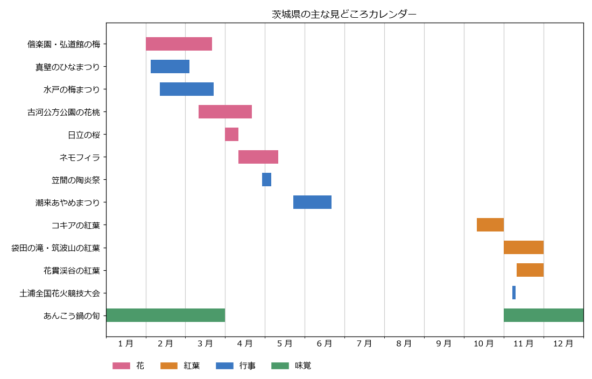

季節の見どころと祭り
====================

茨城県では、早春の梅から始まり、春のネモフィラ、初夏のあやめ、秋のコキアと紅葉まで、季節ごとに見どころが移り変わる。この章では、季節ごとの見どころと主な祭り・行事をまとめる。

花や紅葉の見頃はその年の気候によって前後し、祭りの日程も年ごとに変わる。出かける前に、必ず各公式サイトで最新の情報を確認すること。

見どころカレンダー
------------------

主な花・紅葉の見頃と行事の時期を次の図に示す。時期は各公式サイトに記載された例年の目安と、2026 年の開催実績をもとにしている。

   茨城県の主な見どころカレンダー

春（3 月から 5 月）
-------------------

.. list-table::
   :header-rows: 1
   :widths: 25 20 55

   * - 見どころ
     - 時期の目安
     - 内容
   * - 偕楽園・弘道館の梅
     - 2 月から 3 月
     - 偕楽園には約 100 品種 3,000 本、弘道館には約 60 品種 800 本の梅がある。早咲きから遅咲きまで品種が多いため、長い期間楽しめる（:doc:`kenou`\ を参照）。
   * - 古河公方公園の花桃
     - 3 月中旬から 4 月中旬
     - 約 1,800 本、6 品種の花桃が品種ごとに順に咲く（:doc:`kensei`\ を参照）。
   * - 桜
     - 4 月上旬から下旬
     - 日立市のかみね公園（約 1,000 本）と平和通り（約 120 本）のソメイヨシノは 4 月上旬が見頃である。那珂市の静峰ふるさと公園には八重桜が約 2,000 本あり、ソメイヨシノより遅れて咲く。
   * - 国営ひたち海浜公園のネモフィラ
     - 4 月中旬から 5 月上旬
     - 「みはらしの丘」一面が青く染まる（:doc:`kenou`\ を参照）。
   * - 笠間稲荷神社の藤
     - 5 月上旬
     - 県の天然記念物に指定された藤が咲く。

夏（6 月から 8 月）
-------------------

.. list-table::
   :header-rows: 1
   :widths: 25 20 55

   * - 見どころ
     - 時期の目安
     - 内容
   * - 水郷潮来あやめ園のあやめ
     - 5 月下旬から 6 月下旬
     - 約 500 種 100 万株のあやめが咲く。例年は 6 月 10 日ごろが最も見頃である（:doc:`rokko`\ を参照）。
   * - 海水浴
     - 7 月から 8 月
     - 大洗、鹿行地域の鹿島灘沿岸などに海水浴場がある。開設期間は海水浴場ごとに異なる。

秋（9 月から 11 月）
--------------------

.. list-table::
   :header-rows: 1
   :widths: 25 20 55

   * - 見どころ
     - 時期の目安
     - 内容
   * - 国営ひたち海浜公園のコキア
     - 10 月中旬から下旬
     - 夏の間は緑色のコキアが、10 月中旬に赤く色づく。10 月下旬には赤と茶色が混ざった色合いになる。
   * - 袋田の滝・筑波山の紅葉
     - 11 月上旬から下旬
     - 袋田の滝は 11 月上旬から中旬、筑波山は 11 月上旬から下旬が見頃である（:doc:`kenpoku`、:doc:`kennan`\ を参照）。
   * - 花貫渓谷の紅葉
     - 11 月中旬から下旬
     - 汐見滝吊り橋の周辺が色づき、吊り橋のライトアップも行われる。

冬（12 月から 2 月）
--------------------

.. list-table::
   :header-rows: 1
   :widths: 25 20 55

   * - 見どころ
     - 時期の目安
     - 内容
   * - あんこう鍋
     - 11 月から 3 月
     - 冬の茨城を代表する味覚で、県北の沿岸部や大洗などで味わえる（:doc:`food`\ を参照）。
   * - 袋田の滝の氷瀑
     - 厳冬期
     - 寒さが厳しいと滝が凍りつく。気温によっては凍らない年もある。
   * - 初日の出
     - 1 月 1 日
     - 太平洋に面しているため、大洗磯前神社の神磯の鳥居などで海から昇る初日の出を拝める。

主な祭り・行事
--------------

日程は 2026 年の開催実績である。翌年以降の日程は各公式サイトで確認すること。

.. list-table::
   :header-rows: 1
   :widths: 25 25 50

   * - 名称
     - 2026 年の日程
     - 内容
   * - 真壁のひなまつり（桜川市）
     - 2 月 4 日から 3 月 3 日
     - 真壁の町の商家や民家に、それぞれの家のひな人形が飾られる。2003 年に始まった（:doc:`kensei`\ を参照）。
   * - 水戸の梅まつり（水戸市）
     - 2 月 11 日から 3 月 22 日
     - 偕楽園と弘道館を会場とする梅の祭りで、2026 年で第 130 回を数える。
   * - 鹿島神宮の祭頭祭（鹿嶋市）
     - 3 月 9 日（神事）、3 月 14 日（祭頭囃）
     - 五穀豊穣を祈る春の祭りで、色とりどりの衣装を着た人々が囃しながら練り歩く。国の選択無形民俗文化財である。神事は毎年 3 月 9 日に行われ、祭頭囃は 3 月 9 日以降の直近の土曜日に行われる。
   * - 日立さくらまつり（日立市）
     - 4 月 1 日から 12 日
     - 桜の時期に開かれる祭りで、期間中にユネスコ無形文化遺産「日立風流物」の山車 1 台が公開される。
   * - 笠間の陶炎祭（笠間市）
     - 4 月 29 日から 5 月 5 日
     - 「陶炎祭」は「ひまつり」と読む。笠間芸術の森公園で開かれる陶器市で、200 以上の窯元や作家などが出店する。2026 年で第 45 回を数える。
   * - 潮来あやめまつり（潮来市）
     - 5 月 22 日から 6 月 21 日
     - 水郷潮来あやめ園で開かれる祭りで、2026 年で第 75 回を数える。嫁入り舟などの催しがある（:doc:`rokko`\ を参照）。
   * - 土浦全国花火競技大会（土浦市）
     - 11 月 7 日
     - 全国の花火師が技を競う大会で、約 2 万発の花火が打ち上げられる。2026 年で第 95 回を数える。

日立風流物
~~~~~~~~~~

日立風流物は、日立市の神峰神社の祭礼で披露される、高さ約 15 m、5 層の巨大な山車とからくり人形の芝居である。1977 年に国の重要無形民俗文化財に指定され、2016 年には全国の祭りとともにユネスコ無形文化遺産「山・鉾・屋台行事」に登録された。毎年 4 月の日立さくらまつりで 1 台が公開されるほか、7 年に 1 度の神峰神社大祭礼では 4 台すべてが公開される。直近の大祭礼は 2026 年 5 月に行われた。
