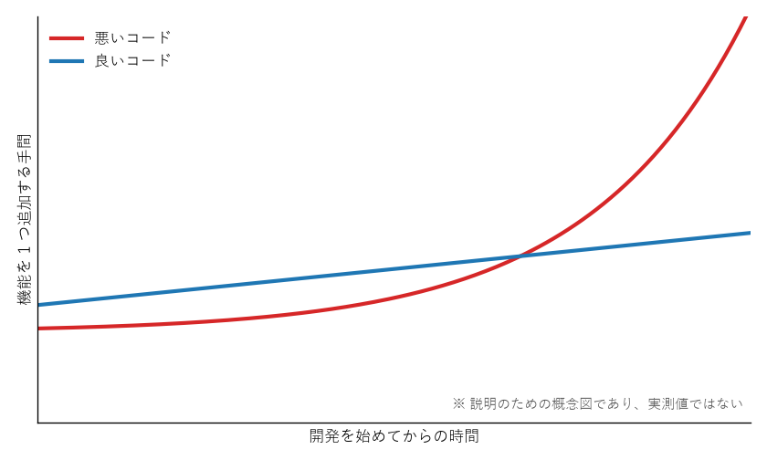

==========================================
良いコードとは何か
==========================================

動くことと良いことは違う
==========================================

次の 2 つの関数は、どちらも同じ結果を返す。

.. code-block:: python
   :linenos:
   :caption: 悪い例

   def f(a):
       r = 0
       for x in a:
           if x % 2 == 0:
               r += x
       return r

.. code-block:: python
   :linenos:
   :caption: 良い例

   def sum_of_even_numbers(numbers: list[int]) -> int:
       total = 0
       for number in numbers:
           if number % 2 == 0:
               total += number
       return total

悪い例は、中身を 1 行ずつ追わなければ何をする関数なのか分からない。良い例は、関数の名前を読むだけで「偶数の合計を求める関数」だと分かる。コンピューターにとってはどちらも同じプログラムだが、人間にとっての分かりやすさは大きく違う。

本書でいう「良いコード」とは、正しく動くことに加えて、人間にとって分かりやすく、直しやすいコードのことである。

コードは書くよりも読まれる
==========================================

プログラムを書いている時間よりも、プログラムを読んでいる時間の方がずっと長い。新しい機能を追加するときも、バグを直すときも、まず既存のコードを読んで理解する必要がある。チームで開発していれば、自分のコードは他の人にも読まれる。

一人で開発している場合も同じである。数か月前に自分が書いたコードは、他人が書いたコードと同じくらい読みにくく感じる。そのため「後で読む自分」も読者の一人だと考えるとよい。

Python の設計思想をまとめた :pep:`20`\ （The Zen of Python）にも「Readability counts.（読みやすさは重要である）」という一文がある。

読みやすさと保守しやすさ
==========================================

本書では、良いコードの性質として次の 2 つを特に重視する。

.. list-table:: 良いコードの 2 つの性質
   :header-rows: 1
   :widths: 20 80

   * - 性質
     - 説明
   * - :term:`可読性`
     - 読みやすさのこと。コードを読んだ人が、何をしているのか、なぜそうしているのかを短い時間で正しく理解できる性質である。
   * - :term:`保守性`
     - 保守しやすさのこと。機能の追加やバグの修正を、少ない手間で、新たなバグを生まずに行える性質である。

この 2 つは密接に関係している。読みにくいコードは、どこを直せばよいのかが分からず、直した結果どこに影響が出るのかも分からない。つまり、読みにくいコードは保守もしにくい。

悪いコードが生む問題
==========================================

悪いコードは、書いた直後には問題にならないことが多い。問題が表面化するのは、後からコードを変更しようとしたときである。

* 何をしているのか理解するのに時間がかかる。
* 1 か所を直すと、思わぬ別の場所が壊れる。
* 同じ修正を何か所にも行う必要があり、直し忘れが起きる。
* バグが見つかっても、原因の場所を特定しにくい。

:numref:`fig-cost-of-change` は、開発が進むにつれて、機能を 1 つ追加する手間がどう変わるかを表した概念図である。

.. _fig-cost-of-change:

   変更にかかる手間の推移（概念図）

開発の初期は、読みやすさを気にせず書いた方が速く進むように感じることがある。しかし、悪いコードは積み重なるほど理解と変更に時間がかかるようになり、やがて少しの変更にも大きな手間がかかるようになる。良いコードを書くことは、将来の自分や仲間の時間を節約することである。

本書で扱う観点
==========================================

次の章からは、良いコードを書くための方法を観点ごとに説明する。

.. list-table:: 各章で扱う観点
   :header-rows: 1
   :widths: 10 30 60

   * - 章
     - 観点
     - 主な内容
   * - 第 3 章
     - 名前の付け方
     - 変数や関数に、意味の分かる名前を付ける。
   * - 第 4 章
     - 見た目を整える
     - インデントや空白などの書き方をそろえる。
   * - 第 5 章
     - コメントと docstring
     - コードだけでは伝わらない情報を書き残す。
   * - 第 6 章
     - 関数を小さく分ける
     - 1 つの関数に 1 つの役割を持たせる。
   * - 第 7 章
     - 処理の流れを分かりやすくする
     - 深い入れ子や複雑な条件式を避ける。
   * - 第 8 章
     - 重複をなくす
     - 同じ処理を何度も書かない。
   * - 第 9 章
     - データの扱い方
     - データをまとめ、意味の分かる形で扱う。
   * - 第 10 章
     - エラーの扱い方
     - エラーを隠さず、分かりやすく伝える。
   * - 第 11 章
     - 道具に頼る
     - テストや検査ツールで品質を保つ。

まとめ
==========================================

* 良いコードとは、正しく動くことに加えて、人間にとって読みやすく、直しやすいコードである。
* コードは書く時間よりも読まれる時間の方が長い。後で読む自分も読者の一人である。
* 悪いコードは、後から変更するときに大きな手間とバグを生む。
