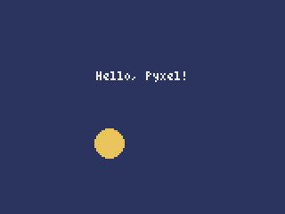

Pyxel の概要と環境構築
======================

この章では、Pyxel がどのようなゲームエンジンなのかを説明し、開発環境を整えて最初のプログラムを動かす。

Pyxel とは
----------

Pyxel は、Python でレトロゲームを作るためのゲームエンジンである。Takashi Kitao 氏が開発し、MIT ライセンスで公開している。中核部分は Rust で書かれており、Python からはモジュール ``pyxel`` として使う。Windows、macOS、Linux で動き、Web ブラウザでも動かせる。

Pyxel の最大の特徴は、1980 年代の家庭用ゲーム機を思わせる意図的な制約である。:numref:`table-pyxel-spec` に主な仕様を示す。

.. _table-pyxel-spec:

.. list-table:: Pyxel 2.9.9 の主な仕様
   :header-rows: 1
   :widths: 30 70

   * - 項目
     - 仕様
   * - 画面
     - 大きさは ``pyxel.init()`` で自由に決められる。1 ピクセルを大きく拡大して表示する。
   * - 色
     - 既定で 16 色のパレットを使う。描画するときは色を 0 ～ 15 の番号で指定する。
   * - イメージバンク
     - 256 × 256 ピクセルの画像を 3 枚（0 ～ 2）持てる。キャラクターなどの絵を置く。
   * - タイルマップ
     - 256 × 256 タイルの地図を 8 枚（0 ～ 7）持てる。1 タイルは 8 × 8 ピクセルである。
   * - サウンド
     - 効果音やメロディを 64 個（0 ～ 63）持てる。
   * - ミュージック
     - サウンドを組み合わせた曲を 8 個（0 ～ 7）持てる。
   * - 音のチャンネル
     - 同時に 4 つの音（チャンネル 0 ～ 3）を鳴らせる。
   * - 入力
     - キーボード、マウス、ゲームパッド（最大 4 台）を扱える。

画像、タイルマップ、サウンド、ミュージックをまとめて\ **リソース**\ と呼ぶ。リソースは付属の **Pyxel Editor** で作成し、リソースファイル（拡張子 ``.pyxres``）として保存する。ゲームのプログラムは、このリソースファイルを読み込んで使う。各要素の関係を\ :numref:`fig-pyxel-structure` に示す。

.. _fig-pyxel-structure:

.. graphviz::
   :caption: Pyxel を構成する要素
   :align: center

   digraph structure {
     rankdir=LR;
     node [shape=box, style="rounded,filled", fillcolor="#eef3ff", fontsize=11];
     edge [fontsize=10];
     editor [label="Pyxel Editor", fillcolor="#fff4d6"];
     res [label="リソースファイル\n(.pyxres)", shape=note, fillcolor="#ffffff"];
     subgraph cluster_res {
       label="リソース"; fontsize=11; style="rounded"; color="#888888";
       img [label="イメージバンク\n(3 枚)"];
       tm [label="タイルマップ\n(8 枚)"];
       snd [label="サウンド\n(64 個)"];
       msc [label="ミュージック\n(8 個)"];
     }
     prog [label="ゲームのプログラム\n(Python)", fillcolor="#fff4d6"];
     screen [label="画面", shape=box3d, fillcolor="#ffffff"];
     ch [label="音のチャンネル\n(4 つ)", shape=box3d, fillcolor="#ffffff"];
     editor -> res [label="保存"];
     res -> img; res -> tm; res -> snd; res -> msc;
     tm -> img [label="タイルの絵", style=dashed];
     msc -> snd [label="並べて使う", style=dashed];
     prog -> res [label="pyxel.load()", dir=back, style=dotted];
     img -> screen [label="pyxel.blt()"];
     tm -> screen [label="pyxel.bltm()"];
     snd -> ch [label="pyxel.play()"];
     msc -> ch [label="pyxel.playm()"];
   }

制約がもたらす利点
------------------

使える色が 16 色しかない、画像を置く場所が 3 枚しかない、といった制約は不便に感じるかもしれない。しかし、初めてゲームを作る人にとって、この制約は大きな利点になる。

* **決めることが減る。**\ 色を 16 色から選ぶだけなので、配色に迷う時間が短くなる。
* **素材を作る手間が小さい。** 8 × 8 や 16 × 16 ピクセルの絵なら、絵を描いた経験がなくても数分で描ける。
* **作品の規模が自然に小さくなる。**\ 置ける素材の量に上限があるので、作りたいものが膨らみすぎない。
* **見た目に統一感が出る。**\ すべての素材が同じパレットと同じ解像度で作られるので、寄せ集めの印象になりにくい。

ゲーム制作で最も難しいのは、最後まで作り切ることである。Pyxel の制約は、完成までの道のりを短くしてくれる。

.. _ch01-install:

開発環境を整える
----------------

Python の準備
^^^^^^^^^^^^^

Pyxel 2.9.9 は Python 3.11 以上を必要とする。Python がインストールされていない場合は、`Python の公式サイト <https://www.python.org/downloads/>`__ からインストールする。Windows で公式のインストーラーを使う場合は、``Add python.exe to PATH`` にチェックを入れる。チェックを入れないと、後で ``pyxel`` コマンドが見つからなくなる。

仮想環境の作成と Pyxel のインストール
^^^^^^^^^^^^^^^^^^^^^^^^^^^^^^^^^^^^^

ゲームごとに仮想環境を作っておくと、ほかのプロジェクトとライブラリのバージョンがぶつからない。作業用のディレクトリを作り、仮想環境を作って有効にしてから Pyxel をインストールする。Windows のコマンドプロンプトでは次のように操作する。

.. code-block:: console
   :linenos:

   > mkdir my_game
   > cd my_game
   > python -m venv .venv
   > .venv\Scripts\activate
   > pip install pyxel==2.9.9

macOS と Linux では、4 行目を ``source .venv/bin/activate`` に読み替える。本書と同じバージョンを使うため、5 行目ではバージョンを指定している。最新版を使う場合は ``pip install -U pyxel`` とする。

インストールできたら、引数を付けずに ``pyxel`` コマンドを実行する。使えるサブコマンドの一覧が表示されれば成功である。

.. code-block:: console
   :linenos:

   > pyxel
   Pyxel 2.9.9, a retro game engine for Python
   usage:
       pyxel run PYTHON_SCRIPT_FILE(.py)
       pyxel watch WATCH_DIR PYTHON_SCRIPT_FILE(.py)
       pyxel play PYXEL_APP_FILE(.pyxapp)
       pyxel edit [PYXEL_RESOURCE_FILE(.pyxres)]
       pyxel package APP_DIR STARTUP_SCRIPT_FILE(.py)
       pyxel app2exe PYXEL_APP_FILE(.pyxapp)
       pyxel app2html PYXEL_APP_FILE(.pyxapp)
       pyxel copy_examples

``pyxel`` コマンドが見つからないというエラーが出る場合は、``python -m pyxel`` と入力すれば同じことができる。

各サブコマンドの役割を\ :numref:`table-pyxel-commands` にまとめる。本書では、これらを章ごとに順に使っていく。

.. _table-pyxel-commands:

.. list-table:: pyxel コマンドのサブコマンド
   :header-rows: 1
   :widths: 25 50 25

   * - サブコマンド
     - 役割
     - 本書で扱う章
   * - ``run``
     - Python スクリプトを実行する。
     - 第 1 章
   * - ``watch``
     - ディレクトリを監視し、ファイルが変わるたびにスクリプトを実行し直す。
     - 第 1 章
   * - ``edit``
     - Pyxel Editor を起動する。
     - 第 4 章、第 5 章
   * - ``package``
     - ゲームを 1 つのファイル（``.pyxapp``）にまとめる。
     - 第 9 章
   * - ``play``
     - ``.pyxapp`` ファイルを実行する。
     - 第 9 章
   * - ``app2html``
     - ``.pyxapp`` ファイルを、ブラウザで動く HTML ファイルに変換する。
     - 第 9 章
   * - ``app2exe``
     - ``.pyxapp`` ファイルを実行ファイルに変換する。
     - 第 9 章
   * - ``copy_examples``
     - Pyxel に付属するサンプルをカレントディレクトリにコピーする。
     - 第 1 章

付属のサンプルを動かす
^^^^^^^^^^^^^^^^^^^^^^

Pyxel には多数のサンプルが付属している。``pyxel copy_examples`` を実行すると ``pyxel_examples`` ディレクトリにコピーされる。

.. code-block:: console
   :linenos:

   > pyxel copy_examples
   > cd pyxel_examples
   > pyxel run 01_hello_pyxel.py

ウィンドウが開いて文字が表示されれば、Pyxel は正しく動いている。ウィンドウを閉じるには Esc キーを押す。``09_shooter.py``\ （シューティング）や ``10_platformer.py``\ （横スクロールアクション）も、本書で作るゲームの参考になる。

最初のプログラム
----------------

Pyxel のプログラムの基本形を見てみよう。:numref:`list-ch01-hello` は、画面に文字を表示し、円を左から右へ動かすプログラムである。

.. _list-ch01-hello:

.. literalinclude:: ../examples/ch01_hello/main.py
   :language: python
   :linenos:
   :caption: ch01_hello/main.py

:download:`ch01_hello/main.py をダウンロード <../examples/ch01_hello/main.py>`

``examples`` ディレクトリで次のように実行すると、:numref:`fig-ch01-hello` の画面が表示される。

.. code-block:: console
   :linenos:

   > pyxel run ch01_hello/main.py

.. _fig-ch01-hello:

   最初のプログラムの実行結果

このプログラムは、Pyxel のプログラムに共通する次の流れでできている。

#. ``pyxel.init()`` で画面の大きさ（ここでは幅 160、高さ 120 ピクセル）とウィンドウのタイトルを決める（28 行目）。
#. ゲームの状態を持つオブジェクト（ここでは ``App``）を作る（29 行目）。
#. ``pyxel.run()`` に、毎フレーム呼び出す 2 つの関数 ``update`` と ``draw`` を渡す（30 行目）。``pyxel.run()`` はゲームが終わるまで戻ってこない。

``update()`` はゲームの状態を 1 フレーム分進める関数で、ここでは円の x 座標を 1 増やし、画面の右端を越えたら 0 に戻している（18 行目）。``draw()`` は現在の状態を画面に描く関数で、画面を色 1（紺色）で塗りつぶしてから（22 行目）、文字（23 行目）と円（24 行目）を描いている。Pyxel は既定で 1 秒間に 30 回、``update()`` と ``draw()`` をこの順に呼び出す。この仕組みは第 3 章で詳しく説明する。

.. note::

   Pyxel 公式のサンプルには、``App`` クラスの ``__init__()`` の中で ``pyxel.init()`` と ``pyxel.run()`` を呼ぶ書き方も多い。本書では、初期化と実行を ``main()`` 関数にまとめ、``App`` は状態と処理だけを持つ書き方に統一する。こうしておくと、第 8 章で ``App`` 以外のクラスをテストから使いやすい。

開発を効率よく進める機能
------------------------

ファイルの変更を監視して自動で再実行する
^^^^^^^^^^^^^^^^^^^^^^^^^^^^^^^^^^^^^^^^

``pyxel watch`` を使うと、指定したディレクトリのファイルを保存するたびにプログラムが自動で再実行される。コードを書き換えて結果を確かめる作業を何度も繰り返すので、ぜひ使ってほしい。監視をやめるには、コマンドを実行した端末で Ctrl + C を押す。

.. code-block:: console
   :linenos:

   > pyxel watch ch01_hello ch01_hello/main.py

実行中に使える特殊キー
^^^^^^^^^^^^^^^^^^^^^^

Pyxel のプログラムの実行中は、:numref:`table-special-keys` の特殊キーが使える。macOS では Alt キーの代わりに Option キーを使う。

.. _table-special-keys:

.. list-table:: 実行中に使える主な特殊キー
   :header-rows: 1
   :widths: 35 65

   * - キー
     - 動作
   * - Esc
     - プログラムを終了する。
   * - Alt + R
     - プログラムを最初からやり直す。
   * - Alt + 1
     - 画面のスクリーンショットをデスクトップに保存する。
   * - Alt + 2
     - 画面録画の開始時点を現在に戻す。
   * - Alt + 3
     - 直近の画面（最大 10 秒）を GIF アニメーションとしてデスクトップに保存する。
   * - Alt + 0
     - パフォーマンスモニター（fps と処理時間）の表示を切り替える。
   * - Alt + Enter
     - フルスクリーン表示を切り替える。

コードの品質を保つ道具
^^^^^^^^^^^^^^^^^^^^^^

ゲームのコードは、作り込むにつれて長くなる。本書のサンプルコードは、次の 2 つの道具で検査している。

* **flake8**：PEP 8（Python の標準的なコーディング規約）への違反を見つける。
* **mypy**：型ヒントをもとに、型の誤りを実行前に見つける。

Pyxel 2.9.9 のパッケージには型情報が含まれているので、mypy は ``pyxel.blt()`` の引数の型の誤りなども検出できる。2 つの道具はどちらも ``pip`` でインストールする。

.. code-block:: console
   :linenos:

   > pip install flake8 mypy

設定は ``examples/setup.cfg`` にまとめてある。本書では、1 行の長さを 120 文字まで許し、mypy は最も厳しい ``strict`` モードで使う。最後の ``[tool:pytest]`` の節は第 8 章で使う。

.. literalinclude:: ../examples/setup.cfg
   :language: ini
   :linenos:
   :caption: examples/setup.cfg

``examples`` ディレクトリで次のように実行し、何も表示されなければ（mypy は ``Success`` と表示されれば）問題はない。setup.cfg はカレントディレクトリから読み込まれるので、必ず ``examples`` ディレクトリで実行する。

.. code-block:: console
   :linenos:

   > flake8 .
   > mypy ch01_hello/main.py
   Success: no issues found in 1 source file

mypy にディレクトリやファイルを複数まとめて渡すと、どれも ``main.py`` という同じ名前なので「モジュール名が重複している」という旨のエラーになる。mypy にはファイルを 1 つずつ渡す。

まとめ
------

* Pyxel は、16 色や 256 × 256 ピクセルのイメージバンクといった制約を持つ、Python 向けのレトロゲームエンジンである。
* ``pip install pyxel`` でインストールし、``pyxel`` コマンドでプログラムの実行や Pyxel Editor の起動を行う。
* Pyxel のプログラムは、``pyxel.init()`` で初期化し、``pyxel.run()`` に ``update`` と ``draw`` を渡して動かす。
