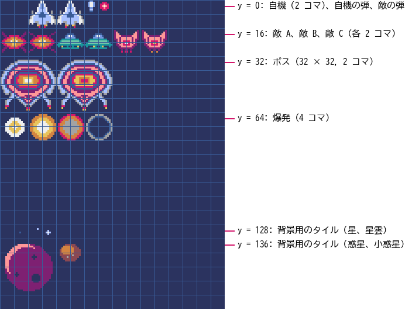

ゲームの企画
============

いきなりコードを書き始めると、作りたいものが途中でぼやけたり、規模が膨らんで完成しなかったりする。この章では、作るゲームの内容を先に決め、必要な素材と作業の順番を洗い出す。

企画で決めること
----------------

企画とは、「どんなゲームを、どこまで作るか」を決める作業である。小さなゲームなら、次の 5 つを決めれば十分である。

.. list-table:: 企画で決める項目
   :header-rows: 1
   :widths: 25 75

   * - 項目
     - 内容
   * - コンセプト
     - ゲームの面白さを一言で表したもの。迷ったときの判断基準になる。
   * - 遊びの核
     - プレイヤーが何度も繰り返す行動の流れ。コアループとも呼ぶ。
   * - 勝ち負けの条件
     - 何をしたら成功で、何をしたら失敗か。
   * - 操作
     - どのキーやボタンで何をするか。
   * - 画面
     - 画面の大きさと、どのような画面（シーン）があるか。

この中で最も大切なのは遊びの核である。遊びの核が面白くなければ、絵や音をどれだけ作り込んでも面白いゲームにはならない。逆に、遊びの核が面白ければ、四角形と円だけでも遊べる。第 6 章で図形だけのプロトタイプを作るのは、遊びの核を早い段階で確かめるためである。

小さく作る
----------

初めてのゲームでは、作るものを思い切って絞る。「作らないもの」を先に決めておくと、作業の途中で機能を足したくなったときに踏みとどまれる。本書の題材ゲームでは、:numref:`table-scope` のように範囲を決めた。

.. _table-scope:

.. list-table:: 作るものと作らないもの
   :header-rows: 1
   :widths: 50 50

   * - 作るもの
     - 作らないもの
   * - 1 種類の自機と 1 種類のショット
     - パワーアップ、ボム、複数の自機
   * - 3 種類の敵と 1 体のボス
     - ステージごとに異なる敵や地形
   * - 時間で進むステージ（ボスを倒すと難易度が上がって繰り返す）
     - 複数のステージとエンディング
   * - スコアとハイスコアの保存
     - オンラインランキング
   * - キーボードとゲームパッドでの操作
     - キー設定の変更画面

「作らないもの」のいくつかは、第 10 章で拡張のアイデアとして取り上げる。完成させてから足せばよい。

題材ゲームの企画書
------------------

企画の内容を 1 枚にまとめたものを企画書と呼ぶ。企画書は人に見せるためだけでなく、自分が迷わないために書く。:numref:`table-proposal` が本書の題材ゲームの企画書である。

.. _table-proposal:

.. list-table:: COSMO RUSH の企画書
   :header-rows: 0
   :widths: 25 75

   * - タイトル
     - COSMO RUSH
   * - ジャンル
     - 縦スクロールシューティング
   * - コンセプト
     - 数分で遊べる、撃って避ける爽快感
   * - 遊びの核
     - 現れる敵を撃って倒し、敵の体当たりと弾を避ける。倒した敵の数と種類に応じてスコアが増える。
   * - 勝ち負けの条件
     - 残機は 3 機。敵や敵の弾に当たると 1 機減り、0 になるとゲームオーバー。各ステージの開始から 45 秒後にボスが現れ、倒すとステージクリアとなって、敵が増えた次のステージが始まる。ハイスコアを目指して遊ぶ。
   * - 操作
     - 矢印キー（または WASD キー、ゲームパッドの方向パッド）で移動する。Z キー（またはスペースキー、ゲームパッドの A ボタン）を押している間、弾を連射する。
   * - 画面
     - 幅 128、高さ 160 ピクセルの縦長の画面。30 fps。タイトル画面、プレイ画面、ゲームオーバー画面の 3 つ。
   * - 登場するもの
     - 自機、自機の弾、敵 3 種類（まっすぐ進む敵 A、揺れながら進む敵 B、止まって狙い撃ちする敵 C）、敵の弾、ボス、爆発、スクロールする宇宙の背景

遊びの核を図にすると\ :numref:`fig-core-loop` のようになる。プレイヤーはこの輪を何度も回りながら、少しずつ上達していく。

.. _fig-core-loop:

.. graphviz::
   :caption: 題材ゲームの遊びの核（コアループ）
   :align: center

   digraph loop {
     node [shape=box, style="rounded,filled", fillcolor="#eef3ff", fontsize=11];
     edge [fontsize=10];
     appear [label="敵が現れる"];
     move [label="位置を取る\n(弾と敵を避ける)"];
     shoot [label="撃つ"];
     defeat [label="倒す"];
     score [label="スコアが増える", fillcolor="#fff4d6"];
     appear -> move -> shoot -> defeat -> score;
     score -> appear [label="もっと稼ぎたい"];
   }

画面遷移を設計する
------------------

ゲームはいくつかの画面（シーン）からできている。それぞれのシーンと、シーンが切り替わるきっかけを図にしたものを画面遷移図と呼ぶ。題材ゲームの画面遷移図を\ :numref:`fig-scene-transition` に示す。

.. _fig-scene-transition:

.. graphviz::
   :caption: 題材ゲームの画面遷移図
   :align: center

   digraph scenes {
     rankdir=LR;
     node [shape=box, style="rounded,filled", fillcolor="#eef3ff", fontsize=11];
     edge [fontsize=10];
     start [shape=point, width=0.15];
     title [label="タイトル画面"];
     subgraph cluster_play {
       label="プレイ画面"; fontsize=11; style="rounded"; color="#888888";
       normal [label="通常\n(敵が出現する)"];
       warning [label="警告"];
       boss [label="ボス戦"];
       clear [label="ステージクリア"];
     }
     over [label="ゲームオーバー画面"];
     start -> title;
     title -> normal [label="キーを押す"];
     normal -> warning [label="43 秒経過"];
     warning -> boss [label="2 秒後"];
     boss -> clear [label="ボスを倒す"];
     clear -> normal [label="4 秒後\n(難易度が上がる)"];
     normal -> over [label="残機が 0", style=dashed];
     boss -> over [label="残機が 0", style=dashed];
     over -> title [label="キーを押す"];
   }

画面遷移図を描いておくと、「ゲームオーバー画面からはどこへ戻るのか」「ボス戦の途中でやられたらどうなるのか」といった抜けに早く気付ける。この図は第 7 章でシーンを実装するときにそのまま使う。

必要な素材を洗い出す
--------------------

企画書から、必要な素材（グラフィックスとサウンド）を洗い出す。Pyxel ではイメージバンクの大きさが限られるので、どの絵をどこに置くかも先に決めておく。

グラフィックス
^^^^^^^^^^^^^^

題材ゲームで使う絵を\ :numref:`table-sprites` にまとめる。「位置」はイメージバンク 0 での左上の座標である。

.. _table-sprites:

.. list-table:: 題材ゲームで使う絵
   :header-rows: 1
   :widths: 25 20 15 40

   * - 名前
     - 大きさ
     - コマ数
     - 位置（イメージバンク 0）
   * - 自機
     - 16 × 16
     - 2
     - (16, 0), (32, 0)
   * - 自機の弾
     - 8 × 8
     - 1
     - (48, 0)
   * - 敵の弾
     - 8 × 8
     - 1
     - (56, 0)
   * - 敵 A
     - 16 × 16
     - 2
     - (0, 16), (16, 16)
   * - 敵 B
     - 16 × 16
     - 2
     - (32, 16), (48, 16)
   * - 敵 C
     - 16 × 16
     - 2
     - (64, 16), (80, 16)
   * - ボス
     - 32 × 32
     - 2
     - (0, 32), (32, 32)
   * - 爆発
     - 16 × 16
     - 4
     - (0, 64), (16, 64), (32, 64), (48, 64)
   * - 背景のタイル
     - 8 × 8
     - －
     - (0, 0), (8, 128) ～ (40, 128) など
   * - タイトルロゴ
     - 121 × 19
     - 1
     - イメージバンク 1 の (0, 0)

この配置をイメージバンク上で見ると\ :numref:`fig-bank-layout` のようになる。同じ大きさの絵を同じ行に並べ、アニメーションのコマを横に並べておくと、プログラムからコマを選ぶ計算が簡単になる。

.. _fig-bank-layout:

   イメージバンク 0 の配置（上半分を拡大。格子は 8 ピクセルごと）

左上の (0, 0) から 16 × 16 ピクセルの範囲は、わざと空けてある。タイルマップのすべてのマスは、最初はイメージバンクの (0, 0) にある 8 × 8 ピクセルの絵（タイル (0, 0)）を指している。(0, 0) に絵を置くと、タイルマップを作り始めたときに、その絵がマップ全体に敷き詰められて見えてしまう。Pyxel Editor のマニュアルも、(0, 0) を空けておくことを勧めている。

サウンド
^^^^^^^^

効果音と BGM も同じように洗い出し、サウンドの番号を割り当てる（:numref:`table-sounds`）。Pyxel は同時に 4 つの音しか鳴らせないので、どのチャンネルで鳴らすかも決めておく。本書では、BGM にチャンネル 0 ～ 2 を、効果音にチャンネル 3 を使う。ただし、ゲームオーバーの音は BGM を止めてから鳴らすので、チャンネル 0 を使う。

.. _table-sounds:

.. list-table:: 題材ゲームで使うサウンドとミュージック
   :header-rows: 1
   :widths: 25 45 30

   * - 番号
     - 用途
     - 鳴らすチャンネル
   * - サウンド 0
     - 自機の弾を撃つ音
     - 3
   * - サウンド 1
     - 敵の爆発音
     - 3
   * - サウンド 2
     - 自機がやられた音
     - 3
   * - サウンド 3
     - ゲーム開始の決定音
     - 3
   * - サウンド 4
     - ボス出現の警告音
     - 3
   * - サウンド 5
     - ゲームオーバーの音
     - 0
   * - サウンド 6
     - 弾が敵に当たったが倒せなかったときの音
     - 3
   * - サウンド 10、11
     - タイトル画面の BGM の部品（メロディ、ベース）
     - －
   * - サウンド 20 ～ 24
     - プレイ画面の BGM の部品（メロディ、ベース、ドラム）
     - －
   * - ミュージック 0
     - タイトル画面の BGM
     - 0、1
   * - ミュージック 1
     - プレイ画面の BGM
     - 0 ～ 2

作業の順番を決める
------------------

ゲーム制作の作業は、おおまかに次の順番で進めると手戻りが少ない。

#. **プロトタイプ**：四角形や円などの図形だけで、遊びの核を動かしてみる。
#. **素材の制作**：遊べることを確かめてから、絵と音を作る。
#. **組み込み**：プロトタイプの図形を素材に置き換え、シーンや演出を加える。
#. **調整**：何度も遊び、敵の数や速さなどの数値を直す。
#. **公開**：ほかの人が遊べる形にまとめて公開する。

素材を先に作り込むと、遊んでみてから仕様を変えたときに、その素材が無駄になる。本書では、Pyxel Editor の使い方を先にまとめて説明するために、素材を作る章（第 4 章、第 5 章）をプロトタイプの章（第 6 章）より前に置いた。自分でゲームを作るときは、第 6 章の進め方を先に行うとよい。

まとめ
------

* 企画では、コンセプト、遊びの核、勝ち負けの条件、操作、画面を決める。最も大切なのは遊びの核である。
* 「作らないもの」を先に決め、小さく作って完成させる。
* 画面遷移図と素材の一覧を作り、イメージバンクの配置とサウンドの番号を先に決めておく。
