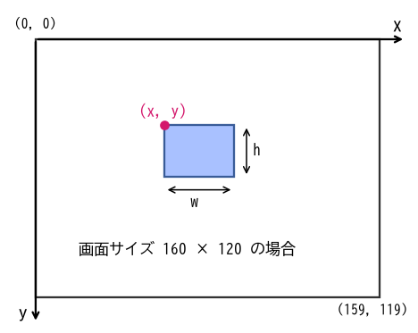
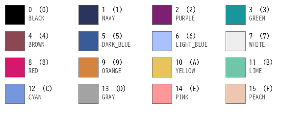
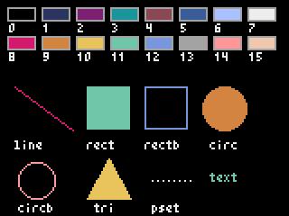
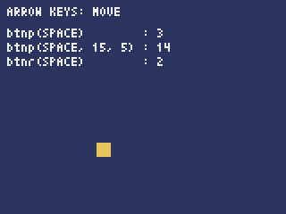
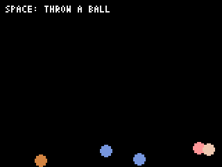
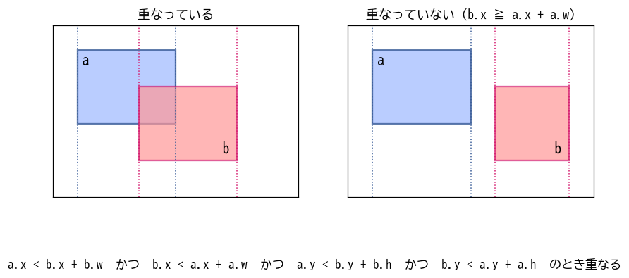
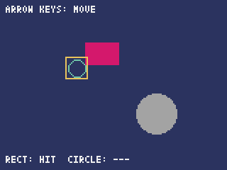
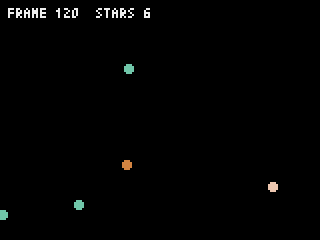

ゲームプログラミングの基礎
==========================

この章では、題材ゲームから少し離れ、どのゲームにも共通する基礎を小さなサンプルコードで学ぶ。ここで学ぶゲームループ、座標と描画、入力、動き、当たり判定、乱数とタイマーは、第 6 章以降でそのまま使う。

この章のサンプルコードは ``examples/ch03_basics`` にある。``examples`` ディレクトリで ``pyxel run ch03_basics/draw_demo.py`` のように実行する。

ゲームループとフレーム
----------------------

一般的なアプリケーションは、ユーザーが操作するまで待ち、操作されたら処理をする。これに対してゲームは、プレイヤーが何もしなくても敵が動き、時間が進む。そのためゲームは、「入力を調べる」「状態を進める」「画面を描く」という処理を、短い間隔で繰り返し続ける。この繰り返しを\ **ゲームループ**\ と呼び、ループ 1 回分を\ **フレーム**\ と呼ぶ（:numref:`fig-game-loop`）。

.. _fig-game-loop:

.. graphviz::
   :caption: Pyxel のゲームループ
   :align: center

   digraph gameloop {
     node [shape=box, style="rounded,filled", fillcolor="#eef3ff", fontsize=11];
     edge [fontsize=10];
     init [label="pyxel.init()\n初期化", fillcolor="#fff4d6"];
     input [label="入力の状態を調べる\n(Pyxel が行う)"];
     update [label="update()\n状態を 1 フレーム分進める"];
     draw [label="draw()\n現在の状態を画面に描く"];
     wait [label="次のフレームまで待つ\n(Pyxel が行う)"];
     init -> input [label="pyxel.run()"];
     input -> update -> draw -> wait;
     wait -> input [label="1/30 秒ごとに繰り返す"];
   }

Pyxel では、ゲームループそのものは ``pyxel.run()`` が受け持つ。プログラマーが書くのは、1 フレーム分の処理である ``update()`` と ``draw()`` だけである。1 秒間のフレーム数を **fps**\ （frames per second）と呼ぶ。Pyxel の既定は 30 fps で、``pyxel.init()`` の引数 ``fps`` で変えられる。30 fps では 1 フレームが約 33 ミリ秒になる。

update と draw を分ける理由
^^^^^^^^^^^^^^^^^^^^^^^^^^^

``update()`` には状態を変える処理だけを書き、``draw()`` には描く処理だけを書く。この分け方には次の利点がある。

* **処理の順番に悩まなくてよい。**\ すべての物体を動かし終えてから描くので、「敵 A は移動後の位置、敵 B は移動前の位置で描かれる」といったずれが起きない。
* **処理が重いときに描画を省ける。** Pyxel は、処理が間に合わないときに ``draw()`` の呼び出しを省いて ``update()`` を優先する。このため、``draw()`` の中で状態を変えると、処理の重さによってゲームの進み方が変わってしまう。
* **テストしやすい。**\ 状態を変える処理が描画から分かれていれば、画面を使わずに確かめられる（第 8 章）。

経過したフレーム数は ``pyxel.frame_count`` で分かる。``pyxel.frame_count`` は ``update()`` が呼ばれるたびに 1 増える。

座標と描画
----------

座標系
^^^^^^

Pyxel の画面の座標系を\ :numref:`fig-coords` に示す。原点 (0, 0) は画面の左上で、x 座標は右へ、y 座標は下へ向かって増える。数学のグラフとは y 軸の向きが逆なので注意する。四角形や画像を描く命令では、左上の座標 (x, y) と、幅 w、高さ h を指定する。

.. _fig-coords:

   Pyxel の座標系

色とパレット
^^^^^^^^^^^^

描画命令では、色を 0 ～ 15 の番号で指定する。番号と色の対応を\ :numref:`fig-palette` に示す。``pyxel.COLOR_RED`` のような定数も用意されているが、本書では番号で書く。Pyxel Editor でも色を番号で扱うからである。

.. _fig-palette:

   Pyxel の 16 色パレット（番号、16 進数での番号、定数名）

主な描画命令
^^^^^^^^^^^^

図形と文字を描く主な命令を\ :numref:`table-draw-api` にまとめる。col は色の番号である。

.. _table-draw-api:

.. list-table:: 主な描画命令
   :header-rows: 1
   :widths: 40 60

   * - 命令
     - 動作
   * - ``pyxel.cls(col)``
     - 画面全体を色 col で塗りつぶす。
   * - ``pyxel.pset(x, y, col)``
     - 点 (x, y) を描く。
   * - ``pyxel.line(x1, y1, x2, y2, col)``
     - (x1, y1) から (x2, y2) まで線を引く。
   * - ``pyxel.rect(x, y, w, h, col)``
     - 左上が (x, y)、幅 w、高さ h の塗りつぶした四角形を描く。
   * - ``pyxel.rectb(x, y, w, h, col)``
     - 同じ大きさの四角形の枠を描く。
   * - ``pyxel.circ(x, y, r, col)``
     - 中心が (x, y)、半径 r の塗りつぶした円を描く。
   * - ``pyxel.circb(x, y, r, col)``
     - 同じ大きさの円の枠を描く。
   * - ``pyxel.tri(x1, y1, x2, y2, x3, y3, col)``
     - 3 つの頂点を持つ塗りつぶした三角形を描く。
   * - ``pyxel.text(x, y, s, col)``
     - 左上が (x, y) の位置に文字列 s を描く。1 文字は幅 4、高さ 6 ピクセルである。

四角形は左上の座標で、円は中心の座標で位置を指定する点に注意する。:numref:`list-draw-demo` は、これらの命令を並べて使う例である。実行結果を\ :numref:`fig-draw-demo` に示す。

.. _list-draw-demo:

.. literalinclude:: ../examples/ch03_basics/draw_demo.py
   :language: python
   :linenos:
   :lineno-match:
   :pyobject: App.draw
   :caption: ch03_basics/draw_demo.py（App.draw）

.. _fig-draw-demo:

   描画命令の例

``draw()`` の最初では、必ず ``pyxel.cls()`` で画面を塗りつぶす（14 行目）。Pyxel の画面は前のフレームの絵を覚えているので、塗りつぶさないと、前のフレームの絵の上に重ねて描くことになる。動く物体を描くと、通った跡が残像のように残ってしまう。

入力
----

キーやボタンの状態は、:numref:`table-input-api` の 3 つの関数で調べる。

.. _table-input-api:

.. list-table:: 入力を調べる関数
   :header-rows: 1
   :widths: 40 60

   * - 関数
     - True を返すとき
   * - ``pyxel.btn(key)``
     - key が押されている間、毎フレーム。
   * - ``pyxel.btnp(key)``
     - key が押された瞬間のフレームだけ。
   * - ``pyxel.btnp(key, hold, repeat)``
     - 押された瞬間に加え、hold フレーム以上押し続けると repeat フレームごと。
   * - ``pyxel.btnr(key)``
     - key が離された瞬間のフレームだけ。

key には、``pyxel.KEY_SPACE`` のようなキーボードのキー、``pyxel.MOUSE_BUTTON_LEFT`` のようなマウスのボタン、``pyxel.GAMEPAD1_BUTTON_A`` のようなゲームパッドのボタンを指定する。自機の移動のように押している間ずっと続く動作には ``btn()`` を、メニューの決定のように 1 回だけ反応してほしい動作には ``btnp()`` を使う。メニューのカーソル移動のように、押し続けたら一定間隔で進んでほしい動作には ``hold`` と ``repeat`` を指定した ``btnp()`` が便利である。

:numref:`list-input-demo` は、3 つの関数の違いを確かめるサンプルコードである。スペースキーを押したり押し続けたりして、カウンターの増え方を比べてみてほしい。

.. _list-input-demo:

.. literalinclude:: ../examples/ch03_basics/input_demo.py
   :language: python
   :linenos:
   :lineno-match:
   :pyobject: App.update
   :caption: ch03_basics/input_demo.py（App.update）

   入力のサンプルコードの実行結果

動き
----

位置、速度、加速度
^^^^^^^^^^^^^^^^^^

物体を動かすには、毎フレーム位置を少しずつ変える。1 フレームあたりの位置の変化量を\ **速度**、1 フレームあたりの速度の変化量を\ **加速度**\ と呼ぶ。物理の授業では秒を単位にするが、ゲームではフレームを単位にすると計算が簡単になる。たとえば、x 方向の速度が 2 の物体は、30 fps なら 1 秒間に 60 ピクセル進む。

:numref:`list-motion-demo` は、ボールに重力をかけて跳ねさせるサンプルコードである。重力は下向きの加速度として表す。

.. _list-motion-demo:

.. literalinclude:: ../examples/ch03_basics/motion_demo.py
   :language: python
   :linenos:
   :lineno-match:
   :pyobject: Ball.update
   :caption: ch03_basics/motion_demo.py（Ball.update）

26 行目で加速度 ``GRAVITY`` を速度 ``vy`` に足し、27 ～ 28 行目で速度を位置に足している。この 2 段階の足し算だけで、ボールは放物線を描いて落ちていく。31 ～ 39 行目は画面の端に当たったときの処理である。位置を画面の内側に戻してから、速度の向きを反転させる。床では速度に ``BOUNCE``\ （0.8）を掛け、跳ねるたびに勢いが弱まるようにしている。

   跳ねるボール（スペースキーでボールが増える）

斜め移動の速さ
^^^^^^^^^^^^^^

キー入力で物体を動かすとき、右キーで x 方向に 1、下キーで y 方向に 1 進めるとする。右と下を同時に押すと、斜めに進む距離は次のようになる。

.. math::

   \sqrt{1^2 + 1^2} = \sqrt{2} \approx 1.41

つまり、斜めに進むときだけ約 1.41 倍速くなってしまう。これを防ぐには、斜めに進むときの速さを :math:`1 / \sqrt{2} \approx 0.7071` 倍にする。題材ゲームの自機でも、この補正を行う（第 6 章）。

当たり判定
----------

弾が敵に当たったか、自機が敵にぶつかったかを調べる処理を\ **当たり判定**\ と呼ぶ。2D のゲームでは、物体を四角形や円とみなして重なりを調べる方法がよく使われる。

四角形どうしの判定（AABB）
^^^^^^^^^^^^^^^^^^^^^^^^^^

辺が x 軸、y 軸と平行な四角形を AABB（Axis-Aligned Bounding Box）と呼ぶ。2 つの AABB a と b が重なっているのは、x 方向と y 方向の両方で区間が重なっているときである（:numref:`fig-aabb`）。

.. _fig-aabb:

   AABB による当たり判定

x 方向について考えると、「b が a の右側に完全に離れている（b.x ≧ a.x + a.w）」でもなく、「b が a の左側に完全に離れている（a.x ≧ b.x + b.w）」でもなければ、x 方向の区間は重なっている。y 方向も同じように考え、4 つの条件をまとめると\ :numref:`list-rects-overlap` の関数になる。

.. _list-rects-overlap:

.. literalinclude:: ../examples/ch03_basics/collision_demo.py
   :language: python
   :linenos:
   :lineno-match:
   :pyobject: rects_overlap
   :caption: ch03_basics/collision_demo.py（rects_overlap）

不等号に ``<`` を使っているので、辺がちょうど接しているだけの場合は重なっていないとみなす。

円どうしの判定
^^^^^^^^^^^^^^

円どうしは、中心の間の距離が半径の和より小さければ重なっている。距離を求めるには平方根が必要だが、両辺を 2 乗して比べれば平方根を計算しなくて済む（:numref:`list-circles-overlap`）。

.. _list-circles-overlap:

.. literalinclude:: ../examples/ch03_basics/collision_demo.py
   :language: python
   :linenos:
   :lineno-match:
   :pyobject: circles_overlap
   :caption: ch03_basics/collision_demo.py（circles_overlap）

``collision_demo.py`` を実行すると、矢印キーで動かす四角形と円が、固定された図形に重なったときに色が変わる（:numref:`fig-collision-demo`）。

.. _fig-collision-demo:

   当たり判定のサンプルコードの実行結果（四角形どうしが重なっている）

題材ゲームでは、計算が簡単な AABB 判定を使う。ただし、絵の大きさそのままの四角形で判定すると、見た目では当たっていないのにやられたように感じることが多い。そこで、判定に使う四角形を絵より小さくする。この工夫は第 6 章で実装する。

乱数とタイマー
--------------

乱数
^^^^

敵の出現位置などを毎回変えると、ゲームに変化が生まれる。Pyxel には乱数を返す関数として ``pyxel.rndi(a, b)``\ （a 以上 b 以下の整数）と ``pyxel.rndf(a, b)``\ （a 以上 b 以下の小数）がある。``pyxel.rseed(seed)`` で乱数の種を決めると、毎回同じ順番で同じ乱数が出る。不具合を再現したいときに使う。

タイマー
^^^^^^^^

「2 秒後に消える」「0.5 秒ごとに敵を出す」といった時間の処理は、フレーム数で数える。30 fps なら 2 秒は 60 フレームである。方法は 2 つある。

* ``pyxel.frame_count`` を一定の数で割った余りを使う。``pyxel.frame_count % 10 == 0`` は 10 フレームに 1 回だけ True になる。
* 物体ごとに残り時間（または経過時間）の変数を持ち、毎フレーム増減させる。

:numref:`list-random-demo` は、10 フレームごとにランダムな位置に星を出し、出現から 60 フレームたった星を消すサンプルコードである。

.. _list-random-demo:

.. literalinclude:: ../examples/ch03_basics/random_demo.py
   :language: python
   :linenos:
   :lineno-match:
   :lines: 13-38
   :caption: ch03_basics/random_demo.py（Star と App）

18 行目で星が生まれたフレームを覚え、21 行目で経過フレーム数を調べている。36 行目は 10 フレームごとに星を出す処理である。38 行目では、寿命が尽きた星を除いた新しいリストを作り直している。リストの要素を for 文でたどりながら ``remove()`` で取り除くと、要素を読み飛ばす不具合が起きる。新しいリストを作り直す方法なら、この問題は起きない。この書き方は題材ゲームでも何度も使う。

   乱数とタイマーのサンプルコードの実行結果

まとめ
------

* ゲームは入力、更新、描画を毎フレーム繰り返す。Pyxel では ``update()`` に状態の更新を、``draw()`` に描画を書く。
* 座標の原点は画面の左上で、y 座標は下へ向かって増える。色は 0 ～ 15 の番号で指定する。
* 押している間の動作には ``btn()`` を、1 回だけの動作には ``btnp()`` を使う。
* 速度と加速度をフレーム単位で考え、毎フレーム足し合わせて動かす。斜め移動の速さは補正する。
* 当たり判定は四角形（AABB）や円の重なりで調べる。
* 時間はフレーム数で数える。
