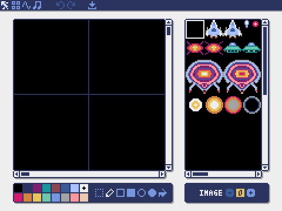
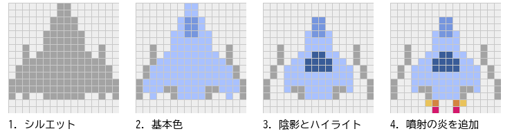
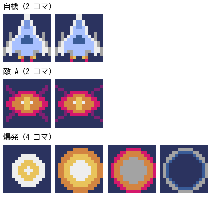
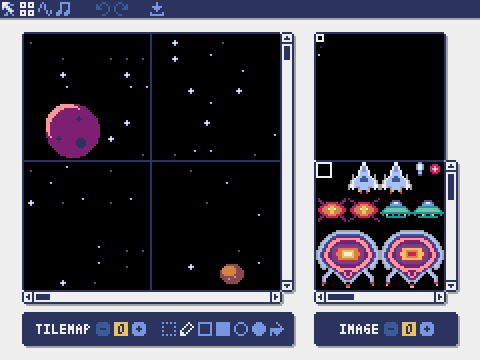

アセット制作（1）グラフィックス
================================

この章では、Pyxel Editor を使ってゲームの絵を作る。Pyxel Editor の操作に加えて、絵を描いた経験がなくても見栄えのするドット絵を描くための基本も説明する。

ゲームで使う絵や音などの素材をまとめて\ **アセット**\ と呼ぶ（本書では素材とも呼ぶ）。Pyxel では、アセットをリソースとしてリソースファイルに保存する。本書の題材ゲームのアセットは ``examples/assets/cosmo_rush.pyxres`` にある。この章を読みながら、このファイルを Pyxel Editor で開いて中身を確かめるとよい。

Pyxel Editor を起動する
-----------------------

Pyxel Editor は ``pyxel edit`` コマンドで起動する。引数にはリソースファイルの名前を指定する。

.. code-block:: console
   :linenos:

   > pyxel edit assets/cosmo_rush.pyxres

指定したファイルがあれば読み込み、なければその名前で新しく作る。ファイル名を省略すると ``my_resource.pyxres`` という名前になる。起動すると\ :numref:`fig-editor-image` の画面が表示される。

.. _fig-editor-image:

   Pyxel Editor のイメージエディタ

Pyxel Editor は、:numref:`table-editors` の 4 つのエディタからできている。画面の左上にある 4 つのボタンで切り替える。Alt キーを押しながら左右の矢印キーを押しても切り替えられる。

.. _table-editors:

.. list-table:: Pyxel Editor を構成するエディタ
   :header-rows: 1
   :widths: 30 70

   * - エディタ
     - 編集するもの
   * - イメージエディタ
     - イメージバンクの絵（スプライトやタイル）
   * - タイルマップエディタ
     - タイルを並べた地図（タイルマップ）
   * - サウンドエディタ
     - 効果音やメロディ（サウンド）。第 5 章で扱う。
   * - ミュージックエディタ
     - サウンドを並べた曲（ミュージック）。第 5 章で扱う。

画面上部には、ほかに元に戻す（Ctrl + Z）、やり直す（Ctrl + Y）、保存（Ctrl + S）のボタンがある。Pyxel Editor は自動では保存しないので、こまめに Ctrl + S で保存する。macOS では Ctrl キーの代わりに Command キーを使う。

ドット絵の基本
--------------

ドット絵は、1 ピクセル（1 ドット）ずつ色を決めて描く絵である。16 × 16 ピクセルの自機なら、決める点は 256 個しかない。少ない点で形を伝えるために、次の手順で描くとよい。

#. **シルエットを決める。**\ まず 1 色だけで形を描く。黒く塗りつぶしても何の絵か分かる形を目指す。小さな絵では、細部よりも輪郭が大切である。
#. **基本の色を塗る。** 1 つの絵に使う色は 3 ～ 4 色に絞る。色を増やすと、小さな絵ではかえって形が分かりにくくなる。
#. **陰影とハイライトを付ける。**\ 光が来る向き（たとえば左上）を決め、光の当たる側に明るい色、反対側に暗い色を置く。立体感が出る。
#. **仕上げる。**\ 噴射の炎のような目立つ色を少しだけ加えると、絵が引き締まる。

:numref:`fig-pixelart-steps` は、この手順で題材ゲームの自機を描いた過程である。

.. _fig-pixelart-steps:

   自機を描く手順

ほかにも、次のような工夫がある。

* **左右対称の絵は半分だけ描く。**\ 左半分を描いたら、選択ツールで左半分を選んで Ctrl + C でコピーする。次に右半分の範囲を選び直して Ctrl + V で貼り付け、そのまま H キーで左右反転する。貼り付けは、そのとき選んでいる範囲の左上を基準に行われる。
* **背景と区別できる色を選ぶ。**\ 題材ゲームの背景は暗い宇宙なので、自機は明るい水色、敵は赤や緑のはっきりした色にしている。自機と敵の弾は、背景からも敵からも区別しやすい色にする。
* **描いたら実際の大きさで見る。**\ 拡大した状態ではよく見えても、等倍だとつぶれて見えることがある。Pyxel Editor の右側にあるイメージバンクのビューで、実際の大きさを確かめる。

透明色
^^^^^^

ゲームの絵は四角形の範囲に描かれるが、絵の周りの部分には背景が見えてほしい。そこで、特定の 1 色を\ **透明色**\ として扱い、描画するときにその色の点を描かないようにする。本書では色 0（黒）を透明色にする。黒を透明色にすると、黒い点は描けなくなる。輪郭や影など暗い色が必要なところには、色 1（紺色）や色 5（暗い青）を使う。

アニメーション
^^^^^^^^^^^^^^

少しずつ違う絵を何枚か用意し、一定の時間ごとに切り替えると絵が動いて見える。この 1 枚 1 枚を\ **コマ**\ と呼ぶ。小さなゲームのキャラクターなら 2 ～ 4 コマで十分である。題材ゲームでは、自機の噴射の炎や敵の脚を 2 コマで動かし、爆発を 4 コマで表現する（:numref:`fig-animation-frames`）。同じ大きさのコマを横に並べて置いておくと、プログラムで「何コマ目を描くか」を計算しやすい。

.. _fig-animation-frames:

   アニメーションのコマ

イメージエディタでスプライトを描く
----------------------------------

ゲームの中で動き回る絵を\ **スプライト**\ と呼ぶ。スプライトはイメージエディタで描く。イメージエディタの画面は、:numref:`table-image-editor` の部分からできている。

.. _table-image-editor:

.. list-table:: イメージエディタの画面
   :header-rows: 1
   :widths: 30 70

   * - 部分
     - 役割
   * - キャンバス（左の大きな領域）
     - 編集している範囲を拡大して表示する。クリックやドラッグで描く。右クリックすると、その点の色を描画色にする。
   * - イメージバンクのビュー（右の領域）
     - イメージバンク全体を等倍で表示する。白い枠が編集している範囲である。クリックするか矢印キーを押すと、編集する範囲が移る。
   * - ツールボタン（左下）
     - 描画に使う道具を選ぶ（:numref:`table-image-tools`）。
   * - パレット（左下）
     - 描画色を選ぶ。1 ～ 8 キーで色 0 ～ 7 を、Shift キーを押しながら 1 ～ 8 キーで色 8 ～ 15 を選べる。
   * - イメージバンクの番号（右下）
     - 編集するイメージバンク（0 ～ 2）を選ぶ。

.. _table-image-tools:

.. list-table:: イメージエディタのツール
   :header-rows: 1
   :widths: 25 20 55

   * - ツール
     - キー
     - 動作
   * - 選択
     - S
     - 四角形の範囲を選ぶ。選んだ範囲は Ctrl + C でコピー、Ctrl + V で貼り付け、H キーで左右反転、V キーで上下反転できる。
   * - ペン
     - P
     - 自由に描く。Shift キーを押しながらドラッグすると直線になる。
   * - 四角形
     - R
     - 四角形の枠を描く。Shift + R で塗りつぶした四角形になる。
   * - 円
     - C
     - 楕円の枠を描く。Shift + C で塗りつぶした楕円になる。
   * - 塗りつぶし
     - B
     - 同じ色でつながった範囲を塗りつぶす。

題材ゲームの自機は、次の手順で描く。

#. イメージバンクの番号が 0 になっていることを確かめる。
#. イメージバンクのビューで (16, 0) の位置をクリックし、白い枠をそこへ移す。キャンバスに表示されるのは 16 × 16 ピクセルの範囲である。
#. 前の節の手順で自機の左半分を描き、選択ツールで反転コピーして右半分を作る。
#. 2 コマ目を描くため、選択ツールで Ctrl + A を押して 1 コマ目全体を選び、Ctrl + C でコピーする。白い枠を (32, 0) へ移し、Ctrl + A で全体を選んでから Ctrl + V で貼り付け、噴射の炎の部分だけを描き換える。
#. Ctrl + S で保存する。

ほかの絵も、:numref:`table-sprites` の位置に同じように描く。

タイルマップエディタで背景を作る
--------------------------------

タイルとタイルマップ
^^^^^^^^^^^^^^^^^^^^

ゲームの背景は画面よりずっと大きいことが多い。大きな背景を 1 枚の絵として描くと、イメージバンクがすぐに足りなくなる。そこで、背景を 8 × 8 ピクセルの小さな絵（**タイル**）の組み合わせで表す。タイルを並べた地図を\ **タイルマップ**\ と呼ぶ。

タイルマップの各マスには、絵そのものではなく「イメージバンクのどの位置のタイルを使うか」という番号の組 (タイルの x, タイルの y) が入っている。この番号は 8 ピクセル単位である。たとえばタイル (3, 16) は、イメージバンクの (24, 128) から始まる 8 × 8 ピクセルの絵を指す。同じタイルを何度使ってもイメージバンクは消費しないので、少ない絵で広い背景を作れる。

題材ゲームの背景
^^^^^^^^^^^^^^^^

題材ゲームの背景は宇宙である。イメージバンク 0 の y = 128 の行に、何もない宇宙、星（3 種類）、星雲（2 種類）のタイルを、その下に惑星（4 × 4 タイル）と小惑星（2 × 2 タイル）を描いた。何もない宇宙のタイルには、空けておいた (0, 0) を使う。これらのタイルをタイルマップ 0 の左上から幅 16 タイル、高さ 64 タイル（128 × 512 ピクセル）の範囲に並べ、縦に長い宇宙の地図を作った（:numref:`fig-editor-tilemap`）。この地図をスクロールさせる方法は第 7 章で説明する。

.. _fig-editor-tilemap:

   タイルマップエディタ

タイルマップエディタの使い方
^^^^^^^^^^^^^^^^^^^^^^^^^^^^

タイルマップエディタの画面は、イメージエディタとよく似ている。左のキャンバスがタイルマップの編集範囲を拡大して表示する。右上のビューはタイルマップ全体を、右下のビューはタイルの元になるイメージバンクを表す。

#. 右下の IMAGE の番号で、タイルの元になるイメージバンクを選ぶ（題材ゲームでは 0）。左下の TILEMAP の番号は、編集するタイルマップ（0 ～ 7）を選ぶ。
#. 右下のビューで使いたいタイルをクリックして選ぶ。ドラッグすると複数のタイルをまとめて選べる。
#. 左のキャンバスで、ペンや塗りつぶしなどのツールを使ってタイルを置く。ツールとキー操作はイメージエディタと同じである。キャンバスを右クリックすると、その場所のタイルを選べる。
#. 右上のビューをクリックすると、タイルマップの別の場所へ編集範囲が移る。

背景を作るときは、まず全体を何もないタイルで塗りつぶし、次に星を散らし、最後に惑星などの目立つものを少しだけ置くとよい。目立つものを置きすぎると、敵や弾が見えにくくなる。背景はプレイの邪魔をしないことが第一である。

リソースファイルを読み込む
--------------------------

Pyxel Editor で保存したリソースファイルは、プログラムから ``pyxel.load()`` で読み込む。

.. code-block:: python
   :linenos:

   pyxel.init(128, 160)
   pyxel.load("cosmo_rush.pyxres")

相対パスは、実行したスクリプトのあるディレクトリから探される。読み込んだ後は、イメージバンクの絵を ``pyxel.blt()`` で、タイルマップを ``pyxel.bltm()`` で画面に描ける。使い方は第 7 章で説明する。

コードで素材を作る
------------------

Pyxel では、Pyxel Editor を使わずに、プログラムで絵を作ることもできる。``pyxel.images[0].set(x, y, data)`` は、1 文字を 1 ピクセルの色（16 進数で 0 ～ f）とみなした文字列のリストを、イメージバンク 0 の (x, y) に書き込む。``pyxel.tilemaps[0].pset(x, y, (tx, ty))`` は、タイルマップの 1 マスにタイルを置く。

本書の素材は、この方法で ``examples/assets/make_assets.py`` に定義した。:numref:`list-make-assets-player` は自機の定義である。``"."`` は透明色（色 0）を表し、左半分だけを書いて ``mirror()`` で左右対称に広げている。

.. _list-make-assets-player:

.. literalinclude:: ../examples/assets/make_assets.py
   :language: python
   :linenos:
   :lineno-match:
   :lines: 33-52
   :caption: assets/make_assets.py（自機の定義）

.. literalinclude:: ../examples/assets/make_assets.py
   :language: python
   :linenos:
   :lineno-match:
   :lines: 183-191
   :caption: assets/make_assets.py（mirror と to_hex）

:download:`make_assets.py をダウンロード <../examples/assets/make_assets.py>`

``examples/assets`` ディレクトリで ``python make_assets.py`` を実行すると、リソースファイルが作り直される。完成版用のコピー ``examples/cosmo_rush/cosmo_rush.pyxres`` も同時に上書きされる。作り直すと Pyxel Editor で加えた変更は消えるので注意する。反対に、Pyxel Editor で ``assets`` のファイルを編集した場合は、完成版のディレクトリにもコピーしないと完成版には反映されない。コードで作る方法は、同じ形を正確に何度も作りたいときや、乱数で背景を自動生成したいときに便利である。普段の絵作りには Pyxel Editor を使い、目と手で調整するほうが早い。

外部の画像を取り込む
--------------------

ほかのペイントツールで描いた PNG などの画像を、イメージエディタにドラッグ & ドロップすると、編集範囲の位置に読み込める。画像の色は、Pyxel のパレットで最も近い色に自動で置き換えられる。プログラムからは ``pyxel.images[0].load(x, y, "image.png")`` で読み込める。

色が置き換わるため、多くの色を使った画像は元の印象と変わってしまう。取り込む画像は、初めから Pyxel のパレットの色だけで描いておくとよい。また、インターネットで配布されている素材を使う場合は、ゲームでの利用や再配布が許されているかを、必ずライセンスで確かめる（第 9 章）。

まとめ
------

* Pyxel Editor は ``pyxel edit`` で起動し、イメージ、タイルマップ、サウンド、ミュージックの 4 つのエディタを持つ。
* ドット絵は、シルエット、基本色、陰影の順に描く。1 つの絵の色は 3 ～ 4 色に絞る。
* 透明色（本書では色 0）を決めておき、暗い色が必要な部分にはほかの色を使う。
* 背景は 8 × 8 ピクセルのタイルを並べたタイルマップで作る。イメージバンクの (0, 0) は空けておく。
* 保存したリソースファイルは ``pyxel.load()`` で読み込む。
