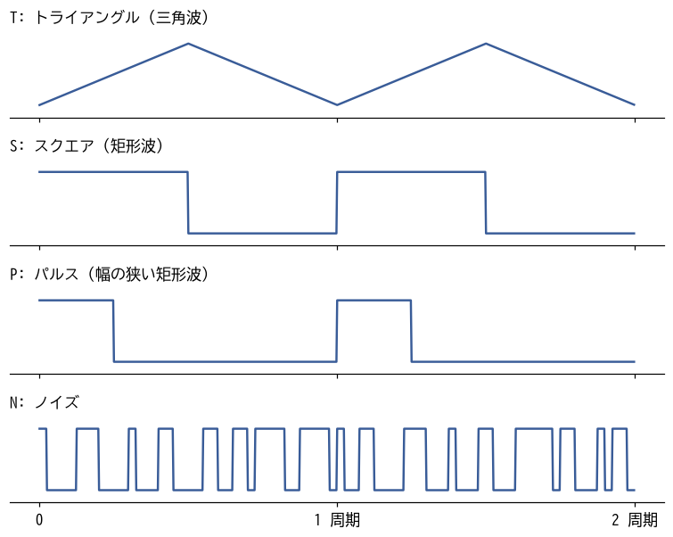
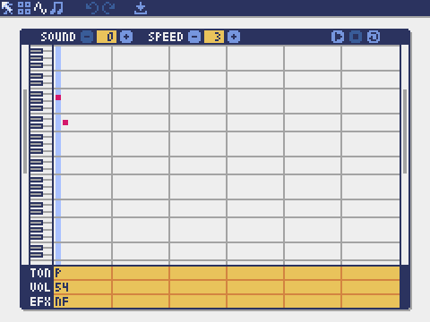
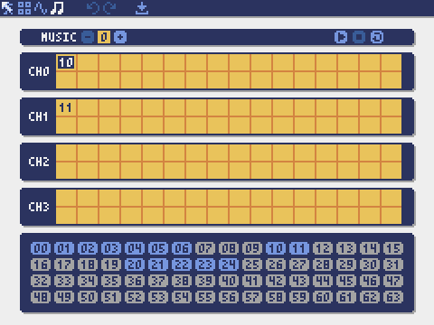

アセット制作（2）サウンド
==========================

音はゲームの手触りを大きく左右する。弾を撃つ音、敵が爆発する音があるだけで、同じ動きでも爽快感がまるで違う。この章では、Pyxel Editor のサウンドエディタとミュージックエディタを使い、効果音と BGM を作る。作曲の経験がなくても作れるように、音楽の基礎知識も必要な分だけ説明する。

Pyxel の音の仕組み
------------------

サウンド
^^^^^^^^

Pyxel の音の最小単位は\ **サウンド**\ である。サウンドは、音符（ノート）を一列に並べたもので、最初から順に 1 つずつ鳴らす。同時に 2 つ以上の音を鳴らすことはできない。和音を鳴らしたいときは、別のチャンネルで別のサウンドを鳴らす。

ノートごとに、:numref:`table-note-params` の 4 つの値を決める。また、サウンド全体で 1 つの再生速度（speed）を決める。

.. _table-note-params:

.. list-table:: ノートごとに決める値
   :header-rows: 1
   :widths: 20 80

   * - 値
     - 内容
   * - 音の高さ
     - C0 ～ B4 の 60 段階と休符。数字はオクターブを表し、A2 が 440 Hz（一般的な音楽の「ラ」）である。
   * - 音色（トーン）
     - T（トライアングル）、S（スクエア）、P（パルス）、N（ノイズ）の 4 種類。
   * - 音量
     - 0 ～ 7 の 8 段階。
   * - エフェクト
     - N（なし）、S（スライド：前のノートから音の高さをなめらかに変える）、V（ビブラート：音の高さを揺らす）、F（フェードアウト：ノート全体で音量を下げる）、H（ハーフフェードアウト：ノートの後半で音量を下げる）、Q（クォーターフェードアウト：ノートの最後の 4 分の 1 で音量を下げる）の 6 種類。

再生速度は、1 つのノートを鳴らす長さを 1/120 秒単位で表す。speed が 3 なら 1 ノートは 0.025 秒、speed が 20 なら約 0.17 秒になる。値が小さいほど速く鳴る。効果音には 1 ～ 9 程度、メロディには 10 以上がよく使われる。

音色
^^^^

4 種類の音色の波形を\ :numref:`fig-waveforms` に示す。

.. _fig-waveforms:

   4 種類の音色の波形

.. list-table:: 音色の特徴と主な用途
   :header-rows: 1
   :widths: 25 45 30

   * - 音色
     - 特徴
     - 主な用途
   * - T（トライアングル）
     - 角のない柔らかい音。低い音でもこもりにくい。
     - ベース、落ち着いたメロディ
   * - S（スクエア）
     - はっきりした、いかにもレトロゲームらしい音。
     - メロディ、決定音
   * - P（パルス）
     - スクエアより細く、鋭い音。
     - メロディ、ショット音
   * - N（ノイズ）
     - 「ザー」という雑音。高さを変えると音の質感が変わる。
     - 爆発音、ドラム

ミュージックとチャンネル
^^^^^^^^^^^^^^^^^^^^^^^^

Pyxel は 4 つの\ **チャンネル**\ を持ち、チャンネルごとに 1 つのサウンドを同時に鳴らせる。**ミュージック**\ は、チャンネルごとに「鳴らすサウンドの番号の並び」を決めたものである。たとえば、チャンネル 0 でメロディのサウンドを、チャンネル 1 でベースのサウンドを、チャンネル 2 でドラムのサウンドを同時に鳴らすと、1 つの曲になる。

サウンドエディタ
----------------

サウンドエディタの画面を\ :numref:`fig-editor-sound` に示す。

.. _fig-editor-sound:

   サウンドエディタ（サウンド 0 を表示している）

.. list-table:: サウンドエディタの画面
   :header-rows: 1
   :widths: 30 70

   * - 部分
     - 役割
   * - SOUND
     - 編集するサウンドの番号（0 ～ 63）を選ぶ。
   * - SPEED
     - 再生速度を決める。
   * - 再生、停止、ループのボタン
     - スペースキーで再生と停止を切り替える。L キーでループ再生を切り替える。
   * - ピアノロール
     - 横軸が時間、縦軸が音の高さを表す。クリックした位置にノートを置く。
   * - TON、VOL、EFX
     - 各ノートの音色、音量、エフェクトを、文字や数字で入力する。

ピアノロールでは、マウスのほかに PC のキーボードでもノートを入力できる。Z、S、X、D、C、V、G、B、H、N、J、M のキーが 1 オクターブ分のピアノの鍵盤（ド、ド#、レ、レ#、…、シ）に対応し、Q、2、W、3、E、R、5、T、6、Y、7、U のキーがその 1 つ上のオクターブに対応する。A キーは休符である。これらのキーを押しながら Enter キーを押すと、カーソルの位置にノートが入る。鍵盤の範囲は PageUp キーと PageDown キーで上下できる。上下の矢印キーでピアノロールと TON、VOL、EFX の行を行き来し、TON の行では T、S、P、N を、VOL の行では 0 ～ 7 を、EFX の行では N、S、V、F、H、Q を入力する。

1 つのサウンドに置けるノートは、Pyxel Editor では最大 48 個である。

効果音を作る
------------

効果音を作るときの定石
^^^^^^^^^^^^^^^^^^^^^^

効果音には、次のような定石がある。

* **短くする。**\ 効果音は何度も鳴るので、長いとうるさく感じる。0.05 ～ 0.5 秒程度にする。
* **高い音から低い音へ下げる。**\ 弾を撃つ、ダメージを受けるといった動作には、音程が下がる音が合う。
* **低い音から高い音へ上げる。**\ 決定、アイテムを取るといった前向きな出来事には、音程が上がる音が合う。
* **爆発にはノイズを使う。**\ ノイズの高さを下げながら、音量を徐々に小さくする。
* **最後をフェードアウトさせる。**\ 最後のノートのエフェクトを F にすると、音がぷつりと切れずに自然に消える。

題材ゲームの効果音
^^^^^^^^^^^^^^^^^^

題材ゲームの効果音は、:numref:`list-make-sounds-se` のように定義した。``Sound.set()`` の引数は、音の高さ、音色、音量、エフェクトを表す文字列と、再生速度である。音の高さは「音名（c ～ b）、必要なら # か -、オクターブ（0 ～ 4）」を 1 つのノートとして並べ、休符は r で表す。音色、音量、エフェクトの文字列がノートの数より短い場合は、最初から繰り返して使われる。

.. _list-make-sounds-se:

.. literalinclude:: ../examples/assets/make_assets.py
   :language: python
   :linenos:
   :lineno-match:
   :lines: 346-354
   :caption: assets/make_assets.py（効果音の定義）

* **自機の弾（サウンド 0）**：パルスで a3 から d3 へ一気に下げる。speed 3 の 2 ノートで、0.05 秒しかない。連射しても邪魔にならない短さにしている。
* **敵の爆発（サウンド 1）**：ノイズを c2 から c1 へ下げながら、音量も 7 から 3 へ下げる。
* **自機がやられた音（サウンド 2）**：敵の爆発より長く、低くまで下げて、重大な出来事であることを伝える。
* **決定（サウンド 3）**：スクエアでド、ミ、ソ、ドと上がる。前向きな音の典型である。
* **警告（サウンド 4）**：同じ音と休符を交互に鳴らし、サイレンのように聞かせる。
* **ゲームオーバー（サウンド 5）**：トライアングルで、ゆっくり下がる短いフレーズにする。
* **命中音（サウンド 6）**：ノイズの短く小さな音。弾が当たったが倒せなかったことを、爆発音と区別して伝える。

Pyxel Editor でこれらを作る場合は、SOUND の番号を合わせ、ピアノロールにノートを置き、TON、VOL、EFX の行と SPEED を同じ値にすればよい。作ったら何度も再生し、実際のゲームの中でも鳴らして確かめる。単独で聞くと良い音でも、ゲームの中ではうるさく感じることがある。

音楽の基礎知識
--------------

BGM を作る前に、必要な音楽の知識を確認しておく。

音名とオクターブ
^^^^^^^^^^^^^^^^

ドレミファソラシは、英語の音名では C、D、E、F、G、A、B と書く。隣り合う白鍵の間にある黒鍵の音は、# を付けて C#（ド#）のように表す。B の次は 1 つ上のオクターブの C に戻る。Pyxel では、c2 の 1 オクターブ上が c3 である。

曲を構成する役割
^^^^^^^^^^^^^^^^

ゲームの BGM は、多くの場合 3 つの役割に分かれている。

* **メロディ**：口ずさめる主旋律。パルスやスクエアで鳴らす。
* **ベース**：低い音で曲の土台を支える。トライアングルで鳴らすことが多い。
* **ドラム**：リズムを刻む。ノイズの低い音を太鼓、高い音をシンバルの代わりにする。

コード進行
^^^^^^^^^^

コードとは和音のことで、曲の中でコードが移り変わる順番をコード進行と呼ぶ。作曲の経験がない場合は、よく使われるコード進行を借りるのが近道である。題材ゲームのプレイ中の BGM は、Am（ラ・ド・ミ）、F（ファ・ラ・ド）、G（ソ・シ・レ）、Am という、少し緊張感のある進行を使っている。

コード進行が決まれば、あとは次の手順で各パートを作れる。

#. ベースは、各コードの一番下の音（Am ならラ、F ならファ）を刻む。
#. メロディは、拍の頭（強拍）にコードに含まれる音を置き、その間を自由につなぐ。
#. ドラムは、太鼓とシンバルを交互に鳴らす単純なパターンを繰り返す。

BGM を作る
----------

題材ゲームの BGM
^^^^^^^^^^^^^^^^

プレイ中の BGM（ミュージック 1）は、:numref:`list-make-sounds-bgm` のサウンド 20 ～ 24 でできている。どのサウンドも 32 ノート、speed 20 で、長さはすべて約 5.3 秒にそろえてある。

.. _list-make-sounds-bgm:

.. literalinclude:: ../examples/assets/make_assets.py
   :language: python
   :linenos:
   :lineno-match:
   :lines: 372-407
   :caption: assets/make_assets.py（プレイ中の BGM の部品）

* サウンド 20 と 21 はメロディである。8 ノートずつ Am、F、G、Am（21 では最後を E に変えて次へつなぐ）の各コードに合わせている。文字列中の空白は無視されるので、読みやすさのためにコードごとに区切っている。
* サウンド 22 と 23 はベースである。各コードの音を 1 オクターブずつ上下させて、躍動感を出している。
* サウンド 24 はドラムである。ノイズの c1（低い音）を太鼓、a3（高い音）をシンバルの代わりにしている。

ミュージックエディタ
^^^^^^^^^^^^^^^^^^^^

サウンドを曲にまとめるには、ミュージックエディタを使う（:numref:`fig-editor-music`）。

.. _fig-editor-music:

   ミュージックエディタ（ミュージック 0 を表示している）

MUSIC の番号で編集するミュージックを選び、CH0 ～ CH3 の行に、そのチャンネルで鳴らすサウンドの番号を順に並べる。上下の矢印キーで編集するチャンネルを、左右の矢印キーで入力位置を選び、画面下の番号の一覧からサウンドを選んで入れる。1 つのチャンネルに並べられるサウンドは最大 32 個である。スペースキーで再生と停止を切り替え、L キーでループ再生を切り替える。

ミュージック 1 は、コードでは次のように定義している。

.. literalinclude:: ../examples/assets/make_assets.py
   :language: python
   :linenos:
   :lineno-match:
   :lines: 410-413
   :caption: assets/make_assets.py（ミュージックの定義）

チャンネル 0 ではサウンド 20、21 の順に、チャンネル 1 では 22、23 の順に、チャンネル 2 では 24 を 2 回鳴らす。チャンネル 3 は空けておき、効果音に使う。ループ再生したときに各パートがずれないように、各チャンネルの合計の長さをそろえておくことが大切である。

コードから音を鳴らす
--------------------

プログラムから音を鳴らす関数を\ :numref:`table-sound-api` にまとめる。

.. _table-sound-api:

.. list-table:: 音を鳴らす関数
   :header-rows: 1
   :widths: 45 55

   * - 関数
     - 動作
   * - ``pyxel.play(ch, snd, sec=0, loop=False)``
     - チャンネル ch でサウンド snd を鳴らす。snd には番号のリストも指定でき、その順に続けて鳴らす。3 番目の引数 sec は再生を始める位置（秒）なので、ループ再生は ``loop=True`` のようにキーワード引数で指定する。
   * - ``pyxel.playm(msc, sec=0, loop=False)``
     - ミュージック msc を鳴らす。ループ再生は ``loop=True`` で指定する。
   * - ``pyxel.stop(ch)``
     - チャンネル ch の音を止める。引数を省略するとすべてのチャンネルの音を止める。

同じチャンネルで新しい音を鳴らすと、それまで鳴っていた音は止まる。BGM と同じチャンネルで効果音を鳴らすと、BGM の一部が途切れてしまう。題材ゲームでは、BGM が使わないチャンネル 3 で効果音を鳴らす。

.. code-block:: python
   :linenos:

   pyxel.playm(1, loop=True)  # プレイ中の BGM をループ再生する
   pyxel.play(3, 0)           # チャンネル 3 でサウンド 0 (ショット音) を鳴らす
   pyxel.stop()               # すべての音を止める

MML と自動作曲
--------------

Pyxel 2 では、MML（Music Macro Language）という文字列でも音を指定できる。MML は、音名や音の長さを文字で書き並べる、昔から使われている楽譜の書き方である。``pyxel.play()`` の snd に MML の文字列を渡すと、その場で鳴らせる。

.. code-block:: python
   :linenos:

   # テンポ 120、音色 1 (スクエア)、オクターブ 4、8 分音符でドレミファソラシド
   pyxel.play(0, "T120 @1 O4 L8 CDEFGAB>C")

MML ではオクターブの数え方が ``Sound.set()`` と異なり、O4 の A が 440 Hz である。使えるコマンドは `Pyxel MML Commands <https://github.com/kitao/pyxel/blob/main/docs/mml-commands.md>`__ にまとめられている。

また、``pyxel.gen_bgm()`` を使うと、BGM を自動で作れる。引数には、曲の雰囲気（0 ～ 7）、移調する半音の数、楽器の編成（0 ～ 3）、乱数の種を指定する。戻り値は、チャンネルごとの MML の文字列のリストである。引数 ``play=True`` を指定すると、作った曲をそのまま鳴らす。

.. code-block:: python
   :linenos:

   # 雰囲気 4 (冒険)、移調なし、編成 1 (メロディ、ベース、ドラム)、乱数の種 7
   mml_list = pyxel.gen_bgm(4, 0, 1, 7, play=True)

プロトタイプの段階で仮の BGM を用意したいときや、曲作りのアイデアがほしいときに便利である。

まとめ
------

* サウンドはノートの並びで、ノートごとに音の高さ、音色、音量、エフェクトを決める。ミュージックはチャンネルごとにサウンドを並べたものである。
* 効果音は短くし、出来事の意味に合わせて音程を上げ下げする。爆発にはノイズを使う。
* BGM はメロディ、ベース、ドラムに分け、よく使われるコード進行を借りて作る。
* BGM と効果音は別のチャンネルで鳴らす。
