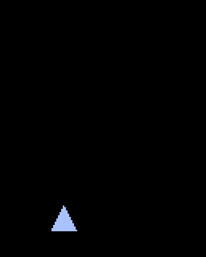
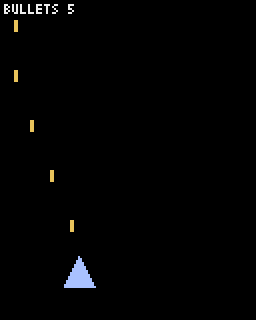
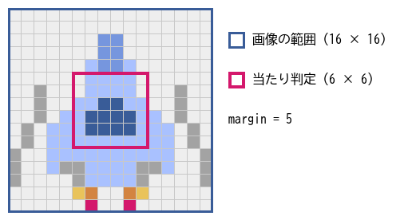
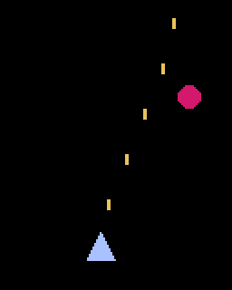
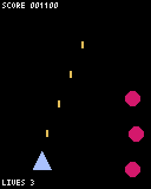

ゲームの実装（1）プロトタイプ
==============================

この章から、題材ゲームのプログラムを作っていく。まずは絵や音を使わず、四角形や円などの図形だけで遊べる最小限のゲーム（**プロトタイプ**）を作る。

プロトタイプの目的
------------------

第 2 章で説明したとおり、プロトタイプの目的は遊びの核を早く確かめることである。題材ゲームなら「敵を撃って倒す」「敵を避ける」が面白いかどうかを、図形だけで確かめる。プロトタイプの段階では、次のことを心がける。

* **見た目にこだわらない。**\ 自機は三角形、敵は円でよい。
* **少しずつ動かす。** 1 つの機能を加えるたびに実行し、思ったとおりに動くかを確かめる。``pyxel watch`` を使うと効率がよい。
* **数値は後で調整する。**\ 自機の速さや敵の出現間隔は、まず適当な値で動かし、遊びながら直す。数値はクラスの定数やモジュールの定数にまとめておくと、後で探しやすい。

この章では、:numref:`table-ch06-steps` の 4 つのステップでプロトタイプを作る。各ステップのサンプルコードは、それだけで実行できる完全なプログラムになっている。

.. _table-ch06-steps:

.. list-table:: 第 6 章のステップ
   :header-rows: 1
   :widths: 25 45 30

   * - ステップ
     - 内容
     - サンプルコード
   * - ステップ 1
     - 自機を表示して動かす。
     - ``ch06_step1/main.py``
   * - ステップ 2
     - 弾を撃つ。
     - ``ch06_step2/main.py``
   * - ステップ 3
     - 敵を出し、弾との当たり判定を行う。
     - ``ch06_step3/main.py``
   * - ステップ 4
     - スコア、残機、ゲームオーバーを加える。
     - ``ch06_step4/main.py``

ステップ 1：自機を表示して動かす
--------------------------------

最初のステップでは、画面の下のほうに自機を表示し、キー操作で動かす。:numref:`list-step1` がプログラムの全体である。

.. _list-step1:

.. literalinclude:: ../examples/ch06_step1/main.py
   :language: python
   :linenos:
   :caption: ch06_step1/main.py

:download:`ch06_step1/main.py をダウンロード <../examples/ch06_step1/main.py>`

入力の扱い
^^^^^^^^^^

8 ～ 11 行目では、方向ごとに反応するキーのリストを定義している。矢印キーに加えて、WASD キーとゲームパッドの方向パッドでも操作できるようにした。14 ～ 16 行目の ``pressed()`` は、リストのキーのどれかが押されていれば True を返す。こうしておくと、操作するキーを増やしたいときに、リストに 1 つ足すだけで済む。

自機の移動
^^^^^^^^^^

``Player.update()`` の 30 ～ 31 行目では、押されているキーから移動の向き dx と dy を求めている。Python では ``int(True)`` が 1、``int(False)`` が 0 になるので、右だけ押されていれば dx は 1、左だけなら -1、両方とも押されているか、どちらも押されていなければ 0 になる。

33 行目は、第 3 章で説明した斜め移動の補正である。35 ～ 36 行目の ``pyxel.clamp(値, 下限, 上限)`` は、値を下限から上限の範囲に収める関数で、自機が画面の外に出ないようにしている。右端の上限が ``SCREEN_W - self.w`` になっているのは、x が自機の左端の座標だからである。

25 ～ 26 行目で ``self.x`` と ``self.y`` に ``float`` 型の注釈を付けているのは、移動の計算結果が小数になるからである。注釈がないと、mypy は 26 行目の整数の値から ``self.y`` を ``int`` 型と推論し、36 行目の代入を型の誤りとして報告する。

40 行目では、仮の見た目として三角形を描いている。:numref:`fig-step1` が実行結果である。

.. _fig-step1:

   ステップ 1 の実行結果

ステップ 2：弾を撃つ
--------------------

次に、ショットのキーを押している間、自機から弾を連射できるようにする。

物体の共通部分をまとめる
^^^^^^^^^^^^^^^^^^^^^^^^

自機、弾、敵など、画面上の物体はどれも位置と大きさを持つ。そこで、共通部分を ``Entity`` クラスにまとめ、各物体のクラスはこれを継承する（:numref:`list-step2-entity`）。

.. _list-step2-entity:

.. literalinclude:: ../examples/ch06_step2/main.py
   :language: python
   :linenos:
   :lineno-match:
   :pyobject: Entity
   :caption: ch06_step2/main.py（Entity）

``alive`` は、物体がまだ存在しているかどうかを表す。画面の外に出た弾や、倒された敵は ``alive`` を False にする。``is_outside()`` は、物体が画面の外に完全に出たかどうかを調べる。

弾
^^

自機の弾は、毎フレーム上へ 5 ピクセルずつ進み、画面の外に出たら ``alive`` を False にする（:numref:`list-step2-bullet`）。

.. _list-step2-bullet:

.. literalinclude:: ../examples/ch06_step2/main.py
   :language: python
   :linenos:
   :lineno-match:
   :pyobject: PlayerBullet
   :caption: ch06_step2/main.py（PlayerBullet）

弾を撃つ
^^^^^^^^

``Player.update()`` に弾を撃つ処理を加える（:numref:`list-step2-player-update`）。

.. _list-step2-player-update:

.. literalinclude:: ../examples/ch06_step2/main.py
   :language: python
   :linenos:
   :lineno-match:
   :pyobject: Player.update
   :caption: ch06_step2/main.py（Player.update）

キーを押している間、毎フレーム弾を出すと、弾が隙間なく並んでしまう。そこで ``shot_timer`` で次に撃てるまでの残りフレーム数を数え、5 フレームに 1 発だけ撃てるようにしている（69 ～ 74 行目）。

この ``update()`` は、新しく撃った弾をリストにして返す。``Player`` が弾のリストを直接持つのではなく、弾を作って返すだけにしているのがポイントである。``Player`` はゲーム全体の弾の管理方法を知らなくてよく、弾をどう管理するかは呼び出し側の ``App`` が決める。このように、各クラスが知っていることを少なくしておくと、後で変更するときの影響範囲が小さくなる。

弾を管理する
^^^^^^^^^^^^

``App`` は、自機の弾を ``player_bullets`` というリストで管理する（:numref:`list-step2-app`）。

.. _list-step2-app:

.. literalinclude:: ../examples/ch06_step2/main.py
   :language: python
   :linenos:
   :lineno-match:
   :pyobject: App
   :caption: ch06_step2/main.py（App）

87 行目で、撃った弾をリストに加える。88 ～ 89 行目ですべての弾を動かし、91 行目で ``alive`` が False になった弾を取り除く。第 3 章の乱数とタイマーのサンプルコードと同じく、条件に合う要素だけで新しいリストを作り直している。

98 行目では、画面上の弾の数を表示している。弾が画面の外に出たら確実に消えているかを確かめるためである。消し忘れると、弾の数が増え続け、やがて処理が重くなる。開発中は、このような確認用の表示を積極的に使うとよい。

.. _fig-step2:

   ステップ 2 の実行結果

ステップ 3：敵を出して当たり判定を行う
--------------------------------------

当たり判定の四角形を小さくする
^^^^^^^^^^^^^^^^^^^^^^^^^^^^^^

第 3 章で説明したとおり、絵の大きさのままの四角形で判定すると、見た目より当たりやすくなる。そこで ``Entity`` に ``margin`` を加え、絵の周囲から ``margin`` ピクセルずつ内側に縮めた四角形を当たり判定に使う（:numref:`list-step3-entity`）。

.. _list-step3-entity:

.. literalinclude:: ../examples/ch06_step3/main.py
   :language: python
   :linenos:
   :lineno-match:
   :lines: 21-51
   :caption: ch06_step3/main.py（Entity と overlaps）

自機の ``margin`` は 5 にした。16 × 16 ピクセルの自機の当たり判定は、中央の 6 × 6 ピクセルだけになる（:numref:`fig-hitbox`）。シューティングゲームでは、自機の当たり判定を見た目よりかなり小さくするのが一般的である。敵の弾をぎりぎりでかわせたとき、プレイヤーは「うまく避けた」と感じる。反対に、敵と自機の弾の当たり判定はあまり小さくしない。自分の弾は当てやすいほうが気持ちよいからである。

.. _fig-hitbox:

   自機の当たり判定

``overlaps()`` は、2 つの物体の ``hitbox()`` を使って AABB 判定を行う。第 3 章の ``rects_overlap()`` と同じ計算である。

敵を出す
^^^^^^^^

敵はまっすぐ下へ進み、画面の下に出たら消える。``App.update()`` では、20 フレームごとに、画面の上端のランダムな位置に敵を出す（:numref:`list-step3-app-update`）。

.. _list-step3-app-update:

.. literalinclude:: ../examples/ch06_step3/main.py
   :language: python
   :linenos:
   :lineno-match:
   :lines: 117-138
   :caption: ch06_step3/main.py（App.update と App.check_collisions）

敵の y 座標の初期値を -16 にしているのは、敵の高さが 16 ピクセルだからである。画面の上の外側で生まれ、上から少しずつ姿を現すように見える。

``update()`` の処理の順番にも意味がある。まずすべての物体を動かし（118 ～ 125 行目）、次に当たり判定を行い（127 行目）、最後に消えた物体を取り除く（129 ～ 130 行目）。当たり判定の途中でリストから要素を取り除くと、for 文で要素を読み飛ばしてしまう。``alive`` を False にするだけにしておき、取り除くのは最後にまとめて行う。

当たり判定
^^^^^^^^^^

``check_collisions()`` は、すべての弾とすべての敵の組み合わせを調べる。135 行目の ``enemy.alive`` の確認は、同じフレームで別の弾に倒された敵に、もう一度当たらないようにするためである。138 行目の ``break`` は、1 発の弾で 2 体以上の敵を倒さないようにするためである。

.. _fig-step3:

   ステップ 3 の実行結果

ステップ 4：スコア、残機、ゲームオーバー
----------------------------------------

最後に、ゲームとして成り立たせるための要素を加える。敵を倒すとスコアが増え、敵にぶつかると残機が減り、残機が 0 になるとゲームオーバーになる。

無敵時間
^^^^^^^^

敵にぶつかった直後にまた別の敵にぶつかると、一瞬で残機がなくなってしまう。そこで、やられた直後の一定時間は当たり判定を行わない\ **無敵時間**\ を設ける。無敵時間中であることがプレイヤーに分かるように、自機を点滅させる（:numref:`list-step4-player-draw`）。

.. _list-step4-player-draw:

.. literalinclude:: ../examples/ch06_step4/main.py
   :language: python
   :linenos:
   :lineno-match:
   :pyobject: Player.draw
   :caption: ch06_step4/main.py（Player.draw）

``pyxel.frame_count % 4 < 2`` は、4 フレームのうち 2 フレームで True になる。そのフレームでは描画を飛ばすので、自機が 2 フレームおきに消えて点滅して見える。

当たり判定とゲームオーバー
^^^^^^^^^^^^^^^^^^^^^^^^^^

``App`` には、ゲームを最初の状態に戻す ``reset()`` を用意し、``__init__()`` とゲームオーバー後のやり直しの両方から呼ぶ（:numref:`list-step4-app`）。

.. _list-step4-app:

.. literalinclude:: ../examples/ch06_step4/main.py
   :language: python
   :linenos:
   :lineno-match:
   :lines: 138-184
   :caption: ch06_step4/main.py（App.reset、App.update、App.check_collisions）

147 ～ 151 行目では、残機が 0 のときはゲームを進めず、キーが押されるのを待つ。ここでは ``btn()`` ではなく ``btnp()`` を使う ``triggered()`` で調べている。``btn()`` を使うと、ショットのキーを押し続けたままやられた場合に、すぐにやり直しが始まってしまう。

173 行目では、敵を倒したらスコアを加える。176 ～ 184 行目は、自機と敵の当たり判定である。ぶつかった敵は消し、残機を 1 減らして無敵時間を設定する。

.. _fig-step4:

   ステップ 4 の実行結果

これで、図形だけのプロトタイプが完成した。実際に遊んで、敵を撃ち落とす操作が気持ちよいか、敵を避けるのが難しすぎないかを確かめてほしい。``SPAWN_INTERVAL`` や ``Player.SPEED`` の値を変えると、遊び心地が大きく変わることが分かるはずである。

設計の整理
----------

ステップ 4 までのクラスの関係を\ :numref:`fig-class-step4` に示す。

.. _fig-class-step4:

.. graphviz::
   :caption: ステップ 4 のクラス図
   :align: center

   digraph classes {
     node [shape=record, fontsize=10, style=filled, fillcolor="#eef3ff"];
     edge [fontsize=9];
     Entity [label="{Entity|x, y, w, h, margin, alive|center()\lhitbox()\lis_outside()\l}"];
     Player [label="{Player|shot_timer, invincible|update() → 弾のリスト\ldraw()\l}"];
     PlayerBullet [label="{PlayerBullet||update()\ldraw()\l}"];
     Enemy [label="{Enemy||update()\ldraw()\l}"];
     App [label="{App|player, player_bullets, enemies,\nscore, lives|reset()\lupdate()\lcheck_collisions()\ldraw()\l}", fillcolor="#fff4d6"];
     Player -> Entity [arrowhead=empty];
     PlayerBullet -> Entity [arrowhead=empty];
     Enemy -> Entity [arrowhead=empty];
     App -> Player [arrowtail=diamond, dir=back, label="1"];
     App -> PlayerBullet [arrowtail=diamond, dir=back, label="0..*"];
     App -> Enemy [arrowtail=diamond, dir=back, label="0..*"];
   }

各クラスの責務（受け持つ仕事）は次のように分かれている。

.. list-table:: 各クラスの責務
   :header-rows: 1
   :widths: 25 75

   * - クラス
     - 責務
   * - ``Entity``
     - 位置、大きさ、当たり判定の四角形、存在しているかどうかを持つ。
   * - ``Player``
     - 入力に応じて動き、弾を作る。無敵時間を管理する。
   * - ``PlayerBullet``、``Enemy``
     - 自分の動きと見た目だけを知っている。
   * - ``App``
     - 物体のリストを持ち、出現、更新、当たり判定、削除、スコアと残機の管理を行う。

個々の物体は自分のことだけを知り、物体どうしの関係（当たり判定）とゲーム全体のルール（スコアや残機）は ``App`` が扱う。この分け方は、第 7 章で機能を増やしても変えない。ただし、このままではタイトル画面やゲームオーバー画面を加えたときに ``App`` が膨らんでしまう。第 7 章では、画面ごとにクラスを分けることから始める。

まとめ
------

* プロトタイプは図形だけで作り、遊びの核が面白いかを早く確かめる。
* 物体の共通部分は基底クラスにまとめる。物体は自分の動きと見た目だけを扱い、物体どうしの関係はゲーム全体を管理するクラスが扱う。
* 消える物体は ``alive`` を False にしておき、フレームの最後にまとめてリストから取り除く。
* 自機の当たり判定は見た目より小さくし、やられた直後には無敵時間を設ける。
