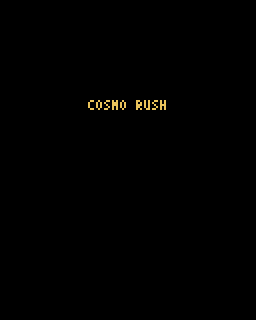
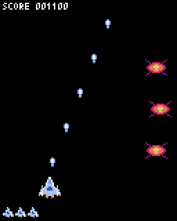
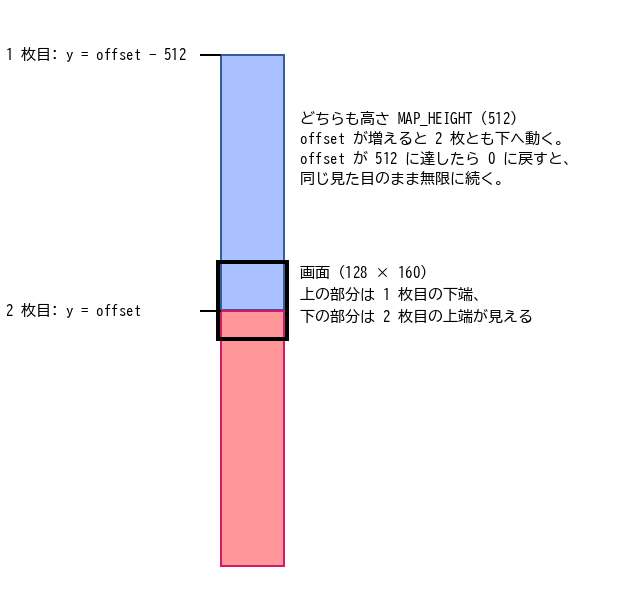
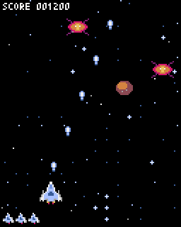

ゲームの実装（2）作り込み
==========================

第 6 章のプロトタイプに、シーン、素材、背景、音、演出を順に加え、最後に敵の種類とボスを加えて題材ゲームを完成させる。:numref:`table-ch07-steps` がこの章のステップである。

.. _table-ch07-steps:

.. list-table:: 第 7 章のステップ
   :header-rows: 1
   :widths: 25 45 30

   * - ステップ
     - 内容
     - サンプルコード
   * - ステップ 5
     - シーン（タイトル、プレイ、ゲームオーバー）を分ける。
     - ``ch07_step5/main.py``
   * - ステップ 6
     - 図形をスプライトに置き換える。
     - ``ch07_step6/main.py``
   * - ステップ 7
     - タイルマップの背景をスクロールさせる。
     - ``ch07_step7/main.py``
   * - ステップ 8
     - 効果音と BGM を鳴らす。
     - ``ch07_step8/main.py``
   * - ステップ 9
     - 爆発や画面の揺れなどの演出を加える。
     - ``ch07_step9/main.py``
   * - 完成版
     - 敵の種類、ボス、ステージの進行、ハイスコアの保存を加える。
     - ``cosmo_rush/main.py``

ステップ 6 ～ 9 は、第 4 章、第 5 章で作ったリソースファイル ``examples/assets/cosmo_rush.pyxres`` を読み込む。完成版は、公開に備えて同じ内容のコピー ``examples/cosmo_rush/cosmo_rush.pyxres`` を読み込む（第 9 章）。

ステップ 5：シーンを分ける
--------------------------

シーンという考え方
^^^^^^^^^^^^^^^^^^

タイトル画面とプレイ画面では、受け付ける入力も描く内容もまったく違う。これらを 1 つの ``App`` に書き、``if`` 文で今どの画面かを調べて処理を分けると、画面が増えるたびにコードが読みにくくなる。そこで、画面ごとにクラスを分ける。この画面のまとまりを\ **シーン**\ と呼ぶ。

各シーンは ``update()`` と ``draw()`` を持ち、``update()`` は次のフレームで使うシーンを返す（:numref:`list-step5-scene`）。シーンを切り替えないときは自分自身（``self``）を、切り替えるときは新しいシーンを返す。

.. _list-step5-scene:

.. literalinclude:: ../examples/ch07_step5/main.py
   :language: python
   :linenos:
   :lineno-match:
   :lines: 133-153
   :caption: ch07_step5/main.py（Scene と TitleScene）

``App`` は、現在のシーンを 1 つ持ち、``update()`` の戻り値で入れ替えるだけになる（:numref:`list-step5-app`）。

.. _list-step5-app:

.. literalinclude:: ../examples/ch07_step5/main.py
   :language: python
   :linenos:
   :lineno-match:
   :pyobject: App
   :caption: ch07_step5/main.py（App）

この仕組みは、第 2 章の画面遷移図（:numref:`fig-scene-transition`）をそのままコードにしたものである。``TitleScene`` はキーが押されたら ``PlayScene`` を返し（146 行目）、``PlayScene`` は残機が 0 になってから 60 フレーム後に ``GameOverScene`` を返し、``GameOverScene`` はキーが押されたら ``TitleScene`` を返す。新しいシーンを作るたびに状態が初期化されるので、第 6 章の ``reset()`` は不要になった。

プレイ画面とゲームオーバー画面
^^^^^^^^^^^^^^^^^^^^^^^^^^^^^^

``PlayScene`` の中身は、第 6 章の ``App`` とほぼ同じである。違いは 2 つある。1 つ目は、敵の出現のタイミングを ``pyxel.frame_count`` ではなく、シーンが始まってからのフレーム数 ``self.frame`` で数えることである。こうしておくと、何度プレイしても同じタイミングで敵が出始める。2 つ目は、残機が 0 になってもすぐには切り替えず、少し待ってからゲームオーバー画面に移ることである（:numref:`list-step5-play-update`）。やられた瞬間に画面が切り替わると、プレイヤーは何が起きたのか分からない。

.. _list-step5-play-update:

.. literalinclude:: ../examples/ch07_step5/main.py
   :language: python
   :linenos:
   :lineno-match:
   :pyobject: PlayScene.update
   :caption: ch07_step5/main.py（PlayScene.update）

``GameOverScene`` も、表示してから 60 フレームの間はキーを受け付けない（:numref:`list-step5-gameover`）。ショットのキーを連打している最中にやられると、ゲームオーバー画面を読む前にタイトル画面へ進んでしまうからである。

.. _list-step5-gameover:

.. literalinclude:: ../examples/ch07_step5/main.py
   :language: python
   :linenos:
   :lineno-match:
   :pyobject: GameOverScene
   :caption: ch07_step5/main.py（GameOverScene）

   ステップ 5 のタイトル画面

ステップ 6：スプライトで描く
----------------------------

リソースファイルを読み込む
^^^^^^^^^^^^^^^^^^^^^^^^^^

図形を、第 4 章で描いた絵に置き換える。まず ``main()`` で、初期化の直後にリソースファイルを読み込む（:numref:`list-step6-main`）。

.. _list-step6-main:

.. literalinclude:: ../examples/ch07_step6/main.py
   :language: python
   :linenos:
   :lineno-match:
   :pyobject: main
   :caption: ch07_step6/main.py（main）

``RESOURCE_FILE`` は ``"../assets/cosmo_rush.pyxres"`` である。相対パスは ``main.py`` のあるディレクトリから探されるので、``ch07_step6`` の 1 つ上にある ``assets`` ディレクトリのファイルを読み込む。

pyxel.blt で絵を描く
^^^^^^^^^^^^^^^^^^^^

イメージバンクの絵を画面に描くには ``pyxel.blt()`` を使う。

.. code-block:: python
   :linenos:

   pyxel.blt(x, y, img, u, v, w, h, colkey)

画面の (x, y) の位置に、イメージバンク img の (u, v) から幅 w、高さ h の範囲の絵を描く。colkey には透明色を指定する。colkey を省略すると透明色を使わず、四角形の範囲がすべて描かれる。w や h を負の値にすると、絵が左右や上下に反転する。

自機の弾は、イメージバンク 0 の (48, 0) にある 8 × 8 ピクセルの絵である（:numref:`list-step6-bullet-draw`）。

.. _list-step6-bullet-draw:

.. literalinclude:: ../examples/ch07_step6/main.py
   :language: python
   :linenos:
   :lineno-match:
   :pyobject: PlayerBullet.draw
   :caption: ch07_step6/main.py（PlayerBullet.draw）

アニメーション
^^^^^^^^^^^^^^

自機と敵は 2 コマのアニメーションを持つ。コマを横に並べて置いたので、何コマ目を描くかを ``pyxel.frame_count`` から計算し、u 座標をずらすだけでよい（:numref:`list-step6-anim`）。

.. _list-step6-anim:

.. literalinclude:: ../examples/ch07_step6/main.py
   :language: python
   :linenos:
   :lineno-match:
   :lines: 112-138
   :caption: ch07_step6/main.py（Player.draw と Enemy）

116 行目の ``pyxel.frame_count // 2 % 2`` は、2 フレームごとに 0 と 1 を交互にとる。これに 16 を掛けて足すと、u 座標は 16 と 32 を交互にとる。137 行目の敵は 8 フレームごとに切り替えている。自機の噴射の炎は速く、敵の脚はゆっくり動かすことで、それぞれの印象に合った動きにしている。

``Enemy`` に定数 ``U`` と ``V`` を持たせたのは、完成版で敵の種類を増やすときに、絵の位置だけを変えた子クラスを作れるようにするためである。

タイトルロゴと残機の表示
^^^^^^^^^^^^^^^^^^^^^^^^

タイトルロゴはイメージバンク 1 に置いてある。``pyxel.blt()`` の img に 1 を指定して描く。残機は自機の絵を並べて表す。``pyxel.blt()`` の引数 ``scale`` に 0.5 を指定すると、絵が半分の大きさで描かれる（:numref:`list-step6-play-draw`）。

.. _list-step6-play-draw:

.. literalinclude:: ../examples/ch07_step6/main.py
   :language: python
   :linenos:
   :lineno-match:
   :pyobject: PlayScene.draw
   :caption: ch07_step6/main.py（PlayScene.draw）

``scale`` を指定した場合、拡大や縮小は描く範囲の中心を基準に行われる。16 × 16 の範囲を 0.5 倍すると、指定した (x, y) から 4 ピクセル内側に 8 × 8 の絵が描かれる。230 行目で x と y から少し引いているのは、このずれを打ち消すためである。

   ステップ 6 の実行結果

ステップ 7：背景をスクロールさせる
----------------------------------

タイルマップを描く
^^^^^^^^^^^^^^^^^^

タイルマップを画面に描くには ``pyxel.bltm()`` を使う。

.. code-block:: python
   :linenos:

   pyxel.bltm(x, y, tm, u, v, w, h, colkey)

画面の (x, y) の位置に、タイルマップ tm の (u, v) から幅 w、高さ h の範囲を描く。u、v、w、h はタイルの数ではなくピクセル単位で指定する。

ループするスクロール
^^^^^^^^^^^^^^^^^^^^

縦スクロールのシューティングでは、自機は画面の中にとどまり、背景が上から下へ流れることで前進しているように見せる。題材ゲームの背景は、高さ 512 ピクセルのタイルマップである。これを下へずらしながら描き、端まで来たら最初に戻す。ただし単純に戻すと、継ぎ目で背景が途切れてしまう。

そこで、同じタイルマップを縦に 2 枚並べて描く（:numref:`fig-scroll`）。ずらす量 ``offset`` が 0 から 512 まで増える間、2 枚の地図は一緒に下へ動く。``offset`` が 512 になったとき、1 枚目はちょうど 2 枚目が最初にあった位置（y = 0）に来ている。そこで ``offset`` を 0 に戻しても、画面の見た目は変わらない。こうして、同じ地図が途切れなく繰り返される。

.. _fig-scroll:

   2 枚のタイルマップを並べたループスクロール（縮尺は 1/2）

背景の処理は ``Background`` クラスにまとめた（:numref:`list-step7-background`）。

.. _list-step7-background:

.. literalinclude:: ../examples/ch07_step7/main.py
   :language: python
   :linenos:
   :lineno-match:
   :pyobject: Background
   :caption: ch07_step7/main.py（Background）

153 行目で ``offset`` を 0.5 ずつ増やし、512 で割った余りをとることで 0 に戻している。159 ～ 161 行目が 2 枚のタイルマップを描く処理である。画面からはみ出す部分は自動的に描かれないので、2 枚ともそのまま描けばよい。

奥行きを出す
^^^^^^^^^^^^

背景のタイルマップに加えて、速く流れる星を 12 個だけ点で描いている（150 行目、154 行目、162 ～ 163 行目）。遠くのもの（タイルマップ）はゆっくり、近くのもの（点の星）は速く動かすと、画面に奥行きが感じられる。この手法を\ **多重スクロール**\ と呼ぶ。

``Background`` のインスタンスはシーンをまたいで引き継ぐ。シーンが変わるたびに作り直すと、背景のスクロール位置が先頭に戻ってしまうからである。そのため、各シーンのコンストラクタは ``Background`` を引数で受け取るように変えた。

   ステップ 7 の実行結果

ステップ 8：効果音と BGM を鳴らす
---------------------------------

第 5 章で作ったサウンドを鳴らす。サウンドとミュージックの番号は、意味の分かる名前の定数にしておく（:numref:`list-step8-consts`）。番号を直接書くと、後で番号を変えたときに直し漏れが起きやすい。

.. _list-step8-consts:

.. literalinclude:: ../examples/ch07_step8/main.py
   :language: python
   :linenos:
   :lineno-match:
   :lines: 11-19
   :caption: ch07_step8/main.py（サウンド番号の定数）

効果音は、それぞれの出来事が起きた場所で鳴らす。弾を撃ったときは ``Player.update()`` で、敵を倒したときと自機がやられたときは ``PlayScene.check_collisions()`` で鳴らす（:numref:`list-step8-collisions`）。

.. _list-step8-collisions:

.. literalinclude:: ../examples/ch07_step8/main.py
   :language: python
   :linenos:
   :lineno-match:
   :pyobject: PlayScene.check_collisions
   :caption: ch07_step8/main.py（PlayScene.check_collisions）

BGM は、シーンが始まるときに ``pyxel.playm()`` でループ再生する（:numref:`list-step8-title`）。タイトル画面からプレイ画面に移るときは、``pyxel.stop()`` でタイトル画面の BGM を止めてから決定音を鳴らす。最後の残機がなくなったときも BGM を止め（264 ～ 265 行目）、やられた音だけを聞かせる。ゲームオーバー画面に移るときは、すべての音を止めてから、空いたチャンネル 0 でゲームオーバーの音を鳴らす。

.. _list-step8-title:

.. literalinclude:: ../examples/ch07_step8/main.py
   :language: python
   :linenos:
   :lineno-match:
   :lines: 187-198
   :caption: ch07_step8/main.py（TitleScene の __init__ と update）

ステップ 9：演出を加える
------------------------

ゲームの中身は同じでも、演出を加えると手触りが大きく変わる。このステップでは、爆発、画面の揺れ、ゲームオーバー画面の暗転を加える。あわせて ``draw_text_center()`` を変え、色 1 で 1 ピクセルずらした文字を先に描いて影を付けた。背景の上でも文字が読みやすくなる。

爆発
^^^^

爆発は当たり判定を持たず、4 コマのアニメーションを再生したら消えるだけの物体である（:numref:`list-step9-explosion`）。

.. _list-step9-explosion:

.. literalinclude:: ../examples/ch07_step9/main.py
   :language: python
   :linenos:
   :lineno-match:
   :pyobject: Explosion
   :caption: ch07_step9/main.py（Explosion）

ステップ 6 のアニメーションは ``pyxel.frame_count`` からコマを決めていたが、爆発は生まれてからのフレーム数 ``age`` からコマを決める（170 行目）。いつ生まれた爆発も、必ず 1 コマ目から再生させるためである。``PlayScene`` は、敵や自機がやられたときに、その中心の位置に ``Explosion`` を作る（283 行目、294 行目）。

画面の揺れ
^^^^^^^^^^

自機がやられたときに画面を揺らすと、衝撃の大きさが伝わる。``pyxel.camera(x, y)`` を呼ぶと、それ以降の描画がすべて (-x, -y) だけずれる。揺れている間は、毎フレーム乱数で少しだけずらす（:numref:`list-step9-play-draw`）。

.. _list-step9-play-draw:

.. literalinclude:: ../examples/ch07_step9/main.py
   :language: python
   :linenos:
   :lineno-match:
   :pyobject: PlayScene.draw
   :caption: ch07_step9/main.py（PlayScene.draw）

315 行目で ``pyxel.camera()`` を引数なしで呼び、ずれを元に戻してからスコアと残機を描いている。スコアの表示まで揺れると読みにくいからである。

ディザリングによる暗転
^^^^^^^^^^^^^^^^^^^^^^

ゲームオーバー画面では、背景を半分だけ暗くして文字を読みやすくする（:numref:`list-step9-gameover-draw`）。Pyxel には半透明の描画がないが、``pyxel.dither(alpha)`` を使うと、点を間引いて描くことで半透明に近い表現ができる。この手法を\ **ディザリング**\ と呼ぶ。alpha は 0.0（何も描かない）～ 1.0（すべて描く）で指定する。

.. _list-step9-gameover-draw:

.. literalinclude:: ../examples/ch07_step9/main.py
   :language: python
   :linenos:
   :lineno-match:
   :pyobject: GameOverScene.draw
   :caption: ch07_step9/main.py（GameOverScene.draw）

343 ～ 345 行目で、alpha を 0.5 にして画面全体に黒い四角形を描き、すぐに 1.0 に戻している。戻し忘れると、それ以降の描画もすべて間引かれてしまう。

.. list-table::
   :class: screens
   :widths: 50 50

   * - .. image:: images/screens/step9.png
          :class: pixel
          :alt: 爆発の演出
     - .. image:: images/screens/step9_gameover.png
          :class: pixel
          :alt: ディザリングで暗くしたゲームオーバー画面
   * - 爆発の演出
     - ディザリングで暗くしたゲームオーバー画面

完成版：敵の種類とボス
----------------------

最後に、敵の種類、敵の弾、ボス、ステージの進行、ハイスコアの保存を加えて完成させる。完成版のコードは ``cosmo_rush/main.py`` にある。全体は\ :doc:`appendix_samples`\ で読める。

:download:`cosmo_rush/main.py をダウンロード <../examples/cosmo_rush/main.py>`

敵の種類を増やす
^^^^^^^^^^^^^^^^

敵の種類ごとに違うのは、絵の位置、体力、得点、動き方、弾の撃ち方である。そこで ``Enemy`` を基底クラスにして、``move()`` と ``shoot()`` を子クラスで上書きする（:numref:`list-final-enemy`）。

.. _list-final-enemy:

.. literalinclude:: ../examples/cosmo_rush/main.py
   :language: python
   :linenos:
   :lineno-match:
   :pyobject: Enemy
   :caption: cosmo_rush/main.py（Enemy）

``update()`` は、毎フレーム同じ順番で ``move()`` と ``shoot()`` を呼ぶ（214 ～ 222 行目）。この順番は変えず、中身だけを子クラスで変える。``shoot()`` は、``Player.update()`` と同じく、撃った弾をリストで返す。

``damage()`` は弾が当たったときに呼ばれ、体力を 1 減らす（230 ～ 237 行目）。倒せなかったときも ``flash`` を設定し、3 フレームの間、絵を白く光らせる。243 ～ 244 行目の ``pyxel.pal(col1, col2)`` は、色 col1 を色 col2 に置き換えて描くように設定する関数である。色 1 ～ 15 をすべて白（7）に置き換えてから描き、246 行目の ``pyxel.pal()`` で元に戻す。体力のある敵に弾が当たったことが、一目で分かる。

敵 B は、``pyxel.sin()`` で左右に揺れながら下へ進む（:numref:`list-final-enemy-b`）。``pyxel.sin()`` の引数は、ラジアンではなく度で指定する。``self.age * 6`` は 60 フレームで 360 度になるので、2 秒で 1 往復する。

.. _list-final-enemy-b:

.. literalinclude:: ../examples/cosmo_rush/main.py
   :language: python
   :linenos:
   :lineno-match:
   :pyobject: EnemyB
   :caption: cosmo_rush/main.py（EnemyB）

敵 C は、途中で止まって自機を 2 回狙い撃ちし、その後に去っていく（:numref:`list-final-enemy-c`）。

.. _list-final-enemy-c:

.. literalinclude:: ../examples/cosmo_rush/main.py
   :language: python
   :linenos:
   :lineno-match:
   :pyobject: EnemyC
   :caption: cosmo_rush/main.py（EnemyC）

自機を狙う弾
^^^^^^^^^^^^

自機を狙う弾は、:numref:`list-final-aimed` の ``aimed_bullet()`` で作る。

.. _list-final-aimed:

.. literalinclude:: ../examples/cosmo_rush/main.py
   :language: python
   :linenos:
   :lineno-match:
   :pyobject: aimed_bullet
   :caption: cosmo_rush/main.py（aimed_bullet）

``pyxel.atan2(dy, dx)`` は、(dx, dy) の向きの角度を度で返す。この角度の向きに速さ speed で進むには、x 方向の速度を ``cos(角度) * speed``、y 方向の速度を ``sin(角度) * speed`` にすればよい。弾は撃たれた瞬間の自機の位置へ向かってまっすぐ飛ぶので、撃たれてから動けば避けられる。

ボス
^^^^

ボスも ``Enemy`` の子クラスである（:numref:`list-final-boss`）。絵の大きさを 32 × 32 にし、体力と移動と攻撃を変えている。

.. _list-final-boss:

.. literalinclude:: ../examples/cosmo_rush/main.py
   :language: python
   :linenos:
   :lineno-match:
   :pyobject: Boss
   :caption: cosmo_rush/main.py（Boss）

* 登場するときは画面の上からゆっくり降りてきて、y = 16 で止まる（308 ～ 310 行目）。降りてくる間は弾を撃たない。
* その後は左右に往復する。体力が半分を切ると、往復の速さが 2 倍になる（311 ～ 313 行目）。位置は毎フレーム少しずつ進める角度 ``angle`` から決めているので、速さが変わっても位置は飛ばない。
* 45 フレームごとに、下向き（90 度）を中心に 60 ～ 120 度の範囲へ 5 発の弾を扇状に撃つ（320 ～ 324 行目）。体力が半分を切ると、自機を狙う弾を 3 連射で追加する（325 ～ 327 行目）。
* 333 行目で、画面の上部に体力ゲージを描く。

戦いの途中で攻撃が激しくなると、プレイヤーは「あと少しだ」と感じて盛り上がる。体力に応じて行動を変えるのは、ボスを印象的にする定番の方法である。

ステージの進行
^^^^^^^^^^^^^^

``PlayScene`` は、ステージ開始からのフレーム数 ``frame`` で敵の出現とボスの登場を管理する（:numref:`list-final-stage`）。

.. _list-final-stage:

.. literalinclude:: ../examples/cosmo_rush/main.py
   :language: python
   :linenos:
   :lineno-match:
   :lines: 476-507
   :caption: cosmo_rush/main.py（PlayScene.spawn_enemies と PlayScene.update_stage）

* ``spawn_enemies()`` は、最初の 10 秒は敵 A だけを、10 秒を過ぎると敵 B も、20 秒を過ぎると敵 C も出す（484 ～ 490 行目）。ボスの警告が始まったら、雑魚敵は出さない（478 ～ 479 行目）。
* 484 行目の ``list[type[Enemy]]`` は「``Enemy`` またはその子クラスそのもの」のリストを表す型である。クラスをリストに入れ、選んだクラスを呼び出して敵を作る（490 行目）。
* ``update_stage()`` は、ボスが現れる 2 秒前に警告音を鳴らし（494 ～ 495 行目）、45 秒でボスを出す（496 ～ 498 行目）。ボスが倒されたら 4 秒後に ``level`` を 1 増やし、``frame`` を 0 に戻して次のステージを始める（499 ～ 506 行目）。
* ``level`` は敵の速さ、敵の出現間隔、ボスの体力などに反映される。ステージを重ねるほど難しくなる。

ボスを倒したときは、時間差で 12 個の爆発を起こし、画面に残った敵の弾を消し、画面を大きく揺らす（:numref:`list-final-hit-enemy`）。``Explosion`` に ``delay`` を加え、指定したフレーム数だけ待ってから再生を始めるようにした。

.. _list-final-hit-enemy:

.. literalinclude:: ../examples/cosmo_rush/main.py
   :language: python
   :linenos:
   :lineno-match:
   :pyobject: PlayScene.hit_enemy
   :caption: cosmo_rush/main.py（PlayScene.hit_enemy）

ハイスコアの保存
^^^^^^^^^^^^^^^^

ハイスコアは、ゲームを終了しても残るようにファイルに保存する（:numref:`list-final-highscore`）。保存先には ``pyxel.user_data_dir(vendor_name, app_name)`` が返すディレクトリを使う。この関数は、OS ごとに適切なユーザー用のデータディレクトリを返し、なければ作成する。

.. _list-final-highscore:

.. literalinclude:: ../examples/cosmo_rush/main.py
   :language: python
   :linenos:
   :lineno-match:
   :lines: 71-87
   :caption: cosmo_rush/main.py（load_high_score と save_high_score）

ファイルが壊れていたり、まだ保存されていなかったりしても、ゲームは止まってはいけない。そのため、読み込みに失敗したら 0 を返し（77 ～ 78 行目）、保存に失敗しても無視する（86 ～ 87 行目）。``GameOverScene`` は、スコアがそれまでのハイスコアを超えていたら保存し、「NEW RECORD!」と表示する。

これで題材ゲームが完成した。``examples`` ディレクトリで実行して遊んでみよう。

.. code-block:: console
   :linenos:

   > pyxel run cosmo_rush/main.py

完成版のクラス図
^^^^^^^^^^^^^^^^

完成版のクラスの関係を\ :numref:`fig-class-final` に示す。

.. _fig-class-final:

.. graphviz::
   :caption: 完成版のクラス図
   :align: center

   digraph classes {
     node [shape=record, fontsize=10, style=filled, fillcolor="#eef3ff"];
     edge [fontsize=9];
     Entity [label="{Entity|x, y, w, h, margin, alive}"];
     Player [label="{Player|update() → 弾のリスト}"];
     PlayerBullet [label="{PlayerBullet}"];
     EnemyBullet [label="{EnemyBullet|vx, vy}"];
     Enemy [label="{Enemy (敵 A)|hp, level, flash|move()\lshoot() → 弾のリスト\ldamage()\l}"];
     EnemyB [label="{EnemyB|move()}"];
     EnemyC [label="{EnemyC|move()\lshoot()\l}"];
     Boss [label="{Boss|move()\lshoot()\l}"];
     Explosion [label="{Explosion|delay, age}", fillcolor="#f2f2f2"];
     Background [label="{Background|offset, stars}", fillcolor="#f2f2f2"];
     Scene [label="{Scene|update() → 次のシーン\ldraw()\l}", fillcolor="#fff4d6"];
     TitleScene [fillcolor="#fff4d6"];
     PlayScene [label="{PlayScene|score, lives, level, frame}", fillcolor="#fff4d6"];
     GameOverScene [fillcolor="#fff4d6"];
     App [label="{App|scene}", fillcolor="#fff4d6"];
     Player -> Entity [arrowhead=empty];
     PlayerBullet -> Entity [arrowhead=empty];
     EnemyBullet -> Entity [arrowhead=empty];
     Enemy -> Entity [arrowhead=empty];
     EnemyB -> Enemy [arrowhead=empty];
     EnemyC -> Enemy [arrowhead=empty];
     Boss -> Enemy [arrowhead=empty];
     TitleScene -> Scene [arrowhead=empty];
     PlayScene -> Scene [arrowhead=empty];
     GameOverScene -> Scene [arrowhead=empty];
     App -> Scene [arrowtail=diamond, dir=back];
     PlayScene -> Player [arrowtail=diamond, dir=back];
     PlayScene -> Enemy [arrowtail=diamond, dir=back];
     PlayScene -> PlayerBullet [arrowtail=diamond, dir=back];
     PlayScene -> EnemyBullet [arrowtail=diamond, dir=back];
     PlayScene -> Explosion [arrowtail=diamond, dir=back];
     PlayScene -> Background [style=dashed, arrowhead=open, label="共有"];
   }

まとめ
------

* 画面ごとにシーンのクラスを分け、``update()`` が次のシーンを返す仕組みで切り替える。
* ``pyxel.blt()`` でイメージバンクの絵を、``pyxel.bltm()`` でタイルマップを描く。コマを並べて置いておけば、アニメーションは u 座標の計算だけで実現できる。
* 同じタイルマップを 2 枚並べて描くと、背景を途切れなくスクロールできる。
* 効果音は出来事が起きた場所で鳴らし、BGM はシーンの開始時に鳴らす。
* 爆発、画面の揺れ、被弾時の点滅、ディザリングなどの演出で、ゲームの手触りが大きく良くなる。
* 敵の種類は、基底クラスの処理の流れを保ったまま、子クラスで動き方と攻撃だけを変えて増やす。
