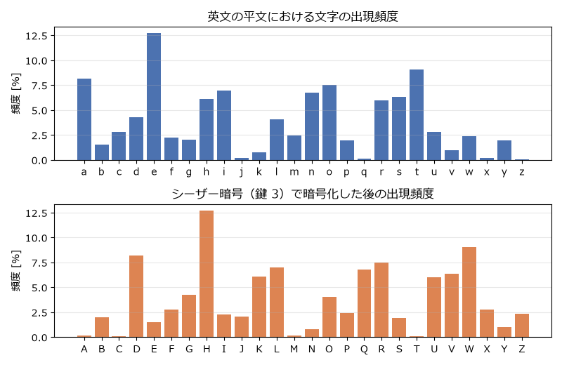

古典暗号
========

本章では、計算機が登場する以前から使われてきた古典暗号を取り上げる。古典暗号は現在では簡単に解読できるが、「なぜ破られるのか」を知ることで、現代の暗号が満たすべき条件が見えてくる。本章では英大文字 26 文字を :math:`0` から :math:`25` の整数（A = 0、B = 1、…、Z = 25）と同一視して扱う。

シーザー暗号
------------

シーザー暗号は、各文字をアルファベット順に一定数 :math:`k` だけずらす暗号である。ユリウス・カエサルが :math:`k = 3` として使ったとされる。平文の文字を :math:`m`、暗号文の文字を :math:`c` とすると、暗号化と復号は次の式で表される。

.. math::

   c = (m + k) \bmod 26, \qquad m = (c - k) \bmod 26

例えば :math:`k = 3` のとき、``ATTACK AT DAWN`` は ``DWWDFN DW GDZQ`` になる。

シーザー暗号の鍵は :math:`0` から :math:`25` の 26 通りしかないため、全ての鍵で復号を試す全数探索によって簡単に解読できる。26 個の候補のうち意味の通る文が 1 つだけ現れるので、それが平文である。:numref:`code-caesar` にシーザー暗号の実装と全数探索を示す。

.. _code-caesar:

.. literalinclude:: ../../examples/caesar.py
   :language: python
   :linenos:
   :caption: caesar.py

:download:`caesar.py をダウンロード <../../examples/caesar.py>`

単一換字式暗号と頻度分析
------------------------

単一換字式暗号は、アルファベットの各文字を、別の文字に 1 対 1 で置き換える暗号である。鍵は 26 文字の並べ替え（置換）であり、鍵の候補は :math:`26! \approx 4.0 \times 10^{26} \approx 2^{88}` 通りもある。これは全数探索では到底試しきれない数である。

しかし、単一換字式暗号は頻度分析によって簡単に解読できる。英文では ``E`` が最もよく使われ、``T``、``A``、``O`` がそれに続くといったように、文字の出現頻度に偏りがある（:numref:`fig-letter-frequency`）。単一換字式暗号では同じ平文の文字は常に同じ暗号文の文字に変換されるので、この偏りが暗号文にもそのまま残る。暗号文で最も多い文字は ``E`` に対応する可能性が高い。さらに ``THE`` のような頻出する単語や、``TH``、``HE`` のような頻出する 2 文字の組を手がかりにすれば、残りの対応も推測できる。

.. _fig-letter-frequency:

   英文の文字の出現頻度。シーザー暗号で暗号化すると、分布の形を保ったまま横にずれる。

この例は、**鍵の候補が多いことは安全であることの十分条件ではない**\ という重要な教訓を示している。暗号文に平文の統計的な性質が残っていれば、鍵を全数探索しなくても解読できてしまう。

ヴィジュネル暗号
----------------

暗号化の手順
^^^^^^^^^^^^

頻度分析への対策として考案されたのが、16 世紀に記述されたヴィジュネル暗号である。ヴィジュネル暗号は、鍵として文字列 :math:`k_0 k_1 \cdots k_{L-1}` を使い、平文の :math:`i` 文字目を :math:`k_{i \bmod L}` だけずらす。

.. math::

   c_i = (m_i + k_{i \bmod L}) \bmod 26

つまり、位置によってずらす量が変わるシーザー暗号である。同じ平文の文字でも位置によって異なる暗号文の文字に変換されるため、暗号文の文字頻度は平らに近づく。ヴィジュネル暗号は長く「解読不能な暗号」と呼ばれていた。

一致指数による鍵長の推定
^^^^^^^^^^^^^^^^^^^^^^^^

ヴィジュネル暗号も、鍵の長さ :math:`L` さえ分かれば解読できる。暗号文を :math:`L` 文字おきに取り出した列（:math:`c_0, c_L, c_{2L}, \ldots` など）は、それぞれ同じ量だけずらしたシーザー暗号になっているからである。

鍵長の推定には、19 世紀のカシスキーによる方法（同じ文字列が繰り返し現れる間隔から推定する）や、20 世紀のフリードマンによる一致指数を使う方法がある。一致指数（index of coincidence）とは、文字列から無作為に選んだ 2 文字が一致する確率である。長さ :math:`N` の文字列で文字 :math:`i` が :math:`n_i` 回現れるとき、一致指数は次の式で求められる。

.. math::

   \mathrm{IC} = \frac{\sum_{i=0}^{25} n_i (n_i - 1)}{N (N - 1)}

英文の一致指数は約 0.066 であり、26 文字が一様に現れる文字列の一致指数 :math:`1/26 \approx 0.038` よりも大きい。シーザー暗号は文字の種類を入れ替えるだけなので、一致指数を変えない。したがって、鍵長の候補 :math:`L` ごとに暗号文を :math:`L` 個の列に分けて一致指数を計算し、その値が英文に近くなる :math:`L` を探せば鍵長が分かる。

鍵の推定
^^^^^^^^

鍵長が分かれば、各列についてシーザー暗号の鍵（ずらす量）を推定すればよい。各ずらし量で列を復号し、得られた文字の出現回数 :math:`O_i` と英文の頻度から計算した期待出現回数 :math:`E_i` との隔たりを、次のカイ二乗値で測る。

.. math::

   \chi^2 = \sum_{i=0}^{25} \frac{(O_i - E_i)^2}{E_i}

カイ二乗値が最小になるずらし量が、その列の鍵である可能性が高い。:numref:`code-vigenere` に、この手順でヴィジュネル暗号を解読するプログラムを示す。

.. _code-vigenere:

.. literalinclude:: ../../examples/vigenere.py
   :language: python
   :linenos:
   :caption: vigenere.py

:download:`vigenere.py をダウンロード <../../examples/vigenere.py>`

実行すると、鍵を知らなくても暗号文だけから鍵 ``PYTHON`` が求まる。

.. code-block:: text
   :linenos:

   暗号文（先頭 60 文字）: RPRWHBVPTWVLXQMOSCGYVAWPTYGKGGJBRVTGTAAUWDJCLMCEHCVBFRRMFTIA
   推定した鍵長: 6
   推定した鍵  : PYTHON
   復号（先頭 60 文字）  : CRYPTOGRAPHYISTHEPRACTICEANDSTUDYOFTECHNIQUESFORSECURECOMMUN

ワンタイムパッド
----------------

暗号化の手順
^^^^^^^^^^^^

ヴィジュネル暗号が破られた原因は、鍵が周期的に繰り返されることにあった。それならば、平文と同じ長さの、完全にランダムな鍵を使えばよい。この考え方に基づくのが\ :term:`ワンタイムパッド`\ （バーナム暗号）である。ビット列で考えると、平文 :math:`m`、鍵 :math:`k` に対して、暗号化と復号は排他的論理和で行う。

.. math::

   c = m \oplus k, \qquad m = c \oplus k

排他的論理和は :math:`x \oplus x = 0` を満たすので、:math:`c \oplus k = m \oplus k \oplus k = m` となり、同じ演算で復号できる。ワンタイムパッドが安全であるためには、次の 3 つの条件を全て満たさなければならない。

#. 鍵は一様ランダムに生成する。
#. 鍵は平文と同じ長さ以上とする。
#. 鍵は 1 回しか使わない。

完全秘匿性
^^^^^^^^^^

Claude Shannon は 1949 年の論文で、暗号文を見ても平文についての情報が一切得られないという性質を\ :term:`完全秘匿性`\ （perfect secrecy）として定式化した。平文を確率変数 :math:`M`、暗号文を確率変数 :math:`C` とすると、完全秘匿性は次の式で表される。

.. math::

   \Pr[M = m \mid C = c] = \Pr[M = m] \quad \text{（全ての } m, c \text{ について）}

つまり、暗号文 :math:`c` を見た後でも、平文が :math:`m` である確率は暗号文を見る前と変わらない。

ワンタイムパッドが完全秘匿性を持つことは次のように示せる。:math:`n` ビットの平文 :math:`m` と暗号文 :math:`c` を任意に固定すると、:math:`c = m \oplus k` を満たす鍵は :math:`k = m \oplus c` のただ 1 つである。鍵は :math:`2^n` 通りから一様に選ばれるので、

.. math::

   \Pr[C = c \mid M = m] = \Pr[K = m \oplus c] = 2^{-n}

となり、これは :math:`m` に依存しない。したがって暗号文の分布は平文と独立であり、ベイズの定理から上の完全秘匿性の式が成り立つ。

ただし Shannon は、完全秘匿性を持つ暗号には平文の候補の数以上の鍵が必要であることも証明した。完全秘匿性を得るには長い鍵を事前に安全に共有しておく必要があり、これがワンタイムパッドの実用を難しくしている。現代の暗号は、完全秘匿性を諦める代わりに、短い鍵で計算量的安全性を実現する（:doc:`basics`\ を参照）。

鍵の再利用の危険性
^^^^^^^^^^^^^^^^^^

ワンタイムパッドの鍵を 2 回使うと、安全性は完全に失われる。同じ鍵 :math:`k` で 2 つの平文 :math:`m_1, m_2` を暗号化すると、

.. math::

   c_1 \oplus c_2 = (m_1 \oplus k) \oplus (m_2 \oplus k) = m_1 \oplus m_2

となり、鍵が消えて平文どうしの排他的論理和が得られる。自然言語の平文どうしの排他的論理和からは、頻度分析などによって両方の平文をかなりの程度復元できる。一方の平文が分かれば、もう一方はそのまま求まる。第二次世界大戦中から戦後にかけて米国がソ連の暗号文の一部を解読したヴェノナ計画は、ソ連側が鍵を再利用していたことを突いたものである。この「平文と排他的論理和を取る列（鍵ストリーム）を再利用してはならない」という原則は、:doc:`symmetric`\ で扱う CTR モードやストリーム暗号にもそのまま当てはまる。

.. _code-otp:

.. literalinclude:: ../../examples/one_time_pad.py
   :language: python
   :linenos:
   :caption: one_time_pad.py

:download:`one_time_pad.py をダウンロード <../../examples/one_time_pad.py>`

古典暗号から得られる教訓
------------------------

古典暗号の歴史から、次のような教訓が得られる。

* 鍵の候補が多くても、暗号文に平文の統計的な性質が残っていれば解読される。
* 鍵ストリームの周期性や再利用は致命的な弱点になる。
* 暗号方式を秘密にしても安全性の根拠にはならない（ケルクホフスの原理）。

Shannon は、安全な暗号が備えるべき性質として、混乱（confusion）と拡散（diffusion）を挙げた。混乱とは、暗号文と鍵の関係をできるだけ複雑にすることである。拡散とは、平文の 1 ビットの変化が暗号文の多くのビットに影響するようにして、平文の統計的な性質を暗号文全体に散らすことである。:doc:`symmetric`\ で扱う現代のブロック暗号は、この 2 つの性質を、単純な処理の繰り返しによって実現している。
