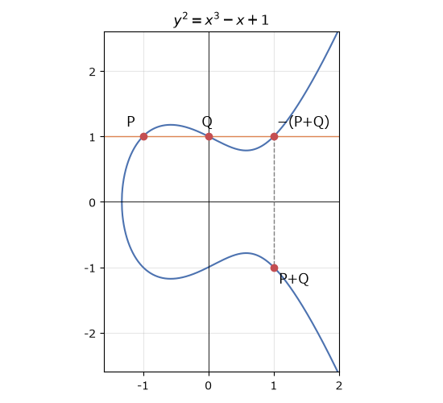
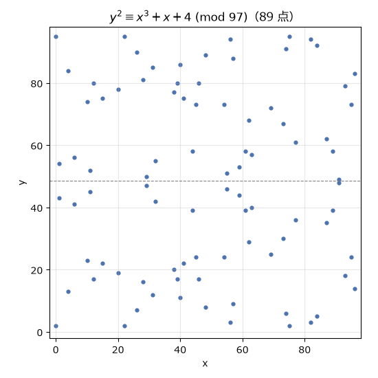

楕円曲線暗号
============

:doc:`key_exchange`\ で扱った DH 鍵共有は、:math:`\mathbb{Z}_p^*` という群の上で離散対数問題の難しさを利用していた。同じ考え方は、離散対数問題が難しい他の群の上でも使える。本章では、楕円曲線上の点がなす群を使う楕円曲線暗号（elliptic curve cryptography、ECC）を扱う。楕円曲線暗号は、RSA や :math:`\mathbb{Z}_p^*` 上の DH よりもはるかに短い鍵で同じ安全性を実現でき、現在の TLS や SSH、暗号資産などで広く使われている。

楕円曲線とは
------------

本書で扱う楕円曲線は、次の形の方程式で表される曲線である。

.. math::

   y^2 = x^3 + a x + b, \qquad 4a^3 + 27b^2 \neq 0

条件 :math:`4a^3 + 27b^2 \neq 0` は、曲線に尖った点や自己交差がないことを保証する。楕円曲線は楕円そのものではない。名前は、楕円の弧長を求める積分（楕円積分）の研究から生まれたことに由来する。:numref:`fig-ec-real` に、実数の範囲で描いた楕円曲線 :math:`y^2 = x^3 - x + 1` を示す。曲線は :math:`x` 軸に関して対称である。

.. _fig-ec-real:

   実数体上の楕円曲線 :math:`y^2 = x^3 - x + 1` と点の加算

点の加算
--------

幾何学的な定義
^^^^^^^^^^^^^^

楕円曲線上の点には、次のように「加算」を定義できる。

* 曲線上の 2 点 :math:`P, Q` を通る直線を引くと、直線は曲線ともう 1 点で交わる。その点を :math:`x` 軸に関して折り返した点を :math:`P + Q` とする（:numref:`fig-ec-real`）。
* :math:`P = Q` の場合は、:math:`P` における接線を使う。
* :math:`P` を :math:`x` 軸に関して折り返した点を :math:`-P` とする。:math:`P` と :math:`-P` を通る直線は :math:`y` 軸に平行になり、曲線と 3 点目で交わらない。そこで、全ての縦線が通る「無限遠点」\ :math:`\mathcal{O}` を考え、:math:`P + (-P) = \mathcal{O}` とする。

無限遠点 :math:`\mathcal{O}` は、加算の単位元（数の加算における 0）の役割を果たす。

加算の公式
^^^^^^^^^^

:math:`P = (x_1, y_1)`、:math:`Q = (x_2, y_2)`、:math:`P + Q = (x_3, y_3)` とすると、直線の傾き :math:`\lambda` を使って、:math:`P + Q` は次の式で計算できる。

.. math::

   \lambda =
   \begin{cases}
   \dfrac{y_2 - y_1}{x_2 - x_1} & (P \neq Q) \\[2ex]
   \dfrac{3 x_1^2 + a}{2 y_1} & (P = Q)
   \end{cases}

.. math::

   x_3 = \lambda^2 - x_1 - x_2, \qquad y_3 = \lambda (x_1 - x_3) - y_1

:numref:`fig-ec-real` の例で確かめてみよう。:math:`P = (-1, 1)`、:math:`Q = (0, 1)` とすると、:math:`\lambda = 0` なので、:math:`x_3 = 0 - (-1) - 0 = 1`、:math:`y_3 = 0 - 1 = -1` となり、:math:`P + Q = (1, -1)` が得られる。

この加算について、楕円曲線上の点と無限遠点の集合は可換群をなす（:doc:`math`\ を参照）。交換法則は直線の対称性から明らかだが、結合法則が成り立つことの証明は簡単ではない。

有限体上の楕円曲線
------------------

暗号で使う楕円曲線は、実数ではなく有限体 :math:`\mathbb{F}_p` の上で考える。つまり、方程式と加算の公式を全て :math:`\bmod p` で計算する。割り算は、モジュラ逆元を掛けることで行う。:numref:`fig-ec-finite` は、:math:`\mathbb{F}_{97}` 上の楕円曲線 :math:`y^2 \equiv x^3 + x + 4 \pmod{97}` の点を示したものである。もはや曲線には見えないが、:math:`y = 97/2` に関して対称であることなど、実数の場合の性質の一部が残っている。

.. _fig-ec-finite:

   :math:`\mathbb{F}_{97}` 上の楕円曲線 :math:`y^2 \equiv x^3 + x + 4` の点（無限遠点を含めて 89 点）

有限体 :math:`\mathbb{F}_p` 上の楕円曲線の点の個数 :math:`N` は、ハッセの定理により :math:`|N - (p + 1)| \le 2\sqrt{p}` を満たし、おおよそ :math:`p` に近い。この曲線の点の個数 89 は素数なので、:doc:`math`\ で述べたとおり、無限遠点以外のどの点も群全体を生成する。

スカラー倍算と楕円曲線離散対数問題
----------------------------------

点 :math:`G` を :math:`d` 回足したものを :math:`dG` と書き、スカラー倍算と呼ぶ。

.. math::

   dG = \underbrace{G + G + \cdots + G}_{d \text{ 個}}

:math:`dG` は、:doc:`math`\ で述べた繰り返し二乗法と同じ考え方（二倍算と加算の繰り返し）で、:math:`d` のビット長に比例する回数の加算で計算できる。一方、:math:`G` と :math:`Q = dG` から :math:`d` を求める問題を\ :term:`楕円曲線離散対数問題`\ （ECDLP）と呼ぶ。適切に選んだ曲線では、ECDLP を解く最良の方法はポラードのロー法などの汎用的なアルゴリズムであり、:math:`G` の位数を :math:`n` とすると約 :math:`\sqrt{n}` 回の計算が必要になる。したがって、:math:`n` が 256 ビットの曲線は約 128 ビットの安全性を持つ。

:math:`\mathbb{Z}_p^*` 上の離散対数問題や素因数分解問題には、汎用的なアルゴリズムよりもずっと速い数体ふるい法などの専用のアルゴリズムが存在する。楕円曲線ではそのような攻撃が知られていないため、短い鍵で済むのである。RSA と楕円曲線暗号で同じ安全性を得るために必要な鍵長は、:numref:`tbl-security-strength` に示したとおりである。

ECDH
----

DH 鍵共有を楕円曲線の群の上で行うものを ECDH（楕円曲線 Diffie-Hellman）と呼ぶ。曲線とベースポイント :math:`G`\ （位数 :math:`n`）を公開パラメータとし、次の手順で鍵を共有する。

#. Alice は秘密鍵 :math:`d_A \in [1, n-1]` を選び、公開鍵 :math:`Q_A = d_A G` を Bob に送る。
#. Bob は秘密鍵 :math:`d_B \in [1, n-1]` を選び、公開鍵 :math:`Q_B = d_B G` を Alice に送る。
#. Alice は :math:`d_A Q_B` を、Bob は :math:`d_B Q_A` を計算する。どちらも :math:`d_A d_B G` に等しい。

:numref:`code-toy-ecc` は、:numref:`fig-ec-finite` の曲線上で点の加算、スカラー倍算、ECDH を行うおもちゃ実装である。

.. _code-toy-ecc:

.. literalinclude:: ../../examples/toy_ecc.py
   :language: python
   :linenos:
   :caption: toy_ecc.py

:download:`toy_ecc.py をダウンロード <../../examples/toy_ecc.py>`

.. code-block:: text
   :linenos:

   ベースポイント G = (0, 2), 位数 n = 89
   G の倍数: [(0, 2), (91, 48), (54, 24), (59, 53), (22, 2)] ...
   Alice: 秘密鍵 23, 公開鍵 (63, 57)
   Bob  : 秘密鍵 85, 公開鍵 (59, 44)
   共有した点: Alice (54, 73), Bob (54, 73)

この例では位数が 89 しかないので、全数探索で簡単に秘密鍵が求まる。実際の暗号では、位数が 256 ビット程度の曲線を使う。

標準的な曲線
------------

楕円曲線暗号の安全性は曲線の選び方に大きく依存するため、自分で曲線を作らず、標準化された曲線を使う。

.. list-table:: 代表的な楕円曲線
   :header-rows: 1
   :widths: 25 75

   * - 曲線
     - 特徴
   * - P-256（secp256r1）
     - NIST が標準化した 256 ビットの曲線。TLS の証明書や署名などで広く使われている。ほかに P-384、P-521 がある。
   * - secp256k1
     - :math:`y^2 = x^3 + 7` の形の曲線。Bitcoin や Ethereum の署名に使われている。
   * - Curve25519
     - Bernstein が 2006 年に設計した曲線。:math:`p = 2^{255} - 19` 上のモンゴメリー曲線 :math:`y^2 = x^3 + 486662 x^2 + x` である。鍵共有用の関数 X25519 が RFC 7748 [RFC7748]_ で規定されている。
   * - Curve448
     - 約 224 ビットの安全性を持つ曲線。鍵共有用の関数 X448 が RFC 7748 で規定されている。

X25519 は、高速であることに加え、安全な実装がしやすいように設計されている。例えば、P-256 などでは、受け取った公開鍵が曲線上の点であるかを検証しないと、不正な点を使って秘密鍵を探る攻撃（invalid curve attack）を受ける恐れがある。X25519 は、受け取った公開鍵が曲線上の点かどうかを検証しなくても、この種の攻撃が成立しないように設計されている。また、スカラー倍算をタイミング攻撃（:doc:`pitfalls`）に強い形で実装しやすい。:numref:`code-x25519-demo` は、``cryptography`` ライブラリで X25519 を使う例である。共有秘密は、:doc:`key_exchange`\ で述べた HKDF を通して鍵に変換している。

.. _code-x25519-demo:

.. literalinclude:: ../../examples/x25519_demo.py
   :language: python
   :linenos:
   :caption: x25519_demo.py

:download:`x25519_demo.py をダウンロード <../../examples/x25519_demo.py>`
