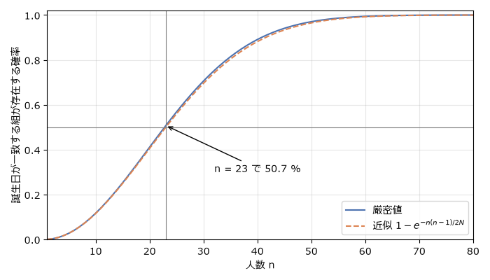

ハッシュ関数とメッセージ認証
============================

本章では、任意の長さのデータを固定長の値に要約する暗号学的ハッシュ関数と、鍵を使って改ざんを検知するメッセージ認証コード（MAC）を扱う。最後に、ハッシュ関数の重要な応用であるパスワードの保存方法を説明する。

ハッシュ関数とその性質
----------------------

:term:`ハッシュ関数` :math:`H` は、任意の長さの入力 :math:`m` から固定長（:math:`n` ビット）の出力 :math:`H(m)` を計算する関数である。出力をハッシュ値またはダイジェストと呼ぶ。辞書（ハッシュテーブル）で使うハッシュ関数とは異なり、暗号学的ハッシュ関数には次の 3 つの性質が求められる。

.. list-table:: 暗号学的ハッシュ関数に求められる性質
   :header-rows: 1
   :widths: 25 45 30

   * - 性質
     - 内容
     - 汎用的な攻撃の計算量
   * - 原像計算困難性
     - ハッシュ値 :math:`h` が与えられたとき、:math:`H(m) = h` となる :math:`m` を求めることが困難である。
     - :math:`2^n`
   * - 第二原像計算困難性
     - 入力 :math:`m` が与えられたとき、:math:`H(m') = H(m)` となる :math:`m' \neq m` を求めることが困難である。
     - :math:`2^n`
   * - 衝突困難性
     - :math:`H(m) = H(m')` となる異なる 2 つの入力 :math:`m, m'` を求めることが困難である。
     - :math:`2^{n/2}`

入力の種類は無限にあり、出力は :math:`2^n` 通りしかないので、ハッシュ値が一致する異なる入力の組（:term:`衝突`）は必ず存在する。衝突困難性とは、衝突が存在しないことではなく、それを見つけることが計算量的に困難であることを意味する。なお、衝突困難性を満たすハッシュ関数は第二原像計算困難性も満たす。第二原像が求まれば、それはそのまま衝突になるからである。

ハッシュ関数は、ファイルの改ざん検知、デジタル署名（:doc:`signature`）、鍵の導出、パスワードの保存、ブロックチェーンなど、暗号のあらゆる場面で部品として使われる。

また、良いハッシュ関数では、入力が 1 ビット変わるだけで出力のおよそ半分のビットが変わる。これを雪崩効果と呼ぶ。:numref:`code-hash-demo` で確かめられる。

.. _code-hash-demo:

.. literalinclude:: ../../examples/hash_demo.py
   :language: python
   :linenos:
   :caption: hash_demo.py

:download:`hash_demo.py をダウンロード <../../examples/hash_demo.py>`

誕生日攻撃
----------

衝突を探す汎用的な攻撃の計算量が :math:`2^n` ではなく :math:`2^{n/2}` である理由は、誕生日のパラドックスと呼ばれる現象にある。:math:`k` 人の誕生日（:math:`N = 365` 通り）がどれも異なる確率は次のとおりである。

.. math::

   \Pr[\text{全員異なる}] = \prod_{i=0}^{k-1} \left( 1 - \frac{i}{N} \right) \approx \exp\left( -\frac{k(k-1)}{2N} \right)

近似には :math:`1 - x \approx e^{-x}` を使った。誕生日が一致する組が存在する確率は :math:`1` からこれを引いたものであり、:numref:`fig-birthday` のように変化する。わずか 23 人で確率が 50 % を超える。一般に、確率が 50 % になる人数は約 :math:`1.18 \sqrt{N}` である。

.. _fig-birthday:

   人数と、誕生日が一致する組が存在する確率（N = 365）

ハッシュ値を誕生日、:math:`N = 2^n`\ （:math:`n` はハッシュ値のビット長）とみなせば、ランダムな入力のハッシュ値を約 :math:`2^{n/2}` 個計算するだけで、高い確率で衝突が見つかる。これを誕生日攻撃と呼ぶ。128 ビットの衝突困難性を得るには、出力が 256 ビットのハッシュ関数が必要になる。:numref:`code-birthday-attack` は、SHA-256 の出力を短く切り詰めて誕生日攻撃を試すプログラムである。

.. _code-birthday-attack:

.. literalinclude:: ../../examples/birthday_attack.py
   :language: python
   :linenos:
   :caption: birthday_attack.py

:download:`birthday_attack.py をダウンロード <../../examples/birthday_attack.py>`

衝突までの試行回数は毎回変わるが、出力が 8 ビット増えるごとに試行回数はおよそ 16 倍（:math:`2^{8/2}`）になる。

代表的なハッシュ関数
--------------------

.. list-table:: 代表的なハッシュ関数
   :header-rows: 1
   :widths: 20 15 65

   * - 名称
     - 出力長
     - 状況
   * - MD5
     - 128 ビット
     - 2004 年に衝突の具体例が発表された。現在は数秒で衝突を作れる。暗号用途に使ってはならない。
   * - SHA-1
     - 160 ビット
     - 2017 年に Google などが実際の衝突（SHAttered）を発表した。暗号用途に使ってはならない。
   * - SHA-2（SHA-256、SHA-384、SHA-512 など）
     - 224 〜 512 ビット
     - FIPS 180-4 [FIPS180-4]_ で規定。現在最も広く使われている。
   * - SHA-3（SHA3-256 など）
     - 224 〜 512 ビット
     - 2015 年に FIPS 202 [FIPS202]_ で規定。SHA-2 とは異なるスポンジ構造を採用している。
   * - BLAKE2
     - 最大 512 ビット
     - SHA-3 の最終候補 BLAKE を改良したもの。ソフトウェアで高速であり、Python の ``hashlib`` でも使える。

Merkle-Damgård 構造
^^^^^^^^^^^^^^^^^^^

MD5、SHA-1、SHA-2 は、Merkle-Damgård 構造と呼ばれる方法で作られている。入力にパディング（入力の長さを含む）を付けて固定長のブロック :math:`m_1, m_2, \ldots, m_t` に分割し、圧縮関数 :math:`f` を繰り返し適用する（:numref:`fig-merkle-damgard`）。

.. math::

   h_0 = \mathrm{IV}, \qquad h_i = f(h_{i-1}, m_i), \qquad H(m) = h_t

.. _fig-merkle-damgard:

.. graphviz::
   :caption: Merkle-Damgård 構造
   :align: center

   digraph md {
       rankdir=LR;
       node [shape=box, style="rounded,filled", fillcolor="#eef3fb"];
       IV [label="IV", fillcolor="#f3f3f3"];
       f1 [label="f", fillcolor="#fdf1e3"]; f2 [label="f", fillcolor="#fdf1e3"]; f3 [label="f", fillcolor="#fdf1e3"];
       m1 [label="m_1"]; m2 [label="m_2"]; m3 [label="m_t\n（パディングを含む）"];
       H [label="H(m)", fillcolor="#e8f4ea"];
       dots [label="…", shape=plaintext, style=""];
       IV -> f1 [label="h_0"];
       f1 -> f2 [label="h_1"];
       f2 -> dots [label="h_2"];
       dots -> f3;
       f3 -> H [label="h_t"];
       m1 -> f1; m2 -> f2; m3 -> f3;
   }

圧縮関数が衝突困難であれば、ハッシュ関数全体も衝突困難になることが証明されている。

この構造には、伸長攻撃（length extension attack）と呼ばれる弱点がある。:math:`H(m)` の値は最後の内部状態 :math:`h_t` そのものなので、:math:`H(m)` と :math:`m` の長さが分かれば、:math:`m` の中身を知らなくても、:math:`m` にパディングと任意のデータ :math:`m'` を続けた入力のハッシュ値を計算できる。このため、秘密の鍵 :math:`K` を使って :math:`H(K \| m)` を改ざん検知用の値とする方法は安全ではない。攻撃者は :math:`K` を知らなくても :math:`H(K \| m \| \text{パディング} \| m')` を計算できてしまう。この問題は次節の HMAC で解決する。

スポンジ構造
^^^^^^^^^^^^

SHA-3 は、Keccak という関数をもとにしたスポンジ構造を採用している。:math:`b` ビットの内部状態を、外部とやり取りする :math:`r` ビット（レート）と、外部に出さない :math:`c` ビット（キャパシティ）に分ける。吸収段階では入力を :math:`r` ビットずつ状態に排他的論理和で取り込みながら置換関数を適用し、絞り出し段階では状態の :math:`r` ビットを出力として取り出す。SHA3-256 では :math:`b = 1600`、:math:`r = 1088`、:math:`c = 512` である。出力は内部状態の一部にすぎないので、SHA-3 は伸長攻撃を受けない。

メッセージ認証コード
--------------------

MAC の役割
^^^^^^^^^^

ハッシュ値を使えばデータの改ざんを検知できるように思えるが、ハッシュ関数は誰でも計算できる。攻撃者はデータを改ざんした後、ハッシュ値も計算し直して差し替えればよい。改ざんを検知するには、正当な送信者と受信者だけが知っている秘密の鍵が必要である。

:term:`MAC`\ （message authentication code、メッセージ認証コード）は、鍵 :math:`K` とメッセージ :math:`m` からタグ :math:`t = \mathrm{MAC}_K(m)` を計算する関数である。送信者は :math:`(m, t)` を送り、受信者は同じ鍵でタグを計算し直して、受け取ったタグと一致するかを確かめる。MAC の安全性は、攻撃者が好きなメッセージのタグを入手できる状況（選択メッセージ攻撃）でも、まだタグを見たことのないメッセージについて正しいタグを作れないこととして定義される。

MAC によって、メッセージが改ざんされていないこと（完全性）と、鍵を持つ者が作成したこと（メッセージ認証）を確認できる。ただし、送信者と受信者が同じ鍵を持つため、受信者もタグを作れる。したがって、第三者に対して「送信者が作った」ことを証明する否認防止には使えない。否認防止には\ :doc:`signature`\ を使う。

HMAC
^^^^

:term:`HMAC` は、ハッシュ関数から MAC を構成する標準的な方法であり、RFC 2104 [RFC2104]_ で規定されている。ハッシュ関数のブロック長に合わせて調整した鍵を :math:`K'` とすると、HMAC は次の式で計算する。

.. math::

   \mathrm{HMAC}_K(m) = H\big( (K' \oplus \mathrm{opad}) \,\|\, H\big( (K' \oplus \mathrm{ipad}) \,\|\, m \big) \big)

ここで ipad はバイト ``36``、opad はバイト ``5c`` をブロック長だけ並べた定数である。内側のハッシュ値をさらに外側のハッシュ関数に通すため、Merkle-Damgård 構造のハッシュ関数を使っても伸長攻撃を受けない。Python では標準ライブラリの ``hmac`` モジュールで計算できる（:numref:`code-hmac-demo`）。

.. _code-hmac-demo:

.. literalinclude:: ../../examples/hmac_demo.py
   :language: python
   :linenos:
   :caption: hmac_demo.py

:download:`hmac_demo.py をダウンロード <../../examples/hmac_demo.py>`

タグの比較には ``==`` ではなく ``hmac.compare_digest()`` を使っている。``==`` による比較は、一致しないバイトが見つかった時点で終了するため、処理時間からタグの内容が推測される恐れがある。この問題は\ :doc:`pitfalls`\ で詳しく扱う。

パスワードの保存
----------------

パスワードの保存は、ハッシュ関数の最も身近な応用の 1 つであると同時に、誤った実装が多い分野でもある。

平文やハッシュ値だけで保存してはならない理由
^^^^^^^^^^^^^^^^^^^^^^^^^^^^^^^^^^^^^^^^^^^^

パスワードを平文で保存すると、データベースが漏洩した時点で全てのパスワードが知られてしまう。多くの利用者は同じパスワードを複数のサービスで使い回しているため、被害は他のサービスにも及ぶ。

パスワードの SHA-256 ハッシュ値だけを保存する方法も不十分である。人間が選ぶパスワードの種類は限られているので、攻撃者はよく使われるパスワードのハッシュ値をあらかじめ計算した表（レインボーテーブルなど）を使って、ハッシュ値からパスワードを逆引きできる。また、同じパスワードを使う利用者は同じハッシュ値になるので、一度に多くの利用者のパスワードが判明する。さらに、SHA-256 は高速に計算できるように設計されているため、GPU を使えば毎秒数十億個以上の候補を試せる。

ソルトとストレッチング
^^^^^^^^^^^^^^^^^^^^^^

そこで、次の 2 つの対策を組み合わせる。

* :term:`ソルト`\ ：利用者ごとに異なるランダムな値を生成し、パスワードと一緒にハッシュ関数に入力する。ソルトはハッシュ値と一緒に保存してよい。同じパスワードでもソルトが違えばハッシュ値が異なるので、事前計算した表が使えなくなり、利用者ごとに個別に攻撃しなければならなくなる。
* :term:`ストレッチング`\ ：ハッシュ値の計算を意図的に遅くする。正規の利用者のログインでは 1 回の計算が数十ミリ秒かかっても問題ないが、攻撃者が試せる候補の数は大幅に減る。

パスワードの保存には、これらの対策を組み込んだ専用の関数を使う。

.. list-table:: パスワードの保存に使う関数
   :header-rows: 1
   :widths: 20 20 60

   * - 関数
     - 規格
     - 特徴
   * - PBKDF2
     - RFC 8018
     - HMAC を指定回数繰り返す。広く実装されているが、GPU や専用回路による並列攻撃に弱い。
   * - scrypt
     - RFC 7914
     - 大量のメモリを必要とするように設計されており（メモリハード）、専用回路による攻撃のコストを上げる。
   * - Argon2
     - RFC 9106
     - 2015 年の Password Hashing Competition の優勝方式。メモリハードであり、Argon2id が推奨されている。

このほか、1999 年に発表された bcrypt も広く使われている。OWASP のガイドライン [OWASP-PW]_ は、Argon2id を第一の選択肢とし、使えない場合は scrypt を、FIPS 140 への準拠が必要な場合は PBKDF2 を推奨している。Python の標準ライブラリでは ``hashlib.scrypt()`` と ``hashlib.pbkdf2_hmac()`` が使える。Argon2 を使うには、``argon2-cffi`` などの外部ライブラリが必要である。:numref:`code-password-hash` は ``hashlib.scrypt()`` を使った例である。

.. _code-password-hash:

.. literalinclude:: ../../examples/password_hash.py
   :language: python
   :linenos:
   :caption: password_hash.py

:download:`password_hash.py をダウンロード <../../examples/password_hash.py>`
