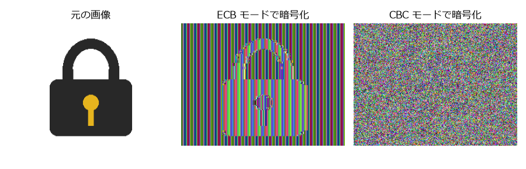

共通鍵暗号
==========

共通鍵暗号は、暗号化と復号に同じ鍵を使う暗号である。公開鍵暗号に比べて数百倍から数千倍高速であり、実際のデータの暗号化はほぼ全て共通鍵暗号で行われる。本章では、ブロック暗号（DES、AES）、ブロック暗号を使って任意の長さのデータを暗号化するための暗号利用モード、ストリーム暗号（ChaCha20）を扱う。

ブロック暗号とストリーム暗号
----------------------------

共通鍵暗号は、処理の単位によって 2 種類に分けられる。

* :term:`ブロック暗号`\ は、平文を固定長のブロック（AES では 128 ビット）に区切り、ブロック単位で暗号化する。
* :term:`ストリーム暗号`\ は、鍵から擬似乱数列（鍵ストリーム）を生成し、平文と 1 ビット（または 1 バイト）ずつ排他的論理和を取って暗号化する。

ブロック暗号は、鍵 :math:`K` を決めるごとに :math:`n` ビットのブロックの集合 :math:`\{0, 1\}^n` 上の置換（1 対 1 の写像）を 1 つ定める関数とみなせる。

.. math::

   E : \{0, 1\}^{\ell} \times \{0, 1\}^n \to \{0, 1\}^n, \qquad (K, P) \mapsto C = E_K(P)

復号はこの置換の逆写像 :math:`D_K = E_K^{-1}` である。安全なブロック暗号とは、鍵を知らない攻撃者にとって、:math:`E_K` が :math:`\{0, 1\}^n` 上の真にランダムな置換と区別できないものをいう。これを擬似ランダム置換（pseudorandom permutation、PRP）と呼ぶ。

ブロック暗号の構造
------------------

現代のブロック暗号は、単純な処理（ラウンド関数）を何度も繰り返すことで、:doc:`classical`\ で述べた混乱と拡散を実現している。各ラウンドには、元の鍵から鍵スケジュールと呼ばれる手順で生成したラウンド鍵を使う。ラウンド関数の構成方法には、主に Feistel 構造と SPN 構造の 2 つがある。

Feistel 構造
^^^^^^^^^^^^

Feistel 構造は、ブロックを左半分 :math:`L` と右半分 :math:`R` に分け、次の処理を繰り返す（:numref:`fig-feistel`）。

.. math::

   L_{i+1} = R_i, \qquad R_{i+1} = L_i \oplus F(K_i, R_i)

.. _fig-feistel:

.. graphviz::
   :caption: Feistel 構造の 1 ラウンド
   :align: center

   digraph feistel {
       node [shape=box, style="rounded,filled", fillcolor="#eef3fb"];
       splines=line;
       Li [label="L_i"]; Ri [label="R_i"];
       F [label="F", shape=box, fillcolor="#fdf1e3"];
       K [label="ラウンド鍵 K_i", shape=plaintext, style=""];
       X [label="⊕", shape=circle, fillcolor="#ffffff", width=0.4, fixedsize=true];
       Li1 [label="L_{i+1}"]; Ri1 [label="R_{i+1}"];
       {rank=same; Li; Ri;}
       {rank=same; X; F; K;}
       {rank=same; Li1; Ri1;}
       Li -> Ri [style=invis];
       Li1 -> Ri1 [style=invis];
       Li -> X;
       Ri -> F;
       F -> K [dir=back];
       X -> F [dir=back];
       X -> Ri1;
       Ri -> Li1;
   }

Feistel 構造の利点は、ラウンド関数 :math:`F` が逆写像を持たなくても、全体として逆変換が可能なことである。:math:`R_i = L_{i+1}`、:math:`L_i = R_{i+1} \oplus F(K_i, L_{i+1})` によって 1 つ前の状態に戻せるので、復号はラウンド鍵を逆順に使うだけで、暗号化と同じ回路で実行できる。

DES とその終焉
^^^^^^^^^^^^^^

DES（Data Encryption Standard）は、1977 年に米国の標準暗号として採用された、Feistel 構造のブロック暗号である。ブロック長は 64 ビット、鍵長は 56 ビット、ラウンド数は 16 である。

DES の最大の弱点は鍵長の短さにあった。鍵の候補は :math:`2^{56} \approx 7.2 \times 10^{16}` 通りしかなく、1998 年には EFF（Electronic Frontier Foundation）が製作した専用の解読機が 56 時間で鍵を全数探索した。1999 年には、この解読機とインターネット上の分散計算を組み合わせ、約 22 時間で解読されている。

延命策として、DES を 3 回適用する Triple DES（:math:`C = E_{K_3}(D_{K_2}(E_{K_1}(P)))`）が使われたが、処理が遅いうえにブロック長が 64 ビットと短い。ブロック長が短いと、:doc:`hash`\ で述べる誕生日のパラドックスにより、同じ鍵で数十 GB 程度を暗号化しただけで暗号文ブロックの一致が起こり、情報が漏れる。NIST は 2023 年末をもって Triple DES による新たな暗号化を認めないこととした。

AES
---

選定の経緯
^^^^^^^^^^

AES（Advanced Encryption Standard）は、DES の後継として NIST が公開のコンペティションで選定したブロック暗号である。世界中から集まった 15 の候補から、2000 年にベルギーの Joan Daemen と Vincent Rijmen による Rijndael が選ばれ、2001 年に FIPS 197 [FIPS197]_ として標準化された。現在、最も広く使われているブロック暗号である。

AES のブロック長は 128 ビットであり、鍵長は 128、192、256 ビットの 3 種類から選べる。ラウンド数は鍵長によって異なり、それぞれ 10、12、14 である。

ラウンドの構成
^^^^^^^^^^^^^^

AES は Feistel 構造ではなく、SPN 構造（substitution-permutation network）を採用している。128 ビットのブロックを 4 × 4 のバイトの行列（ステートと呼ぶ）として扱い、各ラウンドで次の 4 つの処理を行う。

.. list-table:: AES のラウンドを構成する処理
   :header-rows: 1
   :widths: 22 50 28

   * - 処理
     - 内容
     - 役割
   * - SubBytes
     - 各バイトを S-box と呼ばれる表で別のバイトに置き換える。S-box は :math:`\mathrm{GF}(2^8)` における逆元の計算とアフィン変換を組み合わせたものである。
     - 混乱（唯一の非線形な処理）
   * - ShiftRows
     - 行列の第 :math:`i` 行（:math:`i = 0, 1, 2, 3`）を左に :math:`i` バイト巡回シフトする。
     - 拡散（列をまたいでバイトを混ぜる）
   * - MixColumns
     - 各列を :math:`\mathrm{GF}(2^8)` 上の 4 × 4 行列と掛け合わせる。
     - 拡散（列の中でバイトを混ぜる）
   * - AddRoundKey
     - ステートとラウンド鍵の排他的論理和を取る。
     - 鍵の混ぜ込み

最初のラウンドの前に AddRoundKey を 1 回行い、最終ラウンドでは MixColumns を省略する。ShiftRows と MixColumns の組み合わせにより、2 ラウンドで 1 バイトの変化がステートの全 16 バイトに広がる。

AES は、DES の解析で発展した差分解読法や線形解読法（入力の差分の伝わり方や、入出力の線形な近似式の偏りを統計的に利用して鍵を求める攻撃）に対する耐性を考慮して設計されている。現在までに、実用上の脅威となる攻撃は見つかっていない。また、多くの CPU が AES 専用の命令（Intel / AMD の AES-NI、ARMv8 の暗号拡張など）を備えており、非常に高速に処理できる。

パディング
----------

ブロック暗号は固定長のブロックしか扱えないため、平文の長さをブロック長の倍数に揃えるように、末尾に詰め物（:term:`パディング`）を付けてから暗号化する。代表的な方式は PKCS #7 パディングであり、不足するバイト数を :math:`p` として、値 :math:`p` のバイトを :math:`p` 個付け加える。例えば、ブロック長 16 バイトで平文が 13 バイトなら ``03 03 03`` を付け加える。平文の長さがちょうどブロック長の倍数の場合も、値 16（16 進数で ``10``）のバイトを 16 個並べた 1 ブロックを付け加える。こうすることで、復号後に最後のバイトの値を見れば、取り除くべきパディングの長さが必ず分かる。

なお、パディングの検査結果が攻撃者に漏れると、:doc:`pitfalls`\ で扱うパディングオラクル攻撃が可能になる。

暗号利用モード
--------------

ブロック暗号そのものは 1 ブロックしか暗号化できない。任意の長さのデータを暗号化するために、ブロック暗号をどのように繰り返し使うかを定めたものを\ :term:`暗号利用モード`\ （mode of operation）と呼ぶ。代表的なモードは NIST SP 800-38A [SP800-38A]_ で定められている。以下、平文ブロックを :math:`P_1, P_2, \ldots`、暗号文ブロックを :math:`C_1, C_2, \ldots` とする。

ECB モード
^^^^^^^^^^

ECB（Electronic Codebook）モードは、各ブロックを独立に暗号化する最も単純なモードである。

.. math::

   C_i = E_K(P_i)

ECB モードでは、同じ平文ブロックは常に同じ暗号文ブロックになる。つまり、ブロック単位の単一換字式暗号であり、平文の繰り返しのパターンが暗号文に残る。:numref:`fig-ecb-vs-cbc` は、単色の領域が多い画像の画素データを ECB モードと CBC モードで暗号化し、その結果を画像として表示したものである。ECB モードでは、元の画像の輪郭がはっきり読み取れる。

.. _fig-ecb-vs-cbc:

   同じ画像を AES の ECB モードと CBC モードで暗号化した結果

ECB モードは決定的なので、:doc:`basics`\ で述べた IND-CPA 安全性も満たさない。**ECB モードは使ってはならない。**

CBC モード
^^^^^^^^^^

CBC（Cipher Block Chaining）モードは、各平文ブロックに 1 つ前の暗号文ブロックの排他的論理和を取ってから暗号化する（:numref:`fig-cbc`）。最初のブロックには、前の暗号文ブロックの代わりに\ :term:`初期化ベクトル`\ （IV）を使う。

.. math::

   C_0 = \mathrm{IV}, \qquad C_i = E_K(P_i \oplus C_{i-1}), \qquad P_i = D_K(C_i) \oplus C_{i-1}

.. _fig-cbc:

.. graphviz::
   :caption: CBC モードによる暗号化
   :align: center

   digraph cbc {
       node [shape=box, style="rounded,filled", fillcolor="#eef3fb"];
       IV [label="IV", fillcolor="#f3f3f3"];
       P1 [label="P_1"]; P2 [label="P_2"]; P3 [label="P_3"];
       X1 [label="⊕", shape=circle, width=0.4, fixedsize=true, fillcolor="#ffffff"];
       X2 [label="⊕", shape=circle, width=0.4, fixedsize=true, fillcolor="#ffffff"];
       X3 [label="⊕", shape=circle, width=0.4, fixedsize=true, fillcolor="#ffffff"];
       E1 [label="E_K", fillcolor="#fdf1e3"]; E2 [label="E_K", fillcolor="#fdf1e3"]; E3 [label="E_K", fillcolor="#fdf1e3"];
       C1 [label="C_1", fillcolor="#e8f4ea"]; C2 [label="C_2", fillcolor="#e8f4ea"]; C3 [label="C_3", fillcolor="#e8f4ea"];
       {rank=same; P1; P2; P3;}
       {rank=same; IV; X1; X2; X3;}
       {rank=same; E1; E2; E3;}
       {rank=same; C1; C2; C3;}
       P1 -> P2 -> P3 [style=invis];
       X1 -> X2 -> X3 [style=invis];
       E1 -> E2 -> E3 [style=invis];
       C1 -> C2 -> C3 [style=invis];
       P1 -> X1; P2 -> X2; P3 -> X3;
       IV -> X1;
       X1 -> E1; X2 -> E2; X3 -> E3;
       E1 -> C1; E2 -> C2; E3 -> C3;
       C1 -> X2 [constraint=false];
       C2 -> X3 [constraint=false];
   }

同じ平文ブロックでも直前の暗号文ブロックが異なれば別の暗号文ブロックになるため、:numref:`fig-ecb-vs-cbc` のように平文のパターンは消える。CBC モードの注意点は次のとおりである。

* IV はメッセージごとに予測不可能な乱数として生成しなければならない。IV は秘密にする必要はなく、通常は暗号文の先頭に付けて送る。IV が予測できると選択平文攻撃が可能になる（TLS 1.0 に対する BEAST 攻撃がその例である）。
* 暗号化は前のブロックの結果を待つ必要があるため並列化できない。復号は :math:`C_{i-1}` と :math:`C_i` が揃っていれば計算できるので並列化できる。
* パディングが必要である。

CTR モード
^^^^^^^^^^

CTR（Counter）モードは、ナンスとカウンタを連結した値をブロック暗号で暗号化して鍵ストリームを作り、平文と排他的論理和を取る（:numref:`fig-ctr`）。ブロック暗号をストリーム暗号として使うモードである。

.. math::

   C_i = P_i \oplus E_K(\mathrm{nonce} \,\|\, i)

.. _fig-ctr:

.. graphviz::
   :caption: CTR モードによる暗号化
   :align: center

   digraph ctr {
       node [shape=box, style="rounded,filled", fillcolor="#eef3fb"];
       N1 [label="nonce ‖ 1", fillcolor="#f3f3f3"]; N2 [label="nonce ‖ 2", fillcolor="#f3f3f3"]; N3 [label="nonce ‖ 3", fillcolor="#f3f3f3"];
       E1 [label="E_K", fillcolor="#fdf1e3"]; E2 [label="E_K", fillcolor="#fdf1e3"]; E3 [label="E_K", fillcolor="#fdf1e3"];
       X1 [label="⊕", shape=circle, width=0.4, fixedsize=true, fillcolor="#ffffff"];
       X2 [label="⊕", shape=circle, width=0.4, fixedsize=true, fillcolor="#ffffff"];
       X3 [label="⊕", shape=circle, width=0.4, fixedsize=true, fillcolor="#ffffff"];
       P1 [label="P_1"]; P2 [label="P_2"]; P3 [label="P_3"];
       C1 [label="C_1", fillcolor="#e8f4ea"]; C2 [label="C_2", fillcolor="#e8f4ea"]; C3 [label="C_3", fillcolor="#e8f4ea"];
       {rank=same; N1; N2; N3;}
       {rank=same; E1; E2; E3;}
       {rank=same; P1; X1; P2; X2; P3; X3;}
       {rank=same; C1; C2; C3;}
       N1 -> N2 -> N3 [style=invis];
       E1 -> E2 -> E3 [style=invis];
       X1 -> P2 [style=invis]; X2 -> P3 [style=invis];
       C1 -> C2 -> C3 [style=invis];
       N1 -> E1; N2 -> E2; N3 -> E3;
       E1 -> X1; E2 -> X2; E3 -> X3;
       P1 -> X1; P2 -> X2; P3 -> X3;
       X1 -> C1; X2 -> C2; X3 -> C3;
   }

ナンスとカウンタの分け方は実装によって異なる。ライブラリによっては、16 バイトの初期カウンタブロックを指定し、それをブロックごとに 1 ずつ増やす形をとる（:numref:`code-aes-modes` の ``cryptography`` ライブラリはこの形である）。

CTR モードには次の特徴がある。

* 暗号化も復号も各ブロックを独立に計算できるので、並列化できる。
* 鍵ストリームを平文の長さで打ち切ればよいので、パディングが不要である。
* 復号にもブロック暗号の暗号化関数 :math:`E_K` だけを使う。

一方で、CTR モードには致命的な落とし穴がある。同じ鍵で同じナンス（正確には同じカウンタ値）を 2 回使うと、同じ鍵ストリームで 2 つの平文を暗号化することになる。これは\ :doc:`classical`\ で述べたワンタイムパッドの鍵の再利用と同じであり、:math:`C \oplus C' = P \oplus P'` から平文が漏れる。

モードの比較
^^^^^^^^^^^^

.. list-table:: 主な暗号利用モードの比較
   :header-rows: 1
   :widths: 12 22 22 14 30

   * - モード
     - 暗号化の並列化
     - 復号の並列化
     - パディング
     - 注意点
   * - ECB
     - 可能
     - 可能
     - 必要
     - 平文のパターンが漏れる。使ってはならない。
   * - CBC
     - 不可
     - 可能
     - 必要
     - IV は予測不可能な乱数とする。パディングオラクル攻撃に注意する。
   * - CTR
     - 可能
     - 可能
     - 不要
     - 同じ鍵でナンスを再利用してはならない。

ここで紹介した 3 つのモードは、いずれも機密性しか提供しない。暗号文が改ざんされても検知できないという重大な問題があり、実際のシステムでは\ :doc:`aead`\ で扱う認証付き暗号を使うべきである。

Python での利用例
^^^^^^^^^^^^^^^^^

:numref:`code-aes-modes` は、``cryptography`` ライブラリで AES を 3 つのモードで使う例である。同じ 16 バイトのブロックが 2 回続く平文を暗号化すると、ECB モードでは 1 番目と 2 番目の暗号文ブロックが一致するが、CBC モードでは一致しない。

.. _code-aes-modes:

.. literalinclude:: ../../examples/aes_modes.py
   :language: python
   :linenos:
   :caption: aes_modes.py

:download:`aes_modes.py をダウンロード <../../examples/aes_modes.py>`

実行結果の例を示す（鍵や IV は毎回異なるので、16 進数の値は実行ごとに変わる）。

.. code-block:: text
   :linenos:

   ECB: ['f5be39f85dd8fec957253fb78b8b4402', 'f5be39f85dd8fec957253fb78b8b4402', '0ba6e3194009cb263fc3623d20d5d678']
     -> 1 番目と 2 番目のブロックが同じになる
   CBC: ['41d6e737de34e74e2f7a35c4e8bbc583', 'c6404c3a0ba0e8ff9811c9ed452ffff0', '383fc79ffa32363b81bdb08db5e6d4e6']
     -> 同じ平文ブロックでも暗号文ブロックは異なる
     復号: b'YELLOW SUBMARINEYELLOW SUBMARINEEND'
   CTR: 平文 35 バイト -> 暗号文 35 バイト（パディングなし）
     復号: b'YELLOW SUBMARINEYELLOW SUBMARINEEND'

ストリーム暗号
--------------

ストリーム暗号は、鍵（とナンス）から長い鍵ストリームを生成し、平文と排他的論理和を取る。ワンタイムパッドの真の乱数列を、短い鍵から生成した擬似乱数列で置き換えたものと考えられる。したがって、CTR モードと同様に、同じ鍵とナンスの組を再利用してはならない。

かつて広く使われた RC4 は、鍵ストリームに統計的な偏りがあることが分かり、TLS での使用は RFC 7465 で禁止された。現在の代表的なストリーム暗号は、Daniel J. Bernstein が 2008 年に設計した ChaCha20 である。ChaCha20 は 256 ビットの鍵、96 ビットのナンス、32 ビットのブロックカウンタから 64 バイトずつ鍵ストリームを生成する（RFC 8439 [RFC8439]_ の場合）。内部では 32 ビット整数の加算（Add）、ビット回転（Rotate）、排他的論理和（XOR）だけを使う ARX 構造を 20 ラウンド繰り返す。表を引く処理がないため、ソフトウェアで実装してもタイミング攻撃（:doc:`pitfalls`）を受けにくく、AES 専用命令を持たない CPU でも高速である。ChaCha20 は、:doc:`aead`\ で扱う ChaCha20-Poly1305 として TLS 1.3 などで使われている。

鍵長の選び方
------------

AES-128 の 128 ビットの鍵は、:doc:`basics`\ で見たとおり、古典的な計算機による全数探索に対して十分な安全性を持つ。ただし、:doc:`advanced`\ で述べるグローバーのアルゴリズムを使うと、量子計算機は全数探索を平方根の計算量で行える。長期間の安全性が必要な場合や、量子計算機への備えを重視する場合は AES-256 を選ぶとよい。AES-256 の処理時間は AES-128 の 1.4 倍程度（ラウンド数の比 14 / 10）であり、多くの用途で問題にならない。
