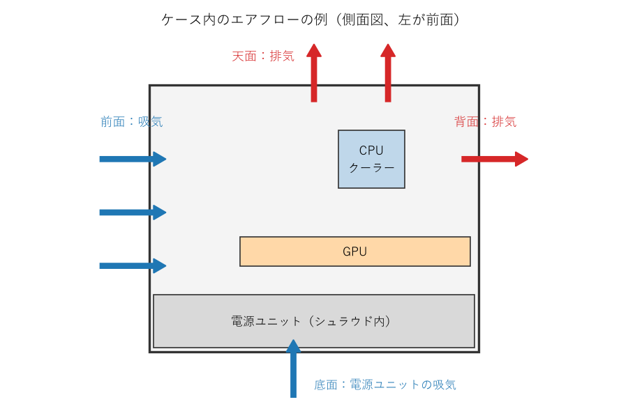

組み立て手順
============

本章では、組み立ての手順を順に説明する。各パーツの細かな取り付け方は製品によって異なるため、本章の説明と併せて各パーツのマニュアルを参照すること。

作業の流れ
----------

組み立ての流れを次の図に示す。CPU、メモリ、M.2 SSD は、マザーボードをケースに入れる前に取り付けると作業しやすい。

.. graphviz::
   :caption: 組み立ての流れ
   :align: center

   digraph flow {
     graph [rankdir=TB, fontname="Meiryo", nodesep=0.3, ranksep=0.3];
     node [shape=box, style="rounded,filled", fillcolor="#EAF2FB", fontname="Meiryo", fontsize=11, width=3.2];
     edge [color="#555555"];

     a [label="1. CPU を取り付ける"];
     b [label="2. メモリを取り付ける"];
     c [label="3. M.2 SSD を取り付ける"];
     d [label="4. CPU クーラーを取り付ける"];
     t [label="（任意）ケース外で最小構成の動作確認", fillcolor="#FFF4CC", style="rounded,filled,dashed"];
     e [label="5. ケースを準備する"];
     f [label="6. マザーボードをケースに取り付ける"];
     g [label="7. 電源ユニットを取り付けて配線する"];
     h [label="8. フロントパネルとファンを配線する"];
     i [label="9. GPU を取り付ける"];
     j [label="10. ケーブルを整理して最終確認する"];

     a -> b -> c -> d -> t -> e -> f -> g -> h -> i -> j;
   }

各手順の説明にある「よくある失敗」は、初めての組み立てで起こりやすい失敗である。作業の前に目を通しておくこと。

ケース外での動作確認（任意）
----------------------------

ケースに組み込む前に、マザーボードの箱の上で最小構成を組み、起動するかを確認する方法がある。最小構成とは、CPU、メモリ、CPU クーラー、電源ユニット、マザーボードの組み合わせである。CPU に内蔵 GPU が無い場合は GPU も加える。

この確認は必須ではないが、パーツの初期不良をケースに組み込む前に発見できる。ケースに組み込んだ後に問題が見つかると、原因の切り分けのために分解する手間がかかる。

起動するには、マザーボードのフロントパネル用のピンのうち、電源スイッチの 2 本のピンをドライバーの先端で一瞬だけ短絡させる。マザーボードに電源ボタンがある場合は、そのボタンを押す。UEFI の画面が表示されれば確認は完了である。確認後は電源ユニットのスイッチを切り、電源ケーブルを抜いてから作業を続ける。

CPU を取り付ける
----------------

1. ソケットのレバーを押し下げて横に外し、持ち上げる。
2. ロードプレート（CPU を押さえる金属の枠）を開ける。
3. CPU の角にある三角形の印と、ソケットの印を合わせる。CPU の側面の切り欠きとソケットの突起の位置も一致させる。
4. CPU を真上からそっと置く。押し込んだり、滑らせたりしない。
5. ロードプレートを閉じ、レバーを元の位置に戻して固定する。

レバーを戻すときには、ある程度の力が必要となる。正しく置かれていれば問題ない。製品によっては、レバーを戻すと保護カバーが自動的に外れる。外れた保護カバーは、修理を依頼する際に必要となることがあるため保管しておく。

.. warning::

   よくある失敗

   * CPU を斜めに置く、または落とす：ソケットのピンが曲がる。ピンが曲がったマザーボードはメーカーの保証を受けられないことが多い。
   * 印の向きを確認しない：向きが合っていなければ CPU は収まらない。無理に押さえつけないこと。

メモリを取り付ける
------------------

1. 事前に確認した推奨スロットを選ぶ。
2. スロットのラッチ（留め具）を開く。片側だけにラッチがあるマザーボードもある。
3. メモリの切り欠きとスロットの突起の位置を合わせる。
4. メモリの両端を均等に、真上から押し込む。ラッチが閉じて「カチッ」と音がするまで押す。

メモリの取り付けには、思ったより強い力が必要となる。片側だけが浮いていると起動しない原因となるため、両端のラッチが閉じていることを目で確認する。

.. warning::

   よくある失敗

   * 推奨スロット以外に挿す：起動しない、またはデュアルチャネルで動作しない。
   * 挿し込みが不十分：起動しない。初回起動時のトラブルの原因として最も多いものの 1 つである。

M.2 SSD を取り付ける
--------------------

1. M.2 スロットにヒートシンクが付いている場合は外す。
2. ヒートシンクの裏面にある熱伝導パッドの保護フィルムを剥がす。
3. SSD を 30 度程度の角度でスロットに挿し込む。
4. SSD を基板と平行になるまで倒し、ネジまたは留め具で固定する。
5. ヒートシンクを取り付ける。

.. warning::

   よくある失敗

   * 熱伝導パッドの保護フィルムを剥がし忘れる：SSD が十分に冷却されず、高負荷時に速度が低下する。
   * 固定用のネジやスタンドオフを紛失する：小さいため、取り外したら小皿に入れておく。

CPU クーラーを取り付ける
------------------------

CPU クーラーの取り付け方は製品によって大きく異なる。必ず CPU クーラーのマニュアルに従うこと。ここでは共通する要点を説明する。

1. マザーボードの裏側にバックプレートが必要な場合は、先に取り付ける。
2. CPU クーラーの底面（CPU と接する面）に保護フィルムが貼られていれば剥がす。
3. CPU の表面中央に、サーマルグリスを米粒から小豆程度の大きさで置く。CPU クーラーに塗布済みの場合は不要である。
4. CPU クーラーを真上から載せ、ネジを対角線の順に少しずつ締める。
5. CPU クーラーのファンのケーブルを、マザーボードの CPU_FAN コネクタに接続する。

サーマルグリスは、塗り広げなくてもよい。CPU クーラーを載せて締め付ける圧力で広がる。量が多すぎても少なすぎても冷却性能が下がるが、多少の差であれば大きな問題にはならない。

簡易水冷の場合は、ラジエーターをケースに取り付けてから、ポンプ部分を CPU に取り付ける。ポンプのケーブルは、マザーボードのマニュアルの指定に従い、ポンプ用のコネクタ（AIO_PUMP などと表記される）または CPU_FAN コネクタに接続する。

大型の空冷 CPU クーラーは、マザーボードをケースに取り付けた後のほうが作業しやすい場合がある。また、メモリのスロットを覆う形状の CPU クーラーは、先にメモリを取り付けておく必要がある。

.. warning::

   よくある失敗

   * CPU クーラーの底面の保護フィルムを剥がし忘れる：CPU が冷えず、すぐに高温になる。初心者に非常に多い失敗である。
   * ネジを 1 本ずつ最後まで締める：CPU クーラーが傾き、CPU との接触が不均一になる。
   * ファンのケーブルを接続し忘れる：CPU が高温になる。マザーボードによっては、CPU_FAN に何も接続されていないと警告を出して起動を止める。

ケースを準備する
----------------

1. ケースの両側のサイドパネルを外す。ガラス製のサイドパネルは、割れないよう柔らかいものの上に置く。
2. マザーボードの背面の入出力端子用のパネル（I/O パネル）が別になっている場合は、ケースの背面に内側からはめ込む。最近のマザーボードは I/O パネルが一体になっていることが多い。
3. ケースのスタンドオフ（マザーボードを浮かせて固定するための台座）の位置が、マザーボードのネジ穴と一致しているかを確認する。

.. warning::

   よくある失敗

   * マザーボードのネジ穴が無い位置にスタンドオフが残っている：マザーボードの裏面と接触して短絡し、起動しない原因や故障の原因となる。不要なスタンドオフは外す。

マザーボードをケースに取り付ける
--------------------------------

1. マザーボードを斜めに入れ、背面の入出力端子を I/O パネルの穴に合わせる。
2. マザーボードをスタンドオフの上に置き、ネジ穴の位置を合わせる。
3. 全てのネジを軽く仮締めしてから、本締めする。

ネジは締めすぎないこと。基板が歪んだり、損傷したりするおそれがある。軽く抵抗を感じたところで止めれば十分である。

電源ユニットを取り付けて配線する
--------------------------------

1. 電源ユニットのファンの向きを決める。ケースの底面に吸気口とフィルターがある場合は、ファンを下に向けて取り付ける。
2. 電源ユニットをケースの背面からネジで固定する。
3. 各パーツへケーブルを接続する。

接続するケーブルを次の表に示す。

.. list-table:: 電源ユニットから接続するケーブル
   :header-rows: 1
   :widths: 30 25 45

   * - ケーブル
     - 接続先
     - 注意点
   * - ATX 24 ピン
     - マザーボード
     - 太く硬いため、奥まで確実に挿し込む。
   * - CPU 補助電源（EPS 8 ピン）
     - マザーボードの上端付近
     - 形状が似た PCIe 8 ピンとは互換性が無い。ケーブルの「CPU」の表記を確認する。
   * - PCIe 8 ピン、または 12V-2x6
     - GPU
     - GPU の取り付け時に接続する。
   * - SATA 電源
     - SATA SSD、HDD、一部のファンハブ
     - 必要な場合のみ接続する。

マザーボードの上端の CPU 補助電源のコネクタは、マザーボードをケースに取り付けた後では手が届きにくい。ケーブルを先に通しておくか、マザーボードを取り付ける前に接続しておくとよい。

.. danger::

   モジュラー式の電源ユニットのケーブルは、同じ製品に付属したものだけを使うこと。電源ユニット側のコネクタのピン配置はメーカーや製品によって異なる。形状が同じでも、他の製品のケーブルを使うとパーツが故障するおそれがある。

フロントパネルとファンを配線する
--------------------------------

ケースの前面のスイッチ、LED、端子からのケーブルを、マザーボードのコネクタに接続する。

.. list-table:: ケースからのケーブルと接続先
   :header-rows: 1
   :widths: 30 30 40

   * - ケーブル
     - 接続先
     - 注意点
   * - POWER SW（電源スイッチ）
     - フロントパネルのピン
     - 極性は無い。
   * - RESET SW（リセットスイッチ）
     - フロントパネルのピン
     - 極性は無い。
   * - POWER LED、HDD LED
     - フロントパネルのピン
     - 極性がある。+ と - を確認する。
   * - USB 3.x（19 ピン）
     - マザーボードの USB 3.x 用コネクタ
     - ピンが曲がりやすい。向きを確認して、まっすぐ挿す。
   * - USB Type-C
     - マザーボードの USB Type-C 用コネクタ
     - マザーボード側にコネクタが無ければ、前面の USB Type-C 端子は使えない。
   * - HD AUDIO
     - マザーボードのオーディオ用コネクタ
     - 前面のイヤホン端子とマイク端子に使う。
   * - ケースファン
     - マザーボードのファン用コネクタ（SYS_FAN、CHA_FAN など）
     - 4 ピンのファンは回転数を細かく制御できる。数が足りない場合は分岐ケーブルやファンハブを使う。

フロントパネルのピンは小さく、表記も読みにくい。ライトで照らし、マザーボードのマニュアルの配置図と照らし合わせながら接続する。LED の極性を間違えても故障はしないが、点灯しない。

GPU を取り付ける
----------------

1. GPU を取り付ける位置のケースの拡張スロットカバーを外す。GPU の厚みに応じて 2 枚から 3 枚外す。
2. マザーボードの一番上の PCIe x16 スロットのラッチを開く。このスロットは CPU に直結しており、最も帯域が広いことが多い。
3. GPU をスロットに真上から挿し込み、ラッチが閉じるまで押す。
4. GPU のブラケットをケースにネジで固定する。
5. 補助電源のケーブルを接続する。

12V-2x6 のコネクタは、奥まで確実に挿し込む。挿し込みが不十分だと接触部が発熱し、コネクタが溶ける事故につながるおそれがある。ケーブルをコネクタの根元で急に曲げることも避ける。

大型で重い GPU は、時間とともに自重で傾くことがある。GPU に支え（サポートステイ）が付属している場合や、ケースに支える仕組みがある場合は使用する。

.. warning::

   よくある失敗

   * 補助電源を接続し忘れる：画面が映らない、または GPU が警告を出す。
   * 補助電源のコネクタの数が足りない分を、1 本のケーブルの分岐で済ませる：GPU のメーカーが 1 本ずつの接続を推奨している場合は従う。

エアフローとケーブルの整理
--------------------------

ケース内の空気の流れ（:term:`エアフロー`）は、前面または底面から吸気し、背面または天面から排気するのが基本である。暖かい空気は上に昇るため、この向きにすると効率よく熱を逃がせる。エアフローの例を次の図に示す。

   エアフローの例

ファンには風の向きを示す矢印が刻印されていることが多い。刻印が無い場合、一般に、ファンを固定する枠（フレーム）の支柱が見える側から風が出る。

吸気の量が排気の量より多い状態（正圧）にすると、ケースの隙間からホコリが入りにくくなる。吸気側にはフィルターを付ける。

ケーブルは、できるだけマザーボードの裏側の空間を通して整理する。ケーブルの整理は見た目だけでなく、空気の流れを妨げないためと、ファンへの巻き込みを防ぐために行う。

最終確認
--------

サイドパネルを閉じる前に、次の項目を確認する。チェックリストは :doc:`checklist` にもまとめている。

* 全ての電源ケーブルが奥まで挿し込まれている（ATX 24 ピン、CPU 補助電源、GPU 補助電源）。
* CPU クーラーのファン（簡易水冷の場合はポンプも）がマザーボードに接続されている。
* メモリの両端のラッチが閉じている。
* ケーブルがファンに接触していない。
* ケース内にネジや工具が残っていない。
