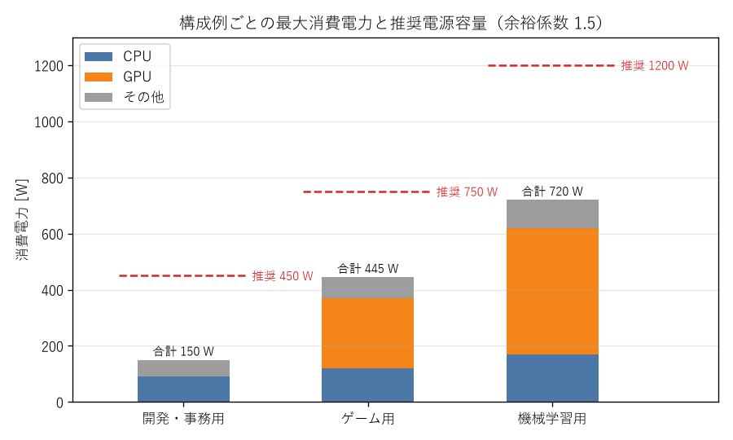

パーツ選定と互換性の確認
========================

本章では、用途からパーツの構成を決める方法と、パーツ同士の互換性を確認する方法を説明する。

用途を定義する
--------------

パーツを選ぶ前に、PC で何をするかを具体的に書き出す。用途によって、予算を集中すべきパーツが変わるためである。

* 主に使うアプリケーション（IDE、コンテナ、仮想マシン、ゲーム、機械学習のフレームワークなど）
* 性能の要求（コンパイル時間を短くしたい、特定の解像度でゲームを遊びたい、特定の大きさのモデルを学習させたいなど）
* その他の要求（静音性、設置場所の広さ、将来の拡張の予定）
* 予算の上限

構成例
------

代表的な 3 つの用途について、構成の例を仕様の水準で示す。電源ユニットの容量は、後述する見積もり方法で求めた値である。

.. list-table:: 用途別の構成例
   :header-rows: 1
   :widths: 16 28 28 28

   * - パーツ
     - 開発・事務用
     - ゲーム用
     - 機械学習用
   * - CPU
     - 8 コア程度、内蔵 GPU あり、最大消費電力 90 W 程度
     - 8 コア程度、最大消費電力 120 W 程度
     - 12 から 16 コア程度、最大消費電力 170 W 程度
   * - メモリ
     - DDR5、32 GB（16 GB × 2 枚）
     - DDR5、32 GB（16 GB × 2 枚）
     - DDR5、64 GB 以上（32 GB × 2 枚）
   * - ストレージ
     - NVMe SSD 1 TB
     - NVMe SSD 2 TB
     - NVMe SSD 2 TB 以上（データ用を追加）
   * - GPU
     - なし（内蔵 GPU を使う）
     - 最大消費電力 250 W 程度
     - VRAM 16 GB 以上、最大消費電力 450 W 程度
   * - 電源ユニット
     - 450 W 以上、80 PLUS Bronze 以上
     - 750 W、80 PLUS Gold 以上
     - 1200 W、80 PLUS Gold 以上、ATX 3.1 対応
   * - CPU クーラー
     - CPU 付属品、またはトップフロー型
     - サイドフロー型
     - 大型のサイドフロー型、または 360 mm の簡易水冷
   * - ケース
     - Micro-ATX 対応の小型ケース
     - ATX 対応のミドルタワー
     - ATX 対応で、長い GPU が収まるミドルタワー以上

静音性を重視する場合は、上記に加えて、大型で低回転のファンを使う CPU クーラーとケースを選び、必要以上に高性能なパーツを避ける。消費電力が小さいほど、発熱が減り、ファンの回転数を下げられる。

予算配分の考え方
----------------

予算は、用途の性能を決めるパーツに優先して配分する。

* 開発・事務用：CPU、メモリ容量、SSD の容量に配分する。GPU が不要であれば、その分を他に回せる。
* ゲーム用：GPU が性能を最も大きく左右する。予算の 4 割前後を GPU に配分することが多い。
* 機械学習用：GPU の VRAM 容量を最優先とする。次にメモリ容量と、データを置く SSD の容量を確保する。

どの用途でも、電源ユニットとマザーボードの品質は削りすぎないこと。性能には直接表れないが、不安定な動作や故障の原因となる。

互換性の確認
------------

パーツ同士が組み合わせ可能かを確認する項目を次の表に示す。購入前に全ての項目を確認する。

.. list-table:: 互換性の確認項目
   :header-rows: 1
   :widths: 22 30 48

   * - 項目
     - 組み合わせ
     - 確認方法
   * - ソケット
     - CPU とマザーボード
     - ソケットの名称が一致するか。
   * - CPU のサポート
     - CPU とマザーボード
     - マザーボードの CPU サポートリストに CPU が載っているか。必要な UEFI のバージョンも確認する。
   * - メモリの規格
     - メモリとマザーボード
     - DDR4 / DDR5 が一致するか。容量と速度がサポート範囲内か。
   * - フォームファクタ
     - マザーボードとケース
     - ケースがマザーボードの大きさに対応しているか。
   * - CPU クーラーのソケット
     - CPU クーラーとマザーボード
     - CPU クーラーが CPU のソケットに対応しているか。
   * - CPU クーラーの大きさ
     - CPU クーラーとケース、メモリ
     - 空冷の高さがケースの最大高以下か。ラジエーターを取り付ける場所があるか。ヒートシンクがメモリと干渉しないか。
   * - GPU の大きさ
     - GPU とケース
     - GPU の長さと厚みがケースに収まるか。
   * - 電源ユニット
     - 電源ユニットとケース、各パーツ
     - 電源ユニットの大きさがケースに合うか。容量が足りるか。必要なコネクタがそろっているか。
   * - M.2 スロット
     - M.2 SSD とマザーボード
     - スロットが SSD の接続方式（NVMe / SATA）と長さに対応しているか。

ソケットと CPU のサポート
^^^^^^^^^^^^^^^^^^^^^^^^^

ソケットが一致していても、マザーボードの UEFI が CPU に対応していなければ起動しない。マザーボードの発売後に登場した CPU を使う場合に起こりやすい。

マザーボードのメーカーは、製品ごとに CPU サポートリストを公開している。リストに「UEFI のバージョン X 以降で対応」と書かれている場合は、購入したマザーボードの UEFI が古い可能性がある。CPU を取り付けずに USB メモリから UEFI を更新できる機能（メーカーによって名称が異なる）を持つマザーボードを選ぶと、この問題に対処しやすい。

メモリ
^^^^^^

マザーボードのメーカーは、動作を確認したメモリの一覧（:term:`QVL`）を公開している。QVL に載っていないメモリが動作しないわけではないが、載っているメモリを選ぶと問題が起きにくい。

フォームファクタ
^^^^^^^^^^^^^^^^

主なフォームファクタを次の表に示す。

.. list-table:: マザーボードの主なフォームファクタ
   :header-rows: 1
   :widths: 25 25 50

   * - 規格
     - 大きさ
     - 特徴
   * - ATX
     - 305 mm × 244 mm
     - 拡張スロットと M.2 スロットが多い。標準的な大きさ。
   * - Micro-ATX
     - 244 mm × 244 mm
     - 拡張スロットが少ない。GPU を 1 枚使う程度であれば十分なことが多い。
   * - Mini-ITX
     - 170 mm × 170 mm
     - 拡張スロットは 1 本。小型の PC を作れるが、パーツの選択肢が狭く、組み立ての難易度が高い。

ケースは、対応するフォームファクタより小さいマザーボードも取り付けられる。たとえば ATX 対応のケースには、Micro-ATX と Mini-ITX のマザーボードも取り付けられる。

物理的な干渉
^^^^^^^^^^^^

大きさに関わる問題は、カタログの数値を比べるだけで防げる。特に次の点に注意する。

* ケースの GPU の最大長は、前面にファンやラジエーターを取り付けた場合に短くなることがある。
* 大型のサイドフロー型の CPU クーラーは、背の高いヒートシンクを持つメモリと干渉することがある。CPU クーラーの仕様に記載されたメモリの高さの制限を確認する。
* 簡易水冷のラジエーターを天面に取り付ける場合、マザーボードの上端の部品と干渉することがある。

M.2 スロットとレーンの共有
^^^^^^^^^^^^^^^^^^^^^^^^^^

マザーボードによっては、特定の M.2 スロットを使うと、一部の SATA 端子が使えなくなったり、PCIe スロットの帯域が減ったりする。CPU とチップセットが持つ :term:`PCIe` のレーン数に限りがあり、複数の機器で共有しているためである。どのスロットがどの機能と共有されているかは、マザーボードのマニュアルの仕様表に記載されている。

電源コネクタ
^^^^^^^^^^^^

電源ユニットが、各パーツの必要とするコネクタを備えているかを確認する。

* CPU 補助電源：マザーボードによって 8 ピンが 1 本または 2 本必要となる。
* GPU 補助電源：PCIe 8 ピンが 1 本から 3 本、または 12V-2x6 が 1 本必要となる。

GPU が 12V-2x6 を必要とする場合は、12V-2x6 のケーブルを備えた電源ユニット（ATX 3.1 対応品）を選ぶのが確実である。変換アダプターを使う方法もあるが、接続部が増えるため推奨しない。

電源容量の見積もり
------------------

電源ユニットの容量は、次の手順で見積もる。

1. CPU、GPU、その他のパーツの最大消費電力を調べる。
2. それらを合計する。
3. 合計に余裕係数を掛けて必要容量を求める。
4. 必要容量以上で、最も小さい一般的な定格容量を選ぶ。

各値の意味を次の表に示す。

.. list-table:: 見積もりに使う値
   :header-rows: 1
   :widths: 25 75

   * - 値
     - 調べ方と考え方
   * - CPU の最大消費電力
     - TDP ではなく最大値を使う。Intel では PL2 または最大ターボパワー、AMD では PPT と表記される。
   * - GPU の最大消費電力
     - GPU メーカーの仕様に記載された TBP などの値。内蔵 GPU のみの場合は 0 とする。
   * - その他
     - マザーボード、メモリ、ストレージ、ファンの合計。50 W から 100 W 程度を見込む。
   * - 余裕係数
     - 本書では 1.5 とする。

余裕係数を 1.5 とする理由は次のとおりである。

* 電源ユニットの変換効率は、定格容量の 50 % 前後の負荷で最も高くなる製品が多い。
* GPU は、仕様に記載された最大消費電力を一瞬だけ大きく超える電力を要求することがある。
* 電源ユニットは経年劣化により供給能力が下がる。
* 将来の GPU の交換やストレージの追加に備えられる。

構成例の見積もり結果を次の図に示す。

   構成例ごとの消費電力と推奨容量

開発・事務用の構成は合計 150 W で、必要容量は 225 W となる。市販の電源ユニットは 450 W 前後が最小となることが多いため、450 W を推奨容量としている。

見積もりスクリプト
^^^^^^^^^^^^^^^^^^

上記の手順を Python で実装したスクリプトを示す。

:download:`psu_estimate.py をダウンロードする <../examples/psu_estimate.py>`

.. literalinclude:: ../examples/psu_estimate.py
   :language: python
   :linenos:
   :caption: psu_estimate.py

ゲーム用の構成例で実行した結果を次に示す。

.. code-block:: text
   :linenos:

   $ python psu_estimate.py --cpu 120 --gpu 250 --other 75
   合計消費電力 : 445 W
   必要容量     : 668 W (余裕係数 1.5)
   推奨容量     : 750 W

このスクリプトは、flake8（行長 120 文字まで許容）と mypy（strict モード）による検査に合格している。検査に使った設定ファイルを次に示す。

:download:`setup.cfg をダウンロードする <../examples/setup.cfg>`

.. literalinclude:: ../examples/setup.cfg
   :language: ini
   :linenos:
   :caption: setup.cfg

購入時の注意
------------

* 初期不良の対応期間：販売店は、購入後一定期間内の初期不良に対して交換や返品に応じることが多い。期間は販売店によって異なり、1 週間から 1 か月程度が多い。組み立てと動作確認は、この期間内に済ませる。
* メーカー保証：パーツごとにメーカーの保証期間がある。保証を受けるには購入時の証明書類が必要なことが多いため、レシートや納品書を保管しておく。
* 相性問題：規格上は動作するはずの組み合わせで、正常に動作しないことがある。特にメモリで起こりやすい。販売店によっては、相性問題による返品を有償で保証するサービスがある。
* 付属品と箱：返品や修理の依頼に備えて、箱と付属品（CPU ソケットの保護カバーを含む）を保管しておく。
