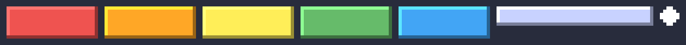

アセット制作
============

ゲームを構成する画像、音、フォントなどの素材を\ :term:`アセット`\ と呼ぶ。この章では、アセットの種類と作り方、既存の素材を使うときの注意点を扱う。

アセットの種類
--------------

.. list-table:: 主なアセット
   :header-rows: 1
   :widths: 20 45 35

   * - 種類
     - 内容
     - 主な形式
   * - グラフィック
     - キャラクター、背景、UI（ボタンやメニュー）、エフェクト
     - PNG
   * - 効果音
     - ジャンプ、攻撃、決定などの短い音
     - WAV、OGG
   * - BGM
     - 背景に流す音楽
     - OGG、MP3
   * - フォント
     - 画面に表示する文字の書体
     - TTF、OTF
   * - データ
     - ステージの配置、敵のパラメーター、会話の文章
     - JSON、CSV、TMX（Tiled の形式）

1 人で制作する場合、プログラムは書けてもアセットの制作に苦労することが多い。:doc:`planning`\ でスコープを決めるときは、アセットの量と自分の制作能力も考慮に入れる。単純な図形だけで描くデザインや、色数の少ないドット絵は、少ない作業量で統一感を出しやすい。

グラフィック
------------

2D ゲームのグラフィックは、大きく 2 つの作り方に分かれる。

- **ドット絵**\ （ピクセルアート）: 小さな解像度で 1 ピクセルずつ描き、ゲーム中で整数倍に拡大して表示する。拡大するときは、ピクセルの境界がぼやけないよう\ **最近傍法**\ （ニアレストネイバー）を使う。
- **高解像度のイラスト**\ : 表示する大きさに近い解像度で描く。ベクター形式で描いておくと、後から解像度を変えやすい。

.. list-table:: グラフィック制作ツールの例
   :header-rows: 1
   :widths: 25 75

   * - ツール
     - 用途
   * - `Aseprite <https://www.aseprite.org/>`_
     - ドット絵とそのアニメーションの制作（有償）
   * - `Krita <https://krita.org/>`_
     - イラストの制作（無料、オープンソース）
   * - `Inkscape <https://inkscape.org/>`_
     - ベクター画像の制作（無料、オープンソース）
   * - `Tiled <https://www.mapeditor.org/>`_
     - タイルを並べたステージの作成（無料、オープンソース）

スプライトシート
~~~~~~~~~~~~~~~~

ゲーム中で動く個々の画像を\ :term:`スプライト`\ と呼ぶ。多数のスプライトを 1 枚の画像にまとめたものを\ **スプライトシート**\ と呼ぶ。ファイルの数が減って管理しやすくなり、ゲームエンジンによっては描画も速くなる。

スプライトシートは画像編集ソフトで作るのが普通だが、単純な図形の組み合わせなら、プログラムで生成することもできる。次の例は、Python の画像処理ライブラリー Pillow を使って、ブロック崩しのブロック、パドル、ボールをドット絵風に描き、1 枚に並べる。

.. literalinclude:: ../examples/make_sprites.py
   :language: python
   :linenos:
   :pyobject: make_bevel
   :caption: examples/make_sprites.py の make_bevel 関数

``make_bevel`` は、長方形の上辺と左辺を明るく、下辺と右辺を暗く塗る。光が左上から当たっているように見え、平面の長方形が立体的に見える。

.. literalinclude:: ../examples/make_sprites.py
   :language: python
   :linenos:
   :pyobject: make_sheet
   :caption: examples/make_sprites.py の make_sheet 関数

``make_sheet`` は、作ったスプライトを間隔を空けて横 1 列に並べ、各スプライトの位置（x、y、幅、高さ）を辞書に記録する。スプライトの間に間隔を空けるのは、拡大縮小したときに隣のスプライトの色がにじみ出るのを防ぐためである。生成したスプライトシートを 6 倍に拡大すると、:numref:`fig-assets-sprites` のようになる。

   Pillow で生成したスプライトシート（6 倍に拡大して表示）

スクリプトの全体は\ :download:`make_sprites.py <../examples/make_sprites.py>`\ からダウンロードできる。``py make_sprites.py`` で ``sprites.png`` を出力し、各スプライトの位置を表示する。

pygame-ce でスプライトシートを使うには、画像を読み込んでから、``subsurface`` で各スプライトの部分を切り出す。

.. code-block:: python
   :linenos:
   :caption: スプライトシートからスプライトを切り出す例

   sheet = pygame.image.load("sprites.png").convert_alpha()
   block_image = sheet.subsurface(pygame.Rect(2, 2, 28, 10))
   block_image = pygame.transform.scale_by(block_image, 2)
   screen.blit(block_image, (100, 60))

1 行目の ``convert_alpha`` は、画像を画面の形式に合わせて変換し、描画を速くする。ウィンドウを作った後（\ ``pygame.display.set_mode`` の後）に呼ぶ必要がある。3 行目の ``pygame.transform.scale_by`` は、最近傍法で画像を拡大するので、ドット絵がぼやけない。

サウンド
--------

効果音は、プレイヤーの操作に対する反応として非常に重要である。同じ操作でも、効果音があるだけで手応えが大きく変わる。

.. list-table:: サウンド制作ツールの例
   :header-rows: 1
   :widths: 25 75

   * - ツール
     - 用途
   * - `jsfxr <https://sfxr.me/>`_
     - ブラウザー上でレトロゲーム風の効果音を生成する（無料）
   * - `Audacity <https://www.audacityteam.org/>`_
     - 録音した音や効果音の編集（無料、オープンソース）
   * - `LMMS <https://lmms.io/>`_
     - BGM の作曲（無料、オープンソース）

pygame-ce では、効果音は ``pygame.mixer.Sound`` で全体をメモリーに読み込んで再生し、BGM のような長い音楽は ``pygame.mixer.music`` でファイルから少しずつ読み込みながら再生する。

.. code-block:: python
   :linenos:
   :caption: 効果音と BGM の再生の例

   jump_sound = pygame.mixer.Sound("jump.wav")
   jump_sound.play()

   pygame.mixer.music.load("bgm.ogg")
   pygame.mixer.music.set_volume(0.5)
   pygame.mixer.music.play(loops=-1)  # -1 は無限に繰り返す指定

音量のバランスにも気を配る。素材ごとに録音時の音量が異なるため、そのまま使うと特定の音だけが大きすぎることがよくある。ゲームの設定画面で、BGM と効果音の音量を別々に変えられるようにしておくと親切である。

フォント
--------

pygame-ce に同梱されたフォントには日本語の文字が無いため、日本語を表示するには日本語のフォントファイルを用意し、ゲームと一緒に配布する。

.. code-block:: python
   :linenos:
   :caption: 日本語フォントの読み込みの例

   font = pygame.font.Font("NotoSansJP-Regular.ttf", 24)
   image = font.render("ゲームスタート", True, (255, 255, 255))

フォントにもライセンスがあり、ゲームへの同梱が許されているかを確認する必要がある。例えば、`Google Fonts <https://fonts.google.com/>`_ で配布されている Noto Sans JP などのフォントは、SIL Open Font License（OFL）で提供されており、ゲームに同梱して配布できる。パソコンに最初から入っているフォントは、多くの場合ゲームへの同梱が許されていないので注意する。

既存の素材を使う
----------------

アセットをすべて自作する必要は無い。無料または有料で使える素材は数多く公開されている。

- `Kenney <https://kenney.nl/>`_: 統一感のある 2D・3D のゲーム素材を、CC0（後述）で大量に公開している。
- `OpenGameArt.org <https://opengameart.org/>`_: 多くの作者がゲーム用の素材を公開している。素材ごとにライセンスが異なる。
- ゲームエンジンのアセットストア: Unity Asset Store などで、有料・無料の素材を購入できる。

素材を使うときは、必ずライセンス（利用規約）を確認する。海外の素材サイトでは、クリエイティブ・コモンズ・ライセンス（CC ライセンス）がよく使われる。

.. list-table:: よく使われる CC ライセンス
   :header-rows: 1
   :widths: 20 80

   * - ライセンス
     - 主な条件
   * - CC0
     - 権利を放棄している。クレジット表記も不要で、自由に使える
   * - CC BY
     - 作者のクレジットを表記すれば、商用を含めて自由に使える
   * - CC BY-SA
     - クレジット表記に加え、素材を改変した場合は改変物を同じライセンスで公開する必要がある
   * - CC BY-NC
     - クレジット表記が必要で、商用利用はできない

正確な条件は\ `クリエイティブ・コモンズの公式サイト <https://creativecommons.org/licenses/>`_\ で確認できる。国内の素材サイトは独自の利用規約を定めていることが多く、「商用利用は可能だが、素材そのものの再配布は禁止」「アダルト作品での使用は禁止」などの条件が付く。

使った素材は、入手元、作者、ライセンス、クレジット表記の要否を一覧にして記録しておく。公開直前になって「この素材はどこから入手したのか」が分からなくなると、差し替えに追われることになる。クレジットはゲーム内のクレジット画面や、配布物に同梱する文書に記載する。

生成 AI で作った素材を使う場合は、利用したサービスの規約で商用利用が認められているかを確認する。また、配布先によっては、生成 AI を使ったことの申告を求められる（Steam など）。

他人が権利を持つキャラクター、音楽、ロゴを無断で使ってはならない。既存の作品の二次創作（ファンゲーム）を作る場合は、権利者が二次創作のガイドラインを公開していないかを確認し、その範囲内で制作する。
