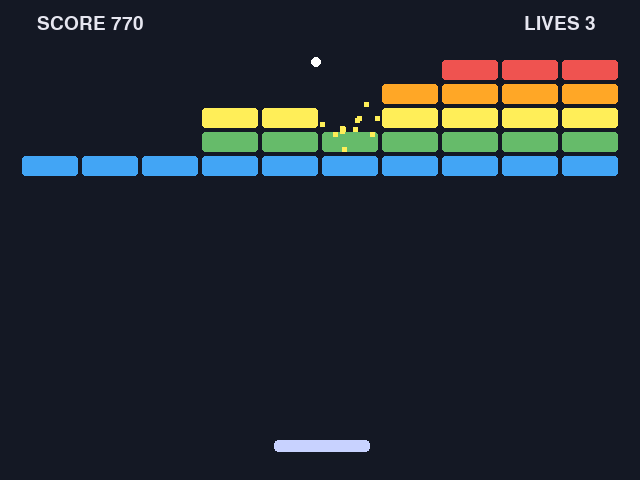

ゲーム作成入門
==============

本書は、Python などのプログラミング経験はあるがゲームを作ったことはないエンジニアに向けて、ゲーム制作の流れを企画から公開・運用まで一通り解説する入門書である。

前半ではゲーム制作の全体像、企画の立て方、ゲームエンジンの選び方を扱う。後半では Python のライブラリー pygame-ce を使ってブロック崩しを段階的に作り、アセットの用意、品質の改善、配布用のビルド、配布サイトでの公開まで進める。

   本書で作成するブロック崩し

.. toctree::
   :maxdepth: 2
   :numbered:
   :caption: 目次

   introduction
   overview
   planning
   engine_selection
   environment
   programming_basics
   practice
   assets
   quality
   build
   release
   operation

.. toctree::
   :maxdepth: 1
   :caption: 付録

   glossary
   references
   examples
