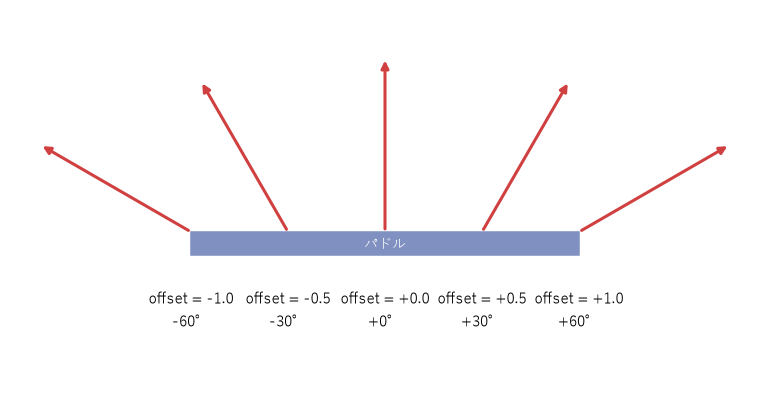

制作実践：ブロック崩しを作る
============================

この章では、pygame-ce を使ってブロック崩しを作る。一度に完成形を書くのではなく、遊べる状態を保ちながら少しずつ機能を足していく。これは\ :doc:`planning`\ で述べた、MVP から段階的に作る進め方の実践でもある。

完成形と進め方
--------------

完成したゲームは、タイトル、プレイ、結果の 3 つの画面からなる。

.. list-table:: 完成したゲームの画面
   :widths: 33 33 34

   * - .. image:: images/screen_title.png
          :alt: タイトル画面
     - .. image:: images/screen_play.png
          :alt: プレイ画面
     - .. image:: images/screen_result.png
          :alt: 結果画面
   * - タイトル画面
     - プレイ画面
     - 結果画面

ゲームのルールは次のとおりである。

- 左右キー（または A キーと D キー）でパドルを動かし、スペースキーでボールを発射する。
- ボールがブロックに当たるとブロックが壊れ、得点が入る。上の段ほど得点が高い。
- ボールを画面の下に落とすと残機が 1 減る。残機が 0 になるとゲームオーバー、ブロックをすべて壊すとクリアである。
- Esc キーでいつでも終了できる。

制作は次の 7 段階で進める。各段階のファイルはそれだけで動く完全なプログラムになっているので、ダウンロードしてそのまま実行できる。

.. list-table:: 制作の段階
   :header-rows: 1
   :widths: 12 38 50

   * - 段階
     - ファイル
     - 内容
   * - Step 1
     - :download:`step01_window.py <../examples/step01_window.py>`
     - ウィンドウを表示し、ゲームループを回す
   * - Step 2
     - :download:`step02_paddle.py <../examples/step02_paddle.py>`
     - キー入力でパドルを動かす
   * - Step 3
     - :download:`step03_ball.py <../examples/step03_ball.py>`
     - ボールを動かし、壁とパドルで反射させる
   * - Step 4
     - :download:`step04_blocks.py <../examples/step04_blocks.py>`
     - ブロックを並べ、当たったら壊す
   * - Step 5
     - :download:`step05_score.py <../examples/step05_score.py>`
     - スコアと残機、クリアとゲームオーバーの判定
   * - Step 6
     - :download:`step06_scenes.py <../examples/step06_scenes.py>`
     - タイトル・プレイ・結果のシーンに分ける
   * - Step 7
     - :download:`step07_polish.py <../examples/step07_polish.py>`
     - 効果音と演出を加えて完成させる

各ファイルは次のように実行する（Step 1 の場合）。

.. code-block:: powershell
   :linenos:
   :caption: サンプルの実行

   py step01_window.py

Step 1：ウィンドウとゲームループ
--------------------------------

Step 1 は、ウィンドウを開いてゲームループを回すだけのプログラムである。内容は\ :doc:`programming_basics`\ のゲームループの節で説明したので、ここでは実行して、何も無い紺色のウィンドウが表示され、閉じるボタンで終了できることを確かめればよい。

Step 2：パドルを動かす
----------------------

Step 2 では、プレイヤーが操作するパドルを作る。まず、ファイルの先頭に、ゲームの設定値を定数としてまとめる。

.. literalinclude:: ../examples/step02_paddle.py
   :language: python
   :linenos:
   :lines: 10-23
   :caption: examples/step02_paddle.py の定数

パドルの速さや大きさのような数値をコードの中に直接書かずに定数にしておくと、後で\ :term:`バランス調整`\ をするときに 1 か所を変えるだけで済む。速さの単位を「ピクセル毎秒」にしているのは、デルタタイムを掛けて使うためである。

パドルは ``Paddle`` クラスで表す。

.. literalinclude:: ../examples/step02_paddle.py
   :language: python
   :linenos:
   :pyobject: Paddle
   :caption: examples/step02_paddle.py の Paddle クラス

- 6 行目で、位置と大きさを ``pygame.FRect`` で持つ。小数の座標を保持できるので、デルタタイムを掛けた細かな移動量が失われない。
- 11 行目で、向き・速さ・デルタタイムを掛けて移動させる。
- 12 行目と 13 行目で、パドルが画面の左右からはみ出さないようにする。

キーの状態から動かす向きを求める処理は、関数に分けておく。

.. literalinclude:: ../examples/step02_paddle.py
   :language: python
   :linenos:
   :pyobject: read_direction
   :caption: examples/step02_paddle.py の read_direction 関数

左右のキーを同時に押すと、``-1 + 1`` で 0 になり、パドルは止まる。

Step 3：ボールを動かして反射させる
----------------------------------

Step 3 では、ボールを追加する。ボールは発射前はパドルの上に乗っていて、スペースキーで発射される。

.. literalinclude:: ../examples/step03_ball.py
   :language: python
   :linenos:
   :pyobject: Ball
   :caption: examples/step03_ball.py の Ball クラス

速度は ``pygame.Vector2`` で表す。発射時の速度（15 行目）は、真上を向いた長さ ``BALL_SPEED`` のベクトルを、``rotate`` メソッドで左右に最大 30 度回転させて作る。毎回同じ向きに飛ぶと単調になるため、乱数で向きを変えている。

パドルで跳ね返すときの向きの決め方が、ブロック崩しの手触りを大きく左右する。単純に y 方向の速度を反転するだけでは、ボールは常に同じ角度で往復し、プレイヤーは狙いを付けられない。そこで、パドルのどこに当たったかで反射の向きを変える。

パドルの中心から当たった位置までのずれを、左端で :math:`-1`\ 、中心で :math:`0`\ 、右端で :math:`1` になるように表した値を :math:`o` とする。最大の傾きを :math:`\theta_{\max}`\ （本書では 60 度）、ボールの速さを :math:`s` とすると、反射後の傾き :math:`\theta` と速度 :math:`(v_x, v_y)` は次のようになる。y 軸が下向きなので、上に向かう :math:`v_y` は負になる。

.. math::

   \theta = o \, \theta_{\max}, \qquad v_x = s \sin\theta, \qquad v_y = -s \cos\theta

   パドルに当たった位置と反射の向き

.. literalinclude:: ../examples/step03_ball.py
   :language: python
   :linenos:
   :pyobject: paddle_bounce_velocity
   :caption: examples/step03_ball.py の paddle_bounce_velocity 関数

7 行目で、ずれを -1 から 1 の範囲に収める。パドルの端ぎりぎりに当たるとボールの中心がパドルの外にあり、1 を超えることがあるからである。:math:`\sin^2\theta + \cos^2\theta = 1` なので、どの位置に当たってもボールの速さは :math:`s` のまま変わらない。

ボールを動かして壁とパドルで反射させる処理は、次のようになる。

.. literalinclude:: ../examples/step03_ball.py
   :language: python
   :linenos:
   :pyobject: move_ball
   :caption: examples/step03_ball.py の move_ball 関数

- 4 行目から 9 行目で、左右の壁に当たったら画面の内側に戻し、x 方向の速度の向きを変える。``velocity.x *= -1`` で反転させずに ``abs`` で向きを明示しているのは、何らかの理由で 2 フレーム続けて壁に当たったと判定されても、向きが元に戻らず必ず画面の内側へ向かうようにするためである。
- 17 行目では、ボールが下向きに動いているときだけパドルとの当たり判定を行う。跳ね返った直後のボールがまだパドルと重なっていても、再び反射しないようにするためである。
- 19 行目で、パドルの中心からのずれを求めて、反射の向きを決める。

最後に、メインループに発射とボールの落下の処理を加える。

.. literalinclude:: ../examples/step03_ball.py
   :language: python
   :linenos:
   :pyobject: main
   :caption: examples/step03_ball.py の main 関数

16 行目と 17 行目で、スペースキーが押されたイベントを受けてボールを発射する。22 行目と 23 行目では、ボールが画面の下に落ちたら ``Ball`` を作り直し、パドルの上に戻す。

Step 4：ブロックを壊す
----------------------

Step 4 では、ブロックを並べて、ボールが当たったら壊れるようにする。ブロックはデータを持つだけの単純なクラスなので、``dataclasses.dataclass`` で定義する。

.. literalinclude:: ../examples/step04_blocks.py
   :language: python
   :linenos:
   :pyobject: Block
   :caption: examples/step04_blocks.py の Block クラス

.. literalinclude:: ../examples/step04_blocks.py
   :language: python
   :linenos:
   :pyobject: create_blocks
   :caption: examples/step04_blocks.py の create_blocks 関数

``create_blocks`` は、10 列 5 段のブロックを、全体が画面の左右中央に来るように並べる。

ブロックとの当たり判定で難しいのは、ボールがブロックの側面に当たったのか、上下の面に当たったのかを見分けることである。側面に当たったなら x 方向、上下の面なら y 方向の速度の向きを変えなければならない。

本書では、ボールを x 方向と y 方向に分けて動かし、それぞれの移動の直後に当たり判定を行う方法を使う。x 方向に動かした直後に重なったなら側面に、y 方向に動かした直後に重なったなら上下の面に当たったと判断できる。

.. literalinclude:: ../examples/step04_blocks.py
   :language: python
   :linenos:
   :pyobject: move_ball
   :caption: examples/step04_blocks.py の move_ball 関数

- 18 行目で、ボールと重なっているブロックを探して取り除く（\ ``pop_hit_block`` 関数）。
- 21 行目から 24 行目で、めり込んだ分を押し戻す。右に動いていたならブロックの左側に、左に動いていたなら右側にボールを置く。押し戻さないと、次のフレームでも重なったままになり、隣のブロックを巻き込んで不自然に反射する。
- 29 行目から 40 行目で、y 方向についても同じ処理を行う。
- 48 行目で、壊したブロックのリストを返す。Step 5 ではこれを使って得点を計算する。

.. literalinclude:: ../examples/step04_blocks.py
   :language: python
   :linenos:
   :pyobject: pop_hit_block
   :caption: examples/step04_blocks.py の pop_hit_block 関数

``collidelist`` は、リストの中でボールと重なっている最初の長方形の番号を返し、無ければ -1 を返す。

この方法は、ボールが 1 フレームに数ピクセルしか動かない場合には十分に機能する。ただし、ボールがブロックの角に当たった場合の反射は、物理的に厳密なものではない。ゲームでは、物理的な正しさよりも、プレイヤーにとって自然に見えて遊びやすいことを優先してよい。

Step 5：スコアと勝敗
--------------------

Step 5 では、スコアと残機を表示し、クリアとゲームオーバーを判定する。

文字の描画には ``pygame.font.Font`` を使う。``Font(None, 大きさ)`` とすると、pygame-ce に同梱されたフォントが使われる。ただし、同梱のフォントには日本語の文字が無いので、画面の文字は英語にしている。日本語を表示する方法は\ :doc:`assets`\ で扱う。

.. literalinclude:: ../examples/step05_score.py
   :language: python
   :linenos:
   :pyobject: draw_text
   :caption: examples/step05_score.py の draw_text 関数

フォントの読み込みには時間がかかるので、毎フレーム読み込むのは避けたい。そこで、フォントを返す ``get_font`` 関数に ``functools.cache`` デコレーターを付けて、同じ大きさのフォントを 2 回目以降は作成済みのもので済ませている。

ゲームの進行状況は、``Game`` クラスの ``state`` 属性に文字列で持たせる。

.. literalinclude:: ../examples/step05_score.py
   :language: python
   :linenos:
   :pyobject: Game
   :caption: examples/step05_score.py の Game クラス

- 11 行目の ``state`` は、プレイ中（\ ``"playing"``\ ）、クリア（\ ``"clear"``\ ）、ゲームオーバー（\ ``"over"``\ ）のいずれかである。型ヒントに ``Literal`` を使っているので、ほかの文字列を代入すると mypy が誤りとして検出する。
- 21 行目と 22 行目で、壊したブロックの得点を加算する。
- 23 行目から 30 行目で、ブロックが無くなればクリア、ボールを落として残機が 0 になればゲームオーバーにする。

これで、ゲームとして最低限遊べる状態になった。\ :doc:`planning`\ で決めた必須の要素がそろったので、これが MVP に当たる。

Step 6：シーンに分ける
----------------------

Step 5 の ``Game`` クラスは、``update`` と ``draw`` の中で ``state`` による条件分岐を行っている。ここにタイトル画面やポーズ画面などを加えていくと、条件分岐が増えて見通しが悪くなる。そこで Step 6 では、\ :doc:`programming_basics`\ で説明したシーンの考え方に従い、画面ごとにクラスを分ける。

まず、すべてのシーンの基になる ``Scene`` クラスを作る。

.. literalinclude:: ../examples/step06_scenes.py
   :language: python
   :linenos:
   :pyobject: Scene
   :caption: examples/step06_scenes.py の Scene クラス

各シーンは、イベントの処理（\ ``handle_event``\ ）、更新（\ ``update``\ ）、描画（\ ``draw``\ ）の 3 つのメソッドを持つ。基底クラスのメソッドは何もしないので、各シーンは必要なものだけを上書きすればよい。シーンを切り替えたいときは、6 行目の ``next_scene`` に次のシーンを設定する。

``TitleScene``\ 、``PlayScene``\ 、``ResultScene`` の 3 つのクラスがこれを継承する。``PlayScene`` の中身は、Step 5 の ``Game`` クラスから ``state`` による分岐を取り除いたものになる。

メインループは、現在のシーンにイベントの処理・更新・描画を任せるだけになる。

.. literalinclude:: ../examples/step06_scenes.py
   :language: python
   :linenos:
   :pyobject: main
   :caption: examples/step06_scenes.py の main 関数

23 行目と 24 行目で、シーンが ``next_scene`` を設定していれば切り替える。切り替えをフレームの最後にまとめて行うのは、更新の途中でシーンが入れ替わり、半端な状態のシーンが描画されるのを防ぐためである。

Step 7：効果音と演出で仕上げる
------------------------------

Step 7 では、効果音と、ブロックを壊したときに破片が飛び散る演出を加える。こうした演出はルールには影響しないが、ゲームの手触りを大きく改善する（\ :doc:`quality`\ の「手触りを良くする」の節を参照）。

効果音は、音声ファイルを使わずにプログラムで生成する。矩形波と呼ばれる、値が正と負を交互に繰り返す単純な波形で、昔のゲーム機のような電子音になる。

.. literalinclude:: ../examples/step07_polish.py
   :language: python
   :linenos:
   :pyobject: make_tone
   :caption: examples/step07_polish.py の make_tone 関数

- 7 行目で、音声の設定（1 秒あたりのサンプル数とチャンネル数）を取得する。
- 12 行目で、1 周期の前半は正、後半は負の値を作る。これが矩形波である。
- 13 行目で、時間とともに音量を下げる。急に音が途切れると、プツッという雑音が出るためである。
- 15 行目で、作った波形のデータから ``pygame.mixer.Sound`` を作る。

音声を出力できる機器が無い環境では ``pygame.mixer.init()`` が失敗する。``SoundBank`` クラスはその場合に例外を捕まえ、音を鳴らさずにゲームを続けられるようにしている。

破片の演出は、``Particle``\ （粒子）という小さなデータを多数作り、それぞれに速度と残り時間を持たせて動かすことで実現している。このような演出の手法を\ **パーティクル**\ と呼ぶ。プレイ画面の ``PlayScene`` では、``move_ball`` が返す結果（何に当たったか）に応じて、効果音を鳴らし、破片を発生させる。

.. literalinclude:: ../examples/step07_polish.py
   :language: python
   :linenos:
   :pyobject: PlayScene
   :caption: examples/step07_polish.py の PlayScene クラス

25 行目の ``move_ball`` は、Step 6 では壊したブロックのリストを返していたが、Step 7 では壁やパドルに当たったかどうかも含めた ``HitResult`` を返すように変えている。効果音を鳴らすには、壁やパドルに当たったことも知る必要があるからである。

最後に、メインループを ``asyncio`` を使って書き換える。

.. literalinclude:: ../examples/step07_polish.py
   :language: python
   :linenos:
   :pyobject: main
   :caption: examples/step07_polish.py の main 関数

1 行目で ``main`` を ``async def`` にし、27 行目でフレームごとに ``await asyncio.sleep(0)`` を呼ぶ。デスクトップで動かす分にはこの変更は不要だが、:doc:`build`\ でブラウザー版を作るときに必要になる。ブラウザーは、ゲームのプログラムが制御を返さない限り画面を更新できないためである。

発展課題
--------

完成したゲームを基に、次のような改造に挑戦してみるとよい。

- 複数のステージを作り、クリアするたびにブロックの並びを変える。
- 一定時間ごとにボールの速さを上げて、難易度を上げる。
- 壊すと落ちてくるアイテムを作り、取るとパドルが広がるようにする。
- 何回か当てないと壊れない、硬いブロックを作る。
- 最高得点をファイルに保存し、タイトル画面に表示する。
