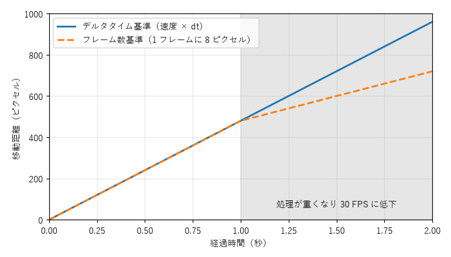

ゲームプログラミングの基礎
==========================

この章では、ゲームの種類やゲームエンジンを問わず共通する、ゲームプログラムの基本的な仕組みを説明する。コードの例には pygame-ce を使うが、考え方はほかのツールでも同じである。

ゲームループ
------------

業務アプリケーションや GUI アプリケーションの多くは\ **イベント駆動**\ で動く。ボタンが押されるなどのイベントが起きるまで待機し、起きたら対応する処理を実行する。何も起きなければ何もしない。

一方、ゲームは何も入力が無くても敵が動き、時間が流れる。そのため、ゲームのプログラムは「入力を受け取る」「状態を更新する」「画面を描く」という処理を、1 秒間に数十回の速さで延々と繰り返す。この繰り返しを\ :term:`ゲームループ`\ と呼び、ループ 1 回分を\ **フレーム**\ と呼ぶ。

.. graphviz::
   :caption: ゲームループ
   :name: fig-basics-game-loop

   digraph gameloop {
       node [shape=box, style="rounded,filled", fillcolor="#eef2ff", color="#6070a0"];
       edge [color="#6070a0"];
       init [label="初期化", shape=ellipse, fillcolor="#f0f0f0"];
       input [label="入力\n（キー、マウス、閉じるボタン）"];
       update [label="更新\n（移動、当たり判定、得点）"];
       draw [label="描画\n（画面に反映）"];
       wait [label="待機\n（フレームレートの調整）"];
       quit [label="終了処理", shape=ellipse, fillcolor="#f0f0f0"];
       init -> input -> update -> draw -> wait;
       wait -> input [label="次のフレーム", fontsize=10];
       input -> quit [label="終了要求", fontsize=10, style=dashed];
   }

pygame-ce で最小のゲームループを書くと次のようになる。:doc:`practice`\ の Step 1 のコードである。

.. literalinclude:: ../examples/step01_window.py
   :language: python
   :linenos:
   :pyobject: main
   :caption: examples/step01_window.py の main 関数

- 8 行目の ``while running:`` がゲームループである。
- 10 行目の ``clock.tick(FPS)`` は、前回の呼び出しから 1/60 秒が経つまで待機し、ループが速く回りすぎないようにする。ループの先頭に置いているが、前のフレームの最後に待機するのと同じことである。
- 13 行目から 15 行目で、溜まっているイベントをすべて取り出す。ウィンドウの閉じるボタンが押されると ``pygame.QUIT`` イベントが届くので、ループを終える。
- 20 行目と 21 行目で、画面を塗りつぶしてから表示に反映する。

ゲームエンジンを使う場合、ゲームループはエンジンの内部にあり、開発者が直接書くことは少ない。その代わり、Unity の ``Update`` メソッドや Godot の ``_process`` メソッドのように、毎フレーム呼ばれる関数に処理を書く。名前は違っても、裏で回っている仕組みはここで示したものと同じである。

フレームレートとデルタタイム
----------------------------

1 秒間に何フレーム処理するかを\ :term:`フレームレート`\ と呼び、単位には FPS（Frames Per Second）を使う。60 FPS なら、1 フレームに使える時間は約 16.7 ミリ秒である。この時間内に更新と描画を終えられないと、フレームレートが下がる。これを\ **処理落ち**\ と呼ぶ。

物を動かすとき、「1 フレームに 8 ピクセル動かす」と書くと、移動の速さがフレームレートに左右されてしまう。処理落ちすると遅くなり、性能の高いモニターで 120 FPS で動かすと 2 倍速になる。

そこで、前のフレームからの経過時間（\ :term:`デルタタイム`\ 、:math:`\Delta t`\ ）を求め、速度に掛けて移動量を計算する。位置を :math:`x`\ 、速度を :math:`v`\ （ピクセル毎秒）とすると、次のようになる。

.. math::

   x_{\text{次}} = x_{\text{今}} + v \, \Delta t

こうすると、フレームレートが変わっても 1 秒あたりの移動量は :math:`v` のまま変わらない。:numref:`fig-basics-dt` は、毎秒 480 ピクセルで物を動かしている途中で、処理が重くなり 30 FPS に落ちた場合の比較である。フレーム数を基準にした移動は処理落ちと同時に遅くなるが、デルタタイムを基準にした移動は同じ速さで進み続ける。

   処理落ちしたときの移動距離の比較

pygame-ce では、``clock.tick()`` の戻り値が前回の呼び出しからの経過時間（ミリ秒）なので、1000 で割れば秒単位のデルタタイムになる。

.. code-block:: python
   :linenos:
   :caption: デルタタイムの求め方

   dt = min(clock.tick(FPS) / 1000, MAX_DT)
   paddle.rect.x += direction * PADDLE_SPEED * dt

1 行目では、デルタタイムに上限（\ ``MAX_DT``\ 、本書では 1/30 秒）を設けている。ウィンドウをドラッグしている間などはゲームループが止まり、再開したときのデルタタイムが非常に大きくなる。上限が無いと、ボールが 1 フレームで壁の向こうまで移動してしまう（後述する\ :term:`すり抜け`\ ）。

デルタタイムを掛ける方法は手軽だが、フレームレートによって計算結果がわずかに変わる。厳密な再現性が必要な物理演算や、ネットワーク対戦のように全員の計算結果をそろえる必要がある場合は、更新を常に一定の時間刻みで行う\ **固定タイムステップ**\ を使う。

.. code-block:: python
   :linenos:
   :caption: 固定タイムステップの考え方

   STEP = 1 / 60  # 更新 1 回で進める時間（秒）
   accumulator = 0.0  # まだ更新に使っていない時間

   while running:
       accumulator += min(clock.tick() / 1000, 0.25)
       handle_events()
       while accumulator >= STEP:
           update(STEP)  # 常に同じ時間刻みで更新する
           accumulator -= STEP
       draw()

経過した時間を ``accumulator`` に溜め、``STEP`` ずつ取り出して更新する。描画が遅れても、更新は決まった刻みで必要な回数だけ行われる。この方法の詳細は、参考文献の「Fix Your Timestep!」が詳しい。本書のサンプルは単純さを優先し、デルタタイムを掛ける方法を使う。

座標系
------

pygame-ce を含む多くの 2D ライブラリーでは、画面の左上が原点 :math:`(0, 0)` で、x 軸は右向き、y 軸は\ **下向き**\ が正である。数学で使う座標系とは y 軸の向きが逆なので、「上に動かす」には y を減らす。

.. list-table:: pygame-ce で位置と大きさを扱うクラス
   :header-rows: 1
   :widths: 25 75

   * - クラス
     - 用途
   * - ``pygame.Rect``
     - 整数の座標を持つ長方形。位置、大きさ、当たり判定を扱う
   * - ``pygame.FRect``
     - 小数の座標を持つ長方形（pygame-ce で追加された）。デルタタイムを掛けた細かな移動量を切り捨てずに保持できる
   * - ``pygame.Vector2``
     - 2 次元ベクトル。速度や向きを表し、回転や長さの計算ができる

``Rect`` と ``FRect`` は、``left``\ 、``right``\ 、``top``\ 、``bottom``\ 、``center``\ 、``midbottom`` などの属性で、辺や中心の座標を読み書きできる。例えば ``rect.midbottom = paddle.rect.midtop`` と書けば、パドルの上辺の中央に、ボールの下辺の中央をそろえられる。

``Rect`` で小さな移動を繰り返すと問題が起きる。例えば毎秒 30 ピクセルで動かす場合、60 FPS では 1 フレームの移動量が 0.5 ピクセルとなり、整数座標に切り捨てられて少しも動かない。動く物の位置には ``FRect`` か ``Vector2`` を使う。

入力処理
--------

キーボードの入力を受け取る方法は 2 つある。

.. list-table:: 入力の受け取り方
   :header-rows: 1
   :widths: 20 40 40

   * - 方法
     - 分かること
     - 向いている用途
   * - イベント（\ ``pygame.KEYDOWN`` など）
     - キーが押された瞬間、離された瞬間
     - ジャンプ、発射、決定など、1 回押すごとに 1 回起きる動作
   * - 状態の取得（\ ``pygame.key.get_pressed()``\ ）
     - 今この瞬間にキーが押されているかどうか
     - 移動など、押している間ずっと続く動作

サンプルゲームでは、ボールの発射にイベントを、パドルの移動に状態の取得を使っている。発射を状態の取得で判定すると、キーを押している間に何フレームも続けて発射されてしまう。

描画
----

ゲームの描画は、毎フレーム画面全体を塗りつぶし、すべての物を描き直すのが基本である。描いた順に上に重なるので、背景、ブロック、パドルとボール、スコアなどの文字の順に描く。

描画中の未完成の画面がそのまま表示されると、ちらつきの原因になる。そこで、表示用とは別の画面（バッファー）に描いてから、完成した画面を一度に表示する。この手法を\ **ダブルバッファリング**\ と呼び、``pygame.display.flip()`` が表示の切り替えに当たる。

当たり判定
----------

物と物が重なったかどうかを調べる処理を\ :term:`当たり判定`\ （衝突判定）と呼ぶ。2D ゲームで最もよく使うのは、軸に平行な長方形どうしの判定（\ :term:`AABB`\ 、Axis-Aligned Bounding Box）である。長方形 :math:`A` と :math:`B` が重なる条件は次のとおりである。

.. math::

   A_{\text{left}} < B_{\text{right}} \;\land\; A_{\text{right}} > B_{\text{left}} \;\land\; A_{\text{top}} < B_{\text{bottom}} \;\land\; A_{\text{bottom}} > B_{\text{top}}

つまり、x 方向と y 方向の両方で区間が重なっていれば、長方形どうしが重なっている。pygame-ce では ``rect.colliderect(other)`` がこの判定を行い、``rect.collidelist(rects)`` は重なっている長方形の番号をリストから探す。

円どうしの判定は、中心間の距離が半径の和より小さいかどうかで行う。中心を :math:`(x_1, y_1)` と :math:`(x_2, y_2)`\ 、半径を :math:`r_1` と :math:`r_2` とすると、条件は次のようになる。

.. math::

   (x_1 - x_2)^2 + (y_1 - y_2)^2 < (r_1 + r_2)^2

平方根を計算しなくて済むよう、両辺を 2 乗した形で比較するのが定石である。

当たり判定は、重なったかどうかを調べるだけでは終わらない。重なっていたら、めり込んだ分を押し戻し、跳ね返りなどの反応を起こす必要がある。具体的な方法は\ :doc:`practice`\ の Step 4 で説明する。

また、毎フレームの位置だけで判定する方法には、速く動く物が薄い物を通り抜けてしまう\ :term:`すり抜け`\ という弱点がある。1 フレームの移動量が相手の厚みより大きいと、あるフレームでは手前にいて、次のフレームでは向こう側にいる、ということが起きる。対策には、速度やデルタタイムに上限を設ける、1 フレームの移動を細かく分割して判定する、移動の軌跡全体で判定する、などの方法がある。

シーンと状態遷移
----------------

ゲームには、タイトル画面、プレイ画面、結果画面のように、入力への反応や描く内容がまったく異なる画面がある。こうした画面の単位を\ :term:`シーン`\ と呼ぶ。シーンの切り替えは、状態と遷移の規則で振る舞いを表す\ :term:`ステートマシン`\ （状態機械）として設計すると整理しやすい。

.. graphviz::
   :caption: ブロック崩しのシーンの遷移
   :name: fig-basics-scenes

   digraph scenes {
       rankdir=LR;
       node [shape=box, style="rounded,filled", fillcolor="#eef2ff", color="#6070a0"];
       edge [color="#6070a0", fontsize=10];
       title [label="タイトル"];
       play [label="プレイ"];
       result [label="結果"];
       title -> play [label="スペースキー"];
       play -> result [label="全ブロック破壊\nまたは残機 0"];
       result -> title [label="スペースキー"];
   }

シーンごとにクラスを分け、各クラスに入力処理・更新・描画のメソッドを持たせると、「プレイ中だけ有効な処理」のような条件分岐がゲームループから消え、コードが読みやすくなる。具体的な実装は\ :doc:`practice`\ の Step 6 で示す。

乱数
----

敵の出現位置やアイテムの出現など、ゲームでは乱数を多用する。Python では ``random`` モジュールを使う。

不具合の調査やテストでは、毎回同じ乱数列が出ると便利である。``random.seed(1)`` のように乱数の\ **シード**\ （種）を固定すると、同じ乱数列を再現できる。シードを記録しておけば、「たまにしか起きない不具合」を同じ条件で再現できる。
