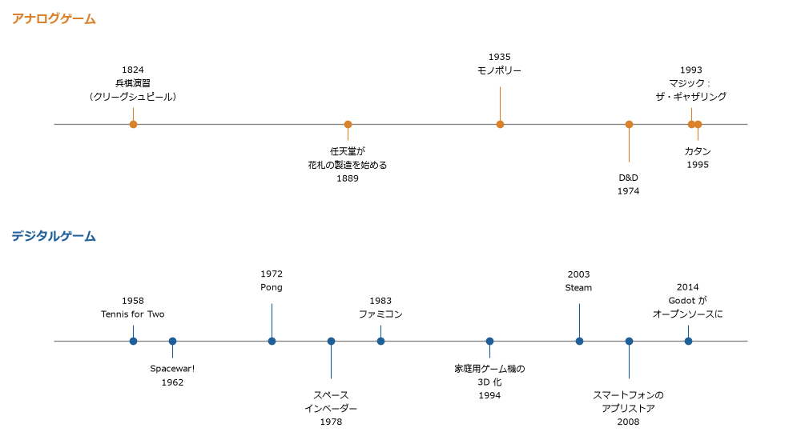

2 章　歴史
==========

この章では、ゲームの歴史を古代から現代までたどる。アナログゲームとデジタルゲームを並べて見ると、遊びの形は技術とともに変わってきたが、遊びの核となる構造は驚くほど変わっていないことが分かる。

   アナログゲームとデジタルゲームの主な出来事（上下で横軸の範囲が異なる）

古代
----

現存する最古級のボードゲームとして、古代エジプトの\ **セネト**\ （紀元前 3000 年ごろ）と、メソポタミアの\ **ウル王朝のゲーム**\ （紀元前 2600 年ごろ）が知られている。どちらも、棒や四面体のサイコロを振って駒を進めるレースゲームであった。ウル王朝のゲームは、楔形文字の粘土板に残された記述からルールが復元されている。

東アジアでは、\ **囲碁**\ が遅くとも紀元前の中国で遊ばれていた。囲碁は偶然の要素を持たない、純粋に思考を競うゲームである。

インドの\ **チャトランガ**\ （6 世紀ごろ）は、王、将軍、象、馬、戦車、歩兵の駒で軍隊を模したゲームで、西に伝わってチェスに、東に伝わって将棋やシャンチー（中国象棋）になったと考えられている。日本の将棋は、取った駒を自分の駒として再び使える点が特徴で、この持ち駒のルールは 16 世紀ごろに定着したとされる。

サイコロで駒を進める\ **双六**\ も古くから遊ばれた。日本では、盤上で駒を進める盤双六が奈良時代以前に伝わり、後に絵の描かれた紙の上を進む絵双六が広まった。現在「すごろく」と呼ばれるのは主に絵双六の系統である。

近代
----

**トランプ**\ は 14 世紀ごろにヨーロッパに広まり、16 世紀にポルトガルから日本に伝わった。日本ではこれをもとにかるたが作られ、\ **花札**\ へと発展した。1889 年に京都で創業した任天堂は、花札の製造から事業を始めた。

19 世紀のプロイセンでは、軍の将校の訓練のために地図と駒を使う\ **兵棋演習**\ （クリーグシュピール）が作られた。審判が戦闘の結果をサイコロと表で判定する仕組みは、後のウォーゲームや TRPG に受け継がれた。

20 世紀初めには、土地の独占の弊害を示すために作られた「ザ・ランドロード・ゲーム」（1904 年に特許取得）が、後に\ **モノポリー**\ （1935 年に販売開始）となった。モノポリーは、作者の意図とは逆に、独占して勝つ楽しさで広く遊ばれるようになった。

20 世紀のアナログゲーム
-----------------------

1974 年に発売された\ **ダンジョンズ＆ドラゴンズ**\ （D&D）は、プレイヤーが 1 人のキャラクターを演じ、ゲームマスターが語る物語の中で冒険する、最初の商業的な TRPG である。ウォーゲームの戦闘の判定を個人の冒険に持ち込んだもので、後のデジタルゲームのロールプレイングゲームにも大きな影響を与えた。

1993 年の\ **マジック：ザ・ギャザリング**\ は、プレイヤーが手持ちのカードから自分のデッキを組んで対戦する、トレーディングカードゲーム（TCG）の始まりである。

1995 年にドイツで発売された\ **カタン**\ （発売時の名前は「カタンの開拓者たち」）は、交渉、資源の管理、ほどよい偶然を組み合わせ、短い時間で家族でも遊べるゲームとして世界的に広まった。カタンを代表とするドイツ発のボードゲームは「ドイツゲーム」や「ユーロゲーム」と呼ばれ、プレイヤーが脱落しないこと、プレイ時間が 1 時間前後であることなどの特徴を持つ。これが現代のボードゲームの流行の出発点の 1 つになった。

デジタルゲームの誕生
--------------------

1958 年、アメリカのブルックヘブン国立研究所で、研究所の一般公開のために **Tennis for Two** が作られた。アナログコンピューターとオシロスコープで、テニスのボールの軌道を表示するものだった。

1962 年には、マサチューセッツ工科大学（MIT）の学生たちが、ミニコンピューター PDP-1 の上で 2 人対戦の宇宙戦争ゲーム **Spacewar!** を作った。Spacewar! はソースコードとともに各地の大学の計算機に広まった。

1972 年、アタリが業務用（アーケード）ゲーム機 **Pong** を発売し、商業的に成功した。同じ年には、最初の家庭用ゲーム機とされるマグナボックス・オデッセイも発売されている。

家庭用ゲーム機とアーケード
--------------------------

1978 年にタイトーが発売した\ **スペースインベーダー**\ は日本で大流行し、ゲームセンターという場を定着させた。

アメリカでは、品質の低いソフトウェアが大量に出回ったことなどから、1983 年ごろに家庭用ゲーム機の市場が急に縮小した。これを\ **アタリショック**\ と呼ぶ。同じ 1983 年、任天堂は日本で\ **ファミリーコンピュータ**\ を発売した。1985 年に北米で NES（Nintendo Entertainment System）として発売する際には、ソフトウェアの発売を許可制にして品質を管理する仕組みを取り入れ、北米の家庭用ゲーム機の市場を立て直した。

3D 化とネットワーク化
---------------------

1990 年代半ばには、3D グラフィックスを描く専用の回路を持つ家庭用ゲーム機が登場し、ゲームの画面は平面から立体へと移った。立体の空間を動き回るには、カメラの操作や、奥行きの分かる画面作りなど、新しい設計の考え方が必要になった。

同じころ、インターネットの普及によって、多数のプレイヤーが同じ世界で同時に遊ぶオンラインゲームが広く普及した。それ以前にも、大学などの計算機の上で、文字だけで遊ぶ多人数のゲーム（MUD）が 1970 年代末から遊ばれていた。

現代
----

2000 年代以降の主な変化を次の表にまとめる。

.. list-table:: 2000 年代以降の主な変化
   :header-rows: 1
   :widths: 25 75

   * - 変化
     - 内容
   * - デジタル配信
     - 2003 年に始まった Steam などにより、パッケージを店で買わずに、インターネットでゲームを購入できるようになった
   * - スマートフォン
     - 2008 年ごろからスマートフォンのアプリストアが広まり、多くの人が常にゲーム機を持ち歩くようになった
   * - :term:`基本プレイ無料`
     - 遊ぶこと自体は無料で、アイテムなどの課金で収益を得るモデルが広まった
   * - インディーゲーム
     - 個人や少人数のチームが作り、デジタル配信で直接販売するゲームが増えた
   * - 汎用のゲームエンジン
     - Unity、Unreal Engine、Godot などのゲームエンジンが、個人でも無料または低価格で使えるようになった（4 章）
   * - アナログゲームの再評価
     - クラウドファンディングによる出版、ボードゲームカフェ、\ :term:`マーダーミステリー`\ などの新しい遊び方が広まった

技術とゲームの関係
------------------

デジタルゲームの歴史は、計算機の技術の歴史と切り離せない。

.. list-table:: 技術の進歩とゲームの変化
   :header-rows: 1
   :widths: 25 75

   * - 技術
     - ゲームへの影響
   * - CPU
     - 処理の速さが、同時に動かせる敵の数や、シミュレーションの細かさを決めた
   * - GPU
     - 3D グラフィックスを実時間で描けるようになり、立体の空間を探索するゲームが生まれた
   * - 記憶容量
     - 容量の少ない時代は、地図や音楽を短いデータから組み立てる工夫が必要だった。容量が増えると、大量の映像や音声を使えるようになった
   * - 通信
     - 遠くの人と同時に遊ぶこと、ゲームを配信で買うこと、発売後に内容を更新し続けることを可能にした

一方で、アナログゲームの側を見ると、セネトと双六、チャトランガと将棋のように、千年単位で同じ構造のゲームが遊ばれ続けている。技術は遊びの「器」を変えたが、競争、偶然、模倣、めまいという遊びの核（1 章）は変わっていない。

演習
----

双六と、手元にある現代のゲームを 1 つずつ遊び比べ、何が変わり、何が変わっていないかを書き出す。双六は紙とサイコロで遊んでもよいし、\ :download:`sugoroku.py <../../examples/py/sugoroku.py>` を次のように実行して遊んでもよい。\ ``sugoroku.py`` は 1 回の手番で 1 回だけ振り直せるルールを加えている。あなたが振り直しを使わなければ、自分の側は昔ながらの双六と同じになる（相手は振り直しを使う）。

.. code-block:: text
   :linenos:

   py sugoroku.py --play

記入例
~~~~~~

.. list-table:: 記入例：双六と現代のすごろく系のデジタルゲーム
   :header-rows: 1
   :widths: 25 75

   * - 観点
     - 記入例
   * - 変わっていないこと
     - サイコロ（乱数）で進み、先にゴールに着いた人が勝つという骨格。運に左右されるので、子どもと大人が対等に遊べる点
   * - 変わったこと
     - 止まったマスでのミニゲーム、アイテムによる妨害、演出と効果音。遊ぶ人が「選ぶ」場面が増えている
   * - 気付いたこと
     - 双六はほぼ選択の無いゲームで、勝ち負けは運だけで決まる。現代のゲームは、選択を加えて運の影響を薄めている。この違いは 8 章の演習 3 で数値で確かめる
