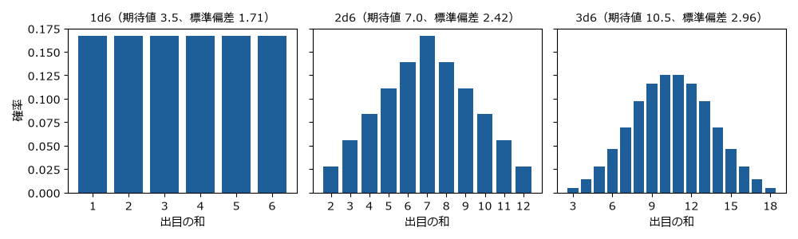
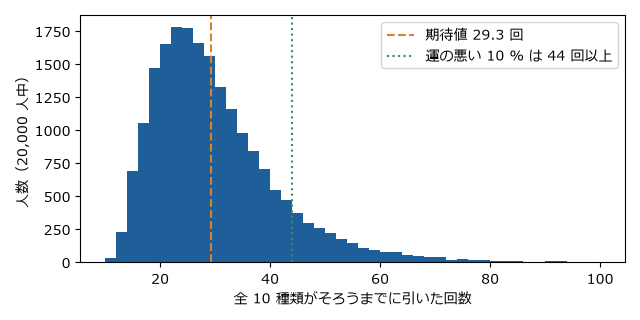
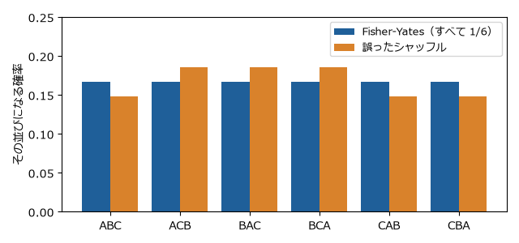

5 章　数理
==========

ゲームはルールで定められた仕組みなので、数学で扱える部分が多い。この章では、8 章の演習で使う数理の道具を説明する。それぞれの節には、計算を確かめる Python のサンプルを用意した。

状態とゲーム木
--------------

ゲームのある時点の状況をすべて書き表したものを\ **状態**\ （局面）と呼ぶ。三目並べなら、9 マスのそれぞれに ×、○、空白のどれがあるかで状態が決まる（プログラムでは × を X、○ を O で表す）。プレイヤーが手を打つと、状態は別の状態に移る。

初期の状態から、打てる手を枝として順に広げていくと、木の形の図ができる。これを\ :term:`ゲーム木`\ と呼ぶ。木の末端（葉）は、勝ち負けが決まった終局の状態である。

三目並べのゲーム木の大きさを、\ :download:`tictactoe.py <../../examples/py/tictactoe.py>` で数えてみる。

.. code-block:: text
   :linenos:

   > py tictactoe.py
   終局までの手順の数: 255168
   到達できる局面の数: 5478
   初期局面の値: 0（0 は双方が最善を尽くすと引き分け）

9 マスに順に打つ手順は最大で :math:`9! = 362880` 通りだが、途中で勝負がつくと手順はそこで終わるので、実際の手順は 255,168 通りになる。また、異なる手順で同じ局面に到達することが多いので、局面の数は 5,478 にまで減る。

三目並べは計算機ですべて調べ尽くせる大きさだが、チェスのゲーム木の大きさは :math:`10^{120}` 程度と見積もられており（シャノン数）、すべてを調べることはできない。

完全情報ゲームを解く
--------------------

完全情報で偶然の要素の無いゲームは、ゲーム木の葉から逆にたどることで、双方が最善を尽くしたときの結果を求められる。この方法を\ :term:`ミニマックス法`\ と呼ぶ。

先手（×）の勝ちを +1、引き分けを 0、後手（○）の勝ちを -1 とする。先手は値が最大になる手を、後手は値が最小になる手を選ぶと考え、葉から順に値を決めていく。

.. graphviz::
   :caption: ミニマックス法の考え方。先手は子の最大値を、後手は子の最小値を選ぶ
   :align: center

   digraph minimax {
     node [shape=box, style="rounded,filled", fontsize=11];
     edge [color="#555555"];
     a [label="先手の手番\n値 = max(3, 2) = 3", fillcolor="#e8f0f8", color="#1f5f99"];
     b [label="後手の手番\n値 = min(3, 5) = 3", fillcolor="#fbeee2", color="#d9822b"];
     c [label="後手の手番\n値 = min(2, 9) = 2", fillcolor="#fbeee2", color="#d9822b"];
     l1 [label="3", shape=ellipse, fillcolor="#f2f2f2"];
     l2 [label="5", shape=ellipse, fillcolor="#f2f2f2"];
     l3 [label="2", shape=ellipse, fillcolor="#f2f2f2"];
     l4 [label="9", shape=ellipse, fillcolor="#f2f2f2"];
     a -> b [label=" 手 A", fontsize=10, penwidth=2.5, color="#1f5f99"];
     a -> c [label=" 手 B", fontsize=10];
     b -> l1 [penwidth=2.5, color="#d9822b"];
     b -> l2;
     c -> l3 [penwidth=2.5, color="#d9822b"];
     c -> l4;
   }

上の図では、手 B の先には 9 という大きな値があるが、後手はそれを選ばず 2 を選ぶ。そのため先手は、確実に 3 が得られる手 A を選ぶ。

``tictactoe.py`` の ``value`` 関数は、この方法で三目並べの初期局面の値を求め、0（引き分け）を得る。つまり、三目並べは双方が最善を尽くすと必ず引き分けになる。\ ``py tictactoe.py play`` で、この方法で手を選ぶ AI と対戦できる。

このように、最善を尽くしたときの結果が分かったゲームを「解かれたゲーム」と呼ぶ。チェッカー（8×8 の盤で駒を斜めに進め、相手の駒を跳び越して取る西洋のゲーム。ドラフツとも呼ぶ）は 2007 年に、双方が最善を尽くすと引き分けになることが証明された。オセロは 2023 年に、同じく引き分けになるという計算結果が発表された。ゲーム木が大きくなると、同じ局面をまとめる工夫や、明らかに悪い枝を調べずに済ませる工夫（枝刈り）が必要になる。

組合せゲーム理論
----------------

**ニム**\ は、いくつかの石の山から、2 人が交互に、1 つの山から 1 個以上の石を取るゲームである。最後の石を取った方が勝ちとする。

ニムには、二進数を使ったきれいな必勝法がある（チャールズ・ブートン、1901）。すべての山の石の数の排他的論理和（XOR）を\ :term:`ニム和`\ と呼ぶ。

.. math::

   s = h_1 \oplus h_2 \oplus \cdots \oplus h_k

ここで :math:`h_i` は :math:`i` 番目の山の石の数、\ :math:`\oplus` は排他的論理和である。

* ニム和が 0 でない局面で手番が来たら、ニム和を 0 にする手が必ずある。
* ニム和が 0 の局面で手番が来たら、どう打ってもニム和は 0 でなくなる。
* 石が無くなった局面のニム和は 0 である。

したがって、自分の手番でニム和が 0 でなければ、常にニム和を 0 にして相手に渡し続けることで必ず勝てる。たとえば山が 3、4、5 個のとき、二進数で 011、100、101 なので、ニム和は 010（= 2）である。3 個の山から 2 個取って 1、4、5 にすると、001、100、101 でニム和は 0 になる。

:download:`nim.py <../../examples/py/nim.py>` の ``winning_move`` 関数がこの手を求める。

.. literalinclude:: ../../examples/py/nim.py
   :language: python
   :linenos:
   :lineno-match:
   :pyobject: winning_move
   :caption: nim.py の winning_move 関数

山の石の数 ``h`` とニム和 ``s`` の排他的論理和 ``h ^ s`` を目標の数とし、それが ``h`` より小さければ、その山から ``h - target`` 個取ればよい。

同時に手を選ぶゲーム
--------------------

じゃんけんのように、双方が同時に手を選ぶゲームは、ゲーム木ではなく\ **利得表**\ で表す。利得表は、両者の手の組合せごとに、それぞれが得る点（利得）を並べた表である。

代表的な例が\ **囚人のジレンマ**\ である。2 人がそれぞれ「協力」と「裏切り」を選び、利得は次のとおりとする（括弧の中は、左が A、右が B の利得）。

.. list-table:: 囚人のジレンマの利得表
   :header-rows: 1
   :stub-columns: 1
   :widths: 30 35 35

   * - A ＼ B
     - 協力
     - 裏切り
   * - 協力
     - (3, 3)
     - (0, 5)
   * - 裏切り
     - (5, 0)
     - (1, 1)

B がどちらを選んでも、A は裏切った方が利得が大きい（3 より 5、0 より 1）。B から見ても同じなので、2 人とも裏切り (1, 1) に落ち着く。どちらも自分だけ手を変えても得をしない組合せを\ :term:`ナッシュ均衡`\ と呼ぶ（ジョン・ナッシュ、1950）。2 人とも協力すれば (3, 3) が得られるのに、それぞれが合理的に選ぶと (1, 1) になる点が「ジレンマ」である。

じゃんけんには、このような 1 つの手に決まる均衡が無い。グーに決めればパーで負かされ、パーに決めればチョキで負かされる。均衡は、3 つの手を確率 1/3 ずつでランダムに出す\ :term:`混合戦略`\ である。どの手にも偏らなければ、相手に読まれることが無い。

勝ったときの点が手によって違うと、均衡も変わる。「グリコ」という遊び（グーで勝つと 3 歩、チョキとパーで勝つと 6 歩進む）を、相手との差を競う\ :term:`ゼロ和ゲーム`\ と見て、\ :download:`rps.py <../../examples/py/rps.py>` で計算する。

.. code-block:: text
   :linenos:

   > py rps.py
   勝ったときの得点: グー 3、パー 6、チョキ 6
   最適な割合:       グー 0.400、パー 0.200、チョキ 0.400
   最適な割合の相手に対する各手の期待値: グー +0.000、パー +0.000、チョキ +0.000
   均等に出す相手に対する各手の期待値:   グー -1.000、パー +0.000、チョキ +1.000
   均等に出す相手に毎回チョキを出したときの平均得点（シミュレーション）: +1.004

同じ 6 歩でも、チョキの割合は 0.4 なのに、パーの割合だけが 0.2 と小さくなる。パーが負かすグーは、勝っても 3 歩しか進めない手なので、それを止める価値が小さいからである。直感に反するこの結果は、8 章の演習 5 で詳しく調べる。

確率と期待値
------------

偶然の要素を持つゲームを理解するには、確率と\ :term:`期待値`\ が基本になる。ある量 :math:`X` が値 :math:`x_i` を確率 :math:`p_i` でとるとき、期待値 :math:`E[X]` と分散 :math:`V[X]` は次の式で表される。

.. math::

   E[X] = \sum_i x_i p_i, \qquad V[X] = \sum_i (x_i - E[X])^2 p_i

6 面のサイコロ 1 個を 1d6、2 個の和を 2d6 のように書く。\ :download:`dice.py <../../examples/py/dice.py>` で 1d6、2d6、3d6 の分布を計算すると次の図になる。

   サイコロの個数による和の分布の違い

1d6 はどの目も 1/6 で平らだが、2d6 は 7 が最も出やすい（6/36 = 1/6）三角形になり、3d6 は釣り鐘の形に近づく。サイコロの個数を増やすと、極端な値が出にくくなり、結果が平均に集まる。ゲームデザインでは、この性質を使って「運の荒さ」を調整する。

ガチャ（くじ）で、\ :math:`n` 種類の景品が同じ確率で出るとき、全種類をそろえるまでに引く回数の期待値は次の式で表される（クーポンコレクター問題）。

.. math::

   E = n \left( 1 + \frac{1}{2} + \frac{1}{3} + \cdots + \frac{1}{n} \right)

10 種類なら約 29.3 回である。最初の数種類はすぐにそろうが、最後の 1 種類は確率 1/10 でしか出ないので、平均 10 回かかる。\ :download:`gacha.py <../../examples/py/gacha.py>` で 20,000 人分をシミュレーションした結果を次に示す。

   10 種類のガチャをそろえるまでの回数の分布

平均は約 29 回だが、分布は右に長く伸びており、運の悪い 10 % の人は 44 回以上かかる。期待値だけでは、プレイヤーの体験のばらつきは分からない。

乱数
----

デジタルゲームのサイコロは、計算で作る\ :term:`擬似乱数`\ である。擬似乱数は、\ **シード**\ と呼ばれる初期値が同じなら、毎回同じ数の列を生む。この性質は、不具合の再現や、同じ地図をもう一度遊ぶ機能、対戦の録画の再生などに使われる。

乱数を正しく使うのは意外に難しい。カードを混ぜる処理（シャッフル）を例にとる。各位置を、全体の中からランダムに選んだ 1 枚と入れ替える、という素直に見える方法は誤りである。3 枚のカードでは乱数の組合せが :math:`3^3 = 27` 通りあり、これを並べ方の 6 通りに均等に割り振ることはできない（27 は 6 で割り切れない）。

正しい方法は **Fisher-Yates のシャッフル**\ で、後ろの位置から順に、まだ決まっていない位置の中から 1 枚を選んで入れ替える。乱数の組合せが :math:`3 \times 2 = 6` 通りになり、並べ方と 1 対 1 に対応する。\ :download:`shuffle.py <../../examples/py/shuffle.py>` で 2 つを比べた結果を次に示す。

   正しいシャッフルと誤ったシャッフルの比較（3 枚の場合）

誤ったシャッフルでは、ACB、BAC、BCA が 5/27、その他が 4/27 になり、偏りが生じる。カードゲームのアプリでこの偏りがあれば、プレイヤーに有利な並びと不利な並びが生まれる。

強さを測る
----------

対戦ゲームでは、プレイヤーの強さを数値で表す仕組みがよく使われる。代表的なものが、物理学者アルパド・イロが考案した\ :term:`イロレーティング`\ である。チェスで採用され、現在は多くの対戦ゲームで、これを元にした方式が使われている。

レーティング :math:`R_A` のプレイヤー A が、\ :math:`R_B` のプレイヤー B に勝つ見込み :math:`E_A` は次の式で表される。

.. math::

   E_A = \frac{1}{1 + 10^{(R_B - R_A)/400}}

試合の結果を :math:`S_A`\ （勝ち 1、引き分け 0.5、負け 0）とすると、試合後のレーティングは次のように更新される。

.. math::

   R_A' = R_A + K (S_A - E_A)

:math:`K` は 1 試合でレーティングが動く大きさを決める定数である。レーティングの差が 200 あれば、強い方が勝つ見込みは約 0.76 になる。見込みどおりの結果ならレーティングはあまり動かず、番狂わせが起きると大きく動く。

:download:`elo.py <../../examples/py/elo.py>` は、本当の強さが 1700、1500、1300 の 3 人に、1500 から始めて総当たりを繰り返させる。100 回戦後には、レーティングはおおむね本当の強さの順に並ぶが、1 試合で最大 32 点（\ :math:`K = 32`\ ）動くので、本当の強さと一致するとは限らない。\ :math:`K` を小さくすると値は安定するが、強さの変化に追いつくのが遅くなる。

演習
----

演習 1　ニムで AI に勝つ
~~~~~~~~~~~~~~~~~~~~~~~~

``py nim.py`` で、山 3、4、5 個のニムを AI と対戦する。あなたが先手である。最初は必勝法を使わずに数回遊び、次に必勝法を使って遊ぶ。

演習 2　7 が出やすいことを確かめる
~~~~~~~~~~~~~~~~~~~~~~~~~~~~~~~~~~

2 個のサイコロを実際に 36 回振り、和の回数を記録する。次に ``py dice.py 2 1000`` で 1,000 回振った結果と比べる。

解答例
~~~~~~

演習 1：最初の局面のニム和は 2 なので、先手が必ず勝てる。最初の手は「0 番の山（3 個）から 2 個取る」である。その後も、AI の手のあとに表示されるニム和が 0 でなければ、\ ``winning_move`` と同じ計算で 0 に戻す。必勝法を知らずに遊ぶと、一度でもニム和が 0 でない局面を AI に渡したとたん、AI がニム和を 0 に戻し続けるので、必ず負ける。

演習 2：36 回では、7 が 6 回前後出るが、2 や 12 が 1 回も出ないことも、7 より 6 や 8 の方が多いこともよくある。\ ``dice.py`` で 1,000 回振ると、各値の割合は理論値に近づく。回数が少ないと確率どおりにならないことは、短いゲームほど運が勝敗を左右しやすいことにつながる（8 章の演習 3）。
