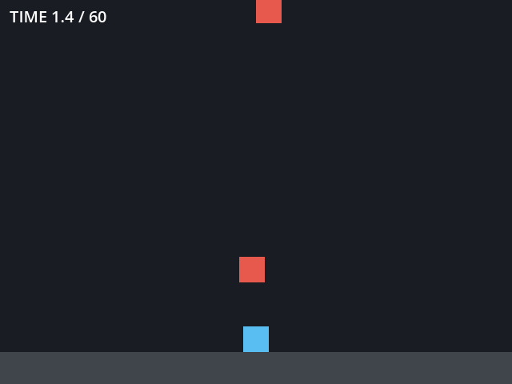

4 章　制作
==========

この章では、ゲームがどのように作られるかを概観する。制作の流れと体制を見たあと、デジタルゲームのプログラムの骨格であるゲームループを Python で確かめ、8 章で使う Godot のサンプルを動かす。最後に、アナログゲームの制作にも触れる。

制作の流れ
----------

規模にかかわらず、ゲームの制作はおおむね次の流れで進む。

.. graphviz::
   :caption: ゲーム制作の流れ
   :align: center

   digraph production {
     rankdir=LR;
     node [shape=box, style="rounded,filled", fillcolor="#e8f0f8", color="#1f5f99"];
     edge [color="#555555"];
     plan [label="企画"];
     proto [label="プロトタイプ"];
     prod [label="量産"];
     test [label="テスト"];
     release [label="リリース"];
     live [label="運用"];
     plan -> proto -> prod -> test -> release -> live;
     proto -> plan [label="面白くなければ\n企画に戻る", style=dashed, fontsize=10];
     test -> prod [label="不具合の修正", style=dashed, fontsize=10];
   }

.. list-table:: 制作の各段階
   :header-rows: 1
   :widths: 20 80

   * - 段階
     - 内容
   * - 企画
     - どのような体験を届けるか、誰に向けるか、どの程度の規模で作るかを決める
   * - :term:`プロトタイプ`
     - ゲームの核となる部分だけを素早く作り、本当に面白いかを確かめる。面白くなければ企画に戻る
   * - 量産
     - ステージ、キャラクター、音楽などの素材を大量に作り、ゲームの全体を組み上げる
   * - テスト
     - 不具合を探すだけでなく、難易度や分かりやすさを、実際に遊んでもらって確かめる
   * - リリース
     - 販売や配信を始める
   * - 運用
     - オンラインのゲームでは、リリース後も内容の追加や調整を続ける

ゲーム制作で特に重視されるのはプロトタイプの段階である。ゲームの面白さは、仕様書を読んでも分からず、実際に遊んでみるまで判断できない。そのため、面白さを確かめる前に量産に入ると、作り直しの費用が大きくなる。

規模と体制
----------

.. list-table:: 制作の規模
   :header-rows: 1
   :widths: 20 20 60

   * - 規模
     - 人数の目安
     - 特徴
   * - 個人
     - 1 人
     - 企画からプログラム、絵、音までを 1 人で担う。小さく作って早く公開することが多い
   * - インディー
     - 数人〜数十人
     - 大きな会社に属さず、独自の発想で作る。デジタル配信で直接販売する
   * - 大規模
     - 数百人以上
     - 開発期間は数年に及ぶ。職種が細かく分かれ、外部の会社と分担することも多い

大規模な制作で関わる主な職種を次に示す。

.. list-table:: 主な職種
   :header-rows: 1
   :widths: 25 75

   * - 職種
     - 役割
   * - プロデューサー
     - 予算、日程、人員を管理し、制作全体に責任を持つ
   * - ディレクター
     - ゲームの内容の方向性を決め、品質に責任を持つ
   * - ゲームデザイナー（プランナー）
     - ルール、ステージ、数値のバランスなどを設計する
   * - プログラマー
     - ゲームの処理、ツール、ネットワークなどを実装する
   * - アーティスト
     - キャラクター、背景、エフェクト、ユーザーインターフェースの絵を作る
   * - サウンド
     - 音楽と効果音を作る
   * - QA（品質保証）
     - 不具合を探し、報告する

ゲームプログラムの骨格
----------------------

ほとんどのデジタルゲームのプログラムは、次の 3 つの処理を繰り返す\ :term:`ゲームループ`\ を骨格に持つ。

1. **入力**\ ：キーボード、マウス、コントローラーなどからプレイヤーの操作を読む。
2. **更新**\ ：操作とルールに従って、ゲームの状態（位置、得点、残り時間など）を 1 段階進める。
3. **描画**\ ：状態を画面に表示する。

次の :download:`game_loop.py <../../examples/py/game_loop.py>` は、落ちてくる果物をかごで受け止める、端末上で動く最小のゲームである。\ ``read_input``\ 、\ ``update``\ 、\ ``draw`` の 3 つの関数が、上の 3 つの処理に対応する。ゲームの状態は ``State`` クラスにまとめている。

.. literalinclude:: ../../examples/py/game_loop.py
   :language: python
   :linenos:
   :caption: game_loop.py

``main`` 関数の ``while`` 文（66〜71 行目）がゲームループである。このサンプルは、プレイヤーが入力するまで次の更新を待つ手番制のループになっている。

アクションゲームのようなリアルタイムのゲームでは、入力を待たずに 1 秒間に 60 回ほどループを回す。このとき、1 回のループで経過した時間（時間刻み、デルタタイム）を測り、移動量を「速さ × 時間刻み」で計算する。こうすると、計算機の速さが違っても、ゲームの中の時間は同じ速さで進む。8 章で使う Godot のサンプルでも、\ ``_process(delta)`` の ``delta`` がこの時間刻みである。

ゲームエンジン
--------------

:term:`ゲームエンジン`\ は、ゲームループ、描画、音、入力、物理の計算、素材の管理、編集用の画面（エディター）など、多くのゲームに共通する機能をまとめたソフトウェアである。ゲームエンジンを使うと、制作者はゲームに固有の部分の制作に集中できる。

.. list-table:: 代表的なゲームエンジン（2026 年時点の概略）
   :header-rows: 1
   :widths: 16 28 28 28

   * - 項目
     - Godot
     - Unity
     - Unreal Engine
   * - 主な言語
     - GDScript（Python に似た文法）、C#
     - C#
     - C++、ブループリント（ノードをつないで処理を書く方式）
   * - 費用
     - 無料。オープンソース（MIT ライセンス）
     - 収益が一定額以下なら無料のプランがある
     - 無料で使える。製品の売上が一定額を超えると使用料が発生する
   * - 特徴
     - 軽量で、エディターの起動が速い。2D に強い
     - 利用者が多く、資料と素材が豊富。スマートフォン向けで広く使われる
     - 高品質な 3D の描画に強い。大規模な制作で広く使われる

料金と条件は改定されることがあるので、使う前に各エンジンの公式サイトで最新の条件を確認する。本書では、無料で使え、ダウンロードしてすぐに起動できる Godot をサンプルに使う。

Godot のサンプルを動かす
------------------------

8 章の演習で使うサンプルゲーム ``dodge_lab`` を動かし、変えられるパラメーターの場所を確認する。\ ``dodge_lab`` は、上から落ちてくるブロックを、左右に動いて避けるゲームである。60 秒生き残ればクリアになる。

   dodge_lab の画面

手順は次のとおりである。

1. :download:`dodge_lab.zip <../_generated/dodge_lab.zip>` をダウンロードし、展開する。
2. Godot 4.7.2 を起動し、プロジェクトマネージャーの「インポート」で、展開したフォルダーの ``project.godot`` を選ぶ。
3. エディターが開いたら、右上の実行ボタン（▶）を押す。矢印キー、または A キーと D キーで左右に動く。ブロックに当たるか 60 秒たつと結果が表示され、Enter キーかスペースキーでもう一度遊べる。
4. ゲームを閉じ、エディターの左上のシーンツリーで ``Main`` ノードを選ぶ。右側のインスペクターに、次の表のパラメーターが表示される。インスペクターでは、\ ``max_speed`` が「Max Speed」のように、単語の先頭を大文字にした名前で、グループ（Player (game feel) など）に分けて表示される。

.. list-table:: dodge_lab のパラメーター
   :header-rows: 1
   :widths: 25 15 60

   * - パラメーター
     - 初期値
     - 意味
   * - ``max_speed``
     - 300
     - 左右に動く最高速度 [px/s]
   * - ``acceleration``
     - 1500
     - キーを押している間の加速度 [px/s²]。大きいほど素早く最高速度に達する
   * - ``deceleration``
     - 2000
     - キーを離したときの減速度 [px/s²]。小さいほど滑る
   * - ``fall_gravity``
     - 400
     - ブロックが落ちる加速度（重力）[px/s²]
   * - ``spawn_interval``
     - 0.9
     - ブロックが出現する間隔 [s]。短いほど難しい
   * - ``block_size``
     - 32
     - ブロックの 1 辺の長さ [px]
   * - ``time_limit``
     - 60
     - この時間だけ生き残ればクリア [s]
   * - ``log_path``
     - ``user://dodge_lab_log.csv``
     - 記録を書き出すファイル

1 回遊ぶごとに、そのときのパラメーターと生存時間が CSV ファイルに 1 行ずつ追記される。\ ``user://`` は Godot がプロジェクトごとに用意する保存場所で、Windows では ``%APPDATA%\Godot\app_userdata\Dodge Lab\`` になる。実際の保存先は、結果の画面と、エディターの下部の出力パネルに表示される。

アナログゲームの制作
--------------------

アナログゲームの制作は、デジタルゲームより少ない道具で始められる。

.. list-table:: アナログゲームの制作の流れ
   :header-rows: 1
   :widths: 25 75

   * - 段階
     - 内容
   * - 紙のプロトタイプ
     - 白紙のカード、手書きの盤、他のゲームの駒とサイコロで、まず遊べる形を作る。見た目にこだわらず、ルールの面白さを確かめる
   * - テストプレイ
     - 自分以外の人に遊んでもらう。ルールを説明せずにルールブックだけで遊べるか（ブラインドテスト）も確かめる
   * - コンポーネントの制作
     - カード、ボード、駒、箱などの部品（コンポーネント）を、印刷所や製造業者に発注する
   * - 頒布
     - 即売会への出展、ネット販売、出版社への持ち込み、クラウドファンディングなどで届ける

紙のプロトタイプは、デジタルゲームの企画でも使われる。ルールの面白さを確かめるだけなら、プログラムを書くより紙で作る方が速いことが多い。

演習
----

好きなデジタルゲームのスタッフクレジット（エンディングやメニューから見られる）を見て、どのような職種の人が何人ぐらい関わっているかを数える。アナログゲームの場合は、箱やルールブックに書かれたクレジットを見る。

記入例
~~~~~~

「小規模なインディーゲームでは、デザイン、プログラム、アートを 2 人で兼任し、音楽だけ外部の 1 人に依頼していた。大規模なアクションゲームでは、クレジットが 10 分以上続き、職種の欄だけで 100 を超えた。ローカライズ（翻訳）、QA、モーションキャプチャーの俳優など、遊んでいるときには意識しない職種が多かった。」
