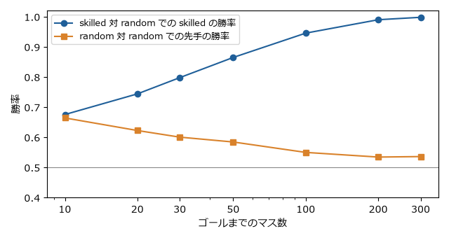
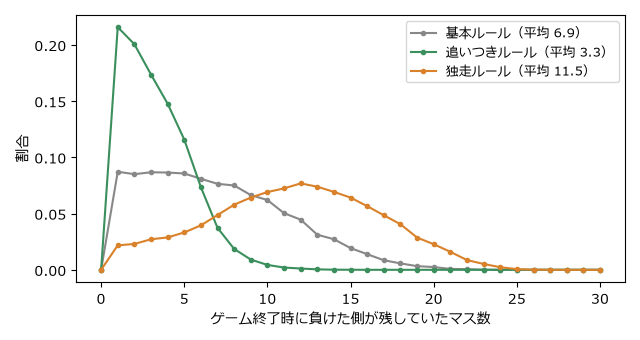
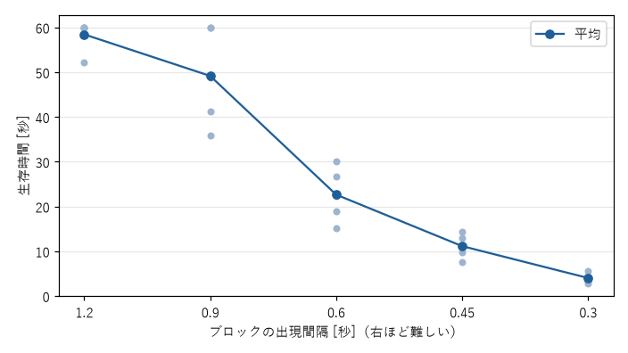

8 章　分析的に遊ぶ
==================

この章では、5 章と 6 章で学んだ概念を使い、ゲームを遊びながら分析する。演習は、紙で遊べる単純なゲームから始め、Python によるシミュレーション、Godot のサンプルでの実験を経て、市販のゲームの分析へと進む。

各演習は「目的 → 手順 → 解答例または記入例 → 考察」の形でそろえた。解答例と記入例は 1 つの例であり、自分の結果と違っていてもかまわない。違いが生じた理由を考えることも分析の一部である。

分析の手順
----------

ゲームを分析するときは、次の手順を繰り返す。

.. graphviz::
   :caption: 分析の手順
   :align: center

   digraph analysis {
     rankdir=LR;
     node [shape=box, style="rounded,filled", fillcolor="#e8f0f8", color="#1f5f99", fontsize=12];
     play [label="遊ぶ"];
     record [label="記録する"];
     split [label="分解する"];
     hypo [label="仮説を立てる"];
     change [label="ルールを変えて\n確かめる"];
     play -> record -> split -> hypo -> change;
     change -> play [label="もう一度遊ぶ", style=dashed, fontsize=10, constraint=false];
   }

.. list-table:: 分析の各段階
   :header-rows: 1
   :widths: 20 80

   * - 段階
     - 内容
   * - 遊ぶ
     - まずは普通に楽しむ。最初から分析しようとすると、プレイヤーとしての素直な感情を見逃す
   * - 記録する
     - 楽しかった瞬間、退屈だった瞬間、迷った選択を書き留める（付録のワークシート）
   * - 分解する
     - 1 章の 4 つの構成要素、6 章の MDA とコアループで、ゲームを部品に分ける
   * - 仮説を立てる
     - 「この楽しさは、このメカニクスから生まれているのではないか」と考える
   * - ルールを変えて確かめる
     - ルールを変えて遊び、仮説どおりに体験が変わるかを確かめる。デジタルゲームでは、パラメーターを変えたりシミュレーションしたりする

最後の段階が、本を読むだけの理解と、遊んで確かめる理解との違いである。

演習 1　構成要素に分ける
------------------------

**目的**\ ：1 章の 4 つの構成要素で、単純なゲームを分解する練習をする。

**手順**\ ：三目並べとニム（5 章）を紙で、または ``tictactoe.py play`` と ``nim.py`` で数回遊び、目的、ルール、フィードバック、自発的な参加の 4 つに分ける。

記入例
~~~~~~

.. list-table:: 記入例：三目並べとニムの分解
   :header-rows: 1
   :widths: 20 40 40

   * - 要素
     - 三目並べ
     - ニム
   * - 目的
     - 自分の印を縦、横、斜めのいずれかに 3 つ並べる
     - 最後の石を取る
   * - ルール
     - 交互に 1 マスずつ印を書く。書いた印は動かせない
     - 交互に、1 つの山から 1 個以上取る。複数の山からは取れない
   * - フィードバック
     - 盤面。相手のリーチ（あと 1 つで並ぶ状態）が見える
     - 山の大きさ。ただし、局面の良し悪しは見ただけでは分からない
   * - 自発的な参加
     - 子どものころは自分から遊んだが、今は誘われないと遊ばない
     - 最初は遊ぶ気になったが、必勝法を知ると遊ぶ気が無くなった

**考察**\ ：2 つのゲームは、どちらも完全情報で偶然の要素の無いゲームである。違いはフィードバックにあり、三目並べは良し悪しが盤面から見えるが、ニムは見えない（ニム和を計算しないと分からない）。ニムを初めて遊ぶと AI が魔法のように見えるのはこのためである。

演習 2　選択を数える
--------------------

**目的**\ ：三目並べが大人にとって「つまらない」理由を、5 章の数値で説明する。

**手順**\ ：\ ``py tictactoe.py`` で局面数とゲームの値を求め、6 章の「楽しさは学習」「意味のある選択」の考え方で解釈する。

解答例
~~~~~~

``tictactoe.py`` の出力から、到達できる局面は 5,478 しかなく、初期局面の値は 0（双方が最善を尽くすと引き分け）である。

* **学ぶことが少ない**\ ：局面が少なく、しかも盤面の対称性（回転と裏返し）で同じものをまとめるとさらに減る。大人は、引き分けにする打ち方をすぐに学び終える（6 章の「楽しさは学習」）。
* **選択に意味が無い**\ ：双方が正しく打てば結果は必ず引き分けで、どの選択も結果を変えない。間違えない者どうしでは、選択が勝敗に影響しない（6 章の「意味のある選択」）。

**考察**\ ：子どもが三目並べを楽しめるのは、まだパターンを学んでいる途中だからである。同じゲームでも、プレイヤーの知識によって面白さが変わる。将棋や囲碁は局面の数が非常に多く、人間が学び尽くすことができないので、長く楽しまれている。

演習 3　偶然を測る
------------------

**目的**\ ：すごろくの勝敗が、どれだけ運で決まるかを数値で測る。

**手順**\ ：\ :download:`sugoroku.py <../../examples/py/sugoroku.py>` を実行する。このすごろくには、1 回の手番で 1 回だけ振り直せるルールがある。振り直しの判断がこのゲームで唯一の選択であり、次の 2 つの戦略を比べる。

* ``skilled``\ ：3 以下が出たら振り直す（期待値 3.5 より小さい目を捨てる）
* ``random``\ ：2 回に 1 回、でたらめに振り直す

.. code-block:: text
   :linenos:

   > py sugoroku.py
   演習 3-1 同じ戦略どうし（random 対 random）での先手の勝率
     ゴールまで  10 マス: 0.664
     ゴールまで  30 マス: 0.600
     ゴールまで 100 マス: 0.549
   演習 3-2 skilled 対 random での skilled の勝率（先手と後手を交互に入れ替える）
     ゴールまで  10 マス: 0.675
     ゴールまで  30 マス: 0.797
     ゴールまで 100 マス: 0.945
     ゴールまで 300 マス: 0.997
   （以下、演習 4 の結果）

解答例
~~~~~~

   ゴールまでのマス数と勝率の関係（各 20,000 回のシミュレーション）

* **実力の差が勝率に表れにくい**\ ：運だけで決まるなら勝率は 0.5、実力だけで決まるなら上手な側の勝率は 1 になる。ゴールまで 10 マスでは、skilled の勝率は約 0.68 にとどまる。上手に振り直しても、短いゲームではサイコロの運の方が大きい。
* **先手が有利**\ ：同じ戦略どうしでも、10 マスでは先手が約 0.66 の確率で勝つ。先に振る分だけゴールに早く着く可能性があるからである。
* **長いゲームほど実力が出る**\ ：ゴールまでのマス数を増やすと、振る回数が増えて運が平均化され（5 章でサイコロの個数を増やした分布と同じ理由）、skilled の勝率は 1 に近づき、先手の勝率は 0.5 に近づく（先手の有利が無くなる）。

**考察**\ ：運と実力の割合は、ゲームの長さで調整できる。家族で遊ぶすごろくが短いのは、子どもでも大人に勝てるようにするためと考えることもできる。逆に、実力を競う競技では、1 回の勝負でなく、何回も対戦した合計で勝敗を決めることが多い。

演習 4　ループを見つける
------------------------

**目的**\ ：6 章のフィードバックループを、すごろくに加えて効果を測る。

**手順**\ ：次の 2 つのルールを加え、基本ルールと比べる。ゴールまでは 30 マス、skilled 対 random で、先手と後手を交互に入れ替える。

* **追いつきルール**\ （負のフィードバックループ）：後ろにいるプレイヤーは、出た目に 2 を足す。
* **独走ルール**\ （正のフィードバックループ）：前にいるプレイヤーは、出た目に 2 を足す。

``py sugoroku.py`` の出力の後半が、この演習の結果である。

解答例
~~~~~~

.. list-table:: ルールによる違い（20,000 回のシミュレーション）
   :header-rows: 1
   :widths: 25 25 25 25

   * - ルール
     - skilled の勝率
     - 負けた側の残りマス（平均）
     - 先頭の入れ替わり（平均）
   * - 基本ルール
     - 0.797
     - 6.9
     - 2.78
   * - 追いつきルール
     - 0.684
     - 3.3
     - 4.96
   * - 独走ルール
     - 0.725
     - 11.5
     - 1.90

   ゲーム終了時の差の分布

* **追いつきルール**\ ：終了時の差が半分以下に縮まり、先頭が入れ替わる回数はほぼ倍になった。接戦が増え、最後まで勝負が分からない。
* **独走ルール**\ ：終了時の差が広がり、先頭の入れ替わりは減った。序盤でリードした方がそのまま逃げ切る展開が多い。
* **どちらも実力の差が表れにくくなった**\ ：追いつきルールでは、上手な側が前に出ると相手に 2 が足されるので、リードが打ち消される。独走ルールでは、序盤のサイコロの運で先に前に出た側が 2 を足され続け、1 手番あたり 2 という加算は、上手な振り直しによる差（期待値で 1 手番あたり約 0.75）より大きい。

**考察**\ ：負のループは接戦を、正のループは決着を生むが、どちらも強すぎると実力より運やルールが勝敗を決めてしまう。多くのゲームでは、加算を小さくする、条件を付ける（大差がついたときだけ働くなど）といった調整で、緊張感と実力の反映を両立させている。\ ``sugoroku.py`` の ``BONUS`` の値を 1 や 4 に変えて、結果がどう変わるか試してみるとよい。

演習 5　バランスを調べる
------------------------

**目的**\ ：勝ったときの点を手ごとに変えたじゃんけんで、最適な手の割合がどう変わるかを調べ、6 章のバランスの考え方を確かめる。

**手順**\ ：\ :download:`rps.py <../../examples/py/rps.py>` に、グー、パー、チョキで勝ったときの点を与えて実行する。次の 3 つを試す。

.. code-block:: text
   :linenos:

   py rps.py 1 1 1
   py rps.py 1 1 2
   py rps.py 3 6 6

解答例
~~~~~~

.. list-table:: 勝ったときの点と最適な割合
   :header-rows: 1
   :widths: 25 25 25 25

   * - 勝ったときの点（グー、パー、チョキ）
     - グー
     - パー
     - チョキ
   * - 1、1、1（普通のじゃんけん）
     - 0.333
     - 0.333
     - 0.333
   * - 1、1、2（チョキで勝つと 2 点）
     - 0.500
     - 0.250
     - 0.250
   * - 3、6、6（グリコ）
     - 0.400
     - 0.200
     - 0.400

チョキの点を上げても、チョキを出す割合は増えない。増えるのは、チョキに勝つグーである。一般に、グー、パー、チョキで勝ったときの点を :math:`w_R, w_P, w_S` とすると、最適な割合はグー：パー：チョキ = :math:`w_S : w_R : w_P` になる。各手の割合は、その手自身で勝ったときの点ではなく、その手が負かす手で勝ったときの点に比例する。チョキの点が高いと、相手のチョキを止めるグーの価値が上がるからである。

**考察**\ ：均衡の状態では、どの手を出しても期待値は 0 で、ある手の点を上げても、その手で得をすることはできない。得ができるのは、相手が均衡からずれた割合で出す場合だけである。\ ``rps.py`` の出力の最後の 2 行は、相手が均等に出す場合に、どの手で得ができるかを示している。つまり、点の調整は「どの手が強いか」ではなく、「プレイヤーが互いを読み合う割合」を変える。カードゲームのカードの強さを調整するときも、強いカードを使う人が増えると、それに強いカードを使う人も増える、という連鎖を考える必要がある。

演習 6　手触りを調べる
----------------------

**目的**\ ：6 章の手触りを、パラメーターを変えて体験する。

**手順**\ ：4 章で準備した ``dodge_lab`` で、\ ``Main`` ノードの次のパラメーターを 1 つずつ変え、それぞれ 2〜3 回遊んで操作感を記録する。変えたら元の値に戻してから次のパラメーターを試す。

.. list-table:: 試すパラメーターの値
   :header-rows: 1
   :widths: 25 25 50

   * - パラメーター
     - 値
     - 観察の観点
   * - ``acceleration``
     - 300、1500、100000
     - 動き出しの重さ
   * - ``deceleration``
     - 200、2000、100000
     - 止まりやすさ、滑る感覚
   * - ``max_speed``
     - 150、300、600
     - 速さと、細かい位置合わせのしやすさ
   * - ``fall_gravity``
     - 100、400、1200
     - ブロックの落ち方の印象と、反応できるかどうか

記入例
~~~~~~

.. list-table:: 記入例：手触りの記録
   :header-rows: 1
   :widths: 30 70

   * - 変更
     - 感じたこと
   * - ``acceleration`` 300
     - 重い乗り物のようで、動き出しが遅い。ブロックが見えてから動いても間に合わず、操作しているのに思いどおりにならない感覚が強い
   * - ``acceleration`` 100000
     - キーを押した瞬間に最高速度になる。機敏だが、少しだけ動かすのが難しい
   * - ``deceleration`` 200
     - 氷の上のように滑る。止まりたい位置の手前でキーを離す必要があり、慣れると上達を感じる
   * - ``max_speed`` 600
     - 避けるのは楽だが、細かい位置合わせが難しく、行き過ぎてブロックに当たる
   * - ``fall_gravity`` 1200
     - ブロックが急に落ちてくるので、見てから避けるのではなく、出現した瞬間に判断する必要がある

**考察**\ ：同じゲームでも、数値を変えるだけで「機敏」「重い」「滑る」と、まったく違う手触りになる。どれが正しいということはなく、ゲームが目指すエステティクス（6 章）に合っているかどうかが基準になる。たとえば、氷の上を舞台にするゲームなら、滑る手触りはむしろ望ましい。

演習 7　難易度を調べる
----------------------

**目的**\ ：6 章の難易度曲線を、自分の記録から描く。

**手順**\ ：

1. ``dodge_lab`` の ``spawn_interval`` を 1.2、0.9、0.6、0.45、0.3 の順に変え、それぞれ 5 回ずつ遊ぶ。その他のパラメーターは初期値に戻しておく。
2. 記録は、4 章で説明した保存先の ``dodge_lab_log.csv`` に自動で追記される。
3. :download:`difficulty_plot.py <../../examples/py/difficulty_plot.py>` に CSV ファイルの場所を与えて、難易度曲線を描く。次の例は Windows のコマンドプロンプトの場合で、PowerShell では ``%APPDATA%`` の代わりに ``$env:APPDATA`` と書く。

.. code-block:: text
   :linenos:

   py difficulty_plot.py "%APPDATA%\Godot\app_userdata\Dodge Lab\dodge_lab_log.csv"

Godot を使えない場合は、記入例のデータ :download:`difficulty_sample.csv <../../examples/py/difficulty_sample.csv>` を使い、引数を付けずに ``py difficulty_plot.py`` と実行する。

記入例
~~~~~~

次の図は、記入例のデータ（ある 1 人のプレイヤーの記録）から描いた難易度曲線である。

   難易度曲線の例（点は 1 回ごとの記録、線は平均）

* 出現間隔が 1.2 秒ではほとんどの回で 60 秒生き残り、0.9 秒でも 5 回中 2 回は生き残った。
* 0.9 秒から 0.6 秒の間で、平均の生存時間が約 49 秒から約 23 秒へと急に下がった。
* 0.3 秒では、ほぼ 5 秒以内に当たった。

**考察**\ ：難しさは出現間隔に比例して上がるのではなく、ある値を境に急に上がる。このプレイヤーにとっては、0.9 秒と 0.6 秒の間に「崖」がある。ゲームを設計するなら、この区間を細かく刻んで、時間とともに出現間隔を少しずつ短くすれば、なだらかな難易度曲線が作れる。ただし、崖の位置はプレイヤーの腕前によって違うので、何人かの記録を比べることが望ましい。また、同じ設定でも 1 回ごとのばらつきが大きいことから、難易度の調整には 1 回の結果でなく複数回の平均を使う必要があることも分かる。

演習 8　市販のゲームを分析する
------------------------------

**目的**\ ：6 章の MDA とコアループを使って、実際のゲームを分析する。

**手順**\ ：好きなアナログゲームとデジタルゲームを 1 つずつ選び、\ :download:`ワークシート 2 <../../examples/worksheets/02_mda_analysis.txt>` に記入する。分析する前に、少なくとも 2 回は遊んでおく。

記入例
~~~~~~

.. list-table:: 記入例：カタン（アナログ）
   :header-rows: 1
   :widths: 25 75

   * - 項目
     - 記入例
   * - エステティクス
     - 仲間（交渉の駆け引き）と挑戦。サイコロの目に一喜一憂する感覚
   * - ダイナミクス
     - 資源の交換の交渉が常に起きる。リードしているプレイヤーは交換に応じてもらえなくなる（負のループ）。開拓地が多いほど資源が増え、さらに開拓地を増やせる（正のループ）
   * - メカニクス
     - 2d6 の出目に対応した土地から資源を得る。資源を組み合わせて道や開拓地を作る。7 が出ると盗賊が動き、手札が 8 枚以上のプレイヤーは半分を捨てる。先に 10 点を取った人が勝ち
   * - コアループ
     - 短い：サイコロを振る → 資源を得る → 交渉する → 建設する。長い：開拓地を増やして生産力を上げる → 得点を重ねる
   * - つながり
     - 出目の分布（5 章）により、6 や 8 の土地の価値が高く、初期配置の選択が重要になる。交渉のメカニクスが、プレイヤーどうしの関係（仲間）というエステティクスを生んでいる
   * - まとめ
     - 正のループで伸びる開拓を、交渉という負のループで抑えることで、最後まで接戦になるように作られたゲーム

.. list-table:: 記入例：テトリス（デジタル）
   :header-rows: 1
   :widths: 25 75

   * - 項目
     - 記入例
   * - エステティクス
     - 挑戦と感覚。ぴたりと収まる気持ちよさ、何も考えずに没頭できる暇つぶし
   * - ダイナミクス
     - 1 列ずつ消すより、まっすぐな長いブロック用に 1 列分の溝を空けて、4 列を一度に消そうとする。積み上げるほど得点の機会は増えるが、危険も増す
   * - メカニクス
     - 7 種類のブロックが落ちてくる。横 1 列がそろうと消える。消した列が多いほど速度が上がる。同時に消す列数が多いほど得点が高い
   * - コアループ
     - 短い：ブロックを回して置く → 列が消える。長い：速度が上がる → 高得点を目指して再挑戦する
   * - つながり
     - 「同時に消すほど高得点」のメカニクスが、「危険を承知で積み上げる」というダイナミクスを生み、危機を切り抜けたときの挑戦の楽しさにつながっている
   * - まとめ
     - 単純なルールから、リスクと報酬の選択を絶えず生み出すゲーム

**考察**\ ：2 つのゲームは媒体も遊び方もまったく違うが、MDA で見ると、どちらも「リスクを取るかどうか」の選択と、それを生むメカニクスを持っている。分析で大切なのは、メカニクスの列挙ではなく、メカニクスがどのダイナミクスとエステティクスを生んでいるかという「つながり」を見つけることである。

演習 9　ルールを 1 つ変える
---------------------------

**目的**\ ：実際のゲームのルールを 1 つだけ変えて遊び、仮説を確かめる。

**手順**\ ：よく知っているゲームを選び、変えるルールを 1 つ決める。変える前に仮説を立て、\ :download:`ワークシート 3 <../../examples/worksheets/03_rule_change.txt>` に記入しながら、変更前と変更後を同じ人数で遊ぶ。

記入例
~~~~~~

.. list-table:: 記入例：大富豪の「革命」を無くす
   :header-rows: 1
   :widths: 25 75

   * - 項目
     - 記入例
   * - 変えるルール
     - 同じ数字のカード 4 枚を出すとカードの強さが逆転する「革命」を無くす
   * - 仮説
     - 大富豪には、勝った人が負けた人から強いカードを受け取る「カード交換」という正のループがある。革命はそれを打ち消す負のループなので、無くすと同じ人が勝ち続ける
   * - 遊んだ回数
     - 変更前、変更後ともに 4 人で 6 回（カード交換は 2 回目から行う）
   * - 結果
     - 変更後は、2 回目以降の 5 回のうち 4 回で、前の回の大富豪が大富豪を維持した。変更前は 5 回中 2 回だった。大貧民になった人は、強いカードを渡し続けるので、変更後は逆転の望みがほとんど無かった
   * - 感想
     - 大貧民になった人は「やることが無い」と退屈そうだった。大富豪の人も、勝って当然なので嬉しくないと言った
   * - 結論
     - 仮説は当たった。革命は、正のループで固定されがちな順位を揺さぶる役割を持っている。変更は残さない

**考察**\ ：ルールを 1 つ変えると、そのルールが担っていた役割が浮かび上がる。何気なく遊んでいたルールにも、それぞれ意味がある。ハウスルール（7 章）を作るときも、まず 1 つだけ変えて、何が起きるかを観察するとよい。

分析を言葉にする
----------------

分析の最後に、遊んだ感想を、この章で使った言葉で書き直す練習をする。分析の言葉で書くと、自分がなぜ楽しかったのかを他の人に伝えられ、7 章で述べたように、他の人のレビューを読むときの手掛かりにもなる。

.. list-table:: 記入例：感想を分析の言葉で書き直す
   :header-rows: 1
   :widths: 40 60

   * - もとの感想
     - 分析の言葉で書き直した例
   * - やめ時が分からない
     - 1 回が 3 分ほどの短いコアループと、報酬で強くなる長いループが重なっていて、いつも「次の区切り」が目の前にある
   * - 最後まで誰が勝つか分からなくて面白い
     - 負のフィードバックループ（リーダーへの妨害が集まる）が働き、先頭が何度も入れ替わる
   * - 運ゲーでつまらない
     - 1 ゲームが短く、偶然の要素の影響に対して、プレイヤーの選択の影響が小さい
   * - 操作が気持ちいい
     - 入力への反応が速く、加速と減速が短い。当たったときの演出がはっきりしている
