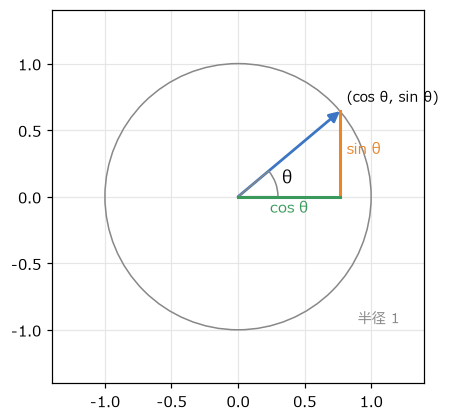
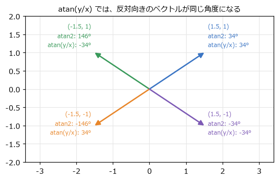
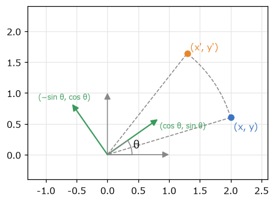
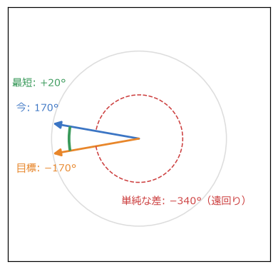
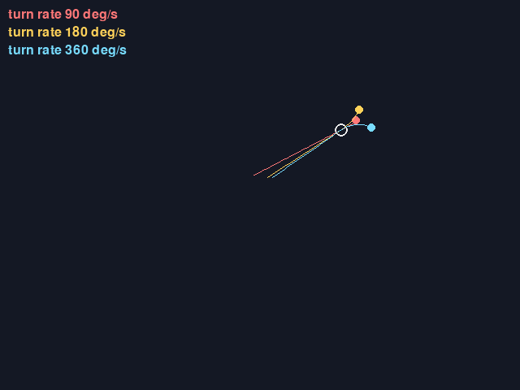

角度と回転
==========

砲台を敵の方へ向ける、衛星を円軌道で回す、ミサイルを少しずつ旋回させる。こうした「向き」と「回転」の計算には三角関数を使う。この章では、角度の表し方から、向きを求める ``atan2``、点の回転、角度の補間までを扱う。

度とラジアン
------------

角度の単位には\ **度**\ （°）と\ **ラジアン**\ （rad）がある。ラジアンは、半径 1 の円で、その角度に対応する弧の長さを角度とする単位である。円周の長さは :math:`2\pi` なので、1 周は 360° = :math:`2\pi` rad になる。

.. math::

   \theta_{\text{rad}} = \theta_{\text{度}} \times \frac{\pi}{180}

Python の ``math.sin`` や ``math.cos`` は、ラジアンで角度を受け取る。度で考えたいときは ``math.radians`` と ``math.degrees`` で変換する。:math:`2\pi` は ``math.tau`` として用意されている。

プログラムの中ではラジアンで統一し、度は「人間が値を設定する定数」と「画面への表示」にだけ使うと、変換の書き忘れを防げる。なお、pygame-ce の ``Vector2.rotate`` は度で、``Vector2.rotate_rad`` はラジアンで角度を受け取る。

三角関数で円運動を書く
----------------------

:numref:`fig-unit-circle` のように、半径 1 の円（**単位円**）の上で、x 軸から角度 :math:`\theta` だけ回った点の座標は :math:`(\cos\theta, \sin\theta)` である。

.. _fig-unit-circle:

   単位円上の点の座標は (cos θ, sin θ)

半径を :math:`r` にすれば :math:`(r\cos\theta, r\sin\theta)` になる。このように「半径と角度」で表した位置を\ **極座標**\ と呼び、「x と y」で表した位置（**直交座標**）に変換するには :math:`\cos` と :math:`\sin` を使う。

.. literalinclude:: ../examples/turret.py
   :language: python
   :linenos:
   :pyobject: from_polar
   :caption: examples/turret.py の from_polar 関数

角度を時間とともに一定の割合（**角速度**）で増やせば、円運動になる。``turret.py`` では、砲台の周りを衛星が回っている。

.. code-block:: python
   :linenos:
   :caption: 衛星の円運動（turret.py より）

   orbit_angle += ORBIT_SPEED * dt
   satellite = center + from_polar(ORBIT_RADIUS, orbit_angle)

同じ式で、向いている角度から「その向きの単位ベクトル」も作れる。角度 :math:`\theta` の向きに速さ :math:`s` で弾を撃つなら、速度は :math:`(s\cos\theta, s\sin\theta)` である。

画面座標では y 軸が下向きなので、角度を増やすと画面上では時計回りに回る。数学の教科書の図（反時計回り）とは逆になるが、式はそのまま使える。

atan2 で向きを求める
--------------------

逆に、ベクトル :math:`(x, y)` が向いている角度を求めるには、逆三角関数を使う。:math:`\tan\theta = y / x` なので :math:`\theta = \arctan(y / x)` と考えたくなるが、これには 2 つの問題がある。

- :math:`x = 0`\ （真上や真下を向いている）のとき、0 で割ることになる。
- :math:`(x, y)` と :math:`(-x, -y)` は :math:`y / x` が同じなので、正反対の向きを区別できない（:numref:`fig-atan2`）。

.. _fig-atan2:

   atan(y/x) と atan2(y, x) の違い

そこで、x と y を別々に受け取る ``math.atan2(y, x)`` を使う。``atan2`` は x と y の符号から向きを判断し、:math:`-\pi` から :math:`\pi` までの角度を返す。引数の順番が y、x であることに注意する。

.. literalinclude:: ../examples/turret.py
   :language: python
   :linenos:
   :pyobject: angle_to
   :caption: examples/turret.py の angle_to 関数

``turret.py`` では、この角度を使って砲身をマウスの方向へ向け、クリックするとその向きに弾を撃つ。

回転の式と点の回転
------------------

点 :math:`(x, y)` を原点の周りに角度 :math:`\theta` だけ回転させた点 :math:`(x', y')` は、次の式で求められる。

.. math::

   x' = x\cos\theta - y\sin\theta, \qquad y' = x\sin\theta + y\cos\theta

この式は、:numref:`fig-rotation` のように考えると覚えやすい。x 軸の単位ベクトル (1, 0) は回転すると :math:`(\cos\theta, \sin\theta)` に、y 軸の単位ベクトル (0, 1) は :math:`(-\sin\theta, \cos\theta)` に移る。点 :math:`(x, y)` は「(1, 0) を x 個、(0, 1) を y 個足したもの」なので、回転後は「回転した (1, 0) を x 個、回転した (0, 1) を y 個足したもの」になる。

.. _fig-rotation:

   回転の式は、回転した軸の組み合わせで表せる

.. literalinclude:: ../examples/turret.py
   :language: python
   :linenos:
   :pyobject: rotate_point
   :caption: examples/turret.py の rotate_point 関数

``turret.py`` では、砲身の形を「右向きを 0 度とした座標」で定義しておき、描くたびに各頂点を ``rotate_point`` で回してから砲台の中心の位置を足している。このように、物の形を物自身を基準とした座標で定義し、回転と移動を加えてから描く考え方は、次の章で行列を使って一般化する。

原点以外の点 :math:`\mathbf{c}` を中心に回すときは、いったん :math:`\mathbf{c}` を原点に移し、回してから戻す。

.. math::

   \mathbf{p}' = R(\theta)(\mathbf{p} - \mathbf{c}) + \mathbf{c}

ここで :math:`R(\theta)` は、上の回転の式を表す。

角度の補間と最短の回転
----------------------

角度を扱うときに必ず出会う問題がある。「今 170° を向いていて、目標が −170° の方向にある」とき、どちらにどれだけ回ればよいだろうか。単純に引き算すると :math:`-170 - 170 = -340` で、ほぼ 1 周逆向きに回ることになる。しかし実際には、:numref:`fig-angle-wrap` のように反対向きに 20° 回るのが最短である。

.. _fig-angle-wrap:

   170° から −170° への最短の回転は +20°

角度の差を常に :math:`-\pi` 以上 :math:`\pi` 未満（−180° 以上 180° 未満）の範囲に収めれば、最短の回転量になる。:math:`2\pi` の整数倍を足し引きしても向きは変わらないので、剰余演算で範囲に収められる。

.. literalinclude:: ../examples/homing.py
   :language: python
   :linenos:
   :pyobject: wrap_angle
   :caption: examples/homing.py の wrap_angle 関数

.. literalinclude:: ../examples/homing.py
   :language: python
   :linenos:
   :pyobject: angle_difference
   :caption: examples/homing.py の angle_difference 関数

Python の ``%`` は、右辺が正なら結果も 0 以上になるので、負の角度でも正しく動く。C 言語などでは負の数の剰余が負になることがあるので、移植するときは注意する。

角度を補間する（たとえば、向きを目標へ少しずつ近づける）ときも、この最短の差を使う。

.. literalinclude:: ../examples/homing.py
   :language: python
   :linenos:
   :pyobject: lerp_angle
   :caption: examples/homing.py の lerp_angle 関数

旋回速度に上限がある追尾
------------------------

ミサイルや敵の向きを一瞬で目標へ向けると、不自然に見えるうえ、避けることもできない。そこで、1 秒あたりに回れる角度（旋回速度）に上限を設ける。

.. literalinclude:: ../examples/homing.py
   :language: python
   :linenos:
   :pyobject: move_toward_angle
   :caption: examples/homing.py の move_toward_angle 関数

``math.copysign(max_delta, diff)`` は、``diff`` と同じ符号を持つ大きさ ``max_delta`` の値を返す。つまり、最短の向きに ``max_delta`` だけ回す。残りの角度が ``max_delta`` 以下なら、目標の角度にそろえて止める。

``homing.py`` では、旋回速度が 90 度毎秒、180 度毎秒、360 度毎秒の 3 発の弾がマウスを追いかける（:numref:`fig-screen-homing`）。旋回速度が小さい弾は大回りになり、目標の周りを回り続けることもある。これは、一定の速さで進みながら旋回すると、回転半径（速さ ÷ 角速度）より内側には曲がれないためである。旋回速度の上限は、避けられるかどうかを決めるゲームの難易度のパラメーターになる。

.. _fig-screen-homing:

   homing.py の画面
