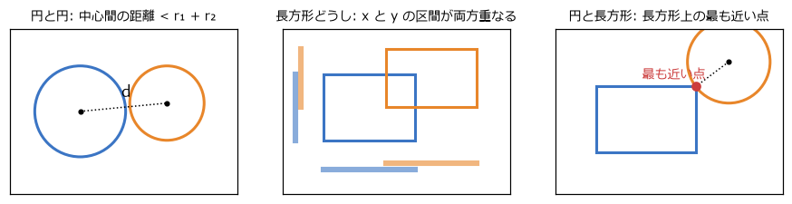
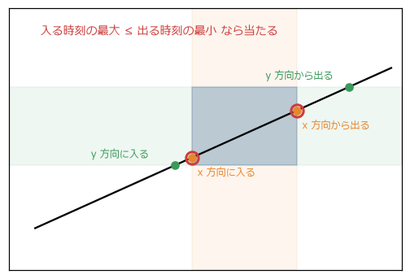
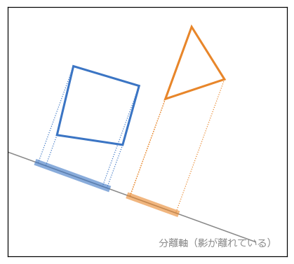
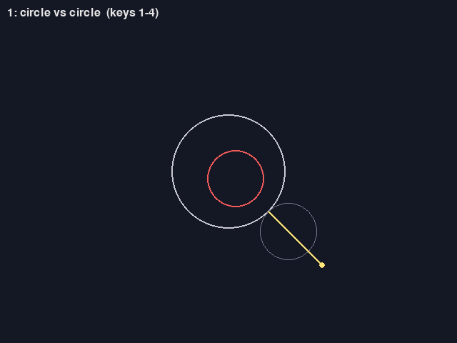
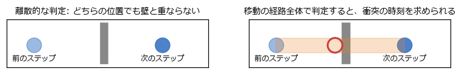
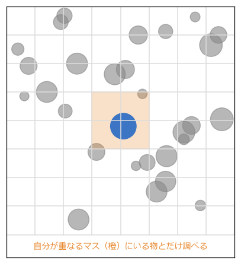

衝突判定
========

弾が敵に当たったか、キャラクターが壁にぶつかったか、コインを取ったか。物どうしが重なっているかを調べる処理を\ **衝突判定**\ と呼ぶ。ゲームの現場では「当たり判定」とも呼ぶ。この章では、よく使う図形の組み合わせごとの判定方法と、たくさんの物を効率よく調べる方法を扱う。判定した後に物を押し戻したり跳ね返らせたりする処理（衝突応答）は、次の章で扱う。

衝突判定の流れ
--------------

ゲームのキャラクターの見た目は複雑な形をしているが、衝突判定では円や長方形のような単純な図形で近似する。この図形を\ **コリジョン形状**\ と呼ぶ。見た目より少し小さめにすると、「かすっただけで当たった」という理不尽さが減る。

物の数が多いと、すべての組み合わせを調べるのは大変である。100 個の物なら 4950 組、1000 個なら約 50 万組になる。そこで、:numref:`fig-collision-pipeline` のように 2 段階に分けて調べる。

.. _fig-collision-pipeline:

.. graphviz::
   :caption: 衝突判定の 2 段階
   :align: center

   digraph pipeline {
     rankdir=LR;
     node [shape=box, style="rounded,filled", fillcolor="#eef3fb", color="#3b75c4", fontsize=11];
     edge [fontsize=10];
     all [label="すべての物"];
     broad [label="ブロードフェーズ\n近くにいる組だけを\n大まかに選ぶ"];
     narrow [label="ナローフェーズ\n選んだ組を\n正確に判定する"];
     resp [label="衝突応答\n（第 12 章）"];
     all -> broad [label="n 個"];
     broad -> narrow [label="候補の組"];
     narrow -> resp [label="接触情報"];
   }

- **ブロードフェーズ**: 空間を区切るなどして、ぶつかる可能性のある組だけを素早く選ぶ（後述）。
- **ナローフェーズ**: 選んだ組について、図形の形に応じた正確な判定を行う。

衝突判定の関数は、重なっているかどうか（真か偽か）だけでなく、押し戻すための情報も返すと便利である。本書の ``collision.py`` では、重なっている場合に\ **接触情報**\ として、次の 2 つの組を返す。

- **法線**: 1 つ目の図形から 2 つ目の図形へ向かう向きの単位ベクトル。2 つ目の図形をこの向きに動かせば、重なりが解消する。
- **めり込みの深さ**: 法線の向きにどれだけ動かせば重なりが解消するか。

点・円・長方形
--------------

最もよく使う 3 つの判定を\ :numref:`fig-overlap-tests` に示す。

.. _fig-overlap-tests:

   円と円（左）、長方形どうし（中央）、円と長方形（右）の判定

円と円
~~~~~~

2 つの円は、中心間の距離が半径の和より小さいときに重なっている。第 4 章で述べたように、平方根を避けて 2 乗どうしで比べる。

.. math::

   |\mathbf{c}_2 - \mathbf{c}_1|^2 < (r_1 + r_2)^2

接触情報も必要な場合は、中心間の距離 :math:`d` を求め、法線を中心から中心への単位ベクトル、めり込みの深さを :math:`r_1 + r_2 - d` とする。

.. literalinclude:: ../examples/collision.py
   :language: python
   :linenos:
   :pyobject: circle_circle_contact
   :caption: examples/collision.py の circle_circle_contact 関数

2 つの中心が完全に一致すると向きが決められないので、適当な向き（ここでは右向き）を返している。円は回転しても形が変わらないので、判定が簡単で速い。弾、ボール、丸い敵などに向いている。

軸に平行な長方形どうし
~~~~~~~~~~~~~~~~~~~~~~

辺が x 軸と y 軸に平行な長方形を **AABB**\ （Axis-Aligned Bounding Box）と呼ぶ。2 つの AABB は、x 方向の区間と y 方向の区間が\ **両方とも**\ 重なっているときに重なっている（:numref:`fig-overlap-tests` の中央）。

.. literalinclude:: ../examples/collision.py
   :language: python
   :linenos:
   :pyobject: aabbs_overlap
   :caption: examples/collision.py の aabbs_overlap 関数

比較 4 回だけで判定できるので非常に速い。タイルマップのゲームでは、キャラクターも壁も AABB で表すことが多い。pygame-ce の ``Rect.colliderect`` も同じ判定をしている。

接触情報は、x 方向と y 方向の重なりの幅を求め、幅が小さい方の軸に押し戻すとする。めり込みが浅い方向へ戻すのが、最も少ない移動で重なりを解消する方法だからである。

.. literalinclude:: ../examples/collision.py
   :language: python
   :linenos:
   :pyobject: aabb_contact
   :caption: examples/collision.py の aabb_contact 関数

円と長方形
~~~~~~~~~~

円と AABB の判定では、まず長方形の上で円の中心に最も近い点を求める。これは、円の中心の座標を長方形の範囲に収める（クランプする）だけで求まる。その点と円の中心の距離が半径より小さければ重なっている（:numref:`fig-overlap-tests` の右）。

.. literalinclude:: ../examples/collision.py
   :language: python
   :linenos:
   :pyobject: closest_point_on_aabb
   :caption: examples/collision.py の closest_point_on_aabb 関数

円の中心が長方形の内部に入り込んでいる場合は、最も近い点が中心そのものになり、距離が 0 になって法線が決められない。``circle_aabb_contact`` では、この場合は最も近い辺の外側へ押し出すようにしている。

点と線分の距離
~~~~~~~~~~~~~~

点から線分への最短距離は、第 4 章の射影を使って求める。点を線分を含む直線に射影し、その位置を線分の範囲（割合 0～1）に収めれば、線分上で最も近い点になる。カプセル形（線分を太らせた形）の判定や、レーザーとの判定に使える。

.. literalinclude:: ../examples/collision.py
   :language: python
   :linenos:
   :pyobject: closest_point_on_segment
   :caption: examples/collision.py の closest_point_on_segment 関数

レイキャスト
------------

ある点からある向きにまっすぐ伸ばした半直線を\ **レイ**\ と呼び、レイが最初に何に当たるかを調べることを\ **レイキャスト**\ と呼ぶ。射撃の弾道（弾を物体として飛ばさない場合）、敵の視線が壁で遮られているかの判定、足元の地面までの距離の測定などに使う。

レイ上の点は、始点 :math:`\mathbf{o}` と向き :math:`\mathbf{d}` を使って :math:`\mathbf{o} + t\,\mathbf{d}`\ （:math:`t \ge 0`）と表せる。レイキャストでは、図形に初めて触れる :math:`t` を求める。

レイと円
~~~~~~~~

レイ上の点が円周上にある条件 :math:`|\mathbf{o} + t\,\mathbf{d} - \mathbf{c}|^2 = r^2` を展開すると、:math:`t` の 2 次方程式になる。2 つの解のうち小さい方が、レイが円に入る点である。判別式が負なら、レイは円を通らない。

.. literalinclude:: ../examples/collision.py
   :language: python
   :linenos:
   :pyobject: ray_circle
   :caption: examples/collision.py の ray_circle 関数

:math:`\mathbf{d}` が単位ベクトルなら、:math:`t` は始点からの距離になる。

レイと長方形（スラブ法）
~~~~~~~~~~~~~~~~~~~~~~~~

AABB は「x 方向の帯（スラブ）」と「y 方向の帯」が重なった部分である。レイが各帯に入る時刻と出る時刻を求めると、レイが長方形の中にいるのは「すべての帯の中にいる」間なので、次のようになる（:numref:`fig-ray-slab`）。

- 長方形に入る時刻 = 各帯に入る時刻の\ **最大値**
- 長方形から出る時刻 = 各帯から出る時刻の\ **最小値**

入る時刻が出る時刻より後なら、レイは長方形に当たらない。

.. _fig-ray-slab:

   スラブ法。赤い丸が、長方形に入る点と出る点

.. literalinclude:: ../examples/collision.py
   :language: python
   :linenos:
   :pyobject: ray_aabb
   :caption: examples/collision.py の ray_aabb 関数

レイがある軸に平行（向きの成分が 0）なら、その軸の帯に入る時刻は求められない。この場合は、始点がその帯の中にあれば常に帯の中、外にあれば決して当たらない、として扱う。

回転した長方形と凸多角形
------------------------

回転した長方形や三角形など、凸多角形どうしの判定には\ **分離軸定理**\ （SAT、Separating Axis Theorem）を使う。分離軸定理は、次のように言い表せる。

   2 つの凸図形が重なっていないなら、2 つの図形の影が重ならないような向き（分離軸）が必ず存在する。

ある軸に 2 つの図形を射影（第 4 章）して、それぞれの影の区間を求める。どれか 1 つの軸で影が離れていれば、図形は重なっていない（:numref:`fig-sat`）。凸多角形の場合、調べる軸は「両方の多角形の各辺の法線」だけで十分であることが知られている。すべての軸で影が重なっていれば、図形は重なっている。

.. _fig-sat:

   分離軸定理。この軸に射影した影が離れているので、2 つの図形は重なっていない

.. literalinclude:: ../examples/collision.py
   :language: python
   :linenos:
   :pyobject: polygon_contact
   :caption: examples/collision.py の polygon_contact 関数

重なっている場合、影の重なりの幅が最も小さい軸の向きに、その幅だけ押し戻せば重なりが解消する。この押し戻しのベクトルを\ **最小移動ベクトル**\ （MTV、Minimum Translation Vector）と呼ぶ。

``collision_demo.py`` では、1 キー～4 キーで判定の種類を切り替え、マウスで図形を動かして判定の結果を確かめられる（:numref:`fig-screen-collision`）。重なると図形が赤くなり、黄色の矢印が法線とめり込みの深さを、細い輪郭が押し戻した後の位置を示す。

.. _fig-screen-collision:

   collision_demo.py の画面（円と円の判定）

タイルマップとの衝突判定
------------------------

2D のアクションゲームの地形は、マス目状に並べたタイルで作ることが多い。キャラクターと地形の判定では、すべてのタイルを調べる必要は無い。キャラクターの AABB が重なっているタイルは、座標をタイルの大きさで割れば求まる。

.. literalinclude:: ../examples/collision.py
   :language: python
   :linenos:
   :pyobject: tiles_overlapping
   :caption: examples/collision.py の tiles_overlapping 関数

右端と下端には ``math.ceil(...) - 1`` を使っている。こうすると、AABB の右端がちょうどタイルの境界にあるとき、隣のタイルを含めない。床の上にぴったり立っているキャラクターが、床のタイルと「重なっている」と判定されないようにするためである。見つかったタイルのうち壁のものとだけ、AABB どうしの判定と押し戻しを行う。押し戻しの方法は次の章で扱い、第 15 章で実装する。

すり抜けと連続衝突判定
----------------------

ここまでの判定は、ある瞬間の位置だけを見て重なりを調べる\ **離散的な判定**\ である。速く動く物では、:numref:`fig-tunneling` の左のように、前のステップでは壁の手前、次のステップでは壁の向こう側にいて、どちらの瞬間にも壁と重ならないことがある。これを\ **すり抜け**\ （トンネリング）と呼ぶ。

.. _fig-tunneling:

   離散的な判定ではすり抜ける（左）。移動の経路全体で判定すれば防げる（右）

対策は次のとおりである。

- **1 ステップの移動量を小さくする**: 速さの上限を決め、1 ステップの移動量が最も薄い壁より小さくなるようにする。固定タイムステップで物理の刻みを細かくするのも有効である。
- **移動の経路全体で判定する（連続衝突判定）**: 前の位置から次の位置までの移動を 1 本の線とみなし、途中で何かに当たるかを調べる。

移動する円と止まっている円の連続衝突判定は、レイキャストに置き換えられる。動く円の半径を 0 に縮め、その分だけ止まっている円の半径を広げると、「点の移動（レイ）」と「半径 :math:`r_1 + r_2` の円」の判定になる。

.. literalinclude:: ../examples/collision.py
   :language: python
   :linenos:
   :pyobject: sweep_circle_circle
   :caption: examples/collision.py の sweep_circle_circle 関数

結果は、移動のうちどの割合の時点で接触したか（0～1）である。その時点まで動かしてから衝突応答を行えば、すり抜けを防げる。物理エンジンには、弾のような速い物にだけ連続衝突判定を有効にする設定が用意されていることが多い。

判定の高速化
------------

ブロードフェーズの代表的な方法が\ **一様グリッド**\ である。空間を一定の大きさのマス目に区切り、各物をそれが重なるマスに登録する。同じマスに登録された物どうしだけを、ナローフェーズで調べればよい（:numref:`fig-grid`）。

.. _fig-grid:

   一様グリッド。青い物は、自分が重なる橙のマスにいる物とだけ判定する

.. literalinclude:: ../examples/spatial_grid.py
   :language: python
   :linenos:
   :pyobject: UniformGrid
   :caption: examples/spatial_grid.py の UniformGrid クラス

マスの大きさは、最大の物の直径くらいにするのが目安である。小さすぎると 1 つの物が多くのマスに登録されて無駄が増え、大きすぎると 1 つのマスに多くの物が入って候補が絞れない。

``spatial_grid.py`` では、4000×4000 の空間に 2000 個の円をばらまき、重なっている組を探す。総当たりでは約 200 万組を調べて約 1 秒かかるが、一様グリッドでは約 1000 組を調べるだけで済み、100 倍以上速い（実行時間は環境によって異なる）。どちらも同じ 257 組を見つける。

.. code-block:: text
   :linenos:
   :caption: spatial_grid.py の実行結果の例

   総当たり     調べた組: 1,999,000  重なっていた組:  257  時間:  1012.5 ms
   一様グリッド   調べた組:     1,008  重なっていた組:  257  時間:     7.8 ms

物の大きさがまちまちだったり、一部の場所に集中していたりする場合は、空間を 4 分割し、物が多い区画だけをさらに 4 分割していく\ **四分木**\ （3D では 8 分割の八分木）が使われる。物理エンジンでは、物を包む AABB を木構造にまとめた **AABB ツリー**\ （動的 AABB ツリー）もよく使われる。
