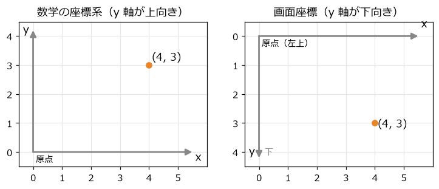
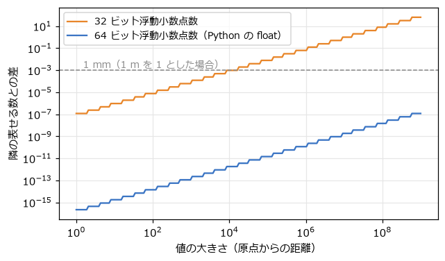

座標系と数値
============

ゲームの世界にある物の位置は、すべて数値で表される。この章では、位置を表す座標系の決め方と、位置を表す数値（浮動小数点数）の性質を確認する。どちらも後の章のすべての計算の土台になる。

ワールド座標と画面座標
----------------------

ゲームでは、少なくとも 2 種類の座標系を区別する。

- **ワールド座標**: ゲームの世界の中での位置を表す座標系。マップの左端を原点にする、などとゲームごとに決める。
- **画面座標**: ウィンドウの中での位置を表す座標系。単位はピクセルで、原点はウィンドウの左上にある。

画面座標では、:numref:`fig-coords` のように y 軸が下向きになる。これは、画面を上の行から順に描いていた昔のディスプレイの仕組みの名残であり、pygame-ce を含むほとんどの 2D のライブラリーがこの向きを使う。

.. _fig-coords:

   数学の座標系（左）と画面座標（右）

2D のゲームでは、ワールド座標も画面座標と同じく y 軸を下向きに取ることが多い。カメラが動かない小さなゲームなら、ワールド座標と画面座標を同じものとして扱ってもよい。カメラがスクロールする場合は、ワールド座標から画面座標への変換が必要になる。この変換は\ :doc:`matrices`\ で扱う。

y 軸を下向きにすると、数学の教科書の図とは上下が逆になる。たとえば、角度を増やす向き（数学では反時計回り）は、画面上では時計回りに見える。本書のサンプルコードはすべて画面座標で書いているので、回転の向きを考えるときには注意が必要である。

単位を決める
------------

座標の単位は自由に決めてよいが、ゲーム全体で統一しておく。主な選択肢は次の 2 つである。

.. list-table:: 座標の単位の選び方
   :header-rows: 1
   :widths: 20 40 40

   * - 単位
     - 利点
     - 注意点
   * - ピクセル
     - 描画の位置と一致するので分かりやすい。ドット絵のゲームに向く
     - 画面の解像度を変えると、速さや重力の値を調整し直す必要がある
   * - メートル
     - 重力加速度 9.8 m/s\ :sup:`2` など、現実の値をそのまま使える。物理エンジンの多くはこの単位を前提に調整されている
     - 描画するときに、1 m を何ピクセルで描くかを決めて変換する

時間の単位は秒にそろえる。速さは「ピクセル毎秒」や「メートル毎秒」、加速度は「ピクセル毎秒毎秒」で表す。速さを「1 フレームあたりのピクセル数」で表すと困ることは\ :doc:`game_loop`\ で説明する。

本書のサンプルコードは、2D のゲームで扱いやすいピクセルを単位にしている。ワールド座標をメートルで表し、y 軸を上向きに取る場合は、:numref:`code-world-to-screen` のように変換する。

.. _code-world-to-screen:

.. literalinclude:: ../examples/float_precision.py
   :language: python
   :linenos:
   :pyobject: world_to_screen
   :caption: examples/float_precision.py の world_to_screen 関数

x 座標は単位を変換するだけでよい。y 座標は、上向きを下向きに反転するため、画面の高さから引いている。

浮動小数点数の性質
------------------

ゲームの座標や速度には、整数ではなく小数を使う。1 フレームの移動量は 1 ピクセルに満たないことがよくあり、整数では表せないからである。コンピューターは小数を\ **浮動小数点数**\ で表す。Python の ``float`` は 64 ビットの浮動小数点数であり、ゲームエンジンや GPU では 32 ビットの浮動小数点数がよく使われる。

浮動小数点数は、2 進数で表せる限られた数しか正確に表せない。その性質から、ゲームでは次の 3 つの点に気を付ける。

小数を ``==`` で比べない
~~~~~~~~~~~~~~~~~~~~~~~~

0.1 は 2 進数では割り切れないので、近い値で近似される。そのため、次のように計算結果が直感と一致しないことがある。

.. code-block:: pycon
   :linenos:
   :caption: 小数の誤差

   >>> 0.1 + 0.2
   0.30000000000000004
   >>> 0.1 + 0.2 == 0.3
   False

小数どうしを比べるときは、差が十分に小さいかどうかで判定する。Python では ``math.isclose`` が使える。

.. literalinclude:: ../examples/float_precision.py
   :language: python
   :linenos:
   :pyobject: nearly_equal
   :caption: examples/float_precision.py の nearly_equal 関数

ゲームでは「ちょうど 0 か」を調べたい場面も多い。たとえば、長さ 0 のベクトルで割り算をしないよう確かめる場面である。このときも、``== 0`` ではなく「非常に小さい値より小さいか」で判定するのが安全である。本書のサンプルコードでは、``1e-9`` のような小さな値（:term:`イプシロン`\ と呼ぶ）を使っている。

誤差は積み重なる
~~~~~~~~~~~~~~~~

小さな誤差でも、足し算を何十万回も繰り返すと目に見える大きさになる。``float_precision.py`` では、1/60 秒を 60 万回足している。正しくは 10000 秒になるはずだが、結果は ``9999.99999993863`` になる。64 ビットでは誤差はまだ小さいが、32 ビットでは同じ計算でもずっと大きな誤差が出る。ゲームの経過時間のように、長時間足し続ける値には注意が必要である。

原点から遠いほど精度が落ちる
~~~~~~~~~~~~~~~~~~~~~~~~~~~~

浮動小数点数は「有効数字が一定の桁数ある」数であり、値が大きくなるほど、隣の表せる数との間隔も広がる。:numref:`fig-float-spacing` は、値の大きさと、その近くで表せる数の間隔の関係である。

.. _fig-float-spacing:

   値の大きさと、隣の表せる数との差

32 ビットの浮動小数点数では、1000 付近の間隔は約 0.00006 だが、100 万付近では 0.0625 にもなる。単位がメートルなら、原点から 1000 km 離れた場所では 6 cm 刻みでしか位置を表せない。広大なオープンワールドのゲームで、原点から遠く離れるとキャラクターが震えたり、物が正しく接触しなくなったりするのはこのためである。対策として、プレイヤーの近くに原点を移し直す（世界全体を平行移動する）方法が使われる。

Python の ``float`` は 64 ビットなので、本書の規模のゲームでこの問題が表に出ることは無い。ただし、ゲームエンジンを使うときには思い出してほしい。

整数座標と小数座標の使い分け
----------------------------

物の位置は小数で持つが、画面に描くときはピクセル単位の整数になる。pygame-ce の ``pygame.Rect`` は座標を整数で持つので、位置の保存に使うと、1 フレームの移動量の小数部分が切り捨てられて動かなくなることがある。位置は ``float`` や ``pygame.Vector2``、``pygame.FRect`` で持ち、描画の直前にだけ整数に丸めるとよい。

ドット絵のゲームでは、描画位置を整数に丸めないと、ドットがにじんだり、隣り合う物の間に 1 ピクセルの隙間が見えたりすることがある。第 15 章のサンプルコードでは、カメラの位置を ``round`` で整数に丸めてから、すべての物を描いている。
