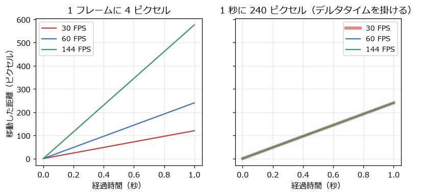
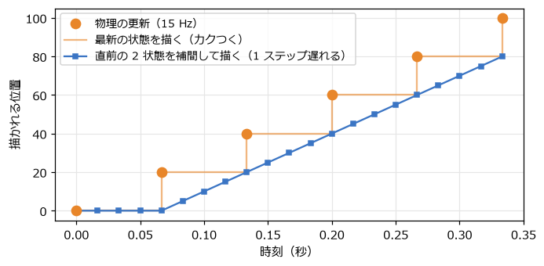

ゲームループと時間
==================

ゲームの中の物は、時間とともに動く。ゲームのプログラムでは、この「時間」をどう扱うかを最初に決めておく必要がある。この章では、ゲームの心臓部であるゲームループと、物理の計算に使う時間の刻み方を扱う。

ゲームループ
------------

ゲームのプログラムは、:numref:`fig-loop` のような繰り返し（**ゲームループ**）を、終了するまで回し続ける。

.. _fig-loop:

.. graphviz::
   :caption: ゲームループ
   :align: center

   digraph loop {
     rankdir=LR;
     node [shape=box, style="rounded,filled", fillcolor="#eef3fb", color="#3b75c4", fontsize=11];
     input [label="1. 入力\nキー・マウスの状態を読む"];
     update [label="2. 更新\n位置や速度を進める\n衝突を調べる"];
     draw [label="3. 描画\n今の状態を画面に描く"];
     input -> update -> draw;
     draw -> input [label="次のフレーム", fontsize=10, color="#888888"];
   }

ループを 1 回まわるごとに画面が 1 枚描かれる。この 1 枚を\ **フレーム**\ と呼び、1 秒あたりのフレームの数を\ **フレームレート**\ と呼ぶ。単位は FPS（frames per second）である。多くのゲームは 60 FPS を目標にしている。

:numref:`code-game-loop` は、pygame-ce でのゲームループの例である。

.. _code-game-loop:

.. literalinclude:: ../examples/game_loop.py
   :language: python
   :linenos:
   :pyobject: main
   :caption: examples/game_loop.py の main 関数

``clock.tick(fps_limit)`` は、ループが速く回りすぎないように待ったうえで、前のフレームからの経過時間をミリ秒で返す。この値を 1000 で割って秒にしたものを、本書では\ **デルタタイム**\ と呼び、``dt`` や :math:`\Delta t` と書く。

フレームレートに依存しない移動
------------------------------

物を動かすとき、最初に思い付くのは「1 フレームに 4 ピクセル動かす」という書き方だろう。この書き方には、フレームレートが変わると物の速さも変わるという問題がある。60 FPS で動くように調整したゲームを 144 Hz のディスプレイで動かすと 2.4 倍の速さになり、処理が重くて 30 FPS に落ちると半分の速さになる。

そこで、速さを「1 秒あたりの移動量」で決め、毎フレームそれにデルタタイムを掛けた分だけ動かす。

.. math::

   x_{\text{次}} = x_{\text{今}} + v \, \Delta t

こうすると、フレームレートによらず 1 秒あたりの移動量は :math:`v` になる。:numref:`fig-dt-compare` は、30 FPS、60 FPS、144 FPS での 2 つの方法の比較である。左のグラフでは、フレームレートによって 1 秒後の位置が大きく異なる。右のグラフでは、3 本の線がほぼ重なっている。

.. _fig-dt-compare:

   フレーム数を基準にした移動（左）と、デルタタイムを基準にした移動（右）

``game_loop.py`` を実行し、1 キー・2 キー・3 キーでフレームレートの上限を切り替えると、上の四角（フレーム数が基準）だけ速さが変わることを確かめられる。

デルタタイムには上限を設けておく。ウィンドウをドラッグしている間などはループが止まり、再開したときにデルタタイムが数秒にもなることがある。そのまま使うと物が一瞬で遠くへ飛び、壁をすり抜けてしまう。``game_loop.py`` では、``min(..., MAX_DT)`` で 0.1 秒までに制限している。

可変タイムステップと固定タイムステップ
--------------------------------------

デルタタイムをそのまま使って物理を進める方法を\ **可変タイムステップ**\ と呼ぶ。簡単で、多くの場面ではこれで十分である。ただし、次のような弱点がある。

- **結果がフレームレートによって少し変わる。**\ 第 10 章で見るように、物理の計算は時間を区切って近似的に行うので、区切り方によって誤差が変わる。60 FPS では届いたジャンプが、30 FPS では足場に届かない、ということが起こりうる。
- **dt が大きいと不安定になる。**\ ばねのように力が位置によって変わる計算では、dt が大きいと誤差が増え続け、物が飛んでいってしまうことがある。
- **再現性が無い。**\ 同じ入力を与えても、フレームレートが違えば結果が少しずつずれる。リプレイの再生やネットワーク対戦では問題になる。

これらを避けるために、物理の更新は常に同じ時間 :math:`h`\ （たとえば 1/120 秒）ずつ進め、描画はそれとは別のペースで行う方法がある。これを\ **固定タイムステップ**\ と呼ぶ。

固定タイムステップの実装
------------------------

固定タイムステップは、:numref:`fig-fixed-step` のように実装する。前のフレームからの経過時間を\ **アキュムレーター**\ と呼ぶ変数に貯めていき、:math:`h` 以上貯まっている間は、:math:`h` を引いて物理を 1 回進める。

.. _fig-fixed-step:

.. graphviz::
   :caption: 固定タイムステップの処理の流れ
   :align: center

   digraph fixed {
     node [shape=box, style="rounded,filled", fillcolor="#eef3fb", color="#3b75c4", fontsize=11];
     add [label="アキュムレーターに\n経過時間を足す"];
     check [label="アキュムレーター ≥ h ?", shape=diamond, fillcolor="#fdf0e2", color="#e8862a"];
     step [label="物理を h 秒進める\nアキュムレーターから h を引く"];
     draw [label="描画する\n（残りの時間 / h で補間）"];
     add -> check;
     check -> step [label="はい", fontsize=10];
     step -> check;
     check -> draw [label="いいえ", fontsize=10];
   }

:numref:`code-consume-time` は、アキュムレーターの処理を関数にしたものである。

.. _code-consume-time:

.. literalinclude:: ../examples/fixed_timestep.py
   :language: python
   :linenos:
   :pyobject: consume_time
   :caption: examples/fixed_timestep.py の consume_time 関数

更新の回数に上限（``max_steps``）を設けているのは、処理が追いつかない状況への備えである。物理の更新 1 回に :math:`h` 以上の時間がかかると、次のフレームではもっと多くの更新が必要になり、さらに時間がかかる、という悪循環に陥る。上限を超えた分の時間は捨て、ゲームの進みが少し遅くなることを受け入れる。

描画の補間
~~~~~~~~~~

固定タイムステップでは、描画のタイミングと物理の更新のタイミングがずれる。たとえば物理を 1 秒に 15 回、描画を 1 秒に 60 回行うと、4 回の描画のうち 3 回は前回と同じ状態を描くことになり、動きがカクつく。

そこで、直前の 2 回の更新結果を、アキュムレーターに残った時間の割合 :math:`\alpha` で補間して描く。

.. math::

   \alpha = \frac{\text{アキュムレーターの残り}}{h}, \qquad x_{\text{描画}} = x_{\text{前}} + (x_{\text{今}} - x_{\text{前}}) \, \alpha

この式は第 8 章で扱う線形補間そのものである。:numref:`fig-interpolation` のように、補間すると描かれる位置が滑らかに変わる。その代わり、描かれる位置は最新の状態より最大 1 ステップ遅れる。物理を 1 秒に 120 回のように十分細かく進めれば、この遅れは問題にならない。

.. _fig-interpolation:

   物理を 15 Hz で更新したときの、描かれる位置

``fixed_timestep.py`` では、上の四角は最新の状態を、下の四角は補間した状態を描く。1 キーで 15 Hz にすると、上の四角のカクつきがよく分かる。:numref:`code-fixed-loop` は、そのゲームループのうち更新と描画の部分である。

.. _code-fixed-loop:

.. literalinclude:: ../examples/fixed_timestep.py
   :language: python
   :linenos:
   :start-after: frame_time = min(clock.tick(60) / 1000, MAX_FRAME_TIME)
   :end-before: screen.blit(font.render(f'physics
   :dedent: 8
   :caption: examples/fixed_timestep.py のゲームループの一部

どちらを使うか
~~~~~~~~~~~~~~

小さなゲームや、物理がほとんど無いゲームなら、上限付きの可変タイムステップで十分である。ジャンプの高さや衝突の結果をフレームレートによらず一定にしたい場合や、ばねなどの計算を安定させたい場合は、固定タイムステップを使う。多くのゲームエンジンは、物理だけを固定タイムステップで進める仕組みを備えている（Unity の ``FixedUpdate`` など）。本書の第 15 章の総合演習では、固定タイムステップを使う。
