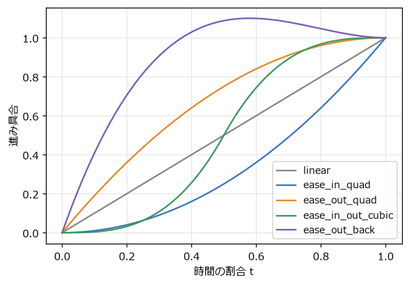
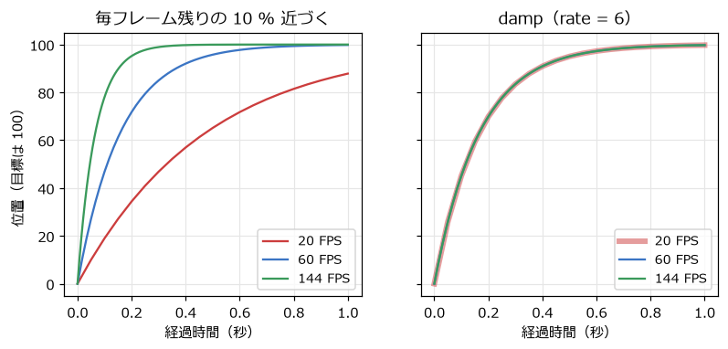
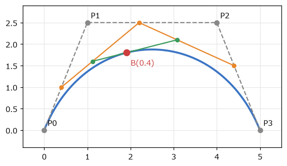
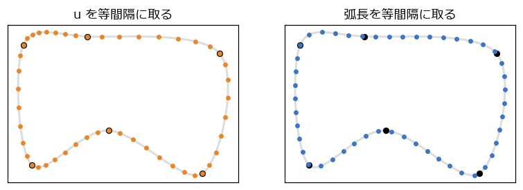

補間・イージング・曲線
======================

ゲームの「手触り」の多くは、値が A から B へどう変わるかで決まる。ボタンを押すとメニューが滑らかに出てくる、カメラがプレイヤーに遅れてついてくる、敵が決められた経路をなぞって飛ぶ。この章では、こうした動きを作る補間の道具を扱う。

線形補間と逆補間
----------------

**線形補間**\ （lerp、linear interpolation）は、2 つの値 :math:`a` と :math:`b` の間を、割合 :math:`t` で結ぶ計算である。

.. math::

   \mathrm{lerp}(a, b, t) = a + (b - a)\,t

:math:`t = 0` なら :math:`a`、:math:`t = 1` なら :math:`b`、:math:`t = 0.5` ならちょうど中間になる。数だけでなく、位置（ベクトル）や色にもそのまま使える。第 3 章の描画の補間も線形補間である。

その逆に、値 :math:`v` が :math:`a` から :math:`b` までのどの割合の位置にあるかを求めるのが\ **逆補間**\ である。2 つを組み合わせると、ある範囲の値を別の範囲の値に変換（**リマップ**）できる。

.. literalinclude:: ../examples/easing.py
   :language: python
   :linenos:
   :start-at: def lerp(
   :end-before: def ease_in_quad
   :caption: examples/easing.py の lerp、inverse_lerp、remap 関数

リマップは、ゲームのパラメーターの調整でよく使う。たとえば「敵との距離が 300 ピクセルから 50 ピクセルに近づくにつれて、警告音の音量を 0 から 1 に上げる」なら ``remap(distance, 300, 50, 0, 1)`` と書ける（範囲の外では ``clamp`` で 0～1 に収める）。

イージング関数
--------------

物を A から B へ 1 秒かけて動かすとき、:math:`t` を時間に比例させて線形補間すると、等速で動いて急に止まる。機械的で硬い印象になる。そこで、時間の割合 :math:`t` を 0～1 の別の値に変換する関数 :math:`f(t)` を挟み、:math:`\mathrm{lerp}(a, b, f(t))` で動かす。この関数を\ **イージング関数**\ と呼ぶ。:math:`f(0) = 0`、:math:`f(1) = 1` であれば、始点と終点は変わらず、途中の速さの変化だけが変わる。

.. literalinclude:: ../examples/easing.py
   :language: python
   :linenos:
   :start-at: def ease_in_quad
   :end-before: EASINGS:
   :caption: examples/easing.py のイージング関数

:numref:`fig-easing-curves` は、それぞれの関数のグラフである。グラフの傾きが速さを表す。

.. _fig-easing-curves:

   イージング関数

.. list-table:: イージング関数の使い分け
   :header-rows: 1
   :widths: 30 70

   * - 関数
     - 向いている場面
   * - ease-out（減速して止まる）
     - 画面に入ってくる UI、カメラの移動。素早く反応しつつ、柔らかく止まる
   * - ease-in（加速しながら動く）
     - 画面から出ていく UI、落下し始める物
   * - ease-in-out（ゆっくり始まりゆっくり止まる）
     - 場面の切り替え、2 点間を往復する足場
   * - back（行き過ぎて戻る）
     - ボタンやアイコンの登場。弾むような楽しい印象を与える

ease_out_back の定数 1.70158 は、目標を約 10 % 行き過ぎるように選ばれた値である。イージング関数の名前と式は、Robert Penner がまとめたものが広く使われている。``easing.py`` の上の 5 行で、それぞれの動きを見比べられる。

フレームレートに依存しない滑らかな追従
--------------------------------------

カメラがプレイヤーを追いかけるとき、目標の位置が毎フレーム変わるので、イージング関数（始点と終点が決まっている）は使えない。よく使われるのは、毎フレーム「残りの距離の一定の割合だけ近づく」方法である。

.. code-block:: python
   :linenos:
   :caption: フレームレートに依存する追従

   camera_x = lerp(camera_x, target_x, 0.1)  # 毎フレーム残りの 10 % だけ近づく

この書き方は簡単で、近づくほど遅くなる自然な動きになる。しかし、「1 フレームあたり」の割合なので、第 3 章と同じくフレームレートによって追従の速さが変わってしまう（:numref:`fig-damp-fps` の左）。

1 フレームで残りの距離が :math:`(1 - 0.1)` 倍になるとすると、1 秒後には :math:`(1 - 0.1)^{\text{FPS}}` 倍になる。これを、フレームレートによらず「1 秒あたり一定の割合で減る」ように直すには、指数関数を使う。

.. math::

   x_{\text{次}} = \mathrm{lerp}\left(x_{\text{今}},\ x_{\text{目標}},\ 1 - e^{-k\,\Delta t}\right)

残りの距離は 1 回の更新で :math:`e^{-k\,\Delta t}` 倍になる。:math:`\Delta t` を 2 回に分けて更新しても :math:`e^{-k\,\Delta t/2} \times e^{-k\,\Delta t/2} = e^{-k\,\Delta t}` 倍になり、分け方によらず同じ結果になる。:math:`k` は追従の速さで、残りの距離は 1 秒で :math:`e^{-k}` 倍になる。この方法を\ **指数関数的減衰**\ と呼び、本書では ``damp`` という関数にしている。

.. literalinclude:: ../examples/easing.py
   :language: python
   :linenos:
   :pyobject: damp
   :caption: examples/easing.py の damp 関数

.. _fig-damp-fps:

   毎フレーム残りの 10 % 近づく方法（左）と damp（右）。目標は 100

``easing.py`` の下の 2 つの四角は、マウスの x 座標を 2 つの方法で追いかける。1 キーで 20 FPS にすると、橙の四角だけ追いつくのが遅くなる。第 15 章の総合演習のカメラも ``damp`` で追従させている。

ベジェ曲線
----------

弾の軌道や敵の移動経路を、なめらかな曲線で作りたいことがある。ゲームで最もよく使われる曲線が\ **ベジェ曲線**\ である。

ベジェ曲線は、線形補間を何段も重ねて作る。:numref:`fig-bezier` の 4 つの\ **制御点** :math:`P_0` ～ :math:`P_3` による 3 次ベジェ曲線では、次のように点を求める。

1. 隣り合う制御点の間を、割合 :math:`t` で線形補間する（橙の 3 点）。
2. その 3 点の隣どうしを、さらに :math:`t` で線形補間する（緑の 2 点）。
3. その 2 点を :math:`t` で線形補間した点が、曲線上の点 :math:`B(t)` である（赤）。

.. _fig-bezier:

   3 次ベジェ曲線と、t = 0.4 の点の求め方

この求め方を\ **ド・カステリョのアルゴリズム**\ と呼ぶ。:math:`t` を 0 から 1 まで動かすと、点は :math:`P_0` から出発して :math:`P_3` に着く。:math:`P_1` と :math:`P_2` は曲線を引き寄せるが、曲線は通らない。

.. literalinclude:: ../examples/curves.py
   :language: python
   :linenos:
   :pyobject: cubic_bezier
   :caption: examples/curves.py の cubic_bezier 関数

展開すると、次の式になる。

.. math::

   B(t) = (1 - t)^3 P_0 + 3(1 - t)^2 t\,P_1 + 3(1 - t)t^2 P_2 + t^3 P_3

制御点が 3 つの 2 次ベジェ曲線は、放物線の弾道を「発射点、頂点付近、着弾点」の 3 点で指定したいときに便利である。ベジェ曲線は、ドローソフトのパスやフォントの輪郭にも使われている。

Catmull-Rom スプライン
----------------------

ベジェ曲線は、間の制御点を曲線が通らない。敵に「この点とこの点とこの点を順に通って飛んでほしい」という場合は、すべての点を通る曲線の方が扱いやすい。そのような曲線の代表が **Catmull-Rom スプライン**\ である。

Catmull-Rom スプラインは、通過点 :math:`P_1` から :math:`P_2` までの区間を、前後の点 :math:`P_0` と :math:`P_3` を使って決める。区間の端での曲線の向きを「前後の点を結ぶ向き」にそろえるので、区間どうしが滑らかにつながる。

.. literalinclude:: ../examples/curves.py
   :language: python
   :linenos:
   :pyobject: catmull_rom
   :caption: examples/curves.py の catmull_rom 関数

``curves.py`` では、6 つの通過点をこの曲線で結んで閉じた経路を作っている。区間 :math:`i` の点を求めるとき、前後の点は番号を通過点の数で割った余りで選ぶので、最後の点の次は最初の点に戻る。

等速で曲線上を移動させる
------------------------

曲線のパラメーター :math:`t`\ （複数の区間をつないだ曲線では :math:`u`）を一定の速さで増やしても、曲線上を一定の速さで動くとは限らない。:numref:`fig-catmull-rom` の左は、:math:`u` を等間隔に取った点である。通過点の間隔が広い区間では点がまばらになり、狭い区間では密になっている。つまり、広い区間では速く、狭い区間では遅く動く。

.. _fig-catmull-rom:

   Catmull-Rom スプライン上で、u を等間隔に取った点（左）と、弧長を等間隔に取った点（右）

一定の速さで動かすには、曲線に沿った距離（**弧長**）から :math:`u` を逆算する。弧長を式で求めるのは難しいので、次のように数値的に表を作る。

1. :math:`u` を細かく区切り、隣り合う点の距離を足していって、各 :math:`u` までの弧長の表を作る。
2. 進みたい距離が表のどこにあるかを二分探索で探し、前後の値から :math:`u` を線形補間で求める。

.. literalinclude:: ../examples/curves.py
   :language: python
   :linenos:
   :pyobject: ArcLengthTable
   :caption: examples/curves.py の ArcLengthTable クラス

距離を時間に比例させて増やし、``u_at`` で :math:`u` に変換すれば、:numref:`fig-catmull-rom` の右のように一定の間隔で進む。``curves.py`` を実行すると、橙の点（:math:`u` が一定の速さ）と水色の点（距離が一定の速さ）の動きの違いがよく分かる。表は経路を作ったときに 1 回だけ作ればよい。
