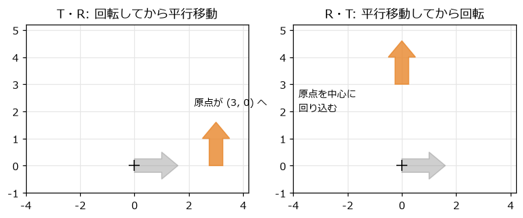
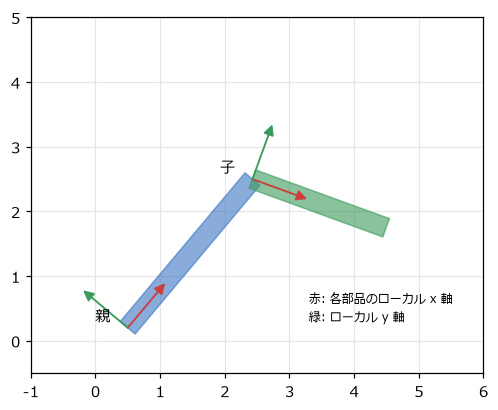
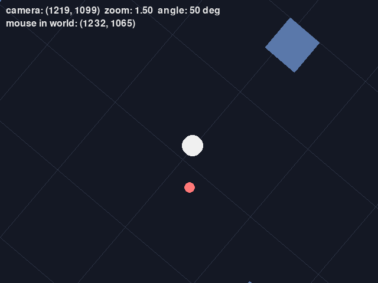
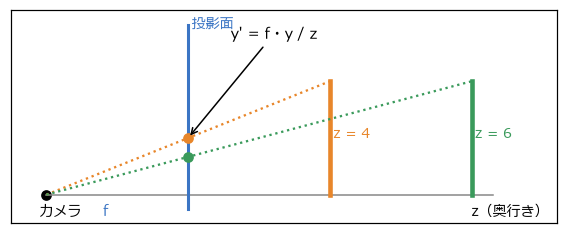

行列と座標変換
==============

前の章では、点を回転させる式を扱った。ゲームでは、回転のほかに拡大縮小と平行移動を組み合わせ、さらに「腕の先の手」「船の上の砲台」のような親子関係や、スクロールするカメラも扱う。こうした変換を統一的に扱う道具が\ **行列**\ である。

変換を行列で表す
----------------

前の章の回転の式は、行列とベクトルの積で書ける。

.. math::

   \begin{pmatrix} x' \\ y' \end{pmatrix} = \begin{pmatrix} \cos\theta & -\sin\theta \\ \sin\theta & \cos\theta \end{pmatrix} \begin{pmatrix} x \\ y \end{pmatrix}

行列とベクトルの積は、「行列の各行とベクトルの内積を並べたもの」である。上の式の 1 行目を計算すると :math:`x' = x\cos\theta - y\sin\theta` になり、前の章の式と一致する。行列の各列は、前の章の\ :numref:`fig-rotation` で見た「x 軸と y 軸の単位ベクトルが移る先」になっている。

拡大縮小も行列で書ける。x 方向に :math:`s_x` 倍、y 方向に :math:`s_y` 倍するなら、次のとおりである。

.. math::

   \begin{pmatrix} x' \\ y' \end{pmatrix} = \begin{pmatrix} s_x & 0 \\ 0 & s_y \end{pmatrix} \begin{pmatrix} x \\ y \end{pmatrix}

:math:`s_x = -1` にすると左右が反転する。2D のゲームで、キャラクターの絵を左右反転して逆向きに歩かせるときに使う。

同次座標で平行移動も行列にする
------------------------------

平行移動 :math:`(x + t_x, y + t_y)` は、2×2 の行列の積では書けない。行列の積は、原点 (0, 0) を必ず原点に移すからである。

そこで、点 :math:`(x, y)` に 3 番目の成分として 1 を付け加えた :math:`(x, y, 1)` で表し、3×3 の行列を使う。このような表し方を\ **同次座標**\ と呼ぶ。

.. math::

   \begin{pmatrix} x' \\ y' \\ 1 \end{pmatrix} = \begin{pmatrix} a & b & c \\ d & e & f \\ 0 & 0 & 1 \end{pmatrix} \begin{pmatrix} x \\ y \\ 1 \end{pmatrix} = \begin{pmatrix} a x + b y + c \\ d x + e y + f \\ 1 \end{pmatrix}

左上の 2×2 の部分（:math:`a, b, d, e`）が回転や拡大縮小を、右の列（:math:`c, f`）が平行移動を表す。回転・拡大縮小・平行移動を組み合わせた変換を\ **アフィン変換**\ と呼び、2D のアフィン変換はすべてこの形の行列で表せる。

同次座標の 3 番目の成分を 0 にすると、平行移動の影響を受けなくなる。位置（点）は 1、向きや速度（ベクトル）は 0 として変換すると、「向きは回転するが、平行移動はしない」という正しい扱いになる。

:numref:`code-mat3` は、この行列を表すクラス ``Mat3`` である。最後の行は常に (0, 0, 1) なので、上の 2 行の 6 つの値だけを持っている。

.. _code-mat3:

.. literalinclude:: ../examples/transform2d.py
   :language: python
   :linenos:
   :start-at: @dataclass(frozen=True)
   :end-before: def __matmul__
   :caption: examples/transform2d.py の Mat3 クラス（冒頭）

変換の合成と順序
----------------

複数の変換を続けて行うことを、変換の\ **合成**\ と呼ぶ。行列では、合成は行列の積になる。点 :math:`\mathbf{p}` に変換 :math:`B` を行ってから変換 :math:`A` を行う場合は、次のように書ける。

.. math::

   A (B \mathbf{p}) = (A B) \mathbf{p}

積 :math:`AB` を一度計算しておけば、たくさんの点を 1 回の行列の積で変換できる。ここで、行列は\ **右から順に**\ 適用されることに注意する。:math:`AB` は「先に :math:`B`、後に :math:`A`」である。

行列の積は、掛ける順番を入れ替えると一般に結果が変わる。:numref:`fig-transform-order` は、90° の回転 :math:`R` と (3, 0) の平行移動 :math:`T` を、異なる順序で合成した例である。

.. _fig-transform-order:

   変換の順序による違い。灰色が元の形、橙が変換後の形

- :math:`TR`\ （回転してから移動）: 矢印はその場で上を向き、(3, 0) へ移る。
- :math:`RT`\ （移動してから回転）: 矢印は (3, 0) へ移ってから原点を中心に回るので、(0, 3) へ回り込む。

物を「その場で回して、置きたい場所へ動かす」なら、:math:`T R S`\ （拡大縮小 → 回転 → 平行移動の順に適用）にするのが基本である。

.. literalinclude:: ../examples/transform2d.py
   :language: python
   :linenos:
   :pyobject: Mat3.__matmul__
   :caption: examples/transform2d.py の Mat3.__matmul__ メソッド

Python では ``@`` 演算子で行列の積を書けるように、``__matmul__`` を定義している。``transform2d.py`` を実行すると、:numref:`fig-transform-order` と同じ計算の結果が表示される。

ローカル座標とワールド座標
--------------------------

物の形は、その物自身を基準とした座標系で定義しておくと扱いやすい。この座標系を\ **ローカル座標**\ と呼ぶ。たとえば、車の形は「車の中心が原点、前方が x 軸」のローカル座標で定義する。車がゲームの世界のどこにあり、どちらを向いているかは、ローカル座標からワールド座標への変換（**ワールド変換**）で表す。

.. math::

   \mathbf{p}_{\text{ワールド}} = M_{\text{ワールド}} \, \mathbf{p}_{\text{ローカル}}, \qquad M_{\text{ワールド}} = T(\text{位置}) \, R(\text{向き}) \, S(\text{大きさ})

親子関係
~~~~~~~~

ロボットの腕のように、ある部品（子）が別の部品（親）に取り付けられている場合を考える。子の位置と向きは、親を基準にして決まる。親が動けば、子も一緒に動く。

この関係は、行列の積でそのまま表せる。子のワールド変換は、親のワールド変換に「親から見た子の変換（子のローカル変換）」を掛けたものである。

.. math::

   M_{\text{子}} = M_{\text{親}} \, L_{\text{子}}

:numref:`fig-parent-child` は 2 つの部品からなる腕である。それぞれの部品のローカル座標の軸を矢印で示している。子の座標系は、親の先端に置かれ、親の向きに対してさらに回転している。

.. _fig-parent-child:

   親子関係のある部品のローカル座標

``arm_demo.py`` は、3 つの関節を持つロボットアームである。:numref:`code-arm` のように、根元から順に、親のワールド変換に自分のローカル変換を掛けていく。

.. _code-arm:

.. literalinclude:: ../examples/arm_demo.py
   :language: python
   :linenos:
   :pyobject: segment_world_transforms
   :caption: examples/arm_demo.py の segment_world_transforms 関数

各部品のローカル変換は「親の先端へ移動してから、自分の関節の角度だけ回す」である。Q キーで第 1 関節を回すと、先の 2 つの部品も一緒に回ることを確かめられる。このように、物を親子関係の木構造で管理する仕組みを\ **シーングラフ**\ と呼ぶ。Unity の Transform や Godot の Node2D は、この仕組みを提供している。

カメラ
------

スクロールするゲームでは、ワールド座標の物を画面に描く前に、カメラに合わせて変換する。この変換を\ **ビュー変換**\ と呼ぶ。2D のカメラが位置 :math:`\mathbf{c}`、回転角 :math:`\phi`、ズーム率 :math:`z` を持つとき、ワールド座標を画面座標に変換する行列は次のようになる。

.. math::

   V = T(\text{画面の中心}) \, S(z) \, R(-\phi) \, T(-\mathbf{c})

右から順に、次の変換を行っている。

1. カメラの位置が原点に来るように、世界全体をずらす。
2. カメラが回った角度と逆向きに、世界全体を回す。
3. ズーム率に合わせて拡大縮小する。
4. 原点（カメラの位置）が画面の中央に来るようにずらす。

カメラを右に動かすと世界は左に動いて見え、カメラを時計回りに回すと世界は反時計回りに回って見える。カメラの変換は、カメラ自身のワールド変換の\ **逆**\ になっている。

.. literalinclude:: ../examples/camera_demo.py
   :language: python
   :linenos:
   :pyobject: view_matrix
   :caption: examples/camera_demo.py の view_matrix 関数

``camera_demo.py`` では、すべての物の頂点をこの行列で変換して描いている。カメラの揺れ（スペースキー）は、手順 4 のずらす量に小さな乱数を加えるだけで実現している。揺れを乱数の代わりにノイズで作る方法は第 9 章で、カメラを滑らかに追従させる方法は第 8 章で扱う。

   camera_demo.py の画面（カメラを回転・ズームしている）

逆変換
------

マウスでクリックした場所にある物を選ぶには、画面座標をワールド座標に戻す必要がある。これには、ビュー変換の\ **逆行列** :math:`V^{-1}` を使う。逆行列は、元の行列と掛けると何もしない変換（単位行列）になる行列である。

.. math::

   \mathbf{p}_{\text{ワールド}} = V^{-1} \, \mathbf{p}_{\text{画面}}

アフィン変換の逆行列は、左上の 2×2 の部分の逆行列と、平行移動の部分から計算できる。

.. literalinclude:: ../examples/transform2d.py
   :language: python
   :linenos:
   :pyobject: Mat3.inverse
   :caption: examples/transform2d.py の Mat3.inverse メソッド

``det`` は 2×2 の部分の\ **行列式**\ で、変換によって面積が何倍になるかを表す。拡大率が 0 の変換は面積を 0 につぶしてしまい、元に戻せないので、逆行列が無い。

合成した変換の逆変換は、それぞれの逆変換を逆の順序で合成したものになる。

.. math::

   (A B)^{-1} = B^{-1} A^{-1}

「靴下をはいてから靴をはく」の逆が「靴を脱いでから靴下を脱ぐ」になるのと同じである。``camera_demo.py`` でクリックすると、``view.inverse()`` でクリック位置をワールド座標に変換し、そこに印を置く。カメラを回したりズームしたりしても、印はクリックした場所の地面に留まる。

3D への拡張の概要
-----------------

3D でも考え方は同じである。点を :math:`(x, y, z, 1)` の同次座標で表し、4×4 の行列で回転・拡大縮小・平行移動を表す。ローカル座標 → ワールド座標 → カメラから見た座標（ビュー座標）という変換の流れも 2D と変わらない。

3D では、これに\ **投影**\ が加わる。:numref:`fig-perspective` のように、カメラから遠い物ほど小さく見えるように描く\ **透視投影**\ では、カメラからの奥行き :math:`z` で割ることで、点を投影面に写す。

.. math::

   x' = \frac{f\,x}{z}, \qquad y' = \frac{f\,y}{z}

:math:`f` はカメラから投影面までの距離（焦点距離）で、大きいほど望遠になる。

.. _fig-perspective:

   透視投影。同じ高さの物でも、遠いほど投影面上で小さくなる

座標の流れ全体を\ :numref:`fig-spaces` にまとめる。次の章の ``cube_demo.py`` では、この透視投影の式を使って立方体を描く。投影の詳細やクリッピングなど、3D の描画については「コンピューターグラフィックス入門」を参照してほしい。

.. _fig-spaces:

.. graphviz::
   :caption: 座標系と変換の流れ
   :align: center

   digraph spaces {
     rankdir=LR;
     node [shape=box, style="rounded,filled", fillcolor="#eef3fb", color="#3b75c4", fontsize=11];
     edge [fontsize=10];
     local [label="ローカル座標\n（物自身が基準）"];
     world [label="ワールド座標\n（ゲームの世界）"];
     view [label="ビュー座標\n（カメラが基準）"];
     screen [label="画面座標\n（ピクセル）"];
     local -> world [label="ワールド変換\nT R S"];
     world -> view [label="ビュー変換\n（カメラの逆）"];
     view -> screen [label="投影（3D）\n拡大と中央へ移動"];
     screen -> world [label="逆変換（クリック位置）", style=dashed, color="#e8862a"];
   }
