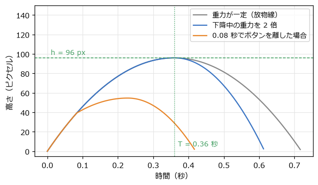
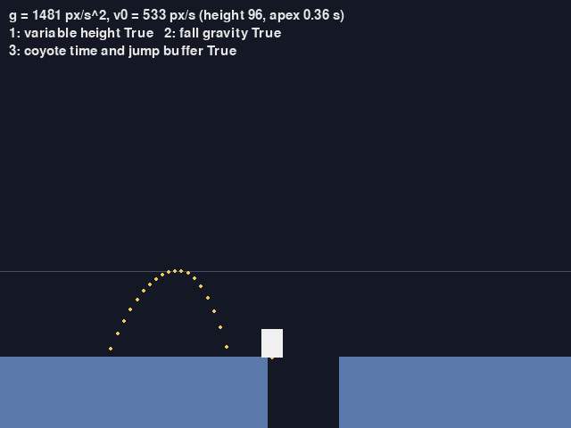
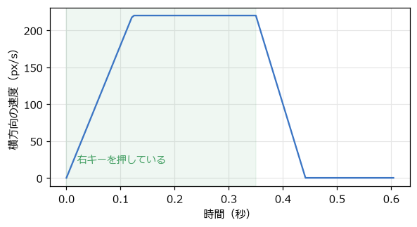
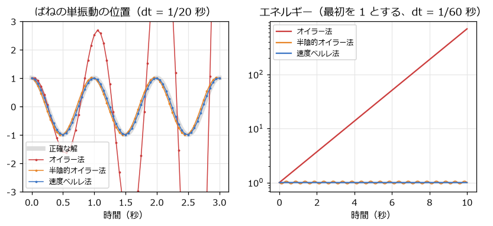

運動の物理
==========

ここから物理の章に入る。この章では、物の動きを決める位置・速度・加速度の関係と、ニュートンの運動の法則を確認し、それを使ってジャンプや走りを作る。最後に、運動の式をコンピューターで計算するための数値積分を扱う。

位置・速度・加速度
------------------

物の\ **位置** :math:`\mathbf{x}` が時間とともに変わる割合が\ **速度** :math:`\mathbf{v}`、速度が時間とともに変わる割合が\ **加速度** :math:`\mathbf{a}` である。微分で書くと次のようになる。

.. math::

   \mathbf{v} = \frac{d\mathbf{x}}{dt}, \qquad \mathbf{a} = \frac{d\mathbf{v}}{dt}

ゲームでは時間を :math:`\Delta t` ずつ区切って進めるので、微分を差分で近似する。:math:`\Delta t` が小さければ、次の式が成り立つとみなせる。

.. math::

   \mathbf{v}_{\text{次}} = \mathbf{v}_{\text{今}} + \mathbf{a} \, \Delta t, \qquad \mathbf{x}_{\text{次}} = \mathbf{x}_{\text{今}} + \mathbf{v} \, \Delta t

第 3 章の「位置に速度×デルタタイムを足す」に、「速度に加速度×デルタタイムを足す」が加わった形である。速度を直接変えるのではなく、加速度を通して速度を変えることで、徐々に速くなる・徐々に遅くなるという、重さを感じる動きになる。

ニュートンの運動の法則と力
--------------------------

加速度は、物に働く\ **力**\ で決まる。ニュートンの運動の法則は、次の 3 つである。

1. **慣性の法則**: 力が働かなければ、物は同じ速度で動き続ける（止まっている物は止まったまま）。
2. **運動方程式**: 物の加速度は、働く力に比例し、質量に反比例する。:math:`\mathbf{F} = m\,\mathbf{a}`
3. **作用・反作用の法則**: 物 A が物 B に力を及ぼすと、B も A に同じ大きさで逆向きの力を及ぼす。

運動方程式から、加速度は :math:`\mathbf{a} = \mathbf{F} / m` で求められる。同じ力を受けても、重い物ほど加速しにくい。物理エンジンは、物に働くすべての力（重力、ばねの力、摩擦力など）を足し合わせ、この式で加速度を求めて速度と位置を進めている。

ゲームでよく使う力を次の表にまとめる。

.. list-table:: ゲームでよく使う力
   :header-rows: 1
   :widths: 20 40 40

   * - 力
     - 式
     - 性質
   * - 重力
     - :math:`\mathbf{F} = m\,\mathbf{g}`
     - 加速度 :math:`\mathbf{g}` は質量によらず一定。重い物も軽い物も同じように落ちる
   * - ばねの力
     - :math:`\mathbf{F} = -k\,(\mathbf{x} - \mathbf{x}_0)`
     - 自然な位置 :math:`\mathbf{x}_0` からのずれに比例し、戻す向きに働く（第 13 章）
   * - 空気抵抗
     - :math:`\mathbf{F} = -c\,\mathbf{v}`
     - 速度に比例し、速度と逆向きに働く。速いほど強くブレーキがかかる
   * - 摩擦力
     - 大きさ :math:`\mu N`
     - 接している面に沿って、滑る向きと逆向きに働く。:math:`N` は面を押し付ける力（第 12 章）

重力と放物運動
--------------

重力だけを受けて飛ぶ物は、加速度が一定（下向きに :math:`g`）なので、位置は時間の 2 次式になる。上向きに初速 :math:`v_0` で跳んだ物の高さ :math:`y` は、次の式で表される（ここでは上向きを正とする）。

.. math::

   y(t) = v_0\,t - \frac{1}{2} g\,t^2, \qquad v(t) = v_0 - g\,t

このグラフは放物線になる。横方向に一定の速さで動きながら跳べば、軌跡も放物線になる。

ジャンプの高さと滞空時間から重力を決める
~~~~~~~~~~~~~~~~~~~~~~~~~~~~~~~~~~~~~~~~

ゲームのジャンプを調整するとき、重力加速度 :math:`g` と初速 :math:`v_0` を直接いじると、思いどおりの値にたどり着くのに時間がかかる。:math:`g` を変えると高さも滞空時間も変わってしまうからである。

設計者が本当に決めたいのは「何ピクセル跳べるか（最高点の高さ :math:`h`）」と「最高点まで何秒かかるか（:math:`T`）」である。最高点では速度が 0 になるので、:math:`v(T) = 0` と :math:`y(T) = h` を連立させて解くと、:math:`g` と :math:`v_0` が求まる。

.. math::

   v_0 = g\,T, \qquad h = v_0 T - \frac{1}{2} g T^2 = \frac{1}{2} g T^2

.. math::

   g = \frac{2h}{T^2}, \qquad v_0 = \frac{2h}{T}

.. literalinclude:: ../examples/jump.py
   :language: python
   :linenos:
   :pyobject: jump_parameters
   :caption: examples/jump.py の jump_parameters 関数

``jump.py`` では、高さ 96 ピクセル（タイル 3 枚分）、最高点まで 0.36 秒としている。このとき :math:`g` は約 1481 ピクセル毎秒毎秒、:math:`v_0` は約 533 ピクセル毎秒になる。地上の重力 9.8 m/s\ :sup:`2` と比べると、ゲームのキャラクターは現実よりずっと強い重力の中で、ずっと強い力で跳んでいることが多い。そうしないと、ふわふわした頼りない動きになってしまう。

ゲームらしいジャンプ
--------------------

物理の式どおりの放物線は、上昇と下降に同じ時間がかかり、どこか間延びして感じられる。アクションゲームでは、遊びやすさのために次のような調整を加えることが多い。:numref:`fig-jump-arc` は、これらの調整による軌道の違いである。

.. _fig-jump-arc:

   ジャンプの高さの時間変化（jump.py の設定）

下降中に重力を強める
~~~~~~~~~~~~~~~~~~~~

下降中だけ重力を 2 倍程度にすると、ふわっと上がってストンと落ちる、きびきびしたジャンプになる。:numref:`fig-jump-arc` の青の線がこれに当たる。最高点の高さと、そこまでの時間は変わらない。

ボタンを押す長さで高さを変える
~~~~~~~~~~~~~~~~~~~~~~~~~~~~~~

ボタンを短く押せば低く、長く押せば高く跳べると、プレイヤーは細かく操作できるようになる。上昇中にボタンを離したら、上向きの速さを初速の 4 割までに抑える。:numref:`fig-jump-arc` の橙の線は、0.08 秒でボタンを離した場合である。

足場から落ちた直後もジャンプを受け付ける
~~~~~~~~~~~~~~~~~~~~~~~~~~~~~~~~~~~~~~~~

足場の端ぎりぎりでジャンプしようとしたとき、ほんの 1 フレーム遅れただけで落ちてしまうと、プレイヤーは「押したのに跳ばなかった」と感じる。そこで、足場から離れた後も 0.1 秒ほどはジャンプを受け付ける。アニメのキャラクターが崖から出てもしばらく空中に留まってから落ちる描写にちなんで、この猶予を\ **コヨーテタイム**\ と呼ぶ。

着地の直前に押したジャンプを覚えておく
~~~~~~~~~~~~~~~~~~~~~~~~~~~~~~~~~~~~~~

逆に、着地の少し前にボタンを押したときも、それを覚えておいて着地した瞬間に跳ばせる。これを\ **先行入力**\ （ジャンプバッファー）と呼ぶ。

これらをまとめた ``Player.update`` メソッドが\ :numref:`code-jump-update` である。

.. _code-jump-update:

.. literalinclude:: ../examples/jump.py
   :language: python
   :linenos:
   :pyobject: Player.update
   :caption: examples/jump.py の Player.update メソッド

縦方向の位置の更新には、:math:`y \mathrel{+}= v\,\Delta t + \frac{1}{2} g\,\Delta t^2` という等加速度運動の式を使っている。1 フレームの間、重力が一定なら、この式で誤差なく計算できる（後述の数値積分の節を参照）。

``jump.py`` では、1 キー・2 キー・3 キーでそれぞれの調整を切り替えられる。調整の無いジャンプと比べると、手触りの違いがよく分かる。

   jump.py の画面。黄色の点がジャンプの軌跡、上の線が目標の高さ

摩擦と空気抵抗
--------------

横方向の動きにも、加速度を使って重さを出す。入力したら一瞬で最高速度になるのではなく、加速度の上限を設けて速度を目標へ近づける。入力を離したときは、別の大きさの加速度（地面との摩擦に当たる）で減速させる。

.. literalinclude:: ../examples/jump.py
   :language: python
   :linenos:
   :pyobject: approach
   :caption: examples/jump.py の approach 関数

:numref:`fig-run-velocity` は、右キーを 0.35 秒押して離したときの速度の変化である。加速度と減速度の値で、氷の上のような滑る感触から、きびきびした感触まで調整できる。空中での加速度を地上より小さくすると、空中では向きを変えにくくなる。

.. _fig-run-velocity:

   右キーを 0.35 秒押して離したときの横方向の速度

空気抵抗のように速度に比例する力を受けると、速度は毎秒一定の割合で減っていく。これは第 8 章の指数関数的減衰と同じ形であり、フレームレートに依存しないように :math:`\mathbf{v} \leftarrow \mathbf{v}\,e^{-c\,\Delta t}` と書ける。第 13 章のパーティクルでは、この方法で空気抵抗を表している。

数値積分
--------

速度と位置を :math:`\Delta t` ずつ進める計算は、微分方程式を数値的に解く\ **数値積分**\ の一種である。計算の順序によって精度と安定性が大きく変わるので、代表的な 3 つの方法を比べる。

.. literalinclude:: ../examples/integrators.py
   :language: python
   :linenos:
   :start-at: def explicit_euler
   :end-before: STEPPERS:
   :caption: examples/integrators.py の 3 つの数値積分の方法

.. list-table:: 数値積分の方法
   :header-rows: 1
   :widths: 25 45 30

   * - 方法
     - 計算の順序
     - 性質
   * - オイラー法
     - 今の速度で位置を進め、今の加速度で速度を進める
     - 最も単純だが、エネルギーが増え続けて不安定になりやすい
   * - 半陰的オイラー法
     - 先に速度を進め、新しい速度で位置を進める
     - オイラー法と同じ手間で、ずっと安定する。ゲームで最もよく使われる
   * - 速度ベルレ法
     - 加速度の項まで含めて位置を進め、前後の加速度の平均で速度を進める
     - 精度が高い。加速度が一定なら誤差が無い

:numref:`fig-integrators` は、ばねにつながれたおもり（単振動）を 3 つの方法で計算した結果である。左は dt = 1/20 秒での位置で、オイラー法は振れ幅がどんどん大きくなって発散している。右は dt = 1/60 秒での力学的エネルギー（本来は一定）で、オイラー法は 10 秒で 700 倍近くに増えている。半陰的オイラー法と速度ベルレ法は、エネルギーがほぼ一定に保たれる。

.. _fig-integrators:

   数値積分の方法による違い（左: 単振動の位置、右: エネルギー）

``integrators.py`` を実行すると、同じ比較を数値で確かめられる。重力による放物運動（加速度が一定）では、dt = 0.1 秒という粗い刻みでも、速度ベルレ法は最高点の高さを正しく求める。オイラー法は高すぎ、半陰的オイラー法は低すぎる値になる。

.. code-block:: text
   :linenos:
   :caption: integrators.py の実行結果

   --- 単振動: 振幅 1 m で 10 秒間。エネルギーは本来変わらない（最初は 19.739） ---
   dt = 1/60 秒
     オイラー法      10 秒後のエネルギー:    13718.868
     半陰的オイラー法   10 秒後のエネルギー:       19.680
     速度ベルレ法     10 秒後のエネルギー:       19.739
   dt = 1/20 秒
     オイラー法      10 秒後のエネルギー: 2956935822.813
     半陰的オイラー法   10 秒後のエネルギー:       18.239
     速度ベルレ法     10 秒後のエネルギー:       19.707
   --- 放物運動: 初速 4.9 m/s で真上に投げる。最高点は本来 1.225 m（0.5 秒後） ---
     オイラー法      最高点: 1.470 m（dt = 0.1 秒）
     半陰的オイラー法   最高点: 0.980 m（dt = 0.1 秒）
     速度ベルレ法     最高点: 1.225 m（dt = 0.1 秒）

本書の多くのサンプルコードでは、手軽で安定した半陰的オイラー法を使う。ジャンプのように加速度が一定の区間がほとんどで、高さを正確に合わせたい場合は、``jump.py`` のように等加速度運動の式（速度ベルレ法と同じ結果になる）を使うとよい。

dt が大きいと何が起きるか
-------------------------

数値積分の誤差は、dt が大きいほど大きくなる。:numref:`fig-integrators` の左のように、dt が大きいと安定な方法でも誤差が目立ち、不安定な方法はすぐに発散する。ばねが硬い（:math:`k` が大きい）ほど、同じ dt でも不安定になりやすい。

これが、第 3 章でデルタタイムに上限を設けた理由であり、物理を固定タイムステップで進める理由でもある。固定タイムステップなら、dt が常に同じなので、開発中に安定していることを確かめた設定のまま、どの環境でも同じように動く。
