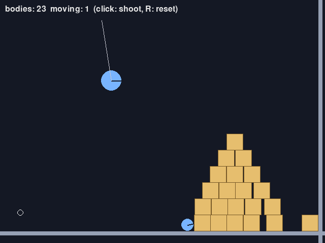

物理エンジンを使う
==================

第 10 章から第 13 章までで、物理の計算を自分で書いてきた。回転する剛体がたくさん積み重なるような場面を正しく安定して計算するのは、さらに多くの工夫が必要で、自分で書くのは大変である。そのような場面では\ **物理エンジン**\ を使う。この章では、物理エンジンが内部で行っていることを整理し、2D の物理エンジン pymunk を使ってみる。

物理エンジンが内部で行っていること
----------------------------------

物理エンジンは、1 ステップごとにおおむね\ :numref:`fig-engine-step` の処理を行っている。

.. _fig-engine-step:

.. graphviz::
   :caption: 物理エンジンの 1 ステップ
   :align: center

   digraph step {
     node [shape=box, style="rounded,filled", fillcolor="#eef3fb", color="#3b75c4", fontsize=11];
     edge [color="#888888"];
     force [label="1. 力を加える\n重力、ばね、ユーザーが加えた力（第 10 章）"];
     vel [label="2. 速度を更新する\n加速度 = 力 ÷ 質量（第 10 章）"];
     broad [label="3. ブロードフェーズ\nぶつかりそうな組を選ぶ（第 11 章）"];
     narrow [label="4. ナローフェーズ\n接触点・法線・めり込みを求める（第 11 章）"];
     solve [label="5. 拘束を解く\n接触・摩擦・ジョイントを満たす力積を\n繰り返し計算する（第 12 章・第 13 章）"];
     pos [label="6. 位置と角度を更新する\n（半陰的オイラー法）"];
     force -> vel -> broad -> narrow -> solve -> pos;
   }

本書の各章で扱った内容が、ほぼそのまま並んでいる。物理エンジンならではの工夫は、主に手順 5 にある。接触点が多数あると、1 つの接触を解消すると別の接触がずれる。物理エンジンは、すべての接触とジョイントを同時に満たす力積を、何度も繰り返し計算して近づけていく。このほか、止まっている物を「眠らせて」計算を省く、速い物にだけ連続衝突判定を使う、といった工夫もしている。

pymunk の基本
-------------

**pymunk** は、C 言語で書かれた 2D 物理エンジン Chipmunk2D を Python から使えるようにしたライブラリーである。pymunk では、次の 4 つのものを組み合わせて物理の世界を作る。

.. list-table:: pymunk の基本的な要素
   :header-rows: 1
   :widths: 20 80

   * - 要素
     - 役割
   * - 空間（``Space``）
     - 物理の世界全体。重力を持ち、``step`` で時間を進める
   * - ボディー（``Body``）
     - 剛体。質量・慣性モーメント・位置・角度・速度・角速度を持つ。形は持たない
   * - 形状（``Shape``）
     - 衝突判定に使う形（``Circle``、``Poly``、``Segment``）。ボディーに取り付け、摩擦係数（``friction``）と反発係数（``elasticity``）を持つ
   * - ジョイント（``Constraint``）
     - 2 つのボディーをつなぐ拘束（``PinJoint``、``PivotJoint``、``DampedSpring`` など）

:numref:`code-add-box` は、箱を 1 つ追加する関数である。ボディーを作るときに、質量と、形から計算した慣性モーメントを与える。

.. _code-add-box:

.. literalinclude:: ../examples/pymunk_demo.py
   :language: python
   :linenos:
   :pyobject: add_box
   :caption: examples/pymunk_demo.py の add_box 関数

地面や壁のように動かない物は、空間に最初から用意されている ``space.static_body`` に形状を取り付ける。ジョイントを使うと、ボディーどうしを関節のようにつなげる。``pymunk_demo.py`` では、空中の点とボールを ``PinJoint``\ （2 点の距離を一定に保つ）でつなぎ、振り子にしている。これは第 13 章の距離拘束と同じ考え方である。

.. literalinclude:: ../examples/pymunk_demo.py
   :language: python
   :linenos:
   :pyobject: build_world
   :caption: examples/pymunk_demo.py の build_world 関数

時間を進めるには ``space.step(dt)`` を呼ぶ。物理エンジンは dt が一定であることを前提に調整されていることが多いので、第 3 章の固定タイムステップで呼ぶのがよい。``pymunk_demo.py`` では、1 フレームに 1/120 秒のステップを 2 回進めている。

描画は自分で行う。ボディーの位置と角度から、形状の頂点をワールド座標に変換して描く。``body.local_to_world`` は、第 6 章のワールド変換を行うメソッドである。

.. literalinclude:: ../examples/pymunk_demo.py
   :language: python
   :linenos:
   :pyobject: draw_space
   :caption: examples/pymunk_demo.py の draw_space 関数

pymunk には、デバッグ用にすべての形状を自動で描く ``pymunk.pygame_util.DrawOptions`` も用意されている。

座標の向きに注意する。pymunk 自体は y 軸の向きを決めていないので、重力を ``(0, 900)`` とすれば画面座標（y 軸が下向き）でそのまま使える。単位も自由だが、本書のようにピクセルを単位にする場合、重力などの値はピクセル基準で決める。

:numref:`fig-screen-pymunk` は ``pymunk_demo.py`` の画面である。クリックするとボールを撃ち出し、箱のピラミッドを崩せる。箱が回転しながら崩れ、積み重なって止まる様子は、第 12 章の簡単な衝突応答では再現が難しい。

.. _fig-screen-pymunk:

   pymunk_demo.py の画面

自作するか物理エンジンを使うか
------------------------------

物理エンジンは強力だが、何にでも使えばよいわけではない。

.. list-table:: 自作の運動と物理エンジンの使い分け
   :header-rows: 1
   :widths: 50 50

   * - 物理エンジンが向いている
     - 自作の運動が向いている
   * - 積み上げた箱が崩れる、物が転がる、建物が壊れる
     - プレイヤーが操作するキャラクター
   * - ラグドール、車、ロープでつながった物
     - 決まったパターンで動く敵や弾
   * - 物理そのものを遊ぶゲーム（物理パズル、投射ゲーム）
     - 手触りを細かく調整したいアクションゲーム

特に、アクションゲームのプレイヤーキャラクターは、物理エンジンに任せず自作の運動で動かすことが多い。物理エンジンのボディーとして動かすと、坂道で滑り落ちる、段差の角に引っかかって跳ねる、押されて予想外に回転する、といった現実的すぎる挙動が出てしまう。第 10 章のコヨーテタイムのような「物理的には正しくない」調整も入れにくい。

多くのゲームエンジンは、この使い分けのために、物理エンジンとは別に\ **キャラクターコントローラー**\ という仕組みを用意している。キャラクターの移動は自作の運動のように指示しつつ、壁や床との衝突判定と押し戻しだけを物理エンジンが行う。第 15 章の総合演習も、この考え方でキャラクターを動かす。

決定性とネットワーク対戦・リプレイ
----------------------------------

同じ初期状態と同じ入力から、毎回まったく同じ結果が得られる性質を\ **決定性**\ と呼ぶ。リプレイを「入力だけを記録して再生する」方式で作る場合や、ネットワーク対戦で各プレイヤーのコンピューターが同じ計算をして状態を合わせる場合には、物理の計算が決定的でなければならない。

決定性を損なう主な原因は、次のとおりである。

- **可変タイムステップ**: dt が違えば結果が変わる。固定タイムステップにする。
- **乱数**: シードを固定し、物理に使う乱数の生成器を演出用と分ける（第 9 章）。
- **処理の順序**: 物を処理する順番が変わると結果が変わることがある。辞書や集合の順序に依存しないようにする。
- **浮動小数点数の計算の違い**: CPU やコンパイラーの最適化によって、同じ式でも末尾の桁が変わることがある。異なる種類の機械どうしで完全に一致させるのは難しく、固定小数点数を使うゲームもある。

同じ機械で同じプログラムを動かすだけなら、最初の 3 つに気を付ければ決定性を保ちやすい。

主な物理エンジン
----------------

.. list-table:: 主な物理エンジン
   :header-rows: 1
   :widths: 20 15 65

   * - 名前
     - 次元
     - 特徴
   * - Box2D
     - 2D
     - 2D の物理エンジンの定番。多くのゲームやエンジンに組み込まれている
   * - Chipmunk2D
     - 2D
     - 軽量な 2D 物理エンジン。pymunk はこれを Python から使えるようにしたもの
   * - Bullet
     - 3D
     - オープンソースの 3D 物理エンジン。ゲームのほか、映像制作やロボットのシミュレーションにも使われる
   * - Jolt Physics
     - 3D
     - オープンソースの 3D 物理エンジン。マルチスレッドでの高速な処理を重視している
   * - PhysX
     - 3D
     - NVIDIA の物理エンジン。Unity の 3D 物理に使われている

ゲームエンジンを使う場合は、エンジンに組み込まれた物理（Unity の Rigidbody、Godot の RigidBody2D / RigidBody3D など）を使うのが普通である。どのエンジンでも、ボディー・形状・ジョイント・固定タイムステップという基本の考え方は共通している。
