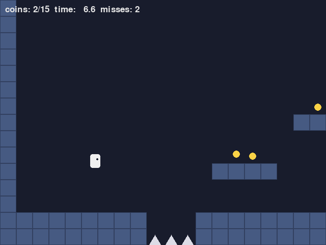
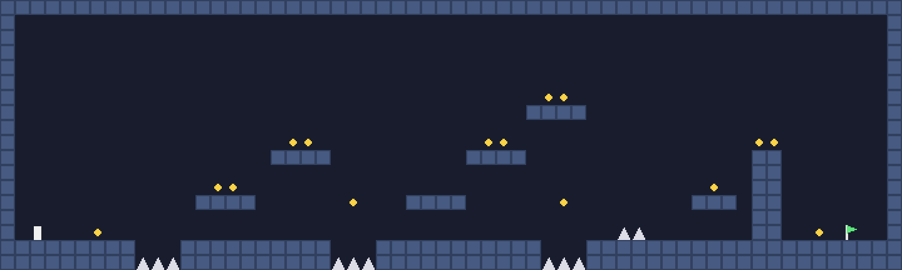

総合演習：2D プラットフォーマーを作る
==========================================

最後に、本書で扱った道具をまとめて、1 本の小さなゲームを作る。題材は、足場を跳び移りながらゴールを目指す 2D プラットフォーマー（横スクロールのアクションゲーム）である。物理エンジンは使わず、キャラクターの動きはすべて自作の運動で作る。

作るゲーム
----------

:numref:`fig-screen-platformer` がゲームの画面、:numref:`fig-level-map` がマップ全体である。

.. _fig-screen-platformer:

   platformer.py の画面

.. _fig-level-map:

   マップ全体（左下の白い四角がスタート、右下の旗がゴール）

ルールは次のとおりである。

- 左右キー（または A キー・D キー）で走り、スペースキー（または上キー・W キー）でジャンプする。押す長さでジャンプの高さが変わる。
- 穴に落ちるか、トゲに触れるとミスになり、スタート地点に戻る。
- コインは取らなくてもクリアできる。全部で 15 枚ある。
- 旗に触れるとクリアになる。R キーで最初からやり直せる。

実行するには、``platformer.py`` と ``collision.py`` を同じフォルダーに置き、``py platformer.py`` を実行する。

全体の構成
----------

``platformer.py`` で使っている道具と、それを扱った章の対応は次のとおりである。

.. list-table:: 総合演習で使う道具
   :header-rows: 1
   :widths: 40 40 20

   * - 処理
     - 使う道具
     - 章
   * - ゲームループ
     - 固定タイムステップ、描画の補間
     - 第 3 章
   * - 走る・跳ぶ
     - 加速度の上限、ジャンプの重力と初速、コヨーテタイム、先行入力
     - 第 10 章
   * - 地形との衝突
     - タイルマップとの判定、軸ごとの押し戻し
     - 第 11 章、第 12 章
   * - コイン・ゴール
     - 円と長方形の判定
     - 第 11 章
   * - カメラ
     - 指数関数的減衰による追従、ノイズによる揺れ
     - 第 8 章、第 9 章
   * - 着地の伸び縮み
     - ばねとダンパー
     - 第 13 章
   * - 土ぼこり・火花
     - パーティクル
     - 第 13 章

プログラムは、:numref:`fig-platformer-classes` のように分かれている。``Game`` がゲーム全体の状態を持ち、``step`` で物理を 1 ステップ進め、``draw`` で描画する。物理の計算（``update_player`` と ``move_and_collide``）は、画面や入力の処理から切り離した関数にして、単体テストで確かめられるようにしている。

.. _fig-platformer-classes:

.. graphviz::
   :caption: platformer.py の構成
   :align: center

   digraph classes {
     rankdir=LR;
     node [shape=box, style="rounded,filled", fillcolor="#eef3fb", color="#3b75c4", fontsize=11];
     edge [color="#888888", fontsize=10];
     main [label="main\nゲームループ\n（固定タイムステップ）", fillcolor="#fdf0e2", color="#e8862a"];
     game [label="Game\nstep / draw\nupdate_camera"];
     up [label="update_player\n走る・跳ぶ"];
     mc [label="move_and_collide\n地形との衝突"];
     level [label="Level\nタイルマップ"];
     col [label="collision.py\nAABB、circle_aabb_contact\ntiles_overlapping"];
     main -> game [label="STEP ごと"];
     game -> up -> mc -> level;
     mc -> col; game -> col; level -> col;
   }

マップ
------

マップは、文字列のリストで書く。1 文字が 1 枚のタイル（32×32 ピクセル）に対応する。

.. list-table:: マップの文字
   :header-rows: 1
   :widths: 15 85

   * - 文字
     - 意味
   * - ``#``
     - 壁・床のタイル
   * - ``^``
     - トゲ。タイルの下半分だけを衝突判定に使う
   * - ``C``
     - コイン
   * - ``P``
     - スタート地点
   * - ``G``
     - ゴールの旗
   * - ``.``
     - 何も無い

文字列のリストにしておくと、テキストエディターで地形を描くように編集できる。``Level`` クラスは、タイルの種類を返す ``tile`` メソッドと、AABB と重なっている壁のタイルを返す ``solid_tiles`` メソッドを持つ。マップの外は壁として扱い、キャラクターがマップの外へ出られないようにしている。

.. literalinclude:: ../examples/platformer.py
   :language: python
   :linenos:
   :pyobject: Level.solid_tiles
   :caption: examples/platformer.py の Level.solid_tiles メソッド

ゲームループ
------------

物理は 1/120 秒の固定タイムステップで進め、描画は直前の 2 ステップの位置を補間して行う（第 3 章）。:numref:`code-platformer-loop` は ``main`` 関数のゲームループの部分である。

.. _code-platformer-loop:

.. literalinclude:: ../examples/platformer.py
   :language: python
   :linenos:
   :start-at: running = True
   :end-before: pygame.quit()
   :dedent: 4
   :caption: examples/platformer.py のゲームループ

ジャンプボタンを「押した瞬間」の入力は、イベントで受け取り、次の物理の更新で 1 回だけ使う。1 フレームに物理の更新が 2 回行われることがあるので、2 回目の更新で同じ入力をもう一度使わないように、使ったら ``False`` に戻している。逆に、そのフレームで更新が 1 回も行われなかった場合は、入力は次のフレームまで持ち越される。

プレイヤーの動き
----------------

プレイヤーの動きは、第 10 章の ``jump.py`` とほぼ同じである。ジャンプの高さはタイル 3.5 枚分、最高点まで 0.38 秒とし、重力と初速はそこから計算している。高さを 3.5 枚にしているのは、3 枚分の段差を確実に登れるようにするためである。

.. literalinclude:: ../examples/platformer.py
   :language: python
   :linenos:
   :pyobject: update_player
   :caption: examples/platformer.py の update_player 関数

``jump.py`` との違いは、縦方向の位置の更新を ``move_and_collide`` に任せていることである。``move_and_collide`` は速度に dt を掛けて動かすので、全体としては半陰的オイラー法（第 10 章）になる。そのため、実際の最高点は設計した高さより 1 ステップ分ほど低くなる。``test_platformer.py`` では、その差が 3 % 以内であることを確かめている。

地形との衝突
------------

第 12 章で説明した、軸ごとに動かして押し戻す方法で実装している。

.. literalinclude:: ../examples/platformer.py
   :language: python
   :linenos:
   :pyobject: move_and_collide
   :caption: examples/platformer.py の move_and_collide 関数

x 方向に動かした後、重なっている壁のタイルがあれば、右へ動いていたならタイルの左端に、左へ動いていたならタイルの右端に、プレイヤーの端をそろえる。y 方向も同様で、下へ動いていて床にそろえた場合は着地とする。

着地の判定には工夫が要る。床の上に立っている間も、重力によって毎ステップ少しだけ下向きの速度が付き、床にわずかにめり込んでから押し戻される。このときに ``on_ground`` を ``True`` にしている。足場の端から歩いて離れた瞬間（前のステップでは床の上にいたが、今は床が無い）には、コヨーテタイムを開始する。

1 ステップの移動量がタイルの大きさより十分小さいので、すり抜けは起きない。落下の最高速度を 720 ピクセル毎秒にしており、1/120 秒では 6 ピクセルしか動かない（第 11 章）。

コイン・トゲ・ゴール
--------------------

``Game.step`` では、プレイヤーを動かした後に、コイン・トゲ・ゴールとの判定を行う。コインとゴールは円、プレイヤーは AABB として、``collision.py`` の ``circle_aabb_contact`` で判定する。

.. literalinclude:: ../examples/platformer.py
   :language: python
   :linenos:
   :pyobject: Game.step
   :caption: examples/platformer.py の Game.step メソッド

トゲの衝突判定の形状は、見た目の三角形より一回り小さい長方形にしている（``Level.touches_spike``）。トゲの先端をかすっただけでミスになると、理不尽に感じられるからである。逆に、コインの判定は見た目どおりにしている。取れる物の判定は大きめ、ミスになる物の判定は小さめにするのが、遊びやすさの基本である。

カメラ
------

カメラは、プレイヤーの位置を ``damp``\ （第 8 章）で追いかける。さらに、プレイヤーが向いている方向の先を少し多く見せる（**先読み**）。先読みの量も ``damp`` で変化させているので、向きを変えたときにカメラが急に動かない。

.. literalinclude:: ../examples/platformer.py
   :language: python
   :linenos:
   :pyobject: Game.update_camera
   :caption: examples/platformer.py の Game.update_camera メソッド

マップの外が映らないように、カメラの中心の範囲を制限している。ミスしたときは ``trauma`` を 1 にし、その 2 乗に比例した大きさで、パーリンノイズによる揺れを加える（第 9 章）。カメラは描画のフレームごとに更新するので、``damp`` にはフレームの経過時間を渡している。

この ``platformer.py`` のカメラは平行移動しかしないので、第 6 章の行列は使わず、カメラの左上の座標を引くだけで画面座標に変換している。回転やズームが必要になったら、``camera_demo.py`` のビュー行列に置き換えればよい。

演出
----

着地したときに、プレイヤーが横につぶれてから元に戻る演出を、ばねとダンパー（第 13 章）で作っている。伸び縮みの量 ``squash`` を、目標 0 のばねで動かす。着地した瞬間に、落下の速さに応じた速度を ``squash_velocity`` に加えると、つぶれてから少し揺れて元に戻る。ジャンプした瞬間には逆向きの速度を加えて、縦に伸ばしている。描画では、横に広げた分だけ縦を縮めて、面積がほぼ変わらないようにしている。

ジャンプと着地のときには足元に土ぼこりを、コインを取ったときとミスしたときには火花を、パーティクルで出している。どちらも見た目だけの演出で、ゲームの結果には影響しない。こうした演出は、ゲームの世界では\ **ジュース**\ と呼ばれ、操作の手応えを大きく高める。

テスト
------

``test_platformer.py`` では、画面を使わずに次のことを確かめている。

- 床に着地すること、落下の速さが上限を超えないこと
- 壁をすり抜けないこと
- ジャンプが設計した高さにほぼ届くこと、ボタンを早く離すと低く跳ぶこと
- コヨーテタイムの間はジャンプでき、過ぎるとできないこと
- 着地の直前に押したジャンプが実行されること（先行入力）
- コインを取れること、トゲでスタートに戻ること、ゴールでクリアになること

.. code-block:: powershell
   :linenos:
   :caption: テストの実行

   py -m unittest test_platformer

ジャンプの高さや重力の値を調整したときに、テストを実行すれば「3 枚分の段差を登れなくなった」といった問題にすぐ気付ける。

改造のアイデア
--------------

本書の内容を使って、次のような改造に挑戦してみてほしい。

- **動く足場**: イージング関数（第 8 章）で往復させ、乗っている間はプレイヤーを一緒に動かす。
- **敵**: 一定の速さで左右に歩き、壁に当たると向きを変える敵を作る。上から踏んだら倒せるようにする（法線の向きで踏んだか横から当たったかを判定する）。
- **飛び道具**: 向いている方向に弾を撃ち、レイキャスト（第 11 章）で壁や敵に当たったかを調べる。
- **坂道**: 斜めのタイルを作り、線分との判定（第 11 章）で坂の上を歩けるようにする。
- **ばねの台**: 乗ると大きく跳ね上げる台を作る。何ピクセルの高さまで跳ばしたいかから、初速を逆算する（第 10 章）。

次のステップ
------------

本書では、ゲームの動きを作る数学と物理を中心に扱った。さらに学びを進めるなら、次のような分野がある。

- **経路探索とゲーム AI**: 敵がマップの中で目標への道を探す A* アルゴリズムや、行動を切り替える状態機械。グラフの探索と、距離の見積もり（ヒューリスティック）を使う。
- **3D のゲーム**: 第 6 章・第 7 章の内容を 3D に広げる。3D の描画の仕組みは「コンピューターグラフィックス入門」で扱っている。
- **ゲームエンジン**: Unity や Godot を使うと、本書で自作した仕組み（ベクトル、行列、物理、衝突判定）の多くが最初から用意されている。仕組みを理解したうえで使えば、思いどおりに動かないときに原因を突き止めやすい。ゲームエンジンの選び方は「ゲーム作成入門」で扱っている。

本書で扱った内容をさらに詳しく学ぶための文献は、:doc:`references`\ にまとめている。
