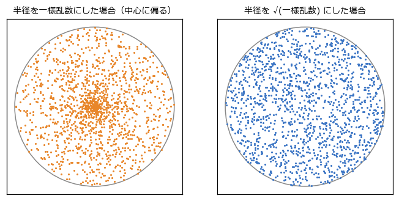
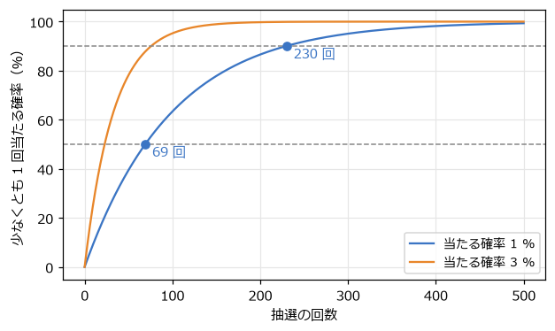
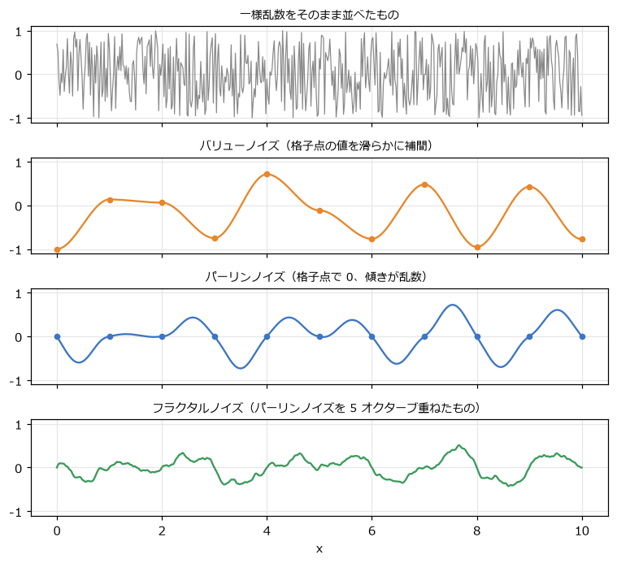

乱数と確率
==========

敵の行動、アイテムのドロップ、地形の生成、画面の揺れ。ゲームは「ほどよい予測できなさ」を乱数で作る。ただし、乱数を素朴に使うと、偏りや不公平感、再現できない不具合を生むことがある。この章では、ゲームで乱数を扱うための道具を整理する。

擬似乱数とシード
----------------

コンピューターが作る乱数の多くは、決まった計算で「乱数らしく見える数の列」を作る\ **擬似乱数**\ である。計算の出発点となる値を\ **シード**\ と呼び、同じシードからは必ず同じ数の列が得られる。Python の ``random`` モジュールは、メルセンヌ・ツイスタという方法で擬似乱数を作る。

.. code-block:: python
   :linenos:
   :caption: 同じシードからは同じ列が出る（random_tools.py より）

   for _ in range(2):
       rng = random.Random(42)
       print([rng.randint(1, 6) for _ in range(10)])  # 2 回とも同じ 10 個の数が表示される

ゲームでは、この「再現できる」性質が役に立つ。

- **デバッグ**: 不具合が起きたときのシードを記録しておけば、同じ状況を何度でも再現できる。
- **リプレイ**: シードとプレイヤーの入力だけを保存すれば、プレイ全体を再生できる。
- **生成されたマップの共有**: マップを自動生成するゲームでは、シードを伝えるだけで同じマップを遊べる。

本書のサンプルコードでは、``random.random()`` のようなモジュールの関数を直接使わず、``random.Random(シード)`` で乱数の生成器を作って使っている。用途ごとに生成器を分けておくと、たとえば「演出のパーティクルの数を変えたら、敵の行動まで変わってしまった」ということが起きない。

一様乱数から範囲・方向・円内の点を作る
--------------------------------------

``rng.random()`` は、0 以上 1 未満の\ **一様乱数**\ （どの値も同じ確率で出る乱数）を返す。これを変換して、さまざまな乱数を作る。

.. list-table:: 一様乱数からの変換
   :header-rows: 1
   :widths: 35 65

   * - 欲しいもの
     - 方法
   * - :math:`a` 以上 :math:`b` 未満の小数
     - ``a + (b - a) * rng.random()``\ （``rng.uniform(a, b)``）。線形補間そのものである
   * - ランダムな向き
     - 角度 ``rng.uniform(0, math.tau)`` を作り、:math:`(\cos\theta, \sin\theta)`
   * - 円の内部のランダムな点
     - 角度と、半径 ``r * math.sqrt(rng.random())`` から作る（後述）
   * - 長方形の内部のランダムな点
     - x と y を別々に一様乱数で作る

円の内部の点を作るとき、半径を一様乱数にすると、:numref:`fig-circle-points` の左のように中心付近に点が集まってしまう。半径 :math:`r` の円周の長さは :math:`r` に比例するので、外側ほど点を多く置く必要があるのに、どの半径にも同じ数の点を置いてしまうからである。半径を一様乱数の平方根にすると、右のように一様に散らばる。

.. _fig-circle-points:

   円の内部のランダムな点

.. literalinclude:: ../examples/random_tools.py
   :language: python
   :linenos:
   :pyobject: random_point_in_circle
   :caption: examples/random_tools.py の random_point_in_circle 関数

半径の 2 乗（面積に比例する量）が一様になるようにすれば、面積あたりの点の数がそろう、と考えると平方根の理由が分かる。爆発の破片を飛ばす位置や、敵を出現させる位置を決めるときに使える。

重み付き抽選
------------

アイテムのドロップでは「ノーマル 80 %、レア 17 %、スーパーレア 3 %」のように、選択肢ごとに確率が異なる。このような抽選は、重みの\ **累積和**\ を使って行う。

1. 重みを順に足した累積和を作る（80, 97, 100）。
2. 0 以上、重みの合計（100）未満の一様乱数 :math:`r` を作る。
3. 累積和が初めて :math:`r` を超える選択肢を選ぶ。

.. literalinclude:: ../examples/random_tools.py
   :language: python
   :linenos:
   :pyobject: weighted_choice
   :caption: examples/random_tools.py の weighted_choice 関数

:math:`r` が 0 以上 80 未満ならノーマル、80 以上 97 未満ならレア、97 以上 100 未満ならスーパーレアになる。それぞれの区間の幅が重みに比例するので、重みどおりの確率になる。累積和はソートされているので、どの区間に入るかは二分探索（``bisect``）で素早く求められる。Python には、同じことをする ``random.choices`` も用意されている。

``random_tools.py`` を実行すると、10 万回の抽選の結果がほぼ重みどおりになることを確かめられる。

偏りを減らす乱数
----------------

本当にランダムな抽選では、同じ結果が何回も続くことがある。確率 1/4 の結果が 3 回続く確率は 1/64 で、何十万人も遊ぶゲームでは毎日誰かに起きる。プレイヤーにとっては「偏っている」「不公平だ」と感じられやすい。

そこで、あえて完全なランダムをやめ、偏りを抑えることがある。代表的な方法が\ **袋方式**\ である。

.. literalinclude:: ../examples/random_tools.py
   :language: python
   :linenos:
   :pyobject: Bag
   :caption: examples/random_tools.py の Bag クラス

すべての選択肢を袋に入れてよく混ぜ、1 つずつ取り出す。袋が空になったら、また全部入れて混ぜ直す。こうすると、選択肢が 4 つなら、4 回引くごとに必ず全種類が 1 回ずつ出る。同じものが出るのは最大 2 回連続（袋の最後と、次の袋の最初）までになる。落ち物パズルで次に落ちてくるブロックを決めるときなどに使われる。

``rng.shuffle`` は\ **フィッシャー–イェーツのシャッフル**\ と呼ばれる方法で、並べ方のすべての組み合わせが同じ確率で出るように混ぜる。自分でシャッフルを書くと偏りが生じやすいので、ライブラリーの関数を使うのが安全である。

確率の期待値
------------

当たる確率が :math:`p` の抽選を何回も行うとき、初めて当たるまでの回数の平均（**期待値**）は :math:`1/p` 回である。確率 1 % なら、平均 100 回で初めて当たる。

ただし、「100 回引けば当たる」わけではない。:math:`n` 回引いて 1 回も当たらない確率は :math:`(1 - p)^n` なので、少なくとも 1 回当たる確率は次のようになる。

.. math::

   P(n) = 1 - (1 - p)^n

.. literalinclude:: ../examples/random_tools.py
   :language: python
   :linenos:
   :start-at: def probability_at_least_once
   :end-before: def main
   :caption: examples/random_tools.py の確率の計算

:numref:`fig-gacha` は、:math:`P(n)` のグラフである。確率 1 % の抽選を 100 回引いて少なくとも 1 回当たる確率は約 63 % にすぎない。半分の人が当たるのは 69 回、90 % の人が当たるのは 230 回、99 % の人が当たるのは 459 回である。平均は 100 回でも、運の悪い人は何百回も引くことになる。

.. _fig-gacha:

   抽選の回数と、少なくとも 1 回当たる確率

ゲームを設計する側は、平均だけでなく「運の悪い人がどれだけ待たされるか」も考える必要がある。外れが続くたびに確率を少しずつ上げる、一定の回数で必ず当たるようにする（いわゆる天井）、といった工夫は、この分布の裾を短くするためのものである。

ノイズ
------

一様乱数を毎フレーム新しく作ると、値は前のフレームと無関係に飛び回る。地形の高さやカメラの揺れのように、「ランダムだが、なめらかにつながっている」値が欲しいときは\ **ノイズ**\ を使う。:numref:`fig-noise` の上の段は一様乱数をそのまま並べたもの、2 段目以降がノイズである。

.. _fig-noise:

   一様乱数とノイズの比較

バリューノイズ
~~~~~~~~~~~~~~

**バリューノイズ**\ は、整数の位置（格子点）ごとに乱数の値を決め、その間を滑らかに補間したものである。格子点の値は、整数とシードから決まった値を返す関数（ハッシュ関数）で作る。同じ位置には常に同じ値が返るので、地形のある場所を何度読み出しても同じ高さになる。

.. literalinclude:: ../examples/noise.py
   :language: python
   :linenos:
   :pyobject: value_noise
   :caption: examples/noise.py の value_noise 関数

補間の重みには、線形補間ではなく ``smoothstep``\ （:math:`3t^2 - 2t^3`）を使う。これは格子点で傾きが 0 になるイージング関数で、格子点で折れ曲がらないようにするためである。

パーリンノイズ
~~~~~~~~~~~~~~

バリューノイズは、格子点の値がそのまま山や谷になるので、格子の間隔が目立ちやすい。**パーリンノイズ**\ は、格子点に「値」ではなく「傾き」（勾配）を乱数で決め、格子点での値は 0 にする。各格子点からその傾きで引いた直線の高さを、滑らかに補間する。

.. literalinclude:: ../examples/noise.py
   :language: python
   :linenos:
   :pyobject: perlin_noise
   :caption: examples/noise.py の perlin_noise 関数

補間の重みには、``smoothstep`` よりさらに滑らかな 5 次式 :math:`6t^5 - 15t^4 + 10t^3`\ （``fade`` 関数）を使う。山や谷が格子点の間に来るので、格子が目立ちにくい自然な形になる。ここでは仕組みが分かりやすい 1 次元で実装したが、2 次元・3 次元でも同じ考え方で作れる。

フラクタルノイズ
~~~~~~~~~~~~~~~~

自然の地形は、大きな山の上に中くらいの起伏があり、さらに細かな凹凸がある。これを真似るため、周波数を 2 倍・振幅を半分にしたノイズを何枚も重ねる。重ねる 1 枚 1 枚を\ **オクターブ**\ と呼び、重ねたものを\ **フラクタルノイズ**\ と呼ぶ。

.. literalinclude:: ../examples/noise.py
   :language: python
   :linenos:
   :pyobject: fractal_noise
   :caption: examples/noise.py の fractal_noise 関数

``noise.py`` を実行し、上下キーでオクターブの数を変えると、地形の細かさが変わる様子を確かめられる。

ノイズで画面を揺らす
~~~~~~~~~~~~~~~~~~~~

爆発や被弾の演出で画面を揺らすとき、毎フレーム一様乱数でずらすと、ガタガタとした硬い揺れになる。ノイズで揺らすと、なめらかで自然な揺れになる。``noise.py`` の下半分では、左の照準を一様乱数で、右の照準をノイズで揺らしている。

揺れの強さは、時間とともに減っていく値（本書では ``trauma`` と呼ぶ）の 2 乗に比例させると、強い揺れが素早く収まり、弱い揺れが少し残る、自然な減り方になる。第 15 章の総合演習では、この方法でミスしたときに画面を揺らしている。
