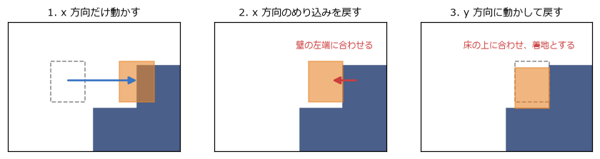
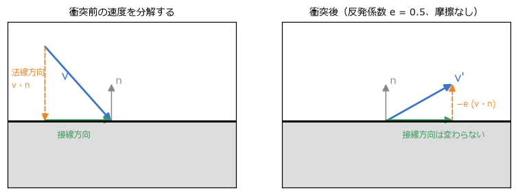
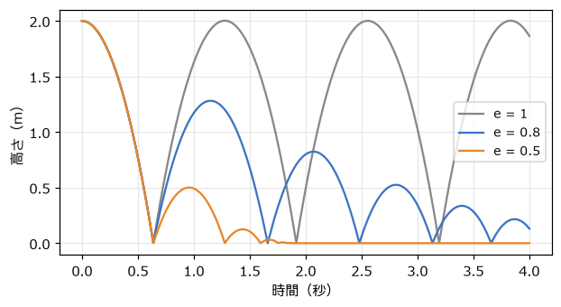
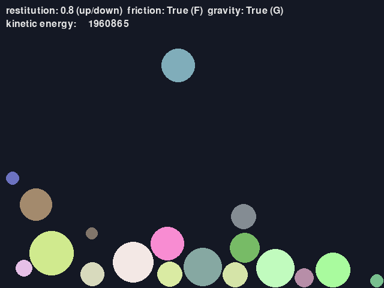

衝突応答
========

前の章の衝突判定で、物どうしが重なっていることと、その法線・めり込みの深さが分かった。この章では、その情報を使って物を押し戻し、跳ね返らせる\ **衝突応答**\ を扱う。

めり込みの解消
--------------

ゲームでは時間を区切って物を動かすので、衝突が見つかった時点では、物はすでに少しめり込んでいることが多い。まず、めり込みを解消するように位置を直す。

動かない壁との衝突なら、動く物だけを法線の向きにめり込みの深さだけ動かせばよい。両方が動く物の場合は、質量に応じて押し分ける。軽い物ほど大きく動き、重い物はあまり動かない。具体的には、質量の逆数の比で配分する。

.. math::

   \Delta\mathbf{x}_A = -\frac{1/m_A}{1/m_A + 1/m_B}\,d\,\mathbf{n}, \qquad \Delta\mathbf{x}_B = +\frac{1/m_B}{1/m_A + 1/m_B}\,d\,\mathbf{n}

ここで :math:`\mathbf{n}` は A から B へ向かう法線、:math:`d` はめり込みの深さである。物理の計算では、質量 :math:`m` そのものより、その逆数 :math:`1/m` を持っておくと便利である。動かない物（壁や地面）は「質量が無限大」とみなし、質量の逆数を 0 にすれば、同じ式で扱えるからである。

軸ごとに解決する方法
~~~~~~~~~~~~~~~~~~~~

タイルマップの 2D アクションゲームでは、キャラクターを x 方向と y 方向に分けて動かし、それぞれの後で押し戻す方法がよく使われる（:numref:`fig-axis-separation`）。

1. x 方向にだけ動かす。壁のタイルと重なったら、動いていた向きに応じて、壁の左端か右端にキャラクターの端をそろえる。
2. y 方向にだけ動かす。重なったら、床の上端か天井の下端にそろえる。下向きに動いていて床にそろえた場合は「着地した」とする。

.. _fig-axis-separation:

   x 方向と y 方向に分けて動かし、それぞれ押し戻す

軸を分けると、どちらの向きに押し戻せばよいかが「その軸で動いていた向き」から決まるので、角に斜めから突っ込んだときにも迷わない。床の上を歩くときに床のタイルの継ぎ目に引っかかる、といった問題も起きにくい。第 15 章の総合演習の ``move_and_collide`` 関数は、この方法で実装している。

速度の法線方向と接線方向への分解
--------------------------------

位置を直しただけでは、物は次のステップでまたぶつかってしまう。速度も直す必要がある。第 4 章の反射ベクトルと同じく、相手に対する速度（**相対速度**）を、法線方向の成分と接線方向の成分に分けて考える（:numref:`fig-normal-tangent`）。

.. math::

   \mathbf{v}_{\text{相対}} = \mathbf{v}_B - \mathbf{v}_A, \qquad v_n = \mathbf{v}_{\text{相対}} \cdot \mathbf{n}

:math:`v_n < 0` なら、2 つの物は近づきつつある。:math:`v_n > 0` なら、すでに離れつつあるので、何もしなくてよい。

.. _fig-normal-tangent:

   速度の法線方向と接線方向への分解

- **法線方向の成分**: ぶつかる向きの成分。跳ね返りでは、これが反転する。
- **接線方向の成分**: 面に沿って滑る向きの成分。摩擦が無ければ変わらない。

反発係数と跳ね返り
------------------

衝突の前後で、法線方向の相対速度がどれだけ残るかを表すのが\ **反発係数** :math:`e` である。

.. math::

   v_n' = -e\,v_n

:math:`e = 1` なら同じ速さで跳ね返り（完全弾性衝突）、:math:`e = 0` なら跳ね返らずにくっつく（完全非弾性衝突）。現実の物は 0 と 1 の間で、ゴムボールは大きく、粘土は小さい。:numref:`fig-restitution` は、2 m の高さから落としたボールの跳ね方である。反発係数が小さいほど早く止まる。

.. _fig-restitution:

   反発係数による跳ね方の違い

運動量と力積
------------

両方が動く物の衝突では、相手の質量によって跳ね返り方が変わる。軽いボールが重いボールにぶつかると、軽い方は大きく跳ね返り、重い方はほとんど動かない。これを正しく計算するには、運動量と力積を使う。

**運動量**\ は質量と速度の積 :math:`m\mathbf{v}` である。外から力が働かなければ、衝突の前後で 2 つの物の運動量の合計は変わらない（運動量保存の法則）。これは作用・反作用の法則から導かれる。

衝突の瞬間に働く大きな力を、時間で積み重ねた量を\ **力積**\ と呼ぶ。衝突応答では、力積 :math:`\mathbf{J} = j\,\mathbf{n}` を、B には :math:`+\mathbf{J}`、A には :math:`-\mathbf{J}` として与え、速度を次のように変える。

.. math::

   \mathbf{v}_A' = \mathbf{v}_A - \frac{j}{m_A}\,\mathbf{n}, \qquad \mathbf{v}_B' = \mathbf{v}_B + \frac{j}{m_B}\,\mathbf{n}

A と B に逆向きで同じ大きさの力積を与えているので、運動量の合計は保たれる。衝突後の法線方向の相対速度が :math:`-e\,v_n` になるという条件から、力積の大きさ :math:`j` が決まる。

.. math::

   j = \frac{-(1 + e)\,v_n}{1/m_A + 1/m_B}

:numref:`code-resolve` は、めり込みの解消、反発、摩擦（後述）をまとめた関数である。

.. _code-resolve:

.. literalinclude:: ../examples/response.py
   :language: python
   :linenos:
   :pyobject: resolve_contact
   :caption: examples/response.py の resolve_contact 関数

同じ質量の 2 つのボールが反発係数 1 で正面衝突すると、速度がそっくり入れ替わる（ビリヤードで、当てた球が止まり、当てられた球が同じ速さで進む）。``test_physics.py`` では、このことと、衝突の前後で運動量の合計が変わらないことを確かめている。

衝突時の摩擦
------------

接線方向の速度、つまり面に沿って滑る速度は、摩擦によって減る。衝突応答では、接線方向にも力積を与えて、滑る速度を打ち消す。ただし、摩擦の力積の大きさには上限があり、法線方向の力積 :math:`j` の :math:`\mu` 倍までとする（**クーロン摩擦**）。:math:`\mu` は\ **摩擦係数**\ で、氷なら小さく、ゴムなら大きい。強く押し付けられているほど、大きな摩擦が働くということである。

``resolve_contact`` の手順 3 では、接線方向の単位ベクトル :math:`\mathbf{t}` を求め、滑る速度を 0 にする力積を計算してから、:math:`\pm\mu j` の範囲に収めている。

``response.py`` は、大きさの異なるボールが箱の中でぶつかり合うデモである（:numref:`fig-screen-response`）。ボールの質量は面積に比例させている。上下キーで反発係数を、F キーで摩擦の有無を、G キーで重力の有無を切り替えられる。重力と摩擦を切って反発係数を 1 にすると、画面の上に表示される運動エネルギーの合計がほぼ一定に保たれる。

.. _fig-screen-response:

   response.py の画面

``step_world`` では、1 フレームを 4 回に分けて物理を進めている（サブステップ）。たくさんのボールが積み重なると、1 つの衝突を解消したことで別の衝突が生じる。細かく何度も解消を繰り返すことで、積み重なったボールが沈み込みにくくなる。

剛体の回転の入門
----------------

ここまでは、物の回転を考えなかった。現実の物は、中心からずれた場所を押されると回り出す。変形しない物体を\ **剛体**\ と呼び、剛体の運動は「重心の移動」と「重心の周りの回転」に分けて扱う。回転の運動は、移動の運動と次のように対応している。

.. list-table:: 移動と回転の対応
   :header-rows: 1
   :widths: 30 35 35

   * - 移動
     - 回転
     - 説明
   * - 位置 :math:`\mathbf{x}`
     - 角度 :math:`\theta`
     - 2D では角度 1 つで向きが決まる
   * - 速度 :math:`\mathbf{v}`
     - 角速度 :math:`\omega`
     - 1 秒あたりに回る角度
   * - 質量 :math:`m`
     - 慣性モーメント :math:`I`
     - 回しにくさ。質量が中心から遠くに分布しているほど大きい
   * - 力 :math:`\mathbf{F}`
     - トルク :math:`\tau = \mathbf{r} \times \mathbf{F}`
     - 回そうとする働き。:math:`\mathbf{r}` は重心から力が働く点へのベクトル（2D の外積）
   * - :math:`\mathbf{F} = m\,\mathbf{a}`
     - :math:`\tau = I\,\alpha`
     - :math:`\alpha` は角加速度（角速度の変化の割合）

**慣性モーメント**\ は、形と質量から決まる。たとえば、半径 :math:`r` の円板では :math:`I = \frac{1}{2} m r^2`、幅 :math:`w`・高さ :math:`h` の長方形の板では :math:`I = \frac{1}{12} m (w^2 + h^2)` である。物理エンジンでは、形状を与えると自動で計算してくれることが多い（第 14 章）。

剛体どうしの衝突では、接触点が重心からずれているので、力積によって角速度も変わる。接触点の速度は「重心の速度」と「回転による速度 :math:`\omega \times \mathbf{r}`」の和になり、力積の大きさの式の分母には、回転のしにくさを表す項が加わる。

.. math::

   j = \frac{-(1 + e)\,v_n}{\dfrac{1}{m_A} + \dfrac{1}{m_B} + \dfrac{(\mathbf{r}_A \times \mathbf{n})^2}{I_A} + \dfrac{(\mathbf{r}_B \times \mathbf{n})^2}{I_B}}, \qquad \Delta\omega_B = \frac{\mathbf{r}_B \times j\,\mathbf{n}}{I_B}

:math:`\mathbf{r}_A`、:math:`\mathbf{r}_B` は、それぞれの重心から接触点へのベクトルである。:math:`\Delta\omega_A` は、力積の向きが逆になるだけで同じ形の式になる。ここまでの考え方が分かれば十分で、実際のゲームで回転する剛体を大量に扱うなら、物理エンジンを使う方がよい。複数の接触点を同時に安定して解く、静止した物を眠らせて計算を省く、といった工夫が必要になるからである。次の 2 つの章で、ばねや拘束の仕組みと、物理エンジンの使い方を見ていく。
